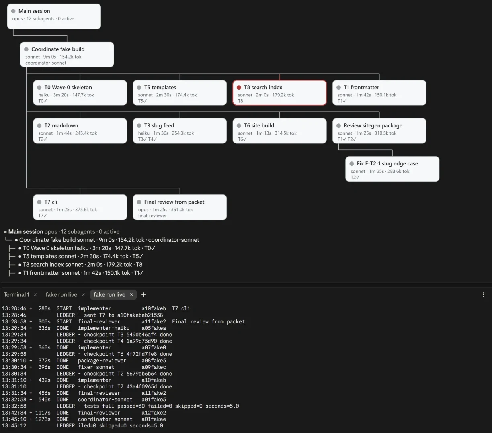

<p align="center">
  
</p>

<h1 align="center">superlite</h1>

<p align="center">
  <b>A software factory. Approve a plan once, then it builds the code.</b>
</p>

<p align="center">
  
  
  
</p>

---

## Use it

Install it ([below](#install)), open a session in your project, and say what you want. superlite shows a one-screen intro the first time; `/superlite:intro` brings it back and `/superlite:help` has every detail.

### Say what you want

| Situation | Say something like | What happens |
|---|---|---|
| **MVP, a new project** | "Build me a static site generator from this spec" | One batch of questions, a plan, then parallel tasks on Sonnet and Haiku, package reviews and one fresh final review |
| **A feature on existing code** | "Add CSV export with column widths to the existing app" | Feature mode: it researches the code (Graphify on a large codebase, never installed without your yes), writes a feature plan you validate, builds a small prototype in its own worktree for you to try, then ports it into your code with frozen interfaces and seam checks. The report shows both builds |
| **Debug** | "This test fails on leap days: find the root cause and fix it" | `diagnosis` finds the cause first; fixes go to fix-only agents by tier, each leaving a note, and escalate after two failed rounds |
| **A small change** | "Rename `build` to `render` everywhere" | Small work stays inline, with a reviewer always |
| **Review and harden** | "Review this branch and fix what you find" | Package reviewers fix their own findings; the final reviewer reports findings with tiers and never edits |
| **You approve first** | "Build X. I will approve the plan" | A human orchestrator: you get a plain-language review plan with diagrams; nothing runs until you say yes |
| **Hands off** | "Build X. I am away, decide yourself" | The AI orchestrator plans, lints, dispatches and rules on open choices without stopping |
| **Ship it** | "We are done: finish the branch" | Verification first, then merge or PR options. It never pushes without you |

### Or use a command

| Command | What it does |
|---|---|
| `/superlite:start [mode] [what]` | A menu: superlite suggests the mode for your request (regular, MVP, feature, debug, small, review), you confirm it and pick who orchestrates |
| `/superlite:mvp <what>` | Plan the smallest working version on a clickable HTML prototype, then build it |
| `/superlite:feature <change>` | Change existing code: a plan you validate, a prototype you try, then the integration with seam checks |
| `/superlite:debug <bug>` | Root cause first, then a fix with a regression test |
| `/superlite:small <change>` | A small change inline, without the planning flow |
| `/superlite:human`, `/superlite:ai`, `/superlite:approve` | Choose who orchestrates; approve the review plan |
| `/superlite:status`, `/superlite:stop`, `/superlite:resume` | Watch, stop or resume a build |
| `/superlite:agents`, `/superlite:tail` | Watch a run: the agent map pane, or the same run as a terminal feed without the mod |
| `/superlite:review`, `/superlite:report`, `/superlite:commit`, `/superlite:finish` | Review a branch, read build reports, turn checkpoints into commits, finish the branch |
| `/superlite:setup`, `/superlite:intro`, `/superlite:help [section]` | First-run check, the intro screen, the detailed help |

Plain words work just as well; the commands are shortcuts.

### Who orchestrates

- **Human orchestrator.** You get a plain-language review plan with diagrams (a `.review.md`, about two pages, with a rough time and cost), and nothing is linted, dispatched or sent to an agent until you reply approve. Any clear approval counts (yes, go ahead, looks good, or similar), including a longer note. After that you are not asked again: any change to scope is recorded as a ruling and listed at the end under "Changed from the approved plan". Small inline work needs only your yes in chat.
- **AI orchestrator.** It plans, lints, dispatches and rules on open choices itself, with no review plan and no questions.

Both stop for destructive, outward (push, merge, publish) or security-sensitive actions, and nothing is committed unless you ask: finished tasks are kept as hidden checkpoints until you run `/superlite:commit`. A checkpoint is a hidden save of one task under `refs/superlite/*`; a commit is a real git commit on your branch, made only by `/superlite:commit` or `sl autocommit on`.

### Watch a run

**Let it run.** Watch `.superlite/` in your project: `progress.md` has the rulings and the log, `test-summary.json` the latest test result, `metrics.jsonl` and the run history the time and cost per agent.


<p align="center">
  
</p>

A read-only view, offered when you approve the plan (reply `approve map`), or opened any time:

- `/superlite:agents` opens the **agent map** in Claude Desktop: a tree from the main session down, each agent under the one that spawned it, green while it runs, red if it was aborted or blocked, grey when done. Each node shows its tier, time, tokens and tasks (✓ once checkpointed); click a row for its details and its ledger lines. It needs the `claude-agent-map` mod: `/plugin install claude-agent-map@superlite-dev`.
- Without the mod (a terminal session, another harness), `/superlite:tail` prints the same run as a **live feed**: every agent start and finish from `metrics.jsonl` and every ledger line from `progress.md` (`sl tail --dir .superlite`).

---

## Install

You need Claude Code, git, Python 3.10 or newer (the tools are Python; the project you build can be in any language), and `bash` (Git Bash on Windows). `uv` is optional.

```
/plugin marketplace add iha2/superlite
/plugin install superlite@superlite-dev
```

Or load a local checkout for one session: `claude --plugin-dir <path-to-superlite>`

Open a fresh session: the superlite intro appears once. Then send `Let's make a react todo list`; a working install starts `inventing` before any code is written. Installs for Codex, Cursor, Gemini CLI, OpenCode and the other harnesses are in [Installation](#installation) below.

---

## What it is

superlite plans a build, splits it into tasks that can run side by side, hands each task to the cheapest agent that can do it well, checks the seams, and reviews the result. You decide **who orchestrates**: you, or the AI.

- **Autonomous.** Describe the project, pick the AI orchestrator, and walk away. Decisions it has to make are recorded as rulings, not asked as questions.
- **Fast.** Up to 18 agents at once (measured in run k1; the dispatch cap is now 10 running tasks), a plan written for parallelism, and mechanical work on Haiku.

### Not a rival to superpowers

superlite is **not a competitor** to [superpowers](https://github.com/obra/superpowers). superpowers is a careful, collaborative workflow that keeps a human close to every step, and it is excellent at that. superlite starts from its ideas (the plugin layout, the session-start hook, the lifecycle skills, with credit) and tunes them for a different job: **autonomous development, at speed**. If you want to steer each step, use superpowers. If you want to hand over a spec and come back to working code, use superlite. A superlite run suspends superpowers until `sl finish`; after that, superpowers can be used again.

---

## It is fast

Same machine, same task: build a Python site generator and a spreadsheet engine from one spec (`sitegen` + `minisheet`, 177 hidden tests), headless on Opus.

| What we measured | superpowers | superlite |
|---|---|---|
| Wall-clock to a finished build | 33.6 min (stock, 3 runs: 21.2 / 31.9 / 47.6)<br>23.5 min (orchestrated, 3 runs) | **16.1 min** |
| Faster than superpowers | | **52%** vs stock, **31%** vs orchestrated |
| Fastest-to-slowest spread, 3 runs | 26.4 min | **9.1 min** |
| Agents working at once | 3 to 4 | **up to 18** (k1) |
| Hidden tests passed | 177 / 177 | 177 / 177 (a tie, at higher speed) |
| Earlier 9-module benchmark (1 run each) | 34.4 min | **8.8 min** |
| superlite against its own first version | 26.9 min | **16.1 min** (40% faster) |

And it is not tied to one language. A TypeScript site generator went from spec to 132 / 132 hidden tests in **8.5 minutes**.

<sub>The 16.1 min figure is one run of the current build. The superpowers figures, the spread row (3 runs of each, on an earlier superlite build) and the 9-module row (the first version, 1 run each) come from earlier runs on the same machine, so treat the gaps as indications, not a statistical proof. superlite can cost more than superpowers and scores lower on the extra robustness probes (4 of 7 against about 5.7 of 7). Details, runs and caveats: [bench/](bench/) and the Benchmark section below.</sub>

---

## More

How it works, in [docs/](docs/): [how a run works](docs/how-a-run-works.md) · [skills and agents](docs/skills-and-agents.md) · [hooks](docs/hooks.md) · [tools](docs/tools.md) · [config](docs/config.md) · [language support](docs/language.md) · [how the rules are enforced](docs/gates.md) · [an example review plan](docs/example-review-plan.md). Installation for other harnesses, the benchmark harness and the task list follow below.

---

## Configuration

- **`detail` (plan switch).** `drafting` records `**Detail:** contracts | tests | full` in the plan header, and a task can override it. `contracts` gives files, signatures and named tests with exact values. `tests` (the default) adds the test code verbatim and leaves the implementation to the implementer. `full` includes implementation code too, for tricky algorithms. `inventing` asks for it in its single batched question, and picks the default itself when unattended.
- **Final review.** The coordinator runs at medium effort. The final review is a fresh Opus `final-reviewer` at high effort: one turn, findings only, reading a review packet built from the logs, with a target under 30 s. It is not a fork, so `CLAUDE_CODE_FORK_SUBAGENT` is not needed.
- **Implementer cache TTL.** Set `CLAUDE_CODE_SUBAGENT_PROMPT_CACHE_TTL=1h` in the environment to keep an implementer's history cached when fix rounds arrive waves later. The agent files no longer set it: a nested `experimental:` block in agent frontmatter made Claude Code ignore `model:`.
- **Context-budgeted sizing.** Each task in a plan carries an `Est. context` line, predicted from the lines it writes, the lines it reads and the docs it is handed, on top of the implementer's fixed ~18k prefix. Tasks predicted above 80k are split, tasks whose variable part is smaller than the prefix are flagged by lint with a NOTE to merge, tasks sit in a 1.5 to 6 minute band (`predictor.json`), there is no fixed wave size (the task graph sets the parallel width), and the whole plan stays under 15k chars because it doubles as the shared prime. The coefficients are fit on one project, so treat them as a guide.

## Installation

Installation differs by harness. If you use more than one, install superlite separately for each one. Every integration loads `using-superlite` at session start; to verify, open a fresh session and send `Let's make a react todo list`. A working install triggers `inventing` before any code is written.

Each harness has a tool-mapping file in `skills/using-superlite/references/` (Antigravity, Codex, Gemini, Hermes, Muse, Pi, plus Claude Code notes). Where a harness has no plugin agents, each agent in `agents/` (`implementer`, `implementer-haiku`, `package-reviewer`, `final-reviewer` and the three fixers) runs as that harness's generic subagent with `agents/<name>.md` as its instructions.

### Claude Code

Load for one session from a local checkout:

    claude --plugin-dir <path-to-superlite>

Or add a local checkout as a marketplace:

    /plugin marketplace add <path-to-superlite>
    /plugin install superlite@superlite-dev

Or install from GitHub:

    /plugin marketplace add iha2/superlite
    /plugin install superlite@superlite-dev

### Antigravity

Install superlite as a plugin from this repository:

```bash
agy plugin install https://github.com/iha2/superlite
```

Antigravity runs the plugin's session-start hook, so superlite is active from the first message. Reinstall with the same command to update.

### Codex App

> Unverified: superpowers ships on Codex through the official Codex marketplace, which superlite isn't listed in. This repo includes `.agents/plugins/marketplace.json` for a repo marketplace, but the command below hasn't been tested yet.

- Add this repository as a plugin marketplace:

  ```bash
  codex plugin marketplace add iha2/superlite
  ```

- In the Codex app, click on Plugins in the sidebar, find `Superlite` in the Coding section, and click the `+` next to it.
- Add `[features]` `multi_agent = true` to `~/.codex/config.toml` for subagent dispatch.

### Codex CLI

> Unverified: superpowers ships on Codex through the official Codex marketplace, which superlite isn't listed in. This repo includes `.agents/plugins/marketplace.json` for a repo marketplace, but the command below hasn't been tested yet.

- Add this repository as a plugin marketplace:

  ```bash
  codex plugin marketplace add iha2/superlite
  ```

- Open the plugin search interface:

  ```bash
  /plugins
  ```

- Search for `superlite` and select `Install Plugin`.

### Cursor

- In Cursor Agent chat, install from marketplace:

  ```text
  /add-plugin superlite
  ```

- Or search for "superlite" in the plugin marketplace.
- Or load a local checkout of `https://github.com/iha2/superlite` as a local plugin; Cursor reads `.cursor-plugin/plugin.json`.

### Devin CLI

- Install the plugin from this repository:

  ```bash
  devin plugins install iha2/superlite
  ```

- Update to the latest version with:

  ```bash
  devin plugins update superlite
  ```

### Factory Droid

- Register the marketplace:

  ```bash
  droid plugin marketplace add https://github.com/iha2/superlite
  ```

- Install the plugin:

  ```bash
  droid plugin install superlite@superlite-dev
  ```

### Gemini CLI

- Install the extension:

  ```bash
  gemini extensions install https://github.com/iha2/superlite
  ```

- Update later:

  ```bash
  gemini extensions update superlite
  ```

### GitHub Copilot CLI

- Register the marketplace:

  ```bash
  copilot plugin marketplace add iha2/superlite
  ```

- Install the plugin:

  ```bash
  copilot plugin install superlite@superlite-dev
  ```

### Grok Build CLI

> Unverified: superpowers ships on Grok through the official xAI marketplace, which superlite isn't listed in. The commands below haven't been tested yet.

- Register this repository as a marketplace:

  ```bash
  grok plugin marketplace add iha2/superlite
  ```

- Install the plugin:

  ```bash
  grok plugin install superlite@superlite-dev --trust
  ```

- Or open the marketplace in the TUI, search for Superlite, and install it:

  ```text
  /marketplace
  ```

### Kimi Code

- Open Kimi Code's plugin manager:

  ```text
  /plugins
  ```

- Install directly from this repository:

  ```text
  /plugins install https://github.com/iha2/superlite
  ```

- Start a fresh session with `/new` afterwards.
- Detailed docs: [docs/README.kimi.md](docs/README.kimi.md)

### OpenCode

OpenCode uses its own plugin install; install superlite separately even if you already use it in another harness.

- Tell OpenCode:

  ```
  Fetch and follow instructions from https://raw.githubusercontent.com/iha2/superlite/refs/heads/main/.opencode/INSTALL.md
  ```

- Detailed docs: [docs/README.opencode.md](docs/README.opencode.md)

### Pi

Install superlite as a Pi package from this repository:

```bash
pi install git:github.com/iha2/superlite
```

For local development, run Pi with a checkout loaded as a temporary package:

```bash
pi -e /path/to/superlite
```

The Pi package loads the superlite skills and a small extension that injects the `using-superlite` bootstrap at session startup and again after compaction. Subagent and task-list tools remain optional Pi companion packages.

### Qwen Code

Qwen Code installs plugins from Claude Code marketplaces directly.

- Install the plugin from this repository:

  ```bash
  qwen extensions install iha2/superlite
  ```

- Update later:

  ```bash
  qwen extensions update superlite
  ```

### Hermes Agent

Install superlite as a Hermes plugin from this repository:

```bash
hermes plugins install iha2/superlite --enable
```

Restart any active Hermes sessions after installing. Hermes has no post-compaction hook, so a very long session that compacts over its first turn loses the bootstrap; start a fresh session if skills stop triggering.

### Muse

Superlite is a native Muse plugin. The `using-superlite` bootstrap is injected via the native `SessionStart` hook, with no per-session opt-in.

- Install from a local checkout:

  ```bash
  muse plugins install ./
  muse plugins approve superlite
  ```

  Or clone and install:

  ```bash
  git clone https://github.com/iha2/superlite.git
  muse plugins install ./superlite
  muse plugins approve superlite
  ```

- Update later:

  ```bash
  muse plugins update superlite
  ```

Restart any active Muse sessions after installing so the `SessionStart` hook takes effect; hooks require approval on first install.

### Keeping versions in sync

The version lives in every manifest listed in `.version-bump.json`. Bump all of them with one command, and check for drift with `--check` or `--audit`:

```bash
scripts/bump-version.sh 0.2.0
scripts/bump-version.sh --check
```

## Benchmark

`bench/` holds a head-to-head harness: both plugins build the same 9-module project (`bench/task/SPEC.md`) headless on Opus, and a hidden 89-test suite scores the result. Run 1 (n=1 per arm; the runs overlapped):

| | superpowers 6.4.1 | superlite 0.1.0 (the version benchmarked) |
|---|---|---|
| Wall-clock | 34.4 min | **8.8 min** (3.9× faster) |
| Hidden tests | 89 / 89 | 89 / 89 |
| Cost (API-equivalent) | $8.15 | **$3.28** (60% cheaper) |

Full write-up: [docs/benchmark-report.md](docs/benchmark-report.md). (An earlier version of these numbers overstated both costs because of a scoring bug; see the correction note in the report.)

### Running it

From the repo root. `harness.py` runs one arm headless and scores it against the hidden suite; `BENCH_TASK` picks a task from `bench/tasks/` (`combo`, `combo-planted`, `brownfield`, `ts-wordstat`, `ts-textkit`, `ts-logflow`, `ts-logflow-plus`, `ts-sitegen`).

    uv run --no-project python bench/harness.py run <arm> <rep> [--smoke]
    uv run --no-project python bench/harness.py score <arm> <rep>
    uv run --no-project python bench/harness.py rescore-tasks <arm> <rep>
    uv run --no-project python bench/harness.py report

Arms are `superpowers` and `superlite`. Environment variables: `SUPERLITE_PLUGIN_DIR` points the superlite arm at another plugin directory (for example a worktree of an older commit, as a frozen baseline); `BENCH_PROMPT_SUFFIX` appends text to the task prompt.

Analysis scripts:

    python bench/report_mechanical.py bench/results/combo-superlite-x1.mechanical.json bench/results/*.json
    python bench/report_mechanical.py --history ~/.superlite/history.jsonl [--focus opus,haiku] [--baseline sonnet]
    python bench/mechanical_ab.py RUN_DIR [--tasks T8,T5] [--n 3] [--cost-cap 2.0] [--timeout 300] [--dry-run] [--wait]
    python bench/routing_evidence.py [--write]
    python bench/build_shape_audit.py [--runs DIR] [--write]
    python bench/predict_calibration.py [--write]

`report_mechanical` compares tasks by agent and model. `mechanical_ab` replays `Kind: mechanical` tasks on Haiku and on the Sonnet implementer. `routing_evidence` gives per-band outcomes by model and a routing recommendation. `build_shape_audit` shows what each task graph costs and which edges could go. `predict_calibration` shows why predicted times miss and fits a model on real runs.

## Tasks

- [ ] **The task-graph flow (planned as 0.3, shipped in 1.0): reach half of superpowers' time.** The design is in `docs/specs/2026-10-17-superlite-architecture-design.md` (D10-D18, G1, R1). Steps:
  - Smoke-test the 0.3 tools and agents.
  - Combined task (`bench/tasks/combo`), 3 reps, arms in parallel.
  - E12: planted defects (`bench/tasks/combo-planted`), 3 reps with and without the incident log.
  - E13: brownfield (`bench/tasks/brownfield`), 3 reps with and without Graphify.

  Done when the superlite median is at most 0.5x superpowers' on the combined task (G1) at equal hidden-test score and robustness of at least 6/7, and the E12 and E13 effects are measured.

## Note

While a superlite run is in progress, superpowers is suspended (`sl orchestrator set` writes `.superlite/peers.json` and, on Claude Code, turns `superpowers@claude-plugins-official` off in `.claude/settings.local.json`). The lifecycle skills are named `inventing`, `drafting`, `swarm`, `testing`, `diagnosis`, `proof`, and `shipping`, so a short-name lookup does not open the superpowers file. Both plugins still inject a session bootstrap. `sl finish` removes the marker and restores the previous setting, so superpowers or anything like it can be used again.

## License

MIT
