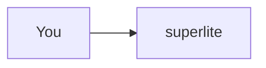

:::tip[TL;DR]
The regular flow plans, builds and reviews a change. You approve the plan first.
:::

```text
regular flow
  step one -> step two
```

## How it works

Run `/superlite:start` and see [the report](/superlite/flows/regular/#example).

| a | b |
|---|---|
| table words are ignored | here |

It uses `superlite-cli session` and the `superlite:inventing` skill and `superlite:implementer` agent.



## Example

```bash
echo this fence is ignored
```
