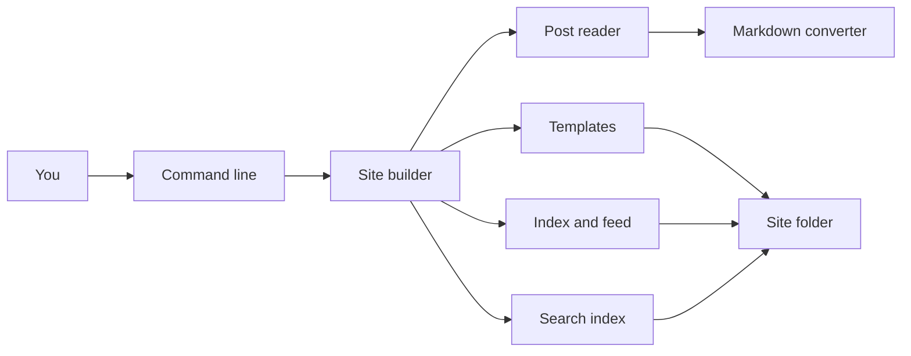
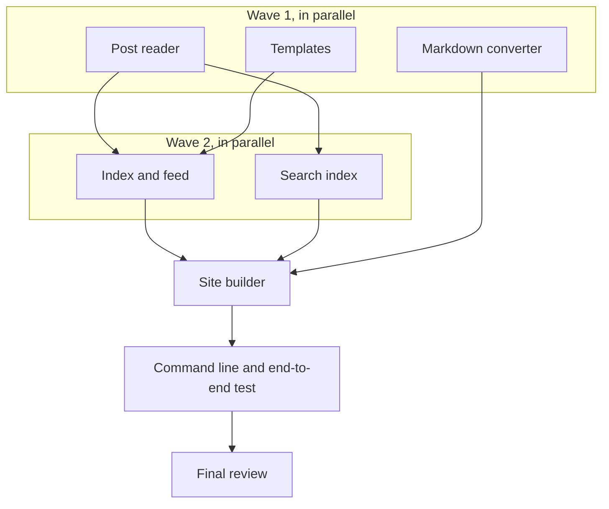

# Example review plan

This is a real review plan produced by superlite in human orchestrator mode, for the request "build a static site generator". It is what you are asked to approve before anything is linted or built; after your yes the coordinator rewrites it in the agent format.

---

# Static site generator: review plan

## Summary
A small Python tool that turns a folder of markdown blog posts into a ready-to-host website. Each post starts with a short
header (title, date, tags, summary). The tool converts the posts to HTML pages using templates, writes a front page listing all
posts newest first, an RSS feed, and a search index file that a page can use to search posts. You run it from the command line.
It uses only the Python standard library (3.12), so there is nothing to install.

## What you will get
- A `ssg` command with `build` (content folder in, site folder out), `new` (creates a dated post stub) and `serve` (previews the built site locally).
- One HTML page per post, an `index.html` listing posts newest first, `feed.xml` (RSS 2.0) and `search.json`.
- Default templates you can edit: a base layout, a post page and an index page.
- Clear errors naming the file when a post has a broken header or a missing title or date.
- A sample content folder, and tests for each part, run with one command.

## What will be built
| Part | What it does | Size | Built by |
|---|---|---|---|
| Post reader | Reads a post file, splits the header from the body, checks title and date are present | S | a fast helper |
| Markdown converter | Turns markdown (headings, paragraphs, bold, italic, links, lists, code) into safe HTML | M | a careful helper |
| Templates | Fills HTML templates with post values, escaping text so posts cannot break the page | S | a fast helper |
| Index and feed | Writes the front page and the RSS feed from the list of posts | S | a fast helper |
| Search index | Writes a JSON file of title, link, tags, summary and words for each post | S | a fast helper |
| Site builder | Runs the whole build: read all posts, render, write every output file | M | a careful helper |
| Command line | The `build`, `new` and `serve` commands, with exit codes and messages | S | a fast helper |

Each part comes with its own tests; one end-to-end test builds the sample site and checks every output.

## How it fits together

## How it gets built

## Decisions you can change
- Libraries: standard library only, with our own small markdown converter (default) | use the `markdown`, `PyYAML` and `Jinja2` packages
- Post header format: simple `key: value` lines between `---` markers, tags as a comma list (default) | full YAML
- Templates: simple `{{ name }}` placeholders with automatic escaping (default) | Jinja2
- Tests: Python's built-in `unittest` (default) | `pytest`
- Draft posts: a `draft: true` header line skips the post (default) | no drafts
- `serve` command: included, built-in Python web server (default) | leave it out
- Commits: leave my work uncommitted, superlite takes hidden checkpoints (default) | commit each task on my branch

## Risks
- Our own markdown converter will not cover all of markdown. We support a stated subset and test it; anything else passes through as plain text.
- Unsafe text in posts (for example `<script>`): titles and text are escaped; raw HTML in post bodies is escaped too, by default.
- Dates and time zones in RSS: dates are read as `YYYY-MM-DD` and written in the RSS date format as UTC midnight.

## Out of scope
- Pagination, tag pages, themes, images or asset pipelines, incremental builds, watch mode.
- A search box user interface: we write the search index file only.
- Publishing or deploying anywhere.

## How we will know it works
- `ssg build` on the sample folder creates one page per post, `index.html`, `feed.xml` and `search.json`.
- The front page lists posts newest first; drafts are missing everywhere.
- `feed.xml` is well-formed RSS 2.0 that Python's XML parser reads.
- A post with no title fails the build with a message naming the file and a non-zero exit code.
- The full test suite passes with one command.

## Rough time and cost
About 15 to 30 minutes and $2 to $4 (rough, until the machine plan is linted).
