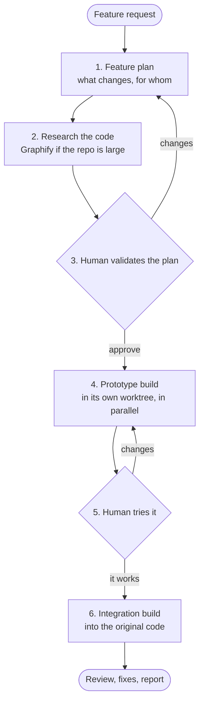

# Feature flow and flow suggestion (design)

Status: built (2026-10-21) on branch claude/feature-flow-3adb4b, covered by unit and hook tests; not yet tried on a real feature build with model agents. Two parts: superlite suggests a flow from what the user wants to build, and a new feature flow that proves the change on a small prototype before it is integrated into the real code.

## Part 1: superlite suggests a flow

Today `/superlite:start` asks the user to pick a mode. Instead, superlite proposes one and the user accepts or switches.

**How the suggestion is made.** A script decides first, so the same request gets the same suggestion; the model only confirms or overrides with a one-line reason.

- `sl suggest_flow --text "<request>"` reads the request and the project state (the session-start hook already computes it: empty folder, existing code, run in progress) and prints one line:
  `suggest: feature - existing code, the request changes how the export page works | also fits: small, regular`
- Signals, in order:
  1. Project state. Empty folder: MVP or Regular. Run in progress: Resume or Status first.
  2. Words. "fails", "bug", "error", "broken", a stack trace: Debug. "add", "change", "extend", "support", naming a part of the existing app: Feature. "build", "new app", "from scratch": MVP or Regular. "rename", "typo", "bump": Small.
  3. Size. A request that names one file or one function is Small; one that spans screens, data and services is Feature (existing code) or Regular (new).
- The start menu shows the suggestion first, marked recommended, with the other fits after it. A user who typed a `/superlite:` command or named a mode skips the suggestion.

**Where it goes.** `commands/start.md` (the menu), `skills/subagent-driven-development/scripts/suggest_flow.py`, and the session-start context: the pointer is the "Start menu" line of `skills/using-superlite/SKILL.md`, which session-start injects (it is now at 1999 of its 2000 characters), so session-start itself is unchanged.

**As built.** `sl suggest_flow --text "<request>" [--root DIR] [--state "<state>"] [--json]`. A run in progress suggests `status` when the request asks where things stand, else `resume`. An empty folder suggests `mvp` for a bare idea or MVP words, `regular` for a "build" request or one that spans screens, data and services, and `small` for one small named piece; debug, feature and review are not offered there. On existing code the order is: debug (bug words or a stack trace; "error" or "exception" next to a change word such as "add" counts as a change), review, a new app beside it (mvp or regular), small (small words, or exactly one file or one function named, and not wide), then feature. A file is a path with a common source or config extension; technology names such as `next.js` are not files. The request table in `tests/scripts/test_suggest_flow.py` pins the behaviour.

## Part 2: the feature flow

A feature on existing code is risky in two ways: the plan can be wrong about the code, and the change can look right in tests but feel wrong in use. This flow answers both before the real code is touched: research first, then a small prototype the user tries, then the integration build.

### Step 1: the feature plan

The user is asked for the feature in their own words if the request is thin, with at most one batched question (the existing brainstorming rule). When `sl agent_specs status` is **on** (opt-in; default off; first session may `prefer on|off` into `~/.superlite/preferences.json`), write a durable **feature spec** (`docs/plans/<date>-<topic>.spec.md`) via `superlite:writing-specs` before or with the plan: a spec is what done looks like and why; a plan is how (one spec can outlive many plans). Open the spec in the harness when `open_in_harness` is on. Opus writes `docs/plans/<date>-<topic>.feature.md`:

- the goal and who it is for, in plain words;
- what the user will see or do differently (screens, commands, endpoints, or outputs, by target kind, as in MVP mode);
- the acceptance checks a human can try (aligned with the feature spec when agent_specs is on);
- after step 2: the code map, the interfaces to keep, the prototype scope and an outline of the integration build.

### Step 2: research the code base

Read before designing, as `commands/feature.md` already says, and write the result into the plan as a **code map**:

- entry points and how the app is stood up today (run command, dependencies, config, data, external services);
- the modules, files and tests the feature touches, and the seams between them;
- the interfaces that must not change (they become `FROZEN` in the integration plan);
- the project's own conventions and toolchain.

Graphify is used when `sl graphify_gate` says so (a large repo), and installed only with the user's yes, as today. Research is read-only and can run as parallel Explore agents, one per area, each returning a short summary rather than file dumps.

### Step 3: the human validates the plan

Human mode: the `.feature.md` plan is the review plan, approved with `sl orchestrator approve --review docs/plans/<date>-<topic>.feature.md`. Before approval only orchestration is blocked, as for any plan. AI mode: no approval; open choices become `Ruling:` lines.

### Step 4: the prototype, in its own worktree

The goal: the smallest thing that stands up and shows the feature working, inside just enough of the original app to run.

- **Where.** A new git worktree on branch `superlite/<topic>-proto`, cut from the user's branch, at `.superlite/sandboxes/<topic>-proto` (the L1 sandbox path of the flows design; `--path` puts it elsewhere). The user's checkout is never touched, and uncommitted changes are not in the prototype (`start` says so). `sl proto start --topic <topic> [--run CMD] [--reach TEXT] [--level L1|L2] [--plan P]` creates it and records `.superlite/feature.json` (topic, feature plan, worktree, branch, base, run command, how to reach it, level, status `building`). If `.superlite/` is not git-ignored yet, `start` appends the common ignore block. The prototype build keeps its own `.superlite` inside the worktree, so its plan, lint, dispatch and report run there and are not gated by the user's checkout.
- **The container.** Only what the feature needs to run: the app's entry point, the screens, routes or commands the feature touches, and their direct dependencies. Everything else is stubbed: the database becomes a seeded fixture or an in-memory store, external services become fakes, config uses test values with no real secrets (the sandbox levels in `docs/specs/2026-10-17-superlite-flows-design.md`, L1 stubs by default, L2 an isolated environment when the feature needs real data shapes).
- **The build.** A normal superlite build, scoped to the prototype: a short plan in the agent format, `lint --stable`, Wave 0 sets up the container, and the feature tasks run in parallel (Haiku for mechanical pieces, Sonnet for the rest). Size cap: the prototype plan stays small (for example at most 8 tasks); a larger one means the scope is wrong.
- **In parallel with it.** While the prototype builds, Opus drafts the integration plan from the code map, so step 6 can start as soon as the user is happy.
- **Tests.** The prototype's tests are written against the acceptance checks, so they can be carried into the integration build as its acceptance tests.

### Step 5: the human tries it

- `sl proto tryout [--run CMD] [--reach TEXT] [--start]` prints the run command (in the worktree), how to reach the prototype (a URL and port, a terminal command, or example calls) and the `## Acceptance checks` bullets of the feature plan, and sets the status to `tryout`. By default it does not start the process: the agent starts it in the background or in a preview pane, so the harness owns the process and its teardown; `--start` launches it detached, with its log in `.superlite/proto-run.log`.
- The user replies "it works" or lists changes. Changes go back to step 4 as a fix round on the prototype, not to a new plan, unless they change the scope: `sl proto start --topic <topic>` on the same topic reopens the prototype (status `building`, the round counted).
- AI mode: the acceptance checks run automatically against the stood-up prototype, and `sl proto tryout --approve --ruling "<result>"` records the result as `Ruling: [tryout] ...` in `.superlite/progress.md`.
- Human mode: `sl proto tryout --approve` records the approval in `.superlite/feature.json` (status `approved`, `tryout_approved`, `tryout_by`, `tryout_approved_time`, the reply text), checked the same way as plan approval. `hooks/record-human-reply` also records the human's prompts while the status is `tryout`, and `--approve` needs an approving reply (the phrases now include "it works", "works for me" and "all good") newer than the prototype's last checkpoint, the later of the try-out time and the worktree's `checkpoints.json`; otherwise exit 3 with a BLOCKED line. It reuses `orchestrator.approving_reply`, not a second mechanism.
- The gate: while the status is `tryout` in human mode, `orchestrator.gate` makes `lint --stable`, `dispatch`, `wave0` and `build_prime` of the integration plan exit 4, and `hooks/block-coordinator-edits` denies `superlite:*` and `general-purpose` agents and the `sl` build tools, exactly as before plan approval (Explore, Plan and file writes stay open). A missing or malformed `feature.json` gates nothing (fail open), and AI mode is never gated. The hook also denies the model writing `feature.json`, and, during a run, writing into `.superlite/sandboxes/**`.

### Step 6: the integration build

A second build on a **dedicated** integration worktree and branch for this feature only (`superlite/<topic>` under `.superlite/worktrees/<topic>`, or equivalent). Never layer integration onto another open feature's checkout or a shared dirty `main` — one feature per worktree so several features can proceed in parallel (AGENTS.md). The prototype sandbox (`.superlite/sandboxes/<topic>-proto`) stays separate.

Then, in that worktree:

- the integration plan in the agent format: one task per touched module, the existing interfaces `FROZEN`, migration tasks where data changes, and the prototype's acceptance tests as the target;
- code is ported from the prototype, not merged: the prototype's stubs and fakes stay behind;
- seam checks between the new and the existing code, and every existing test must still pass;
- the normal review, final review, tiered fixes and finish report. The report shows the prototype and the integration as two parts, each with time and cost, projected against actual.

The prototype worktree is removed at finish with `sl proto discard`, which first saves the prototype's report headline into `feature.json`, then removes the worktree and the branch (`--keep-branch` keeps the branch). `sl proto status [--json]` shows the state at any time.

**The report.** When `.superlite/feature.json` exists, `sl report` adds a feature-flow part: the prototype and the integration on two lines, each with wall-clock and agent cost, projected and actual, and the prototype's cost as a share of the integration against the 25% cap. The prototype numbers come from its own build report in the worktree (`.superlite/report.json`), saved into `feature.json` at try-out and discard so they outlive the worktree.

## What has to be built

| Piece | What |
|---|---|
| `commands/feature.md` | Rewritten to the six steps |
| `commands/start.md` | Shows the suggested flow first |
| `scripts/suggest_flow.py` | The flow suggestion (`sl suggest_flow`) |
| `scripts/proto.py` | `sl proto start | tryout | status | discard`; writes `.superlite/feature.json` |
| `skills/feature-prototype/SKILL.md` | How to cut the container: what to keep, what to stub, by target kind |
| `skills/writing-plans/SKILL.md` | The `.feature.md` plan shape and the integration plan rules |
| `hooks/block-coordinator-edits` | Blocks integration dispatch until the try-out is approved (human mode), as it blocks orchestration before plan approval |
| `scripts/report.py` | The report split into prototype and integration |
| tests | One per script, the hook's new state, and the command texts |

## Decisions (accepted, recorded)

All four recommendations below were accepted. Where each is recorded: 1 in `skills/subagent-driven-development/orchestrator.md` (the one exception to "not asked again after approval"), `commands/feature.md` step 5 and the two hooks; 2 in `commands/feature.md` step 6 and the integration plan rules of `skills/writing-plans/SKILL.md` (no prototype stub in an `Owns` list); 3 in `skills/feature-prototype/SKILL.md` and `sl proto start --level`; 4 in the prototype plan rules (at most 8 tasks, about a quarter of the integration estimate) and the report's share against the cap.

The original questions:

1. **A second human checkpoint.** Human mode now means you approve the plan and are not asked again. The try-out in step 5 is a second planned stop. Recommendation: allow it for the feature flow only, because trying the prototype is the point of the flow, and record it as a gate, not a question.
2. **Prototype code: port or merge.** Recommendation: port, task by task, so the stubs never reach the real code.
3. **Prototype fidelity.** Recommendation: L1 stubs by default, L2 an isolated environment only when the plan says the feature depends on real data shapes.
4. **Cost.** The flow builds twice. Recommendation: cap the prototype plan's size and budget (for example a quarter of the integration estimate) and show both in the report, so the cost of the safety is visible.

## How it is verified

- `tests/scripts/test_suggest_flow.py`: a table of requests and project states, the line shape, determinism, and the state computed like session-start.
- `tests/scripts/test_feature_flow.py`: `proto` on a real temporary git repo (worktree created, `feature.json` written, fix round, the try-out gate in human and AI mode, discard), the orchestrator gate (it skips the prototype's own build and fails open), the hooks' try-out state (dispatch denied before the approval and allowed after, AI mode and bad input ungated, `feature.json` and the sandbox protected, replies recorded while the try-out waits), the report's two parts, and the command and skill texts.
- Not done yet: one end-to-end feature build with real model agents on a sample app.
