# Superlite 0.3: Execution Engine Rework (design + plan)

**Status:** draft for your approval, 2026-10-17. Nothing is implemented. · **Repo:** `C:\Users\CWogu\source\repos\superlite` (local `main`, ahead of [iha2/superlite](https://github.com/iha2/superlite), not pushed)
**Builds on:** `Specs\2026-10-17-superlite-architecture-design.md` (D1–D9, E1–E10, §2.3c–2.6). **Renumbering ruling:** the flows work in `Specs\2026-10-17-superlite-flows-design.md` moves from 0.3 to **0.4**. 0.3 is the engine it will run on.
**Evidence:** combined benchmark (sitegen + minisheet, 177 hidden tests + 7 robustness probes), reps e1 and e2 below. e3 was stopped at your request about 18 min in, and isn't scored.

---

## 0. The whole system on one page

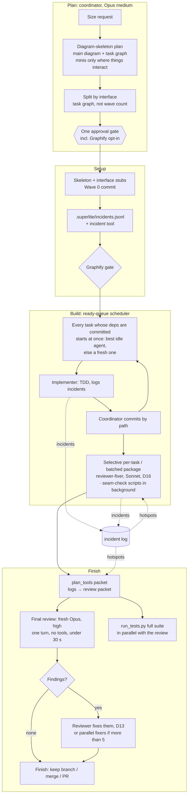

| # | Decision (yours unless marked) | Replaces |
|---|---|---|
| D10 | **The best split, whatever the agent count.** Tasks follow interface boundaries. The task graph decides parallel width; there is no fixed wave size | "≤5 per wave" |
| D11 | **No agent queues behind another.** Ready work starts the moment its dependencies are committed. **Reuse only idle agents**, so their cache is preserved. Finished agents wait in an idle pool. A ready task goes to the most relevant idle agent: the coordinator picks when the match is known, and otherwise the idle agents report a relevance score and the highest wins. If no agent is idle or eligible, create a new one | Sending work to busy agents (rep e1's queued fixes) |
| D12 | **Review on the builders' model: selective per task, otherwise one batched review per package (D16)**, then **one Opus final review** | Wave review plus fork final review |
| D13 | **Whoever finds a defect fixes it**, with a regression test from the failing input | Fix rounds sent back to implementers |
| D14 | **A diagram-skeleton plan** with superpowers' planning considerations | 0.2's contract-only plan format |
| G1 | **Target: about half of superpowers' orchestrated time** (its combined-task mean is 23.5 min over b1, e1 and e2, so superlite targets **about 11–12 min or less**), at equal hidden-test score and robustness ≥ 6/7 | Your goal, 2026-10-17 |
| D15 | **Cap the longest task at about 3 min** (predicted `Est. time`), split anything longer, start the longest tasks first, and keep slow tests out of the TDD loop | new |
| D16 | **Selective per-task review, and seam checks by script.** A task gets its own review the moment it commits **only if it matters**: it's on a seam, has `Complexity` ≥ 5, touches a Review Focus risk, or has an open incident. All other tasks are batched into **one review per package**, once that package's remaining tasks commit. A **seam check runs as a background script** (no model) when the second side of an interface commits; only a mismatch brings in an agent | Reviewing every task (about +$1.2–2.2 per run) |
| D17 | **Scripts over agents for anything mechanical.** If a step has a definite right answer (run tests, commit owned files, check scope, compute ready tasks, score idle agents, lint the plan, build the prime, check contracts, collect the finish summary, block unsafe commands), a script does it. Agents only design, write code, review meaning, fix and rule | Coordinator turns and the Haiku test-runner agent |
| D18 | **Bash wherever a `.cmd` wrapper would go.** Hooks call `bash "${CLAUDE_PLUGIN_ROOT}/hooks/<script>"` directly (`run-hook.cmd` is removed: it lost non-zero exit codes on Windows). Every tool is invoked as `bash <skill-dir>/scripts/sl <tool> …`. The `sl` launcher runs a `.sh` tool under bash, or a `.py` tool under the first working Python (`$SUPERLITE_PYTHON`, `python3`, `python`, `py -3`, `uv run --no-project python`), skipping Windows Store stubs, and exits 3 when there's none, so the caller logs the gap and continues. Skills and agents never call `python` directly | Your decision, 2026-10-17 |
| E12 | **Shared incident log** (file, line, context) informs reviewers | new |
| E13 | **Gated Graphify** for search in non-trivial codebases | new |
| R1 | **Coordinator at medium effort; final review by a fresh Opus agent at high effort, from a review packet built from the logs, in one turn, targeting under 30 s.** The coordinator ran at medium in every benchmark so far (nothing set it higher), and changing an agent's effort mid-run invalidates its cache, so a higher-effort review needs a separate agent. The packet makes the review targeted: open and repeated incidents, probe failures and uncovered categories, contract mismatches, failing tests and code excerpts around each hotspot. The reviewer reads only the packet (no tools), and fixes what it finds afterwards (D13). It replaces the earlier "coordinator reviews" ruling | Your decisions, 2026-10-17 |

---

## 1. Evidence behind 0.3

```mermaid
gantt
  dateFormat  m
  axisFormat %M
  title Combined task, rep e1 (minutes)
  section superpowers (13.3)
  4 implementers in parallel   :0, 7
  2 package reviews (Sonnet)   :7, 4
  coordinator fixes            :11, 2
  section superlite 0.2+E10 (33.9)
  wave-1, 3 agents             :1, 6
  same agents reused (queued)  :7, 10
  Opus final review            :18, 7
  fixes via original agents    :25, 5
  re-check + polish            :30, 4
```

| Rep | superpowers | superlite (0.2 + E10) |
|---|---|---|
| b1 (before E10) | 27.2 min, $9.03, 177/177, robust 1/7 | 15.5 min, $5.54, 177/177, robust 3/7 |
| e1 | **13.3 min**, $4.58, 177/177, robust 6/7 | 33.9 min, $7.89, 177/177, **robust 7/7** |
| e2 | 30.1 min, **$7.07**, 177/177, robust 1/7. Two Opus package reviews (6.8 min each), mostly serial | 32.6 min, $9.17, 177/177, **robust 6/7**. Build done at **12.4 min**, then an 11.1 min Opus final review and 3.6 min of fixes. Coordinator median 117k |
| e3 | stopped (not scored) | stopped (not scored); its final reviewer ran `taskkill /IM python.exe` (§5.1, probe safety) |

What we learned:
1. **Reusing agents serialized the work.** In e1, one agent carried all of minisheet: engine, then workbook, then server, then fixes, with fixes queued "after Task 6".
2. **Superpowers' fast rep** used one fresh agent per task, all four at once, split minisheet by layer, ran two same-model package reviews in parallel, and had the coordinator patch the findings itself.
3. **The tail after the build** (an Opus review on the critical path, fixes routed back to the original agents, re-checks, polish) took 16.5 of superlite's 33.9 min in e1.
4. **The Opus robustness review works:** 7/7 and 6/7, against superpowers' 6/7 and 1/7. Keep it, but take it off the critical path where possible, and let it fix what it finds.
5. **Both arms vary from rep to rep** (superpowers ran 13–30 min). Decisions need the mean of 3 reps.
6. **Superpowers' robustness follows its Review Focus luck.** Every superpowers plan had a Review Focus of 5 hand-picked inputs, each pinned by a test. When deep input made the list (e1: "2000-cell chain must not hit the recursion limit"), it scored **6/7**. When it didn't (b1, e2), **1/7**. **Superlite 0.2 had dropped Review Focus entirely**, which is why it needed the long E10 review. 0.3 restores it, category-based by app type (§5.1), so coverage doesn't depend on which five things the planner happens to pick.

---

## 2. Plan format (D14): the diagram skeleton


**Kept from superpowers' writing-plans** (its strongest planning practice):
- a **file structure first**, with one responsibility per file, split by responsibility rather than by layer;
- **right-sized tasks**: the smallest unit with its own test cycle that a reviewer could reject alone; setup folded into the task that needs it;
- **exact interfaces** for each task (consumes and produces, with signatures);
- **no placeholders** ("TBD", "handle edge cases", "similar to Task N" are plan failures);
- **TDD steps** (failing test, run it, implement, run it, done);
- a **Review Focus** section listing the input classes the spec implies but no test exercises, each pinned by a test in the task that owns the code. Superpowers picks five by hand; superlite makes it the **category-based probe plan** (§5.1);
- a **self-review** for coverage, placeholders, type consistency and Review Focus.

**Added by superlite:**
- **Always: a main diagram** (Mermaid) of components and data flow.
- **Always: a task graph diagram**, tasks as nodes and interface dependencies as edges. It's **machine-readable**: one `Tn --> Tm` edge per line, in a block headed `%% taskgraph`. The scheduler parses dependencies from it with `plan_tools.py taskgraph` (T12), not from prose.
- **Always, generated: a predicted schedule.** `plan_tools.py schedule` reads the `%% taskgraph`, each task's `Est. time`, the concurrency cap and the longest-first rule, then inserts into the plan a Mermaid Gantt of predicted lanes and one summary line: `critical path: T1 → T7 (5.0 min) · peak width 5 · predicted build 5.0 min · predicted total ≈ 8.5 min (target ✓)`. The coordinator writes nothing for it. It isn't a hand-drawn agent graph, because agents are assigned dynamically (idle reuse, selective reviewers, fixers on failure). It shows you the width and length of the run at the approval gate, catches a bad split before anything runs, and gives the benchmark a predicted-vs-actual baseline for refitting `Est. time`.
- **Mini diagrams only where something interacts:** a sequence across components, a state machine, or a protocol (for example request → workbook → recalc → response), at most about 15 nodes. **Skip them for self-contained modules** such as slug, feed or errors. Their `Consumes`, `Produces`, `Owns` and verbatim tests already say everything an agent needs.

  *Why:* agents read Mermaid as text, so a diagram helps an agent only when it shows something the text doesn't spell out: ordering across components, or state transitions. For self-contained modules it repeats the interface lines, adding context and a risk of contradiction. The main diagram and the task graph also serve you at the approval gate, where a wrong split is cheapest to catch. This rule likely halves diagram-writing time during planning.
- `detail: tests` as the default (verbatim test code), with `full` per task for tricky cores;
- per-task `Est. context`, `Complexity` (§4.4 of the design) and `Owns` (files).

**Plan size cap: about 15k characters.** The plan rides in the shared prime and the coordinator's context, and it's written on the critical path. Keep it to contracts, verbatim tests and the diagrams the rules require. If a plan would exceed the cap, move spec excerpts to referenced paths rather than pasting them.

**Task template:**

````markdown
### T7 minisheet server  · Complexity 5 (O-1) · Est. context 38k   ← interacts, so it gets a mini diagram
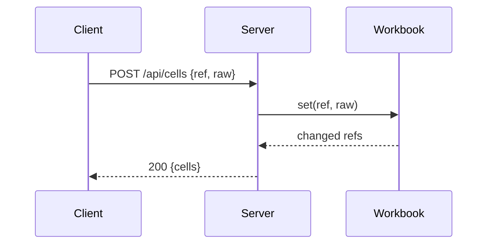
**Owns:** src/minisheet/server.py, tests/minisheet/test_server.py
**Est. time:** 2.5 min (1 component, about 120 LOC, server tests: slow)
**Consumes:** Workbook.set(ref:str, raw:str)->list[str] (T5) · Workbook.get(ref)->Value (T5)
**Produces:** create_server(wb, port=0)->HTTPServer
**Tests (verbatim):** ```python … ```
**Steps:** 1 failing test → 2 run: FAIL → 3 implement → 4 run: PASS
**Notes:** unknown method → 404 {"error":"not found"} (SPEC §10)
````

---

## 3. Work split (D10): split by interface, schedule from a ready queue

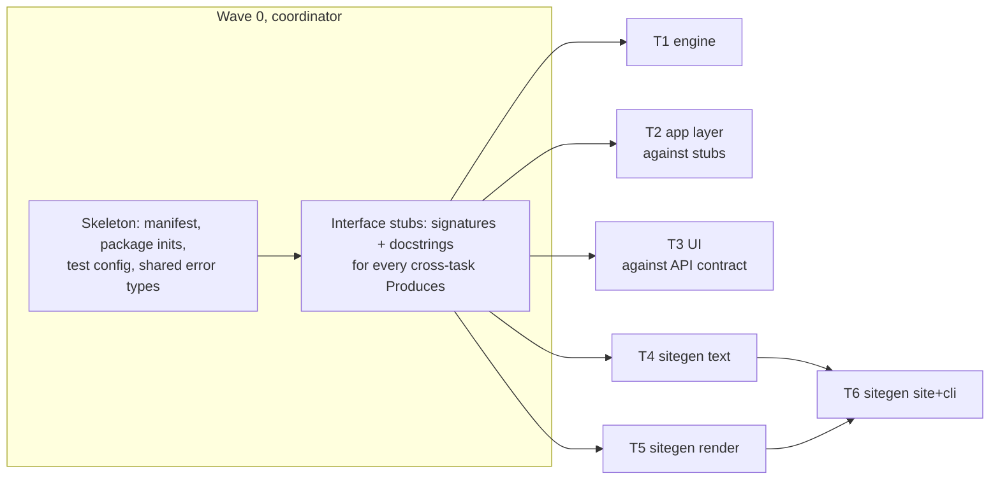

Rules:
1. **Interface stubs in Wave 0, generated.** For every `Produces` that another task consumes, `plan_tools.py stubs` (T12) turns the plan's `Produces` lines into stub modules in seconds, and the coordinator commits them. Each stub has the exact signature and a contract docstring. It raises `NotImplementedError`, or is a `Protocol`. A consuming task builds and tests against the stub with fakes or the contract, so layers proceed **in parallel** instead of in sequence. This is the move that let superpowers' minisheet app layer build alongside its engine. **The stub is the contract:** an implementer can't change a signature without a coordinator ruling, and `plan_tools.py contract` (the seam-check script) checks that the real code matches the stub.

   ```python
   # src/minisheet/evaluator.py  (generated stub, Wave 0)
   def evaluate(formula: str, get_cell: "Callable[[str], Value]") -> Value:
       """Contract: never raises; parse/eval errors return ErrorValue('#VALUE!')."""
       raise NotImplementedError("T1 engine")
   ```

   Consumers' unit tests use a small fake for the stub. The integration test that runs both sides belongs to the consuming task, or to the package review.
2. **A task waits only when its tests must *execute* another task's code.** A names-only dependency, or one satisfied by a stub, does not make it wait. The integration test that executes both sides belongs to the later task, or to the package review.
3. **Width comes from the task graph.** Dispatch every ready task at once. Respect the platform's concurrency (20 subagents); use a practical cap of **10 concurrent**, for rate limits. A task over the cap starts the moment *any* slot frees. It never waits for a specific agent (D11).
4. **Merge tasks smaller than an agent's own overhead.** An agent costs about 18k tokens of fixed context and about 30–60 s to start. A task whose predicted variable work (its `Est. context` minus that 18k prefix) is under about 18k, or that's expected to take less than about a minute, is merged with a related task in the same package. The merge must keep the result within the 80k limit and must not join tasks that could otherwise run in parallel on the critical path. `plan_tools.py taskgraph` warns about mergeable tasks.
5. **Cap the longest task at about 3 min (D15).** Each task gets an `Est. time` from the components it owns, the lines of code it owns, and how slow its tests are (browser and server tests are slow, pure functions fast). The formula starts as a rough rule and is refit after each benchmark from measured task times. Any task predicted over about 3 min is split along its components. For example, rep e2's 4.7 min server+UI task becomes server (against the workbook stub) and UI (against the SPEC's JSON contract, checked against a tiny contract-shaped fake server), run in parallel. A task that overruns 1.5× its prediction is logged and refit; it isn't interrupted.
6. **Check the predicted critical path before running: a warning, not a failure.** When the predicted total misses the plan's time target (`--target-min`, set in the plan header), `plan_tools.py lint` emits `MISSED TARGET: predicted 14.0 min vs target 11.0 min — critical path T1 → T5 → T6`. It exits 0. The coordinator (the parent agent) **considers** it: re-split or stub the named tasks if that's sensible, or accept the plan and record a `Ruling:` saying why (for example, an inherently sequential task). The warning and the ruling are shown at the approval gate. (Rep e1's minisheet funnel would have shown up here as one long chain.)
7. **Longest predicted tasks first.** When ready tasks exceed free slots, start the longest predicted first, so short tasks fill in around them.
8. **Slow tests out of the inner loop.** Implementers run only fast, focused tests during TDD. Slow browser and server suites run once, in the background, via `run_tests.py` after commit.
9. **Ready queue instead of wave barriers.** A task starts as soon as its own dependencies are committed, not when the whole previous wave finishes. "Waves" remain only as a planning view.

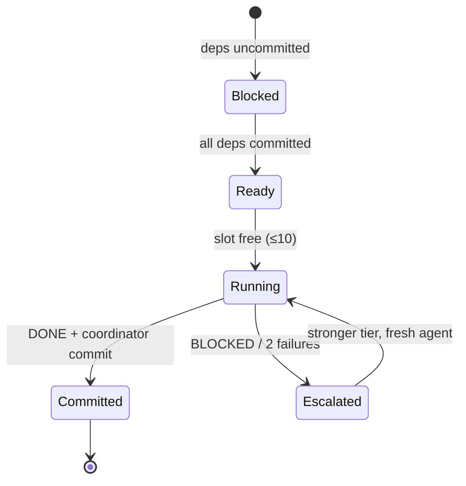

---

## 4. Dispatch (D11): an idle pool, relevance-based reuse, fresh agents when needed

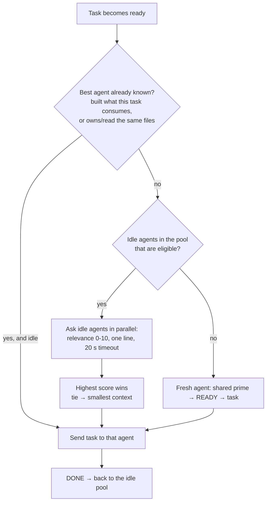

- **The idle pool.** An agent that reports DONE joins the pool, primed, with its cache warm for 1 h (implementer `cacheTtl: 1h`). **Busy agents are never candidates**, so work never queues behind another task.
- **Known match, so no question.** The coordinator scores relevance from the task graph: +5 if the agent built a `Produces` that this task consumes, +3 for each file it owns or read that this task touches, +1 for the same package. A clear winner (a margin of ≥ 3) gets the task directly. This should cover most assignments.
- **Asking for a score** happens only on a tie or with no signal. Each idle agent gets one line, "Relevance 0–10 for task Tn (files …, consumes …)? Reply `score: N — reason ≤10 words`", sent in one message. It resumes from its own cache, so it's cheap. Answers that don't arrive within 20 s are ignored. The highest score wins, and a tie goes to the smaller context.
- **Eligibility limits:** an agent's current context plus the task's `Est. context` must stay ≤ 80k; at most **3 tasks per agent**; idle ≤ 50 min (cache TTL). An ineligible agent leaves the pool and exits.
- **A fresh agent** is created only when no eligible idle agent exists. It gets the **same prime bytes for the whole run**, so its first call reads the shared cache (measured at 100% on sibling first calls).
- **The prime is built by `build_prime.py`, never typed by the coordinator.** The cache only hits on a **byte-identical** prefix; one changed character makes every agent re-write about 25k tokens (about $0.10 each) with no warning. Combined run b1 reached only 71% sibling hits, and an inconsistent prime is a likely cause. The script assembles the fixed preamble template, the plan file and the listed SPEC sections (by heading) **in a fixed order**, normalizes line endings and trailing spaces, adds no timestamps, enforces the size cap, writes `.superlite/prime.md`, and prints its hash. The coordinator pastes the file verbatim. The harness checks that every agent's prime has the same hash (`prime_hash_mismatches`).
- **Never:** send work to a busy agent, queue a task "after" another, or resume an agent for a task outside its limits.
- **The READY wait still applies to fresh agents** (it fixes the rep e1 race): send tasks only after their READY arrives.
- **Overlap the prime with Wave 0.** The first batch is primed while the skeleton and stubs commit. The prime holds the plan and spec, not code, so the handshake is off the critical path.

---

### 4.1 Scripts over agents (D17)

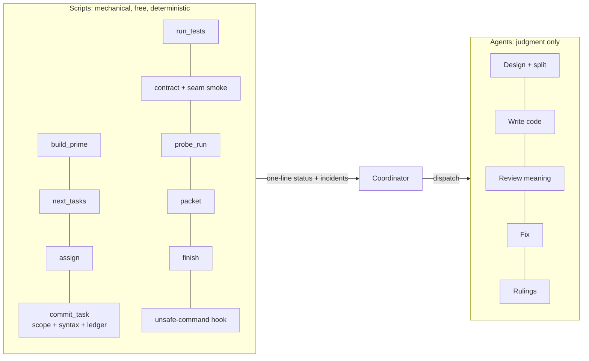

| Script | Replaces | What it does |
|---|---|---|
| `build_prime.py` | the coordinator typing the prime | assembles a byte-identical prime and prints its hash (§4) |
| `next_tasks.py` | coordinator reasoning on each scheduling turn | reads the task graph and committed tasks, prints ready tasks sorted longest-first, within the concurrency cap |
| `assign.py` | coordinator scoring of idle agents | scores idle agents from the task graph and each agent's history (§4). It names the winner, or says "poll" on a tie |
| `commit_task.py Tn` | coordinator commit turns, the scope check, ledger updates | stages exactly the task's `Owns` files and **blocks** any change outside them (logged as an incident). Then it runs `py_compile` plus an import check on each touched module, commits with the task title, records the SHA in the progress ledger, and launches the background probes and seam checks for that commit |
| `run_tests.py` | the Haiku test-runner agent | runs pytest (fast or full), parses the results, prints one summary line, and logs each failure as an incident and each passing test file as `verified` |
| `plan_tools.py lint` | Opus self-reviewing its plan | scans for placeholders, checks every `Consumes` against a `Produces`, checks that diagrams parse, checks the size caps and the mergeable or over-3-min tasks, and checks that every SPEC section is referenced by a task |
| `plan_tools.py contract` + seam smoke | a reviewer doing the seam check | the three-part seam check (§5) |
| `finish.py` | 1–2 coordinator turns at the end | collects every `Ruling:` line, the commits, the test counts and the open incidents into the closing summary |
| **unsafe-command hook** (plugin `PreToolUse` on Bash/PowerShell) | the harness only flagging it | **blocks** `taskkill /IM`, `pkill`, `killall`, `Stop-Process -Name` and `kill -9 -1` before they run, and tells the agent to kill by PID (§5.1 probe safety) |

Expected effect (estimates):
- about 15–25 fewer coordinator turns per run, at about 5–15 s each at medium, so **−1.5–4 min** on the critical path;
- no test-runner agent start-ups, so **−0.5–1 min**;
- about **−$0.5–1 per run** (each coordinator turn re-reads about 100k context);
- the same answer every time.

## 5. Review and fix (D12, D13)

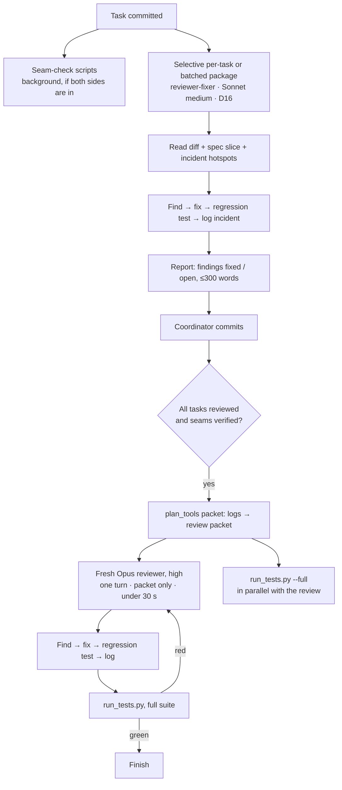

| Review | Who | When | Fixes |
|---|---|---|---|
| **Per-task review (D16, selective)** | `superlite:package-reviewer`, **Sonnet** (the builders' model, as superpowers does) | **The moment a task commits, if** it's on a seam, has `Complexity` ≥ 5, touches a Review Focus risk, or has an open incident | **It fixes its own findings**, adding a regression test per fix. It owns that task's files during the review |
| **Batched package review (D16)** | `superlite:package-reviewer`, Sonnet, one per package | When a package's remaining (unreviewed) tasks have all committed | Same: it fixes its own findings, one review over all those tasks' diffs |
| **Seam check (D16)** | **scripts, not a model**: `commit_task.py` launches them in the background when the second side commits | When both sides of a seam (a `Produces` → `Consumes` edge in the task graph) are committed | Three parts. **① Code interface:** `plan_tools.py contract` parses the plan's `Produces` signature with `ast`, reads the real one with `inspect.signature` in a subprocess, and compares parameters, order, defaults, the return annotation and class methods. **② Data contract:** it scans the consumer for the calls it makes (for example `fetch('/api/…')` in `index.html`), checks each is in the contract, starts the real server on port 0, sends each contract request, and checks the responses against the plan's JSON shapes (keys, types, status). **③ Behavior:** it reruns the consumer's tests with the **real producer swapped in for its fake** (`SUPERLITE_REAL=1`). **Pass:** a `verified: seam Ta↔Tb` entry, with no agent and no tokens. **Fail:** an incident with the mismatch at `file:line`, and a Sonnet reviewer-fixer (or the idle owner of one side) fixes it, with a regression test. Differences in *meaning* that keep the same shape are left to the tests and reviewers |
| Final review | **a fresh `superlite:final-reviewer`** (Opus, high, R1) | After all package reviews are committed, once `plan_tools.py packet` builds the review packet | **Targets under 30 s, in one turn, with no tools.** It reads only the packet and returns a verdict and its findings. Then **it fixes them itself** (D13), or splits more than 5 across parallel Sonnet fixers. The fix time is separate from the 30 s |
| Scoped re-check | — | **Dropped.** The next `run_tests.py` run is the check; fixes come with tests | — |
| Polish after approval | — | **Forbidden.** Freeze once the final suite is green | — |

Safety for "the finder fixes": a reviewer-fixer's own patch is checked by its regression test, by the full suite, and by the next review tier. The final reviewer's patches are checked only by tests. If it finds **more than 5** issues, it splits them across fresh fix agents (Sonnet) in parallel, runs at most one more suite, and stops.

**Keeping the coordinator off the critical path** (each extra review means another dispatch and another report for it to handle, one turn at a time):
- dispatch a task's review **in the same message as its commit**;
- handle **every pending report in one turn**, not one turn per report;
- review and seam-check reports go to the incident log, and the coordinator reads only their one-line status unless a finding is open.

**The final review is log-driven and targets under 30 s** (rep e2: 11.1 min, of which 3.6 min was reading and 7.4 min probing):
- **All probing happens earlier:** on every commit (§5.2 ②) and in the per-task and package reviews. The final review runs **no probes and no tools**.
- **`plan_tools.py packet`** builds `.superlite/review-packet.md` (≤ about 20k tokens) from the logs:
  1. **open incidents** (unresolved, low confidence, or a repeated `file:line`, ranked);
  2. **probe results**: failures still open, and categories with no `verified` entry for a package (each is a finding by itself);
  3. **contract check**: real signatures compared with the plan's `Produces` and stubs, mismatches only;
  4. **test summary**: counts, plus any failing or skipped tests;
  5. **cross-package seams**: every call from one package into another, with its location;
  6. **code excerpts**: ±12 lines around each item above;
  7. **diff stat**, and the plan's Review Focus list.
- **The reviewer** (`superlite:final-reviewer`, Opus high, fresh) answers in **one turn**: a verdict, then findings as `file:line — problem — fix`. Anything the packet marks unverified is either judged from its excerpt or listed as a finding. It never browses the repo during the review.
- **The final suite runs alongside the review.** `run_tests.py --full` runs the full suite at the same moment the final reviewer reads the packet; both use the frozen tree. A red suite becomes a finding.
- **Fast path:** when the packet has no open incidents, no probe failures, no unverified categories and no contract mismatches, the reviewer gives a short APPROVED in about 10 s.
- **Feasibility:** the tool-less Opus decider in our benchmark answered from a ~25k-token prompt in about 11 s (design §9). A ≤20k packet with a ≤300-word answer should take about 15–30 s at high effort. The harness measures `final_review_s`.
- **Fixes come afterwards,** by the reviewer itself (D13), with probes rerun incrementally (⑦). If there are more than 5, they go to parallel Sonnet fixers.

### 5.1 Parallel probe runner (no agents)

Rep e2's 11.1 min Opus final review split into 3.6 min of reading and 7.4 min of probing. The probing was 15 scripts written and run one after another, and about half re-checked SPEC examples the tests already covered.

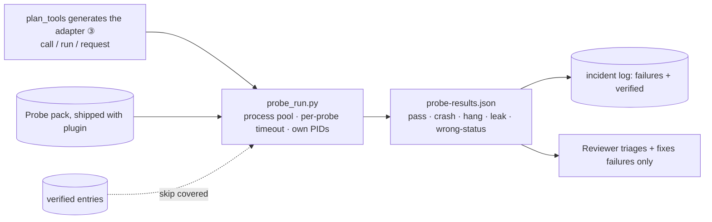

- **App type decides the probes.** At plan time the orchestrator classifies each package by app type (library/parser, CLI, HTTP service, web UI, file I/O, data pipeline, concurrency, auth) and writes its **probe plan into the plan's Review Focus section**:
  - the **generic categories** that type implies, selected from the table below;
  - **app-specific risks** the domain implies: for a spreadsheet, circular references through ranges, huge-range timing, CSV formula injection; for a site generator, path traversal in slugs, template recursion, huge front matter.

  The package reviewer writes the probes. Cross-package integration probes run automatically when the last package commits.
- **The generator library** (`skills/subagent-driven-development/probes/`) holds building blocks, not a fixed test list. It covers:
  - **deep:** nesting, long expressions, long chains;
  - **numeric:** `1e999`, NaN, inf, huge ints, division by zero;
  - **encoding:** lone surrogates, a BOM, invalid UTF-8, non-ASCII digits and whitespace;
  - **protocol:** unknown methods, a bad Content-Length, oversize and malformed bodies, unknown CLI commands;
  - **file:** traversal, symlinks, huge files, missing permissions;
  - **state:** consistency after an error.

  Reviewers compose probes from these generators instead of writing them from scratch. **No SPEC examples, ever.**

  | App type | Generic categories |
  |---|---|
  | library / parser / evaluator | deep, numeric, encoding, state |
  | CLI | protocol (commands and args), encoding, state, file |
  | HTTP service | protocol, encoding, numeric, state |
  | web UI | protocol via its API, encoding (rendering/XSS) |
  | file I/O / generator | file, encoding, deep |
  | data pipeline | numeric, encoding, state, deep |
  | concurrency | state (races, partial writes), protocol |
  | auth | protocol, state; **security review required** (D2, Opus) |
- **The adapter** (`.superlite/probes/adapter.py`, generated by `plan_tools.py adapter` from the `Probe entry` lines, ③) maps the project onto up to three entry kinds: `call(text)->value` (library), `run(args, stdin)->(rc, out, err)` (CLI), `request(method, path, body)->(status, json)` (server, with the runner starting it on port 0).
- **The runner** (`probe_run.py`) runs every applicable probe in parallel OS processes (`concurrent.futures`, workers = CPU count). Each probe gets a timeout (default 10 s; a timeout is a hang). The runner owns and kills **only the PIDs it started**. It writes `probe-results.json` and logs each failure as an incident and each pass as `verified`. It skips categories that already have `verified` entries for the same files.
- **Who runs it:** `commit_task.py` runs it in the background on every commit (②). Each **per-task or package reviewer** reruns it for its scope, while other tasks still build. The **final review runs no probes**: still-failing or uncovered categories reach it through the packet. Cross-package integration probes run when the last package commits (②).
- **Final review target: under 30 s** (§5), since probing has already happened on commit and in the package reviews.

### 5.2 Probe speed: eight levers

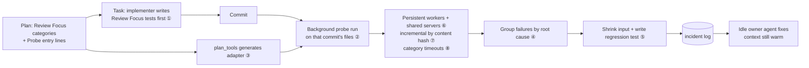

| # | Lever | Rule | Saves (est.) |
|---|---|---|---|
| ① | **Prevent the failures** | Each task gets the Review Focus categories and app-specific risks that apply to its files. The implementer writes those cases as tests during TDD, as superpowers' Review Focus intends, but category-based | Most fix rounds: about 1–3 min per package |
| ② | **Probe on every commit** | When the coordinator commits a task, it launches `probe_run.py` in the background on that commit's files. It's processes only, so no tokens and no blocking. Failures go to the incident log while the owning agent is still in the idle pool, and the coordinator assigns it the fix (D13, context warm). Committed code only, never a working tree | Package review starts with probing done: −1–2 min |
| ③ | **Generate the adapter** | Each package's plan section has a `**Probe entry:**` line (for example `call=minisheet.Workbook.set · run=python -m minisheet · serve=minisheet.server.create_server`). `plan_tools.py adapter` writes `.superlite/probes/adapter.py` from it. No agent writes adapters | −1–2 min per review |
| ④ | **Group by root cause** | The runner groups failures by exception type plus the top in-repo `file:line` of the traceback, or by status/leak kind. One incident per group, pointing at that line | Triage: −0.5–1 min |
| ⑤ | **Shrink and generate the regression test** | For each group, the runner shrinks the input (size steps, then bisection, ≤ 5 s per group) and writes `tests/regression/test_probe_<cat>_<n>.py` with the minimal input and the expected outcome. The fixer fixes the code; the test is already written | −0.5–1 min per fix |
| ⑥ | **Persistent workers and shared servers** | Long-lived worker processes import the package once. Server probes share one server per worker on port 0, health-checked after each probe and restarted only on a crash. (The hidden suite spent 74 of its 76 s starting a server per test) | Run from about 1 min to about 10–20 s |
| ⑦ | **Incremental results** | Results are cached in `.superlite/probes/cache.json`, keyed by (category, file, content hash). Only changed files are re-probed, and `verified` entries are reused | Re-runs after a fix: seconds |
| ⑧ | **Category timeouts** | 2 s for library/CPU probes, 5 s for CLI, 10 s for server. Deep probes step up (100 → 2k → 10k) and stop at the first failure | Faster hang detection: −10–30 s |

**Effect on the estimate:**
- the last package's review-fix drops from 3–5 min to **about 1–2 min**;
- the final review is a **one-turn, packet-only pass of about 10–30 s** (§5), plus 0–1 min of fixes when it finds something;
- likely total **about 8–11 min** (G1: about **0.34–0.47×** superpowers' orchestrated mean of 23.5 min). That's plan 1.5–2 (15k cap, `plan_tools lint` instead of an Opus self-review), then build end at 5–6 (≤3 min tasks, longest first), the last task's review +1 (seam checks are scripts), coordinator handling +0.3–1 (scripts do the bookkeeping, D17), packet and final review (suite in parallel) +0.5, fixes +0–1, and finish +0.3 (`finish.py`). Without D15–D17 it's 12–15. Halving superpowers' **best** rep (13.3 min → 6.7) is below the floor of planning plus the longest task plus a review (about 7–8 min).
- **Cost:** selective review adds about **+$0.6–1.2** per run over per-package review, against +$1.2–2.2 for reviewing every task. With D17's fewer coordinator turns (−$0.5–1), expected **about $5–6.5 per run**, against superpowers' **$6.89 mean over the same reps as the 23.5 min (b1, e1, e2)**. So time is about halved, at lower cost.

**Probe safety (found in rep e3).** Superlite's 0.2 Opus final reviewer ran `taskkill //F //IM python.exe` to clean up its probe servers. That kills **every Python process on the machine**. Rules for every agent or script that starts processes (reviewers, implementers, fixers, scripts):
- **Kill only processes you started, by PID.** Record the PID at launch (`$!`, `Popen.pid`) and stop that PID, or use a context manager or fixture that owns the process.
- **Never kill by image name, pattern or user** (`taskkill /IM`, `pkill`, `killall`, `Stop-Process -Name`, `kill -9 -1`). The harness flags these commands as a safety violation in the score (`unsafe_kill_commands`).
- **Probe servers bind to port 0 or a free port, with a timeout,** so a leftover can't block anything.

---

## 6. Incident log (E12)

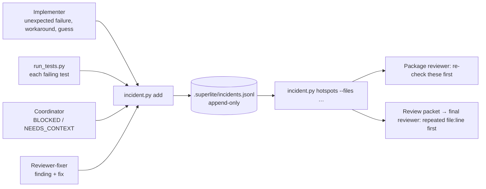

**Entry (one JSON line):** `file`, `line` and `context` are required; everything else is optional.

```json
{"file":"src/minisheet/parser.py","line":139,"context":"Deep nesting (100 parens) raised RecursionError in _parse_primary; added a depth guard returning #VALUE!","agent":"T1-engine","kind":"exception","resolution":"fixed","confidence":"medium","time":"18:58:12"}
```

- `kind` is one of: `test-failure` (a failure other than the planned red step), `exception`, `workaround`, `spec-ambiguity`, `assumption`, `flaky`, `perf`, `unsure`, **`verified`**.
- **`verified` entries** use the same file, line and context shape, and record what has been checked and passed. Package reviewers write them for each item they confirm. The probe runner writes them for each passing probe category per file. `run_tests.py` writes one per test file that passes on the final green run. They let the final review skip anything already covered, and spend its time on what nobody has checked.

```json
{"file":"src/minisheet/parser.py","line":0,"context":"probe deep: nesting 100/2k/10k and 5k terms return #VALUE!, no crash","agent":"probe_run","kind":"verified","time":"19:41:02"}
```
- **Writes:** `incident.py add` takes a file lock and writes one line per append, so parallel agents are safe. `context` is capped at 200 chars.
- **Reads:** `hotspots --files a,b` returns entries for those files sorted by file and line, repeated `file:line` first, then unresolved, then low confidence. Reviewers get only their slice, by path. The log never goes in the prime, because it changes and would break the cache.
- **Location:** the coordinator copies `incident.py` to `.superlite/bin/` in Wave 0 and git-ignores `.superlite/incidents.jsonl` during the build. At finish, it archives the log next to the plan.
- **Promotion gate:** planted defects next to logged hotspots, reviewers run with and without the log, 3 reps. Promote if review **recall rises by ≥ 1 planted defect on average** at ≤ +10% review time.

---

## 7. Gated Graphify (E13)

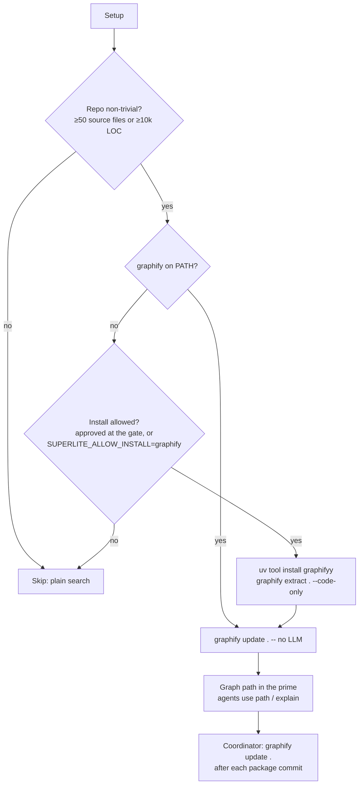

- `graphify update <path>` re-extracts code **without an LLM** (`graphify --help`), so per-update cost is local CPU only. The initial build is `graphify extract . --code-only`, which is how your movedocs and CIMI graphs were built.
- **Never install silently.** Installing is offered inside the single approval question. Unattended runs install only with `SUPERLITE_ALLOW_INSTALL=graphify`.
- Agents query with `graphify path "A" "B"` and `graphify explain "X"` instead of broad Explore sweeps. Reviewers get `explain` output for each changed symbol's neighbors.
- **Updates come only from the coordinator, after commits.** Agents never rebuild the graph while others write.
- **Promotion gate:** a brownfield task (§10), with the graph vs without it, 3 reps. Promote if Explore and read turns drop ≥ 25% and wall-clock doesn't rise.

---

## 8. Roles and models

| Role | Agent | Model / effort | Writes code | New in 0.3 |
|---|---|---|---|---|
| Coordinator | main session | Opus 5.5 at **medium for the whole run** (R1; what every benchmark actually ran). **No effort switching within an agent:** the prompt-caching docs say *"Changing the `output_config.effort` value always invalidates message blocks"*. Effort varies only across separate agents | skeleton, generated stubs, commits | ready-queue scheduler; builds the review packet |
| Implementer | `superlite:implementer` | Sonnet medium (Haiku routing, E5, stays out of 0.3 scope) | its own files | idle-pool reuse by relevance (≤3 tasks, ≤80k); logs incidents |
| Package reviewer-fixer | `superlite:package-reviewer` | **Sonnet medium** | its package's files after build | **new agent** |
| Final reviewer | `superlite:final-reviewer` | **Opus high**, fresh | yes, for its own findings (after the review) | **new agent:** one-turn, packet-only review, under 30 s |
| Test runs | **`run_tests.py` (script, D17)** | — | — | replaces the Haiku test-runner agent; logs failures as incidents and passes as `verified` |
| Lookups | Explore, or Graphify queries | Haiku low | — | Graphify when gated on |

---

## 9. Implementation plan

**Goal:** implement D10–D17, R1, E12 and E13 in the superlite plugin and harness, then benchmark.
**Global constraints:**
- Plugin skills ≤ 12k chars each; agent files ≤ 3k.
- Scripts are stdlib-only Python ≥ 3.12, cross-platform, tested with pytest under `uv run --no-project --with pytest`.
- No change to the hidden suites.
- No push until you've seen the results.

**Task graph:**

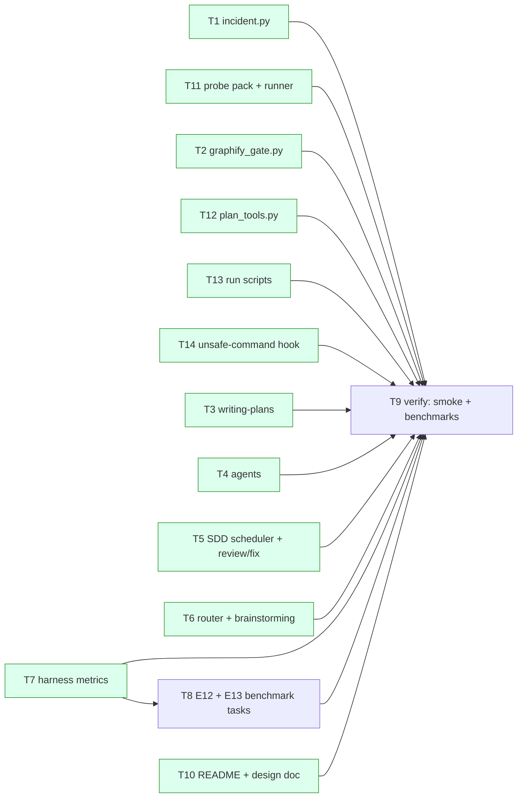

Batch 1 (parallel, disjoint files; the task graph has only execution dependencies, since names-only dependencies don't wait, §3 rule 2): **T1, T2, T3, T4, T6, T7, T10, T11, T12, T13, T14**. T5 depends only on the *names* from T1, T2, T4, T11, T12 and T13 (CLI flags, agent names), which are fixed below, so **T5 also runs in batch 1**. T11 uses T1's `incident.py add` CLI by name, so it shares the batch. T8 needs T7's metrics. T9 is last.

### T1 · incident log tool · Complexity 3 (O−2) · Est. context 22k

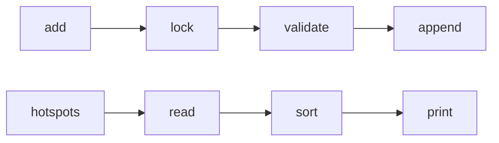

**Owns:** `skills/subagent-driven-development/scripts/incident.py`, `tests/scripts/test_incident.py`
**Produces:**
- `incident.py add --file F --line N --context C [--agent A] [--kind K] [--resolution R] [--confidence X] [--log PATH]`
- `incident.py hotspots [--files a,b] [--log PATH] [--max 30]`
- `incident.py summary [--log PATH]`

Default log path: `.superlite/incidents.jsonl`.

**Tests:**
- `test_add_writes_one_json_line`: add with file, line and context gives exactly 1 line, with those 3 keys plus `time`.
- `test_context_truncated_to_200`: a 300-char context is stored at 200 chars, ending in "…".
- `test_line_must_be_int_ge_0`: `--line -1` exits 2 with "line must be >= 0".
- `test_kind_must_be_known`: `--kind banana` exits 2.
- `test_parallel_appends_are_whole_lines`: 8 processes × 50 adds give 400 lines, all valid JSON.
- `test_hotspots_filters_files_and_sorts`: entries for a.py:10, b.py:5, a.py:10 and a.py:3, queried with `--files a.py`, return a.py:10 (×2, repeated) first, then a.py:3.
- `test_hotspots_puts_open_before_fixed`: for the same file and line count, `resolution=open` comes first.

**Notes:** the lock is `msvcrt.locking` on Windows and `fcntl.flock` elsewhere, held only around the write.

### T11 · probe pack and parallel runner · Complexity 7 (O−1, high effort) · Est. context 55k (split into T11a runner core + T11b grouping/shrink/cache if the estimate exceeds 60k)

**Owns:** `skills/subagent-driven-development/probes/` (`probe_run.py`, `pack/{deep,numeric,encoding,protocol,file,state}.py`, `adapter_template.py`), `tests/scripts/test_probe_run.py`
**Consumes:** `incident.py add` (T1, names only)
**Produces:** `probe_run.py --adapter PATH [--app-type T] [--probes DIR] [--categories deep,numeric,…] [--files a,b] [--timeout 10] [--workers N] [--out probe-results.json] [--log .superlite/incidents.jsonl]`

**Tests** (each against a tiny fixture project in `tests/scripts/fixtures/`):
- `test_crash_is_reported`: a recursive parser with no guard; the deep probe reports `crash` with RecursionError, and an incident is logged.
- `test_hang_is_reported_and_killed`: an infinite loop on input; the probe reports `hang` after its timeout, and the child PID is gone afterwards.
- `test_runs_in_parallel`: 20 probes that each sleep 1 s finish in under 5 s with `--workers 8`.
- `test_pass_logs_verified`: a robust fixture gives all passes and one `verified` entry per category per file.
- `test_skips_verified_categories`: with existing `verified` entries for deep on a.py, deep doesn't run for a.py.
- `test_only_kills_own_pids`: a sentinel `python` process started outside the runner is still alive after the run.
- `test_server_adapter_uses_free_port`: the runner starts the fixture server on port 0, probes TRACE, and records the status.
- `test_category_selection_by_app_type`: `--app-type cli` selects protocol, encoding, state and file only.

**Speed levers in T11 (§5.2):**
- ② a `--commit SHA` mode that probes only the files a commit touched, runs in the background, and writes incidents;
- ④ grouping by root cause;
- ⑤ shrinking plus generated regression tests;
- ⑥ persistent workers and shared servers;
- ⑦ the content-hash cache;
- ⑧ category timeouts and stepped sizes.

**More tests:**
- `test_groups_by_root_cause`: 30 failing deep probes with the same traceback top give 1 incident.
- `test_shrinks_and_writes_regression_test`: a parser that fails at depth ≥ 300 gives a generated test with depth in 300–600 that fails before the fix.
- `test_shared_server_restarts_only_on_crash`: 20 HTTP probes use 1 server start, and a crash triggers exactly 1 restart.
- `test_incremental_skips_unchanged`: a second run with no file changes runs 0 probes and reuses the results.
- `test_commit_mode_probes_only_touched_files`.
- `test_category_timeouts`: a 3 s library hang is reported as a hang at 2 s.

**Notes:** the library holds generators and the app-type → category table. The probes themselves are written per project from the plan's Review Focus (the probe plan). It never includes SPEC-derived examples.

### T12 · plan tools: stubs, task graph, adapter, review packet · Complexity 5 (O−1) · Est. context 38k

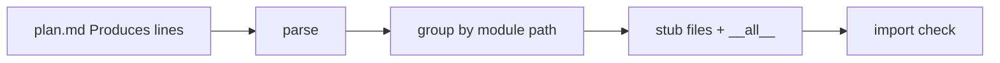

**Owns:** `skills/subagent-driven-development/scripts/plan_tools.py`, `skills/subagent-driven-development/scripts/predict.py`, `skills/subagent-driven-development/config/{models.json,predictor.json}`, `tests/scripts/test_plan_tools.py`
**Produces:**
- `plan_tools.py taskgraph --plan PLAN.md` prints JSON `{"T1": [], "T5": ["T1", "T2"], …}` (task → dependencies) from the `%% taskgraph` block. It fails with exit 2 on a cycle, an unknown task id, or a missing block.
- `plan_tools.py stubs --plan PLAN.md [--root .] [--dry-run]`. It reads each task's `**Produces:**` line (`module.function(args) -> ret` or `Class.method(...)`), writes stub modules that raise `NotImplementedError("<task id>")`, with the contract text from the task as the docstring, and prints the files it wrote. Files that already exist are left alone and listed.
- `plan_tools.py packet --plan PLAN.md [--log .superlite/incidents.jsonl] [--probes .superlite/probes/] [--out .superlite/review-packet.md] [--max-tokens 20000]` builds the review packet (§5): open incidents, probe failures and uncovered categories, a **contract check** (the real signatures compared with `Produces`), the test summary, cross-package seams, ±12-line excerpts, the diff stat and Review Focus.
- `plan_tools.py contract --plan PLAN.md [--root .] [--seam Ta,Tb]` compares the real signatures with `Produces` and the stubs, and prints mismatches (exit 1 if any).
- `predict.py --plan PLAN.md [--models config/models.json] [--coef config/predictor.json]` is the **stored predictor**. It reads each task's measurable features (`Components`, `LOC owned`, `Tests: fast|slow`, `Model`), computes `Est. time`, `Est. context` and **cost per task**, and prints run totals as JSON. **Model prices and speeds live in `config/models.json`**: input, output, cache write (5 min and 1 h), cache read, and measured output tokens per second. Edit that file when prices change. The coefficients live in `config/predictor.json` and are **refit** by `predict.py --refit bench/results/*.json` from predicted-against-actual data after each benchmark. The coordinator writes only the features, never the estimates.
- `plan_tools.py schedule --plan PLAN.md [--cap 10] [--target-min 11] [--insert]` uses `predict.py`'s per-task times, then simulates the run: ready queue, longest `Est. time` first, up to `--cap` lanes. It prints the critical path, the peak width and the predicted build and total time, and with `--insert` writes a Mermaid Gantt plus that summary line into the plan under a `%% schedule` marker (replacing any earlier one).
- `plan_tools.py lint --plan PLAN.md [--spec SPEC.md]`: a **warning only** (`MISSED TARGET …`, exit 0) when the predicted total misses `--target-min`, naming the critical-path tasks; the placeholder scan, `Consumes`/`Produces` consistency, diagram parse, size caps, mergeable and over-3-min tasks, and SPEC sections with no task. It prints issues and exits 1 if there are any.
- `plan_tools.py adapter --plan PLAN.md [--out .superlite/probes/adapter.py]` generates the probe adapter from each package's `**Probe entry:**` line (③).

**Tests:**
- `test_function_stub_written`: `evaluate(formula: str, get_cell) -> Value` in `src/minisheet/evaluator.py` gives that exact signature, and calling it raises `NotImplementedError('T1')`.
- `test_class_method_stub`: `Workbook.set(ref: str, raw: str) -> list[str]` gives class `Workbook` with method `set`.
- `test_existing_file_untouched`: a pre-existing `evaluator.py` is unchanged and reported as skipped.
- `test_stubs_import_cleanly`: every generated module imports, with `from __future__ import annotations` so unresolved type names are fine.
- `test_dry_run_writes_nothing`.
- `test_taskgraph_parses_edges`: the block `T1 --> T5`, `T2 --> T5` gives `{"T5": ["T1", "T2"]}` with T1 and T2 having none.
- `test_taskgraph_warns_mergeable`: a task with `Est. context 24k` (variable 6k) is flagged as mergeable.
- `test_predict_uses_price_file`: doubling Sonnet's input price in a temporary `models.json` doubles that part of a task's predicted cost.
- `test_predict_refit_improves_error`: refitting on fixture results with known times lowers the mean absolute error.
- `test_schedule_critical_path`: T1(3) → T7(2) plus independent T9a(3) gives critical path `T1 → T7`, 5.0 min, peak width 2.
- `test_schedule_respects_cap_and_longest_first`: 4 ready tasks of 3, 2, 2 and 1 min with `--cap 2` start the 3- and 2-min tasks first; the predicted build is 4 min.
- `test_schedule_insert_replaces_previous`: running `--insert` twice leaves exactly one `%% schedule` block.
- `test_lint_warns_when_predicted_misses_target`: a predicted total of 14 min with `--target-min 11` prints `MISSED TARGET`, lists the critical-path tasks, and **exits 0**; the other lint errors still exit 1.
- `test_taskgraph_rejects_cycle`: `T1 --> T2`, `T2 --> T1` exits 2 with "cycle".
- `test_taskgraph_requires_block`: a plan with no `%% taskgraph` block exits 2.
- `test_packet_lists_open_and_uncovered`: an open incident plus a package with no `verified` deep entry both appear as items with excerpts.
- `test_packet_contract_mismatch`: a real `evaluate(formula)` against a planned `evaluate(formula, get_cell)` is listed as a mismatch.
- `test_packet_size_cap`: a log with 500 incidents gives a packet ≤ 20k tokens (about 38k chars), keeping the top-ranked items.
- `test_packet_empty_is_fast_path`: no open items gives a packet whose header says `FAST PATH`.
- `test_contract_seam_ok_and_mismatch`: matching signatures exit 0; a missing parameter exits 1 and names it.
- `test_taskgraph_lists_seams`: `T9a --> T9b` produces seam `T9a↔T9b`.
- `test_adapter_from_probe_entry`: `call=pkg.mod.fn · run=python -m pkg` gives an adapter whose `call` imports `pkg.mod.fn` and whose `run` executes `python -m pkg`.

### T13 · run scripts (D17) · Complexity 5 (O−1) · Est. context 40k · Est. time 3 min

**Owns:** `skills/subagent-driven-development/scripts/{build_prime,next_tasks,assign,commit_task,run_tests,finish}.py`, `tests/scripts/test_run_scripts.py`
**Consumes:** `plan_tools.py taskgraph` (T12), `incident.py add` (T1), `probe_run.py --commit` (T11), names only.
**Produces:**
- `build_prime.py --plan P --spec S --sections "1,3,5" [--out .superlite/prime.md]` prints `hash size`;
- `next_tasks.py --plan P --committed T1,T3 --running T2 [--cap 10]` prints ready task ids, longest `Est. time` first;
- `assign.py --task Tn --pool .superlite/pool.json` prints `agent=<id>` or `poll`;
- `commit_task.py Tn [--plan P]` prints `sha` or exits 1 with the files out of scope;
- `run_tests.py [--fast PATHS | --full]` prints `passed failed skipped seconds`;
- `finish.py` prints the closing summary.

**Tests:**
- `test_prime_is_byte_identical_across_runs`: two builds from the same inputs give the same hash; a CRLF input gives the same hash as LF.
- `test_prime_section_order_fixed`: `--sections 5,1` and `1,5` give the same output.
- `test_next_tasks_longest_first_and_cap`.
- `test_assign_known_match_and_tie_polls`: a +5 producer match wins; equal scores print `poll`.
- `test_commit_blocks_out_of_scope`: a change to a file not in `Owns` exits 1, logs an incident and commits nothing.
- `test_commit_rejects_syntax_error`: a touched module with a syntax error is not committed.
- `test_run_tests_logs_failures_and_verified`.
- `test_finish_collects_rulings`: every `Ruling:` line in the ledger appears, in order.

### T14 · unsafe-command hook (D17) · Complexity 2 (O−2) · Est. context 16k

**Owns:** `hooks/hooks.json` (add a PreToolUse entry for Bash and PowerShell), `hooks/block-unsafe-kill.py`, `tests/scripts/test_block_unsafe_kill.py`
It blocks (exit 2, with a message to kill by PID) any command matching `taskkill .*(/IM|//IM)`, `\bpkill\b`, `\bkillall\b`, `Stop-Process .*-Name`, or `kill -9 -1`. Everything else is allowed.
**Tests:**
- `test_blocks_taskkill_im` (both `/IM` and `//IM`);
- `test_blocks_pkill_killall_stop_process_name`;
- `test_allows_kill_by_pid`: `kill 1234` and `taskkill /PID 1234` are allowed;
- `test_allows_unrelated_commands`.

### T2 · Graphify gate · Complexity 3 (O−2) · Est. context 20k

**Owns:** `skills/subagent-driven-development/scripts/graphify_gate.py`, `tests/scripts/test_graphify_gate.py`
**Produces:** `graphify_gate.py [--root .] [--min-files 50] [--min-loc 10000]`, which prints JSON: `{"use":bool,"reason":str,"installed":bool,"needs_install":bool,"allowed":bool}`.

**Tests:**
- `test_small_repo_skips`: 10 files and 500 LOC give `use=false`, `reason="small repo"`.
- `test_large_repo_installed_uses`: 60 files, with a fake `graphify` on PATH, gives `use=true`, `installed=true`.
- `test_large_repo_missing_not_allowed`: no graphify and no env var give `use=false`, `needs_install=true`, `allowed=false`.
- `test_env_allows_install`: `SUPERLITE_ALLOW_INSTALL=graphify` gives `allowed=true`.
- `test_counts_tracked_files_only`: untracked and ignored files are excluded (via `git ls-files`).

### T3 · writing-plans: the diagram skeleton · Complexity 4 (O−1) · Est. context 30k

**Owns:** `skills/writing-plans/SKILL.md`
Rewrite it to the §2 format, including the **generated predicted schedule (`plan_tools.py schedule --insert`, run right after the plan is written)**, the **15k plan cap**, an **`Est. time` per task with the 3-min split rule (D15)**, a **`**Probe entry:**` line per package (③)**, the Review Focus categories copied into each task whose files they touch (①), and the **diagram rules** (the main diagram and the machine-readable `%% taskgraph` always; mini diagrams only for interacting sections). Review Focus becomes the **probe plan** (app type per package, plus app-specific risks, §5.1). The rest: the header, main diagram, file structure, task graph diagram, sections with mini diagrams, Review Focus and self-review. Add the superpowers considerations listed in §2. Add the D10 split rules (interface stubs in Wave 0, waiting only for execution dependencies, no wave cap) and the task template from §2, with `Owns`, `Est. context` and `Complexity`.
**Checks:**
- `wc -c` ≤ 12k;
- every Mermaid block in the template parses (`npx -y @mermaid-js/mermaid-cli` if available, otherwise mark it "manually checked");
- grep confirms "Review Focus", "Interface stubs" and "no placeholders".

### T4 · agents · Complexity 4 (O−1) · Est. context 26k

**Owns:** `agents/implementer.md`, `agents/package-reviewer.md` (new), `agents/final-reviewer.md` (new), `agents/test-runner.md` (deleted: `run_tests.py`, D17), `agents/reviewer.md` (deleted)
- **implementer:** test against a **swappable fake** of each producer it consumes. One fixture returns the fake by default and the real implementation when `SUPERLITE_REAL=1`, so seam check ③ can rerun the same tests against real code. Write the task's Review Focus cases as tests first (①); fix probe failures on its own files when assigned from the idle pool (②); after DONE, stay available for another task; answer relevance polls as one line `score: N — reason`; work on only one task at a time; incident logging rules with the exact `incident.py add` call; READY protocol kept.
- **package-reviewer** (sonnet, medium, all tools), used **per task (selective) or per package (batched), D16**: review the given diffs, spec slice and hotspots. When assigned a **seam mismatch** incident, fix it on either side, with a regression test; run `probe_run.py` (T11) against its task or package with the adapter generated by `plan_tools.py adapter` (③); fix every finding with a regression test; log each finding with `resolution`; never commit; report in ≤300 words (findings fixed or open, tests added, probes run).
- **final-reviewer** (opus, high, all tools, but **reviews with none**): read `.superlite/review-packet.md` only; answer in one turn with `Verdict: APPROVED | CHANGES_REQUESTED`, then findings as `file:line — problem — fix` (≤300 words). An item the packet marks unverified is judged from its excerpt or listed as a finding. Never browse during the review. Fixing happens afterwards, when the coordinator replies "fix them": regression test per fix, incremental probe rerun.

**Checks:** each file ≤ 3k chars with valid frontmatter, and `model`/`effort` set.

### T5 · subagent-driven-development: the scheduler, review and fix · Complexity 7 (O−1, high effort) · Est. context 48k

**Owns:** `skills/subagent-driven-development/SKILL.md`
**Consumes (names only):** the CLIs from T1, T2, T11, T12 and T13 exactly as written there; the agents `superlite:implementer`, `superlite:package-reviewer` and `superlite:final-reviewer`.

Sections to write, each with its mini diagram from this plan:
- Setup: skeleton, **generated interface stubs (`plan_tools.py stubs`)**, the first batch's prime sent while Wave 0 commits, the incident tool copied to `.superlite/bin/`, and the Graphify gate.
- After the plan is written: `plan_tools.py schedule --insert`, then `plan_tools.py lint`. On a `MISSED TARGET` warning, the coordinator considers re-splitting or stubbing the named tasks, or accepts the plan with a `Ruling:`; either way it shows the warning at the approval gate.
- The ready-queue scheduler (§3 state diagram, cap 10), with dependencies read from `plan_tools.py taskgraph` and the **idle-pool assignment** (§4): known-match scoring, relevance poll, eligibility limits, fresh agents only when no eligible idle agent exists.
- The same prime bytes for the whole run, with a wait for READY before a fresh agent's task (§4).
- **Selective per-task review, batched package review, and background seam-check scripts (D16)**: the trigger rule (seam, `Complexity` ≥ 5, Review Focus risk, open incident), dispatching the review with the commit, and handling all pending reports in one turn; the longest-first scheduling and the 3-min split (D15); the final suite running alongside the final review.
- **Probe on every commit (②):** the background `probe_run.py --commit`, failures routed to the idle owning agent, and **cross-package integration probes when the last package commits**. Reviews (§5) start from those results.
- **The final review** (§5, R1): build the packet (`plan_tools.py packet`), dispatch a fresh `superlite:final-reviewer` (opus, high), the one-turn rule, the **fast path**, then its fixes or the 5-findings split. Then the fix policy (D13).
- Freeze after green.
- **Scripts over agents (D17):** where each script is called (`build_prime`, `next_tasks`, `assign`, `commit_task`, `run_tests`, `finish`, `plan_tools lint`). The coordinator reads their one-line output, not raw logs.
- Rulings and finishing (`finish.py`).

Remove the wave-review, fork final review and scoped re-review rules.
**Checks:** ≤ 12k chars; no "≤5 per wave", wave review or scoped re-review rules; no fork review, and the final review is the packet-only `superlite:final-reviewer`; every agent name it uses exists in `agents/`.

### T6 · router and brainstorming · Complexity 2 (O−2) · Est. context 18k

**Owns:** `skills/using-superlite/SKILL.md`, `skills/brainstorming/SKILL.md`
- **Router:** lean toward orchestration (D9); the final review is a fresh `superlite:final-reviewer` reading the review packet (R1); the incident log and Graphify are mentioned in one line each.
- **Brainstorming:** the single approval question includes the Graphify install opt-in when `graphify_gate.py` reports `needs_install`.

**Checks:** the router stays ≤ 1.8k chars.

### T7 · harness metrics · Complexity 5 (O−1) · Est. context 40k

**Owns:** `bench/harness.py`, `tests/bench/test_metrics.py`

New score fields:
- `queued_assignments`: a task sent to an agent that was **still busy**, or queued "after" other work. **Must be 0**;
- `agent_reuse_idle`: tasks given to idle-pool agents (allowed);
- `relevance_polls` and `relevance_poll_s`: poll rounds and the latency they add;
- `reuse_limit_breaches`: reuse past 3 tasks or 80k context;
- `idle_gaps_s`: the coordinator waiting while no agent runs;
- `critical_path_s`;
- `tail_after_build_s`: last implementer end to finish;
- `incidents` (count, by kind);
- `graphify_used`;
- `final_review_s` (dispatch to verdict) and `final_fix_s`;
- `longest_task_s` and `est_time_error` (predicted against actual per task);
- `predicted_total_s` against the actual wall-clock, and `critical_path_predicted` against `critical_path_actual`;
- `seam_checks` and `seam_mismatches`;
- `reviews_per_task`, `reviews_batched` and `review_cost_usd`;
- `prime_hash_mismatches` and `coordinator_turns`;
- `coordinator_report_lag_s` (a report arriving until the coordinator handles it);
- `unsafe_kill_commands`: Bash commands that kill by image name or pattern (`taskkill /IM`, `pkill`, `killall`, `Stop-Process -Name`, `kill -9 -1`).

It also fixes implementer detection, so descriptions like "Task A1" count (rep e2 scored superpowers' 6 implementers as 0).

**Tests:** use the committed e1 logs as fixtures (copied in trimmed form to `tests/bench/fixtures/`).
- `test_superlite_e1_queued_assignments_ge_1`: e1's fix round queued "after Task 6" to a busy agent is detected.
- `test_idle_reuse_not_counted_as_queued`: a task sent to an agent after its DONE counts as `agent_reuse_idle`, not `queued_assignments`.
- `test_superpowers_e1_agent_reuse_0`.
- `test_tail_after_build_superlite_e1_about_16min`: 900–1100 s.
- `test_metrics_absent_fields_default_none`.
- `test_unsafe_kill_detected_in_superlite_e3`: the `taskkill //F //IM python.exe` call in e3 counts as 1.
- `test_superpowers_e2_implementers_6`: "Task A1…B3" descriptions are counted.

### T8 · E12 and E13 benchmark tasks · Complexity 6 (O−1) · Est. context 45k

**Owns:** `bench/tasks/combo-planted/` (E12), `bench/tasks/brownfield/` (E13)

- **E12:** the combined reference with 8 planted defects. 4 sit next to seeded incident entries; 4 are control defects with no entries. The defects go into a starting repo the arm must *review and fix* (the arm prompt says "review this branch"). Score: planted defects fixed (from a defect-specific hidden test per defect) plus hidden 177.
- **E13:** a brownfield feature on an existing codebase large enough to trigger the gate: the combined reference **plus** a vendored, MIT-licensed mid-size pure-Python library (chosen at implementation time, ≥ 10k LOC, recorded in the task README). Feature: "add XLSX-style column widths to minisheet's CSV export, configurable from sitegen front matter". It has its own hidden tests. Arms run with and without `SUPERLITE_ALLOW_INSTALL=graphify`.

**Checks:**
- the hidden tests pass on the task's reference solution;
- the planted-defect tests fail on the planted repo and pass on the reference.

### T9 · verify · Complexity — · coordinator

1. Smoke: plugin load, hooks (including the unsafe-command block), every agent resolves, the T13 scripts' tests are green, and the `incident.py`, `graphify_gate.py`, `probe_run.py` and `plan_tools.py` tests are green.
2. **The combined benchmark, 3 reps** (each rep's arms in parallel), against the e-series. Targets: robustness ≥ 6/7, `queued_assignments` = 0, `tail_after_build_s` ≤ 6 min, `final_review_s` ≤ **30 s** (the review turn; fixes measured separately as `final_fix_s`), `unsafe_kill_commands` = 0, a probe run per package ≤ 30 s, `longest_task_s` ≤ 180 s (the 3-min cap; up to 1.5× is logged as a predictor miss, not a failure), and **G1: a median ≤ 0.5× superpowers' median in the same reps** (about 11–12 min on the combined task).
3. **E12:** 3 reps, with and without the log.
4. **E13:** 3 reps, with and without Graphify.
5. Update the design doc §2 and §7, and `bench/report.md`, with the results, and refit the `Est. time` formula from predicted against actual.

### T10 · docs · Complexity 2 (O−2) · Est. context 15k

**Owns:** `README.md` (Skills, Agents and Tasks sections), `C:\Work\Planning\Specs\2026-10-17-superlite-architecture-design.md`: add D10–D17, G1, E12, E13 and R1, and mark "≤5 per wave", the fork final review and the coordinator-review ruling (both replaced by R1), and sending work to busy agents as superseded (idle reuse stays, D11).

---

## 10. Benchmark plan

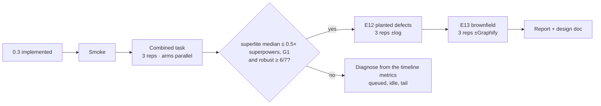

Methodology is unchanged from the design doc §5: the decider plays the human, a clean environment, scoring the last result per session, run dirs outside the repo, and the D9 prompt. Budget is $40 per arm-run. Estimated total: the combined task (3 × ~30 min), E12 (3 × 2 × ~15 min), E13 (3 × 2 × ~25 min), so about 4.5 h of wall-clock if reps run back to back. That's an estimate; the actual times of reps 1–2 are 36 and 35 min.

---

## 11. Self-review

| Check | Result |
|---|---|
| Every request you made maps to a section | Diagram skeleton → §2 and T3 · best split → §3 and T5 · no queuing, plus idle-agent reuse by relevance → §4 and T5 · same-model review plus a log-driven final review under 30 s by a fresh Opus at high effort, with a medium coordinator → §5, §8, R1 and T4/T5/T12 · finder fixes → §5 and T4 · incident log (file/line/context, plus verified entries) → §6 and T1 · parallel probe scripts, not agents → §5.1 and T11 · only real robustness probes → §5.1 · gated Graphify → §7 and T2 · generated stubs, fast-path review, early integration probes, prime overlap → §3, §4, §5 and T12/T5 · effort split considered and rejected (cache invalidation) → §8 · eight probe-speed levers → §5.2 and T3/T4/T5/T11/T12 · scripts over agents (D17) and `build_prime` → §4, §4.1 and T13/T14 · the three-part seam check with swappable fakes → §5, T4 and T12 · generated predicted schedule plus a critical-path *warning* the coordinator considers (not a failure) → §2, §3 and T12 · half of superpowers' time (G1) via the 3-min task cap, selective per-task review (batched otherwise), seam checks, coordinator report batching, parallel final suite and 15k plan cap → §3, §5, §2 and T3/T4/T5/T7/T12 · diagram rules (main and task graph always, machine-readable task graph, minis only where things interact) → §2 and T3/T12 · superpowers' planning considerations → §2 and T3 |
| Placeholders | None. The E13 library is chosen at implementation time against fixed criteria (MIT, pure Python, ≥ 10k LOC), recorded in its README |
| Type and name consistency | The CLIs in T1, T2, T11, T12 and T13 match T5's Consumes. The agent names in T4 (implementer, package-reviewer, final-reviewer) match §8 and T5; the test-runner agent is deleted (D17) |
| Parallelism | 12 of 14 tasks start together. T8 waits only on T7's metrics; T9 is last |
| Risks covered | §12 |

## 12. Risks

| Risk | Mitigation |
|---|---|
| Reviewer-fixers lose independence | Regression test per fix, the full suite, the objective probe runner, then a fresh Opus final review |
| More agents means more cold starts | Idle-pool reuse keeps warm agents busy; fresh agents read the run-wide shared prime from cache |
| Splitting to ≤3 min tasks creates more seams and coordinator turns | Seam checks are background scripts (no tokens) that run as soon as both sides commit; the merge rule stops over-splitting; the split applies only to long tasks |
| Per-task reviews add Sonnet cost | Selective: only seam, high-complexity, Review Focus or incident tasks get their own review; the rest are batched per package. About +$0.6–1.2 per run |
| The coordinator becomes a bottleneck handling reports | Reviews dispatched with commits, all pending reports handled in one turn, one-line statuses; measured as `coordinator_report_lag_s` |
| Reused agents grow large and less accurate | Eligibility limits: ≤3 tasks, ≤80k context, ≤50 min idle |
| Relevance polls add latency | The coordinator scores known matches itself; polls only on ties, with a 20 s timeout; the harness measures `relevance_poll_s` |
| Interface stubs drift from the real implementation | The stub is the contract: the implementer may not change a signature without a ruling, and `plan_tools.py contract` (the seam-check script) checks it |
| A 10-concurrent cap hits rate limits | The cap is configurable; the harness logs throttling (`api_error` events) |
| Graphify install is a supply-chain risk | Never silent: approval-gated or env-gated; pinned to `graphifyy` from PyPI by name |
| The incident log is noisy, or agents under-report | Required core fields, a 200-char cap, automatic entries from `run_tests.py`, `commit_task.py` and `probe_run.py`; E12 measures the effect |
| A final review on the critical path is still slow | Package reviews and package-level probe runs catch most defects earlier. The final review covers integration and uncovered categories only; more than 5 findings go to parallel fixers. Targets: final review ≤ 30 s, tail ≤ 6 min |
| A 30 s packet-only review misses what the logs don't show | Probing is done earlier and logged; uncovered categories are findings by themselves; the reviewer can list "needs a look at X" as a finding, which its fix step then opens. E12 measures recall |
| A medium-effort coordinator plans or schedules worse | Medium is what every benchmark so far actually ran; T9 compares the split quality and the rulings |

## 13. Decisions for you

1. ~~R1~~ **Decided:** coordinator at medium effort; final review by a fresh Opus reviewer at high effort, from a log-built packet, in one turn, under 30 s.
2. **Concurrency cap:** 10 (recommended), or let it scale to the platform's 20?
3. ~~Flows renumbered to 0.4~~ **Decided** (header ruling).
4. **E13's vendored library:** OK to vendor a public MIT library into the benchmark repo, or should I build E13 on your own repo (for example, a read-only copy of delivery-analysis)?

## Related
- Spec: [[2026-10-17-superlite-flows-design]]
- Next fix round: [[2026-10-18-superlite-0.3.1-fixes]]
- Project: [[Superlite]]

Hub: [[Plans index]]
