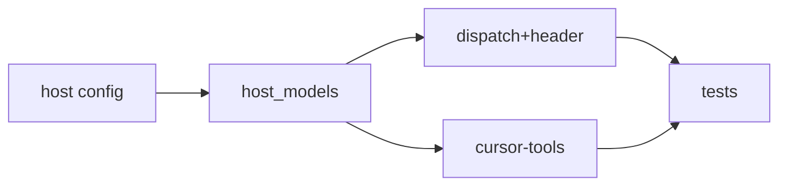

# Integration: Cursor host profile + Multitask swarms

**Goal:** Port the approved prototype into the plugin so Cursor runs get host-models + SWARM dispatch.
**Architecture:** Additive host layer; Claude path unchanged without Execution header.
**Tech stack:** Python, markdown harness maps
**Spec:** docs/plans/2026-10-22-cursor-multitask-swarms.feature.md
**Detail:** tests
**Target-min:** 10
**Review plan:** docs/plans/2026-10-22-cursor-multitask-swarms.feature.md

## Global constraints

- language: python
- FROZEN: existing `sl dispatch` line grammar (`agent=` / `poll` / `fresh` / `wave0` + `tier=`)
- FROZEN: SDD never pass `model` on Claude Code plugin agents
- Port from prototype only; no prototype stubs in Owns

### T1 host config · Complexity 1 · Est. context 8k
**Owns:** skills/subagent-driven-development/config/hosts/cursor.json
**Components:** 1
**LOC owned:** 50
**Tests:** fast
**Model:** haiku
**Kind:** mechanical
**Depends on:** —
**Produces:** config/hosts/cursor.json
**Consumes:** —
**Verify:** test -f skills/subagent-driven-development/config/hosts/cursor.json
**Done when:** jobs mechanical/build/build-hard/judge present

### T2 host_models · Complexity 3 · Est. context 20k
**Owns:** skills/subagent-driven-development/scripts/host_models.py, skills/subagent-driven-development/scripts/sl
**Components:** 1
**LOC owned:** 220
**Tests:** fast
**Model:** sonnet
**Kind:** logic
**Depends on:** T1
**Produces:** host_models.resolve(host, plan) -> dict
e.g. resolve("cursor")["host"] -> "cursor"
**Consumes:** config/hosts/cursor.json
**Verify:** bash skills/subagent-driven-development/scripts/sl host_models resolve --host cursor --force
**Done when:** sl lists host_models; resolve sticky without --force

### T3 dispatch header · Complexity 3 · Est. context 24k
**Owns:** skills/subagent-driven-development/scripts/dispatch.py, skills/subagent-driven-development/scripts/plan_tools.py
**Components:** 2
**LOC owned:** 60
**Tests:** fast
**Model:** sonnet
**Kind:** logic
**Depends on:** T2
**Produces:** Plan.header_execution() -> dict
e.g. header_execution on Execution host=cursor -> {"host":"cursor",...}
**Consumes:** host_models.resolve(host, plan) -> dict
**Verify:** python -m pytest tests/scripts/test_dispatch_swarm.py -q
**Done when:** SWARM additive; no header → no SWARM; FROZEN dispatch lines intact

### T4 cursor-tools · Complexity 2 · Est. context 12k
**Owns:** skills/using-superlite/references/cursor-tools.md, skills/using-superlite/SKILL.md
**Components:** 1
**LOC owned:** 120
**Tests:** fast
**Model:** haiku
**Kind:** mechanical
**Depends on:** T2
**Produces:** cursor-tools.md
**Consumes:** —
**Verify:** grep -q Multitask skills/using-superlite/references/cursor-tools.md
**Done when:** Pool vs Multitask documented; platform list has cursor

### T5 acceptance tests · Complexity 2 · Est. context 16k
**Owns:** tests/scripts/test_host_models.py, tests/scripts/test_dispatch_swarm.py
**Components:** 1
**LOC owned:** 180
**Tests:** fast
**Model:** sonnet
**Kind:** logic
**Depends on:** T3, T4
**Produces:** test_host_models + test_dispatch_swarm green
**Consumes:** Plan.header_execution() -> dict
**Verify:** python -m pytest tests/scripts/test_host_models.py tests/scripts/test_dispatch_swarm.py -q
**Done when:** 8 tests pass on the integration tree
