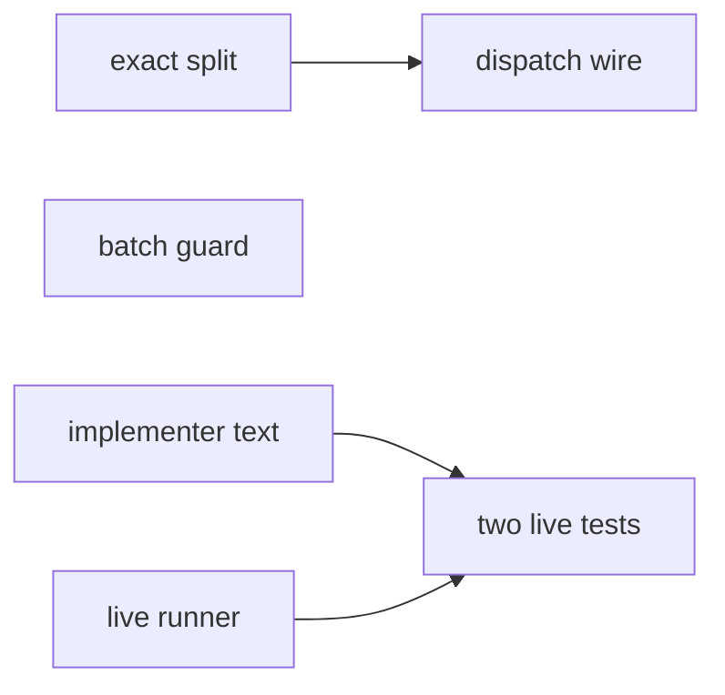

# Prototype: implementer batches (exact formula)

**Goal:** Prove the exact split, dispatch wiring, batch guard, implementer batch/question rules, and two live instruction tests.
**Architecture:** `split.choose` replaces `make_batches`; dispatch writes `dispatch.json`; one new hook rule; live runner records and denies tool calls.
**Tech stack:** Python stdlib, pytest, Claude Code headless for live tests
**Spec:** docs/plans/2026-10-24-implementer-batch.feature.md
**Detail:** tests
**Target-min:** 12
**Review plan:** docs/plans/2026-10-24-implementer-batch.feature.md
**Design:** docs/plans/2026-10-24-implementer-batch.review.md (formula, scenario table, instruction-test rules)

## Global constraints

- language: python
- test command: `python -m pytest tests/scripts/test_split.py tests/scripts/test_batching.py -q`
- FROZEN: `sl dispatch` stdout line format (`agent=` / `poll` / `fresh` / `wave0` + `tier=`)
- FROZEN: implementer reply statuses DONE / DONE_WITH_CONCERNS / NEEDS_CONTEXT / BLOCKED
- Minutes are whole tenths; scenario table rows in the design review plan must match
- Prototype keep-set only; question/tier guards, Wave 0 prose, compaction, haiku text are integration

### T1 exact split · Complexity 5 · Est. context 40k
**Owns:** skills/subagent-driven-development/scripts/split.py, tests/scripts/test_split.py
**Components:** 1
**LOC owned:** 280
**Tests:** fast
**Model:** sonnet
**Kind:** logic
**Depends on:** —
**Produces:** split.choose(minutes, busy_left, ctx, cap, cp) -> (score, F, A, batches)
e.g. choose([10,10,10,10,10], (), [0]*5, float("inf"), ())[2] -> 3
e.g. choose([10,10,10,10,10], (), [0]*5, float("inf"), ())[3] sizes -> [2,2,1]
**Consumes:** —
**Verify:** python -m pytest tests/scripts/test_split.py -q
**Done when:** every scenario row matches; 300 random lists agree with brute force; 60-task split under 1s; no empty batch; API matches review-plan pseudocode (fits, exact_split, tenths)

### T2 dispatch wire · Complexity 5 · Est. context 36k
**Owns:** skills/subagent-driven-development/scripts/dispatch.py, skills/subagent-driven-development/config/routing.json, tests/scripts/test_batching.py
**Components:** 2
**LOC owned:** 120
**Tests:** fast
**Model:** sonnet
**Kind:** logic
**Depends on:** T1
**Produces:** dispatch.plan_dispatch writes batches from split.choose; .superlite/dispatch.json
e.g. five equal ready tasks -> keys sized 1,1,1,1,1
**Consumes:** split.choose(minutes, busy_left, ctx, cap, cp) -> (score, F, A, batches)
**Verify:** python -m pytest tests/scripts/test_batching.py -q
**Done when:** make_batches replaced by choose over ready tasks (per tier); minutes from effective_times rounded to tenths; busy remaining from pool current + metrics start; dispatch.json last batches; routing batch max_tasks retired; FROZEN line format; five equal -> 1 each (finish-first); CP alone; context budget honored

### T3 batch guard · Complexity 3 · Est. context 24k
**Owns:** hooks/block-coordinator-edits, tests/scripts/test_block_coordinator_edits.py
**Components:** 1
**LOC owned:** 80
**Tests:** fast
**Model:** sonnet
**Kind:** logic
**Depends on:** —
**Produces:** batch guard denies mismatched implementer Task/Agent
e.g. prompt tasks not in dispatch.json -> deny naming printed batches
**Consumes:** —
**Verify:** python -m pytest tests/scripts/test_block_coordinator_edits.py -q
**Done when:** wrong batch denied with listed batches; exact match passes; existing three rules still pass

### T4 implementer batch and question · Complexity 2 · Est. context 16k
**Owns:** agents/implementer.md
**Components:** 1
**LOC owned:** 40
**Tests:** fast
**Model:** haiku
**Kind:** mechanical
**Depends on:** —
**Produces:** agents/implementer.md batch+question rules
**Consumes:** —
**Verify:** grep -E "NEEDS_CONTEXT|BLOCKED|any number|batch" agents/implementer.md
**Done when:** any batch size; on fail mark BLOCKED, skip later tasks whose tests run its code, build rest, one reply; on question reply NEEDS_CONTEXT at once with done and unstarted; answered task first

### T5 live instruction runner · Complexity 4 · Est. context 32k
**Owns:** tests/live/conftest.py, tests/live/runner.py, pyproject.toml
**Components:** 1
**LOC owned:** 180
**Tests:** fast
**Model:** sonnet
**Kind:** logic
**Depends on:** —
**Produces:** tests.live.runner.run_instruction(agent_md, prompt, budget=0.02) -> Outcome
e.g. Outcome.kind in {Followed, Guarded, Wrong}
**Consumes:** —
**Verify:** python -c "from tests.live.runner import run_instruction, Outcome"
**Done when:** live marker registered; default suite skips live; runner uses claude -p one turn, PreToolUse record-and-deny, costs to .superlite/instruction-test-costs.jsonl, 30s/$0.02 caps; skip when instruction hash unchanged since last pass

### T6 two live tests · Complexity 3 · Est. context 20k
**Owns:** tests/live/test_implementer_batch.py, tests/live/test_implementer_question.py
**Components:** 1
**LOC owned:** 100
**Tests:** slow
**Model:** sonnet
**Kind:** logic
**Depends on:** T4, T5
**Produces:** live tests for BLOCKED-continue and question-at-once
**Consumes:** tests.live.runner.run_instruction(agent_md, prompt, budget=0.02) -> Outcome
**Verify:** python -m pytest tests/live -m live -q
**Done when:** failed-task test Followed (BLOCKED then continue, skip dependent); question test Followed (NEEDS_CONTEXT, no file write); each under 30s and $0.02

## Review Focus

- App type: library/cli plugin scripts
- Risks: empty batch, wrong A*, dispatch line drift, live cost overruns

## Self-review

- ≤8 tasks, proto keep-set only
- T1/T2 carry scenario and five-equal acceptance
- Live tests are two of the twelve design rules
