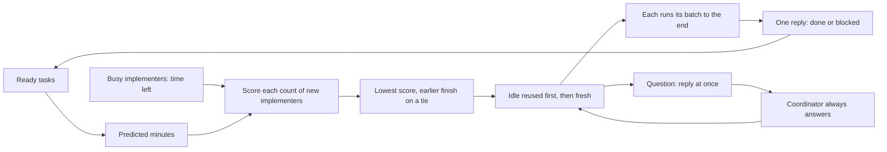
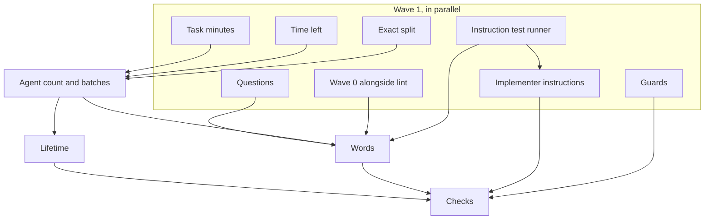

# Implementer batches: review plan

## Summary
Dispatch picks how many implementers to run and which ready tasks each one holds, from one formula that works for any task list. There is no fixed implementer count and no special case at a particular number of tasks. The formula keeps two numbers small together: how many implementers are running, and how long the wave takes measured in lengths of the longest task. It minimizes the larger of the two, and the earlier finish wins a tie. Implementers already busy count toward the total, so tasks that become ready later are packed around the work already running. Dispatch computes the formula exactly; it does not approximate it. Dependencies, failures and the 30-minute compact keep the rules superlite already has, with two small changes: an implementer carries on with its batch after a failed task, and it sends a question the moment it has one. The coordinator always answers, and the same implementer resumes its batch. Wave 0, the skeleton and stubs, starts as soon as the machine plan is written, while lint runs, instead of after lint.

## Task minutes
Dispatch takes every task's minutes from the predictor, not from a handwritten estimate. For a task that states its components, lines of code, and tests:

`1.0813 + 0.405 × components + slow + 0.002178 × loc × (80 / output_tokens_per_second)`

`slow` is `0.6068` when the tests are slow, and `0` when they are fast. `output_tokens_per_second` is 80 for Sonnet, 150 for Haiku, and 45 for Opus. A task with nothing stated uses 1 component, 100 lines, and fast tests. A handwritten "Est. time" is kept only when those three fields are missing.

Check: 1 component, 120 lines, slow tests, Sonnet is `1.0813 + 0.405 + 0.6068 + 0.002178 × 120 = 2.354` minutes before `time.scale`. The shipped `predictor.json` multiplies by `scale` (0.9 today), so dispatch sees about `2.119` minutes for that task. A machine with enough local history may refit coefficients; packing tests pin the shipped file when they need a fixed number.

Dispatch rounds each task's minutes to the nearest tenth of a minute (six seconds) and works in whole tenths, so every sum and comparison is exact. The predictor is far coarser than six seconds, so the rounding changes no decision that the minutes can support.

The constants are a ridge regression on timed tasks (shipped priors, optionally refit from `~/.superlite/history.jsonl`). Measured runs miss by about a minute and a half per task on average, so the minutes order and pack the work; they never stop an implementer.

## The assignment

### Variables
- \(n\): number of ready tasks.
- \(i\): a task, \(1\) to \(n\).
- \(m_i\): predicted minutes of task \(i\).
- \(B\): number of implementers already busy.
- \(r_k\): minutes busy implementer \(k\) still needs: the predicted minutes of its unfinished tasks minus the time since it started, never below 0.
- \(T\): the longest of every \(m_i\) and every \(r_k\).
- \(A\): number of implementers that take new tasks in this call. Idle ones are reused before fresh ones are started.
- \(j\): one of those implementers, \(1\) to \(A\).
- \(F(A)\): soonest finish with \(A\) new implementers, counting the busy ones too.
- \(A^*\): the count chosen.
- \(x_{ij}\): 1 if task \(i\) is on implementer \(j\), else 0.
- \(y_j\): 1 if implementer \(j\) is used, else 0.
- \(Z\): the score being minimized.
- \(\kappa_i\): predicted context of task \(i\), in thousands of tokens.
- \(\kappa_{\max}\): context budget of one implementer.
- \(c\): a critical-path task.

### The rule
\[
T = \max\left(\max_i m_i,\ \max_k r_k\right)
\qquad
F(A) = \max\left(\max_k r_k,\ \min_{\text{tasks split over } A} \; \max_j \sum_{i \in j} m_i\right)
\]

\[
A^* = \arg\min_{A \ge 1} \; \max\!\left( B + A,\ \frac{F(A)}{T} \right) \qquad \text{ties go to the smaller } F(A)\text{, then the smaller } A
\]

In words: for each possible number of new implementers, find the soonest the whole wave can finish, busy implementers included. Score it by whichever is larger, the total number of implementers running or the finish in longest-task lengths. Pick the lowest score. When two counts score the same, pick the one that finishes sooner. With nothing busy, \(B = 0\) and every \(r_k\) term drops out.

Every implementer the rule starts gets at least one task. If the best split for a count left one implementer empty, one fewer would finish at the same time with a lower score, and a tie goes to fewer.

Busy implementers are closed: each received its batch in one message and takes nothing more until it replies. They still count toward the total, and the work they have left can set \(T\), so new tasks are packed to finish when the running wave does.

### Reading F(A)
\(F(A)\) is the soonest the wave can finish with \(A\) new implementers, if the new tasks are split as well as possible. Read it from the inside out:

1. \(\sum_{i \in j} m_i\) adds up the minutes of every task on implementer \(j\). An implementer does its tasks one after another, so this is when it finishes.
2. \(\max_j\) takes the largest of those sums. The slowest implementer sets the finish time.
3. \(\min_{\text{tasks split over } A}\) tries every way of handing the tasks to \(A\) implementers and keeps the split whose slowest implementer finishes earliest.
4. The outer \(\max\) with \(r_k\) keeps the busy implementers in it: the wave is not done until they are.

Tasks of 10, 4, 3, and 3 minutes with \(A = 2\) and nothing busy:

| Split | Implementer 1 | Implementer 2 | Slowest |
|---|---|---|---|
| 10+4, and 3+3 | 14 | 6 | 14 |
| 10+3, and 4+3 | 13 | 7 | 13 |
| 10, and 4+3+3 | 10 | 10 | 10 |

The best split finishes at 10, so \(F(2) = 10\). With one implementer everything runs in a row, so \(F(1) = 20\).

\(F(A)\) is never less than the longest task, because a task cannot be split, and never less than the total minutes divided by \(A\). With more tasks than implementers, two of the \(A+1\) longest tasks share an implementer, so it is also never less than the \(A\)-th and \((A+1)\)-th longest added together.

Dispatch computes \(F(A)\) exactly. Listing every split is too slow past a handful of tasks, so it answers a narrower question instead: can the tasks fit on \(A\) implementers if none runs past \(C\) minutes? It answers that for one \(C\) at a time and keeps the smallest \(C\) that fits.
- The search for \(C\) runs between the lower bounds above and the finish of a quick longest-first split, halving the range each step.
- Each fit test puts the longest remaining task on a new implementer. It then tries every way to fill that implementer, fullest first, and repeats for the tasks left over.
- A fit test either returns batches or proves that none exist. It never guesses.
- Identical tasks are treated as one choice, and a set of leftover tasks already proven not to fit is never searched again.

The result is the true minimum. It matches trying every split on every list small enough to try them all. Measured in Python, it takes about 2 milliseconds for 30 ready tasks and under 20 milliseconds for 60.

Worked through for 10, 4, 3, 3 with nothing busy:

| \(A\) | Best split | \(F(A)\) | \(F(A)/T\) | Score |
|---|---|---|---|---|
| 1 | all four | 20 | 2 | 2 |
| 2 | 10, and 4+3+3 | 10 | 1 | 2 |
| 3 | 10, 4, and 3+3 | 10 | 1 | 3 |

1 and 2 tie at 2. Two finishes at 10 instead of 20, so \(A^* = 2\).

### The same rule as an integer program
\[
\begin{aligned}
\text{minimize} \quad & Z \\
\text{subject to} \quad & B + \sum_j y_j \le Z && \text{implementer count} \\
& \sum_i m_i x_{ij} \le Z \cdot T && \text{each new implementer's minutes, in longest-task lengths} \\
& r_k \le Z \cdot T && \text{each busy implementer's remaining minutes} \\
& \sum_j x_{ij} = 1 && \text{every ready task runs once} \\
& x_{ij} \le y_j && \text{only used implementers hold tasks} \\
& \sum_i \kappa_i x_{ij} \le \kappa_{\max} && \text{context budget per implementer} \\
& x_{cj} = 1 \Rightarrow \sum_i x_{ij} = 1 && \text{a critical-path task } c \text{ runs alone} \\
& x_{ij}, y_j \in \{0,1\}
\end{aligned}
\]

### Equal tasks, nothing busy
When every task has the same minutes, \(F(A)/T = \lceil n/A \rceil\), so the rule reduces to

\[
A^* = \arg\min_{A} \; \max\!\left( A,\ \left\lceil \frac{n}{A} \right\rceil \right)
\]

which lands near \(\sqrt{n}\): implementers and tasks per implementer stay about the same size. Sixteen equal tasks give 4 implementers with 4 each. Seventeen give 5 implementers holding 4, 4, 3, 3, and 3: four and five both score 5, and five finishes sooner.

### Pseudocode
All minutes are whole tenths of a minute.

```
B = busy implementers;  r = minutes each still needs
T = longest of the ready tasks' minutes and r
solo = critical-path tasks, each on its own implementer
rest = the other ready tasks, longest first
fixed = longest of the solo tasks' minutes and every r

# 1. A score each count can surely reach, from a quick longest-first split
for A = max(1, size of solo) .. n:
    k = A - size of solo                      # implementers for the rest
    reach[A] = max(B + A, max(longest_first(rest, k), fixed) / T)
               (none if the context budget does not fit)
U = smallest reach[A]

# 2. Solve exactly every count that could still win or tie
best = none
for A, smallest first:
    k = A - size of solo
    low = max(longest task in rest, ceil(total of rest / k),
              k-th longest + (k+1)-th longest)
    if max(B + A, max(low, fixed) / T) > U:
        skip A                                # even its best split cannot win or tie
    F, batches = exact_split(rest, k)
    if no split fits the context budget:
        skip A
    F = max(F, fixed)
    score = max(B + A, F / T)
    if best is none or (score, F) < (best.score, best.F):    # a tie goes to the earlier finish, then fewer
        best = (score, F, A, batches + solo)
return best.batches                           # idle implementers are reused first, then fresh ones

exact_split(tasks, k):
    lo = low above;  hi = finish of longest_first(tasks, k)
    while lo < hi:                            # smallest C that fits
        C = (lo + hi) / 2, rounded down
        if fits(tasks, k, C): hi = C  else: lo = C + 1
    return hi, the batches fits returned for hi

fits(tasks, k, C):                            # k implementers, each at most C minutes and the context budget
    if no tasks: yes
    if k == 1: yes when all of them fit C and the budget
    if (k, these tasks) was already proven not to fit: no
    open a batch with the longest task
    for each way to fill that batch, fullest first:
            at most C, within the budget, at least total - (k - 1) * C,
            and an identical task left out leaves its twins out too
        if fits(the tasks left, k - 1, C): yes, with this batch
    remember (k, these tasks) does not fit; no
```

## Dependencies
- **Most dependencies do not wait.** A task that only calls another task's interface builds against its stub and examples. Only a task whose tests run another task's code has a real edge, and lint removes edges that examples make unnecessary.
- **Only ready tasks are batched.** A task is ready once everything it depends on is checkpointed. A producer and its dependent are never in one batch, so a dependent arrives in a later dispatch call, where the busy implementers are counted.
- **Producers that others wait on run alone.** A batch is checkpointed when its implementer replies, so a producer inside a long batch would hold its dependents. Critical-path tasks therefore run alone and are checkpointed as soon as they are done. A producer off the critical path may be batched: the run has slack there, so a later checkpoint does not push out the finish.
- **Dependents go back to the producer's implementer.** Assignment already gives an idle implementer 5 points for having built one of a task's dependencies, so a dependent usually returns to the implementer that already has the producer's code in context.
- **Wave 0 provides the stubs.** Interface-only consumers build against the stubs Wave 0 writes.

## Wave 0 alongside lint
Today `lint --stable` writes the Wave 0 brief and prints it last, so the skeleton agent waits for the whole lint. Wave 0 needs only the plan's Produces lines, Global constraints, and test command, so it can start earlier.
- **When the machine plan is written** (after your approval, with a human orchestrator), the coordinator runs `sl wave0 --plan` and sends the Wave 0 implementer in the same message that starts `lint --stable`.
- **Lint stops printing Wave 0** once it has been sent. `lint --stable` still writes the brief when Wave 0 has not started, so a run that skips the early start loses nothing.
- **A lint fix that changes a Produces line** leaves a stub stale. Lint names those lines, and the coordinator sends a short stub update to the Wave 0 implementer, or to a fresh one if it has finished. Tasks that use the changed interface wait for that update.
- **No Wave 0 is needed** for a change to an existing project that adds no new interfaces. Then nothing is sent.
- Wave 0 takes one implementer slot. The formula counts it as busy, with its predicted minutes as its time left.

## Failures inside an implementer
- **The batch carries on.** When a task fails (tests stay red or the implementer is stuck), it marks that task BLOCKED with the reason, skips any later task in the batch whose tests run the failed task's code, and builds the rest. It sends one reply at the end.
- **A question is sent the moment the implementer has one.** The implementer stops and replies at once: NEEDS_CONTEXT, the question, the tasks it has finished, and the ones it has not started. Replying is how an implementer reaches the coordinator on every harness, so the question arrives immediately. The tasks it finished are checkpointed then.
- **The coordinator always answers.** It answers from the plan, the spec, and the code. It never skips the task, defers it, or sends it elsewhere. When the plan does not settle the question, the coordinator decides, records a `Ruling:` line in the plan, and answers with that ruling. With a human orchestrator, you see every ruling in the plan and at the finish.
- **The same implementer resumes.** The answer goes to that implementer, which still has the context. It builds the answered task first, then the rest of its batch, and replies once at the end. Until then it counts as busy, with the minutes it has left.
- **BLOCKED or red** goes to a fixer one tier up. Fixers are separate from implementers, so the failed task simply leaves the batch.
- **A failed checkpoint** (unowned files, syntax or import errors) goes back to the implementer.
- **A failed Haiku task** goes to the Sonnet fixer, the miss is logged, and it is never retried on Haiku.
- **Dependents wait** until the failed task is fixed and checkpointed; they become ready in the next dispatch.

## Scenarios
Every row was run through the exact method above and matches. When several splits finish at the same time, the row shows the one the method returns.

| Ready tasks | Busy implementers (minutes left) | New implementers | What each new one holds | Finish |
|---|---|---|---|---|
| Four of 10 minutes | none | 2 | 2 and 2 | 20 |
| Five of 10 minutes | none | 3 | 2, 2, 1 | 20 |
| Sixteen of 6 minutes | none | 4 | 4 each | 24 |
| Seventeen of 6 minutes | none | 5 | 4, 4, 3, 3, 3 | 24 |
| Twenty of 6 minutes | none | 5 | 4 each | 24 |
| Twenty-one of 6 minutes | none | 5 | 5, 4, 4, 4, 4 | 30 |
| Twenty-five of 6 minutes | none | 5 | 5 each | 30 |
| Twenty-six of 6 minutes | none | 6 | 5, 5, 4, 4, 4, 4 | 30 |
| One hundred of 6 minutes | none | 10 | 10 each | 60 |
| 10, plus 4, 3, and 3 | none | 2 | the 10, and 4+3+3 | 10 |
| 10, plus 6 and 6 | none | 2 | the 10, and 6+6 | 12 |
| 30, plus 10, 10, 10, 8, 6, 4, 2 | none | 2 | 30+8+2, and 10+10+10+6+4 | 40 |
| 30, plus twelve of 2 | none | 1 | all thirteen | 54 |
| 30, plus twenty of 2 | none | 2 | 30+2+2+2, and seventeen of 2 | 36 |
| 10, plus eight of 1 | none | 1 | all nine | 18 |
| A critical-path 4, plus two of 2 | none | 2 | the 4 alone, and 2+2 | 4 |
| Three of 6 minutes | one, 20 | 1 | all three | 20 |
| Three of 6 minutes | four: 20, 15, 12, 8 | 1 | all three | 20 |
| Ten of 3 minutes | one, 30 | 1 | all ten | 30 |
| Four of 6 minutes | two: 12, 5 | 1 | all four | 24 |
| Tasks whose minutes fit together but whose context does not | any | one more than minutes alone would pick | the overflow task on its own implementer | set by the split |

## What you will get
- One rule for any number of tasks, picking the implementer count and the batches together, computed exactly.
- Wave 0 building while lint runs, instead of after it.
- Equal tasks spread so implementers and tasks per implementer stay about the same, near the square root of the task count.
- Mixed tasks packed against the longest one, with another implementer added only when the wave is longer than the implementer count in longest-task lengths.
- Tasks that become ready later packed around the implementers already running, instead of each small group getting its own.
- Predicted minutes in place of handwritten estimates for every packing decision.
- An implementer that keeps working until every task in its batch is done, carries on past a failed task, and compacts every 30 minutes.
- An explicit agent ceiling that still limits how many implementers run; the formula picks the best count under it.

## What will be built
| Part | What it does | Size | Built by |
|---|---|---|---|
| Task minutes | Uses the predictor's minutes for every ready task | S | a careful helper |
| Exact split | Finds the true soonest finish and its batches for a given implementer count, within the context budget | M | a careful helper |
| Agent count and batches | Scores each implementer count, busy ones included, solves exactly the counts that could win, and keeps the best | M | a careful helper |
| Wave 0 alongside lint | Sends Wave 0 when the machine plan is written, stops lint printing it again, and names Produces lines a lint fix changed | S | a careful helper |
| Time left | Works out how long each busy implementer still needs from its tasks' minutes and its start time | S | a careful helper |
| Lifetime | Lets an implementer finish however many tasks its batch holds before it is retired | S | a careful helper |
| Implementer instructions | Carry on after a failed task, skip its dependents in the batch, reply at once with a question and the unstarted tasks, resume with the answered task first | S | a fast helper |
| Questions | Checkpoints the finished part of a batch when a question arrives, keeps the implementer busy with its unstarted tasks, and tells the coordinator to always answer, with a ruling when the plan is silent | S | a careful helper |
| Words | Tells the coordinator how the count is chosen, when to send Wave 0, and about the 30-minute compact | S | a fast helper |
| Checks | One check per scenario row, the exact split against trying every split, the failure and question cases, and Wave 0 before lint ends | S | a careful helper |
| Guards | The batch, question, and tier guards in the coordinator's hook, each with free tests that it denies the wrong call, names the right move, and lets the right call pass | S | a careful helper |
| Instruction tests | The twelve one-rule tests below, the three-outcome result, the one-turn runner that records and blocks tool calls, the cost and time limits, the cost log, and the skip for unchanged instructions | S | a careful helper |

## How it fits together


## How it gets built


## Decisions you can change
- Objective: \(\max(B+A, F/T)\) (default; kept after sitegen A/B — see `docs/specs/2026-10-25-implementer-batch-objective.md`) | finish-first \(\arg\min(F,A)\), which packs denser and raised wall/cost on that bench
- Score: the larger of implementer count and wave length in longest-task lengths (default) | their sum, which favours fewer implementers
- Ties: earlier finish (default) | fewer implementers, which puts seventeen equal tasks on 4 implementers
- Busy implementers: counted, with their time left setting the target (default) | ignored, each dispatch call packs its own tasks alone
- Task minutes: the predictor (default) | a handwritten Est. time even when components, lines, and tests are present
- Split: exact, in whole tenths of a minute (default) | longest-first, faster on very large lists but up to about a third late
- Wave 0: sent when the machine plan is written, alongside lint (default) | after lint, as today
- Questions: sent at once, always answered by the coordinator, and the same implementer resumes (default) | questions that change the plan wait for you
- Explicit ceiling: limits the count, formula picks the best under it (default) | ignored
- Critical path and context: a critical-path task runs alone, and a batch stops when the context budget is full (default) | ignore both
- Instruction tests: each on the model its role uses (default) | all on Haiku, cheaper still, but they no longer prove what Sonnet and Opus do
- Commits: leave this work uncommitted until you ask (default) | commit each task on this branch

## Risks
- The predictor misses a task by about a minute and a half on average, so a batch can finish a little early or late, and time left for a busy implementer is an estimate. The implementer finishes its batch anyway.
- Large task lists produce big batches, for example ten tasks each at one hundred tasks. Long batches lean on the 30-minute compact and on the context budget.
- The rest of a batch pauses while the coordinator answers a question, usually for under a minute. A ruling made without you can be wrong; it is recorded in the plan, so you can overturn it and the task can be fixed.
- The lifetime limit on an implementer has to follow the batch size, or a large batch is retired before it is done.
- The exact split is exponential in the worst case. Measured lists of up to 60 tasks finish in milliseconds, but an unusual list could take longer. The check measures a 60-task list so a slowdown shows up.
- Wave 0 can start from a plan that lint then fixes. A changed Produces line costs one stub update, and the tasks that use it wait for that update.

## Out of scope
- Starting task implementers other than Wave 0 before lint finishes, linting longest tasks first, and lint releasing results task by task.
- Linting each task inside its implementer.
- Release times for broken or dependent tasks inside the formula.
- Putting a producer and its dependent in one batch.
- Complexity weights, and stopping an implementer because a batch reached six minutes.
- The prototype UI work on the other branch.

## How we will know it works
- Each scenario row happens as written.
- On 300 random lists of up to 6 tasks, with busy implementers, context budgets, and critical-path tasks, the chosen count, finish, and score equal those from trying every split.
- No chosen implementer is ever empty, on random lists with busy implementers, context budgets, and critical-path tasks.
- The exact split of 60 tasks of mixed minutes takes under one second.
- Wave 0 is sent before `lint --stable` finishes, and lint does not print it a second time.
- A lint fix that changes a Produces line is named, and a stub update follows.
- A failed task in the middle of a batch leaves the tasks after it built, except those whose tests run its code.
- A question in the middle of a batch reaches the coordinator at once, with the finished tasks checkpointed. The coordinator answers it (with a recorded ruling when the plan is silent), and the same implementer builds the answered task first and then the rest of its batch.
- Every instruction test below fails on the old instructions and ends Followed on the new ones, each within 30 seconds and $0.02, with its outcome and cost shown. A Guarded result passes but is listed for a clearer instruction.
- Each guard denies its wrong call, names the right move, and lets the right call pass, tested without a model.
- Compact stays every 30 minutes.
- One component, 120 lines, slow tests, and Sonnet produce 2.354 minutes before scale (about 2.119 with shipped `scale` 0.9).

## Agent instruction tests
The checks above test the scripts. These test the instructions the agents follow. Each test is small: it proves one rule from one instruction file, with one short agent call that finishes in seconds and costs about a cent. They are written while the feature is built, the same way as code tests: write the test, see it fail on the old instructions, change the instructions, see it pass.

### One test, one rule
Each test has three parts:
- **The situation.** A few lines that put the agent at one decision point, for example "task T1 is done; task T2 says 'return the parsed value' and does not say which type".
- **The real instructions.** The instruction file is read as it is in the repo (`agents/implementer.md`, `agents/implementer-haiku.md`, or the coordinator's skill), not a copy, so a change to the file is what gets tested.
- **One decision.** The agent gets one turn, with up to three tool calls so a reroute can be seen. The repo's real guard hooks are active. A tool call that gets past them is recorded and not run, so nothing is built.

### Three outcomes
Every test ends in exactly one of three results, and the run shows which:
- **Followed:** the agent's first move is the expected one, and no guard fired. Pass.
- **Guarded:** the first move was wrong, a named guard denied it, and the agent's next move is the expected one. This passes, because the run stays safe, but it is flagged: the instruction alone did not hold, so it should be made clearer.
- **Wrong:** a wrong move got through, or after a guard's denial the agent did something else wrong or unexpected, or gave up. It is also Wrong when a guard denied the expected move, because that is a guard bug. Fail.

A rule with no guard can only be Followed or Wrong. Each guard is also tested for free, without a model: the wrong call is fed straight to the hook, and the test checks that it is denied, that the reason names the right move, and that the right call passes.

### The tests
| Rule | Instruction file | Expected move | Guard that catches the wrong move |
|---|---|---|---|
| A question is sent at once | implementer | A NEEDS_CONTEXT reply naming the question, without writing a file of the ambiguous task | none; Followed or Wrong only |
| The reply lists what is done and what is not | implementer | The reply names T1 as done and T2 and T3 as not started | none |
| An answered task comes first | implementer | Its first tool call works on the answered task, not the next one | none |
| A failed task does not stop the batch | implementer | BLOCKED for T2, then a move to T4, skipping T3, whose tests run T2's code | none |
| A batch is built in the order given | implementer-haiku | Its first tool call works on the first task listed | none |
| Dispatch lines are followed as printed | coordinator | Exactly the launches `sl dispatch` printed: three implementers with 2, 2, and 1 tasks, none empty, none extra | new batch guard |
| Wave 0 starts alongside lint | coordinator | The Wave 0 launch and `lint --stable` in the same message | none; waiting for lint is slow, not unsafe |
| A question is always answered | coordinator | A message to the same implementer with an answer. There is no fixer, no new agent, and no skip. | new question guard |
| The coordinator does not answer by writing the code itself | coordinator | An answer to the implementer, not an edit of the task's files | existing `block-coordinator-edits` |
| A silent plan gets a ruling | coordinator | A `Ruling:` line written to the plan before the answer is sent | none |
| BLOCKED goes up a tier | coordinator | A launch of the fixer one tier above the implementer | new tier guard |
| Nothing is built before your approval | coordinator | No Wave 0 or implementer launch while the plan awaits you | existing approval gate in `block-coordinator-edits` |

### New guards
Three small additions to the coordinator's PreToolUse hook. Each reads state the scripts already write, and each denial names the right move:
- **Batch guard.** An implementer launch or task message whose tasks are not exactly one batch that `sl dispatch` last printed is denied, and the denial lists the printed batches. This also stops an empty or extra implementer.
- **Question guard.** While a task waits for an answer, a fixer or a new implementer for that task is denied: "answer the implementer that asked".
- **Tier guard.** For a BLOCKED task, a fixer below the required tier is denied, and the denial names the right fixer.

Choices made by scripts are not tested here. The script checks already prove them: the implementer count, critical-path tasks alone, busy implementers counted, and the lifetime limit.

### Cost and time
- Every test prints its outcome (Followed, Guarded, or Wrong), its seconds, tokens, and dollars, read from the agent call's own result, and the run prints the total. Each run is appended to `.superlite/instruction-test-costs.jsonl`, so cost can be watched over time.
- Each test is stopped at 30 seconds or $0.02. Exceeding either is a failure.
- Expected: 5 to 20 seconds and about $0.002 to $0.02 per test. All twelve together take about two minutes and cost about $0.10 to $0.15. The guard tests without a model cost $0 and run in the free suite.
- A test whose instruction file has not changed since it last passed is skipped and costs $0, so a normal run is just the one or two tests for the rule being changed.
- The tests are marked `live`. The free suite never runs them; `pytest -m live -k <rule>` runs one.

### Honest results
Agents are not deterministic. A failing test is run once more, and both results are shown. A rule that fails twice means the instruction is unclear, and it is rewritten. A pass on the second try is reported as flaky, not hidden.

## Rough time and cost
About 30 to 50 minutes and a few dollars for the build (rough, until the machine plan is linted). The instruction tests take seconds each, about two minutes and $0.10 to $0.15 for all twelve, and $0 for a rule whose instructions have not changed.
