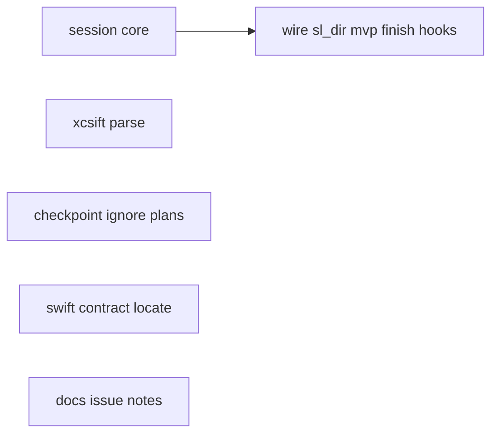

# Issues #2, #3, #4: listing, sessions, Swift/multi-repo bugs

**Goal:** Investigate and execute on GitHub issues 2–4: accept the awesome-ai-plugins listing (outward PR deferred), add deletable per-worktree sessions so concurrent superlite runs do not collide, and fix or close still-valid items from issue #4.
**Architecture:** One `session` tool owns lifecycle and path resolution; `orchestrator.sl_dir` and MVP/hooks route through it; peers stay project-level. Issue #4 fixes stay local to `testcmd`, `checkpoint`/`gitignore`, and `pt_review`.
**Tech stack:** Python 3.10+, bash hooks, pytest
**Detail:** tests
**Target-min:** 45
**Orchestrator:** AI

## Rulings

- Ruling: AI orchestrator (user asked to execute)
- Ruling: detail=tests
- Ruling: issue #2 outward PR deferred (no fork to hashgraph-online); document ready README entry
- Ruling: sessions under `.superlite/sessions/<id>/`, self-clean on `finish` (and on host restart via `session start`); stop keeps the session for resume; peers/worktrees/sandboxes stay shared
- Ruling: issue #4 #3 not valid against current packet (working-tree diff)
- Ruling: issue #4 #2 Swift parallel compile races: document only this pass
- Ruling: issue #4 #6/#7 multi-repo: document known limits

## Design

### Issue #2
Accept the listing. Ready entry for `### Development & Workflow` (alphabetically near similar workflow plugins):

```markdown
- [superlite](https://github.com/iha2/superlite) - Build-lifecycle plugin that plans work, runs parallel subagent waves, and drives TDD, debugging, and branch finishing across Claude Code, Cursor, Codex, and other harnesses.
```

Cannot open the PR from this agent (no fork permission). Maintainer submits or retries with credentials.

### Issue #3 — sessions
```
.superlite/
  sessions.json          # registry: ids, by_host, created
  active                 # last-started id (hook fallback when env unset)
  sessions/<id>/         # per-session run state (orchestrator, mvp, pool, …)
  peers.json             # SHARED
  worktrees/ sandboxes/  # SHARED
```

- `sl session start|end|status|path` (+ library used by orchestrator/mvp/finish/hooks)
- Resolution: `SUPERLITE_SESSION` → host map → `active` → legacy flat `.superlite` when no `sessions/`
- Second start always gets a new id (no MVP overwrite); same `--host-session` ends the previous tree first
- **Self-cleanup:** `sl finish` always calls `session end` (id from ledger path if needed); empty registry removes `sessions.json` / `active` / empty `sessions/`; stop does not end (resume)
- Back-compat: existing flat layout unchanged until a session is started

### Issue #4
| # | Verdict | Action |
|---|---|---|
| 1 xcsift counts | STILL VALID | Parse JSON `passed_tests` / `failed_tests` in `testcmd.parse_output` |
| 2 Swift parallel exit 65 | STILL VALID | Document; no compile lock |
| 3 packet base..HEAD | FIXED / not in code | Comment: already `git diff <base>` (working tree) |
| 4 Swift contracts | STILL VALID | Find `.swift` files; skip Python introspection with clear skip |
| 5 commit_task plan docs | PARTIAL | Never-block `docs/plans/`, `docs/specs/` |
| 6 orchestrator end wrong repo | PARTIAL | Document; session/finish bind to resolved cwd state |
| 7 plan in other repo | STILL VALID | Document: keep plan under each repo’s tree |

## File structure

- `skills/swarm/scripts/session.py` — lifecycle + resolve
- `skills/swarm/scripts/orchestrator.py` — `sl_dir` via session; project root helper for exclusive
- `skills/swarm/scripts/exclusive.py` — peers at project `.superlite`
- `skills/swarm/scripts/mvp_check.py` — page/feedback under session state dir
- `skills/swarm/scripts/finish.py` — end session after summary
- `skills/swarm/scripts/testcmd.py` — xcsift/JSON counts
- `skills/swarm/scripts/checkpoint.py` / `config/gitignore.json` — never-block plans/specs
- `skills/swarm/scripts/pt_review.py` — Swift locate + non-Python skip
- hooks — resolve session state dir (active / SUPERLITE_SESSION)
- `tests/scripts/test_session.py` (+ extend testcmd, gitignore, pt_review, mvp)
- `docs/language.md` — Swift / multi-repo notes

## Task graph



T3, T4, T5, T6 are independent of T1/T2 except docs may mention sessions.
