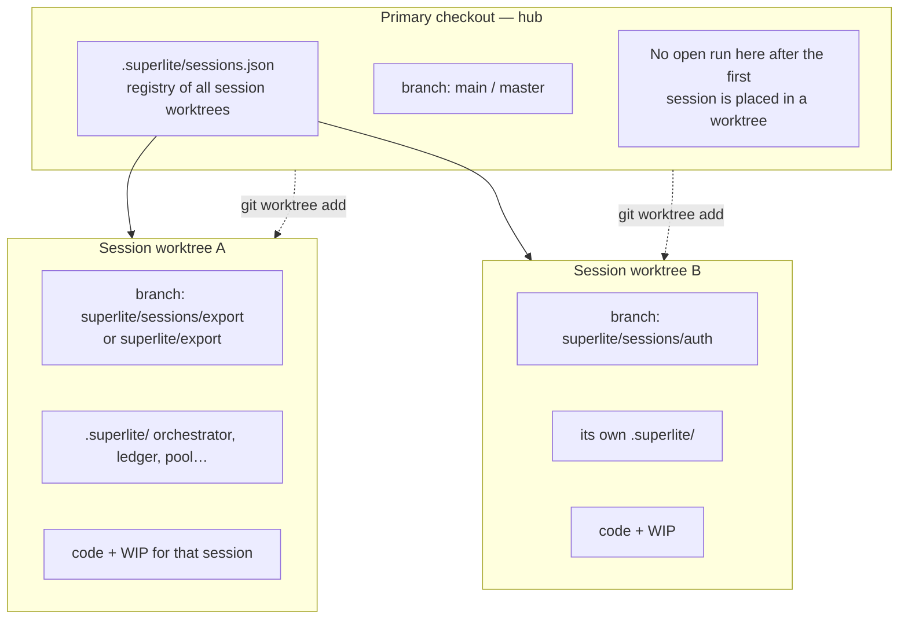
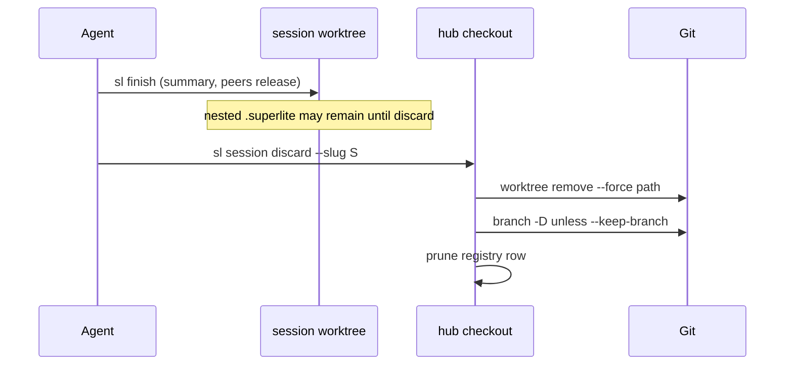

# Feature: Worktree-and-branch sessions

## Goal

Make sessions efficient with **worktrees + branches**, and define hard rules for **switching** so WIP and run state park and restore correctly (stash/apply when needed). Who it is for: anyone running more than one superlite line of work who wants isolation without always paying for another full checkout.

This PR already ships a first cut (`sl session split` + docs). This feature **augments that cut** into: create, register, **switch (use)**, discard, and finish cleanup — plus the switch rules below.

**Out of scope for this feature (decide later):** in-checkout-only `sessions/<id>/` as the primary model; rich host-session binding across harness chat ids.

## What changes

**Target kind:** `cli` / agent-orchestrated (commands + `sl` tools + docs). No web UI.

### Mental model (branches and worktrees)



| Idea | Rule |
|---|---|
| Session | One line of work: a branch + parked run state + optional WIP stash |
| Branch | `superlite/sessions/<slug>` — home branch for that session |
| Worktree | A checkout that *hosts* one or more sessions. Prefer **one shared session worktree** and switch sessions inside it (saves space). Cut a **second** worktree only when two sessions must be live in parallel (two agent roots / two dirty trees at once). |
| Hub | Primary checkout on base; holds the registry |
| Feature proto / integration | Unchanged paths under `sandboxes/` and `worktrees/<topic>/` |

**Namespace.** Session host worktree default: `.superlite/worktrees/sessions/host` (or the first created session worktree). Per-session parked state: `.superlite/session-store/<slug>/` on the **hub** (or inside the host worktree’s project container — see switch rules). Branches: `superlite/sessions/<slug>`.

### Switch rules (stash / apply / park)

Switching sessions means: leave session A, enter session B **in the same worktree** (space-saving path). `sl session use --slug B` implements these rules; agents must not ad-hoc `git switch`.

```mermaid
sequenceDiagram
  participant Use as session use --slug B
  participant WT as session host worktree
  participant Store as session-store
  participant Git

  Note over WT: Currently on session A
  Use->>WT: 1. Refuse if merge/rebase in progress
  Use->>Store: 2. Park run state: move .superlite/run → session-store/A/
  Use->>Git: 3. If dirty: stash push -u -m "superlite-session:A"
  Use->>Store: 4. Record stash ref / oid on registry row A
  Use->>Git: 5. git switch superlite/sessions/B
  Use->>Store: 6. Restore run state: session-store/B/ → .superlite/run
  Use->>Git: 7. If B has a parked stash: stash apply (then drop only if clean)
  Use->>WT: 8. Point active → B; print status
```

**Rules (normative):**

1. **Active session** — exactly one per host worktree (`registry.active` or `sessions.json` active pointer). All `sl` tools in that cwd use that session’s restored run dir.
2. **Park before leave** — never `git switch` away from A while A’s `.superlite/` run files or dirty WIP remain live.
3. **Run state ≠ stash** — `.superlite/` is gitignored; `git stash` does **not** save it. Always **move/copy** the run tree to `session-store/<slug>/` on park, and move it back on enter. Stash is only for tracked/untracked **project** files.
4. **Stash when dirty** — if `git status --porcelain` is non-empty after parking run state: `git stash push -u -m "superlite-session:<slug>"`. If clean: no stash; registry `stash: null`.
5. **Switch branch** — `git switch superlite/sessions/<slug>` (create with `create` if missing). Fail if that branch is checked out in another worktree.
6. **Restore on enter** — move `session-store/<slug>/` back to the live run path; if registry has a stash for B, `git stash apply` (prefer apply + keep until verified clean, then drop; never `stash pop` on conflict — abort switch restore and report).
7. **Conflicts** — if stash apply conflicts: leave branch on B, run state restored, stash kept, exit non-zero with “resolve conflicts, then `sl session use --slug B --continue`”.
8. **Parallel exception** — if two sessions need to be dirty at once, `session create --worktree` (second host worktree) instead of switch. No stash dance across two live trees.
9. **Space default** — prefer switch (one worktree, many branches + store) over split/create-extra-worktree unless the user asks for parallel or start-menu “separate into worktrees” for a second live chat.

**Live run path inside the host worktree:** keep a single live `.superlite/` for tools that already expect it (FROZEN flat orchestrator discovery), fed by park/restore from `session-store/<slug>/`. Do not require every tool to learn session ids on day one.

### Lifecycle

```mermaid
stateDiagram-v2
  [*] --> Hub: clone / open repo on base
  Hub --> Host: session create --slug S\n(host worktree + branch)
  Host --> Host: invent on active session
  Host --> Host: session use --slug T\n(park/stash/switch/restore)
  Host --> Host: session create --slug U\n(new branch + store row;\nsame host unless --worktree)
  Host --> Gone: session discard --slug S
  Hub --> Host: session split\n(second live worktree /\nparallel exception)
  Gone --> [*]
```

### Create (no open run required)

Today `split` only works when `orchestrator.json` exists. Efficient session creation needs:

```text
sl session create --slug auth [--base main]
→ worktree .superlite/worktrees/sessions/auth on branch superlite/sessions/auth
→ empty nested .superlite/ (ready for /superlite:start)
→ registry row appended (not overwritten)
→ print: cd / open that path; start there
```

`split` becomes the special case of create: move the *current* open run into `sessions/<keep>`, then `create` for `--new`.

### Registry (durable, N sessions)

Replace the two-row overwrite with an append/update registry on the hub:

```json
{
  "v": 2,
  "base": "main",
  "active": "export",
  "host_worktree": "…/worktrees/sessions/host",
  "sessions": [
    {
      "slug": "export",
      "branch": "superlite/sessions/export",
      "worktree": "…/worktrees/sessions/host",
      "store": "…/session-store/export",
      "stash_message": "superlite-session:export",
      "has_stash": true,
      "status": "parked",
      "created_at": 0
    }
  ]
}
```

`status`: `active` (live in host), `parked` (in store ± stash), `finished`, `parallel` (owns a dedicated worktree). Feature sandboxes stay out of this list.

### Split (augment existing)

Keep the user-facing start-menu ask. Internally:

1. Ensure hub is on base (or return to base).
2. Place the open run’s branch + WIP + nested `.superlite/` into `worktrees/sessions/<keep>`.
3. `create` the new slug.
4. **Append** both to the registry; never drop other live sessions.

### Discard / finish



Mirror `sl proto discard` semantics. Document that `finish` alone does not delete the worktree (same as today for feature integration); discard (or an explicit finish flag later) does.

### Start menu / hooks

- **Start something new** → create or split as today, then instruct moving the agent root into the new worktree.
- `hooks/session-start`: project state remains based on **cwd** `.superlite/orchestrator.json` (correct once the agent is inside the session worktree). Optionally mention registry sessions when cwd is the hub with no open run but `sessions.json` lists actives (“sessions open in worktrees: …”).

### What the user sees / does differently

| Action | Today (#21 cut) | After this feature |
|---|---|---|
| Second request (serial, save space) | Ask → always new worktree | Prefer `session create` + `session use` (stash/park/switch) on one host worktree |
| Second request (parallel chats) | `split` → two worktrees | Same: split / `create --worktree` (parallel exception) |
| Switch back to earlier work | Manual | `session use --slug` with the switch rules |
| Done with a session | Manual `git worktree remove` | `session discard --slug` (drop store + stash + branch unless keep) |
| List | last split only | All sessions: active/parked/parallel + branch + stash flag |

Commands: `create`, `use` (switch), `status`, `split`, `discard`.

## Acceptance checks

1. `sl session create --slug auth` on a clean hub creates the host worktree (if needed), branch `superlite/sessions/auth`, registry row, and makes `auth` active with a live run path ready for `/superlite:start`.
2. With dirty files + an open run on `export`, `sl session use --slug auth` parks `.superlite` under `session-store/export`, stashes WIP with message `superlite-session:export`, switches to `auth`’s branch, restores `auth`’s store (empty if new), and leaves `export` as `parked` with `has_stash: true`.
3. `sl session use --slug export` restores export’s run state and applies its stash; project files match pre-park content when there was no conflict.
4. Stash apply conflict: non-zero exit, run state for the target session restored, stash retained, clear `--continue` instruction; no silent `stash pop`.
5. `sl session split` / `create --worktree` still creates a second worktree for parallel use without parking the first (parallel exception).
6. `sl session status` lists every session with slug, branch, status (active/parked/parallel), and stash flag.
7. `sl session discard --slug auth` drops store + stash ref + branch (unless `--keep-branch`); if it was the only session in a dedicated parallel worktree, remove that worktree; other sessions untouched.
8. Docs state the switch rules (including “stash does not hold `.superlite`”); proto/feature paths remain FROZEN; existing split tests updated or superseded.

## Code map

**Entry / stand-up**

- `skills/swarm/scripts/session.py` — `create`, `use` (switch rules), registry v2, `discard`, keep `split`/`status`.
- `commands/start.md` — Start something new: prefer create+use (serial) vs split (parallel).
- `docs/sessions.md` — hub, host worktree, switch rules, mermaid.
- `hooks/session-start` — optional: list parked sessions when registry present.

**Patterns to reuse**

- Current split: stash + move `.superlite`.
- `proto.py` discard for parallel worktree removal.

**Touched tests**

- Expand `test_session_split.py` / add `test_session.py`: create, use (dirty park/restore), use conflict, discard, split parallel.

**Interfaces that must not change (FROZEN)**

- `sl proto *`, `feature.json`, tryout gates.
- Live tools still see a normal `.superlite/orchestrator.json` when a session is active (park/restore behind `session use`).
- Feature integration path `.superlite/worktrees/<topic>`.

**Conventions / toolchain**

- Branch prefix `superlite/sessions/`; store `.superlite/session-store/<slug>/`; host `.superlite/worktrees/sessions/host`.
- Stash message exact: `superlite-session:<slug>`.

## Prototype scope

**Keep:** create / use / status / discard on one host worktree with real stash + park/restore; pytest temp repo; docs for the nine switch rules.

**Stub:** auto-cd in harness; finish auto-discard; multi-host parallel beyond one split path.

**Level:** L1. **Run:** `python -m pytest tests/scripts/test_session*.py -q`.

## Integration outline

1. Registry v2 + `session-store` + host worktree on this PR.
2. Implement `use` with the switch rules; tests for dirty and conflict paths.
3. Retarget `split` as parallel exception; start.md copy.
4. Rewrite `docs/sessions.md`.
5. Seam: proto tests green.

## Design notes

- **Space:** default = one host worktree + many session branches; park/stash on switch. Extra worktrees only for parallel.
- **Stash is not enough** for superlite state — rule 3 is the load-bearing one.
- Branch-per-session gives cheap history; worktree-per-parallel-session gives concurrency.
