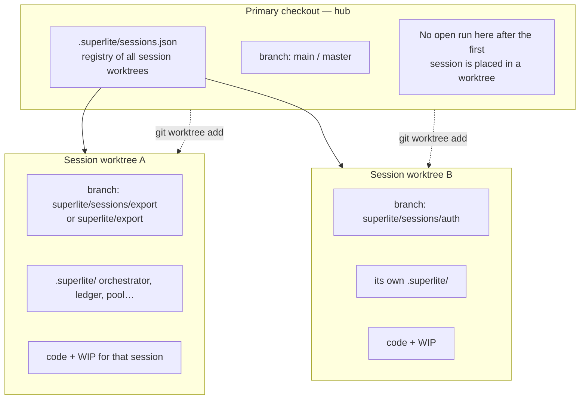
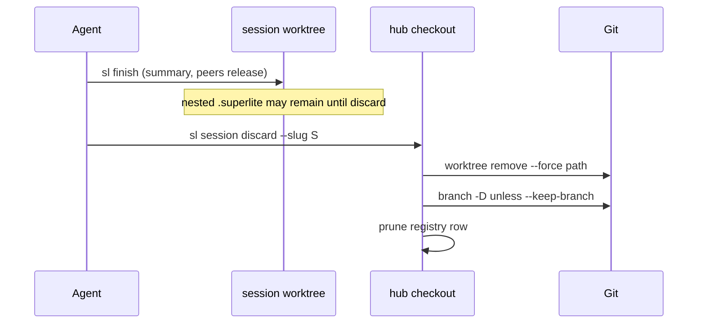

# Feature: Worktree-and-branch sessions

## Goal

Make **one superlite session = one git worktree on one dedicated branch**, so concurrent work never shares a checkout or a `.superlite/` tree. Who it is for: anyone running two or more superlite chats (or a second request while a run is open) who needs isolation without thinking about hidden session ids.

This PR already ships a first cut (`sl session split` + docs). This feature **augments that cut** into a complete worktree/branch model: create, register, discard, and finish cleanup — with a clear rule for how session worktrees relate to feature sandboxes and integration worktrees.

**Out of scope for this feature (decide later):** in-checkout `sessions/<id>/` namespacing; rich host-session binding; the full list/use/discard UX polish beyond what the worktree model needs to stay correct.

## What changes

**Target kind:** `cli` / agent-orchestrated (commands + `sl` tools + docs). No web UI.

### Mental model (branches and worktrees)



| Idea | Rule |
|---|---|
| Session | One chat’s run + its code checkout |
| Branch | `superlite/sessions/<slug>` (or keep an existing feature branch when moving an open run) — **one branch checked out in exactly one worktree** |
| Worktree | `.superlite/worktrees/sessions/<slug>/` (see namespace below) holding that branch and a full nested `.superlite/` |
| Hub | The user’s primary checkout stays on the base branch; it holds the registry, not an active inventing run |
| Feature proto | Still `.superlite/sandboxes/<topic>-proto` — not a session |
| Feature integration | Still `.superlite/worktrees/<topic>/` — one feature per worktree; a session worktree may *contain* that flow once the agent root is there |

**Namespace (recommended).** Put session checkouts under `.superlite/worktrees/sessions/<slug>/` so they cannot collide with feature integration paths `.superlite/worktrees/<topic>/`. Branches: `superlite/sessions/<slug>`. The current `split` paths (`.superlite/worktrees/<slug>`) migrate or gain a compatibility alias in the first integration tasks.

### Lifecycle

```mermaid
stateDiagram-v2
  [*] --> Hub: clone / open repo on base
  Hub --> Session: session create --slug S\n(or first /superlite:start that opts into a worktree)
  Session --> Session: invent, dispatch, checkpoint
  Session --> Hub: finish in that worktree\n(registry: status finished or removed)
  Session --> Gone: session discard --slug S\n(remove worktree; branch -D unless --keep-branch)
  Hub --> Session: session create --slug T\n(second concurrent session)
  Session --> Session: session split\n(open run moves; new slug created)
  Gone --> [*]
```

### Create (no open run required)

Today `split` only works when `orchestrator.json` exists. Efficient session creation needs:

```text
sl session create --slug auth [--base main]
→ worktree .superlite/worktrees/sessions/auth on branch superlite/sessions/auth
→ empty nested .superlite/ (ready for /superlite:start)
→ registry row appended (not overwritten)
→ print: cd / open that path; start there
```

`split` becomes the special case of create: move the *current* open run into `sessions/<keep>`, then `create` for `--new`.

### Registry (durable, N sessions)

Replace the two-row overwrite with an append/update registry on the hub:

```json
{
  "v": 2,
  "base": "main",
  "sessions": [
    {
      "slug": "export",
      "worktree": "…/worktrees/sessions/export",
      "branch": "superlite/sessions/export",
      "status": "active",
      "created_at": 0,
      "kind": "session"
    }
  ]
}
```

`status` reflects whether the worktree’s nested `.superlite/orchestrator.json` exists (`active`) or not (`idle` / after finish `finished` until discard). Feature sandboxes stay out of this list (still `feature.json`).

### Split (augment existing)

Keep the user-facing start-menu ask. Internally:

1. Ensure hub is on base (or return to base).
2. Place the open run’s branch + WIP + nested `.superlite/` into `worktrees/sessions/<keep>`.
3. `create` the new slug.
4. **Append** both to the registry; never drop other live sessions.

### Discard / finish



Mirror `sl proto discard` semantics. Document that `finish` alone does not delete the worktree (same as today for feature integration); discard (or an explicit finish flag later) does.

### Start menu / hooks

- **Start something new** → create or split as today, then instruct moving the agent root into the new worktree.
- `hooks/session-start`: project state remains based on **cwd** `.superlite/orchestrator.json` (correct once the agent is inside the session worktree). Optionally mention registry sessions when cwd is the hub with no open run but `sessions.json` lists actives (“sessions open in worktrees: …”).

### What the user sees / does differently

| Action | Today (#21 cut) | After this feature |
|---|---|---|
| Second request while a run is open | Ask → `split` → two worktrees under `worktrees/<slug>` | Same ask → split into `worktrees/sessions/…`; registry keeps all |
| Start a session on a clean hub | Invent on main (collides later) | `session create` (or start offers “worktree session?”) before inventing |
| Done with a session | Manual `git worktree remove` | `session discard --slug` |
| List | `session status` (last split only) | Registry list of all session worktrees + branch + active/idle |

Management verbs beyond create / status / discard / split stay light until we agree the branch layout above; list formatting and “use” (switch) can be a follow-up once create/discard feel right.

## Acceptance checks

1. From a hub on `main` with **no** open run, `sl session create --slug auth` creates `.superlite/worktrees/sessions/auth` on `superlite/sessions/auth`, appends a registry row, and leaves hub clean (no `orchestrator.json` on hub).
2. With an open run on hub (or in a session worktree), `sl session split --keep export --new auth` moves WIP + `.superlite/` into the keep session worktree, creates the new one, and **keeps any other registry rows**.
3. `sl session status` lists every registered session with slug, branch, worktree path, and whether an open run is present in that worktree.
4. `sl session discard --slug auth` removes that worktree and deletes `superlite/sessions/auth` unless `--keep-branch`; registry no longer lists it; other sessions untouched.
5. Session paths do not collide with a feature integration worktree at `.superlite/worktrees/<topic>` or a proto at `.superlite/sandboxes/<topic>-proto` for the same topic string.
6. `/superlite:start` “Start something new” still asks to separate into worktrees and calls the augmented split; docs/`docs/sessions.md` describe the hub + `sessions/` namespace with mermaid.
7. Existing tests for the current split behavior stay green or are updated to the namespaced paths; new tests cover create, append registry, and discard.
8. `sl proto start/discard` and one-feature-one-worktree rules remain unchanged (FROZEN).

## Code map

**Entry / stand-up**

- `skills/swarm/scripts/session.py` — extend: `create`, registry v2 append/update, `discard` (mirror `proto.cmd_discard`), keep `split`/`status`.
- `skills/swarm/scripts/sl` — already registers `session`.
- `commands/start.md` — Start something new → split/create wording.
- `docs/sessions.md`, `docs/tools.md`, `docs/README.md` — already linked; rewrite for hub + namespace.
- `hooks/session-start` — optional hub hint when registry has actives (cwd has no orchestrator).

**Patterns to reuse**

- `proto.py`: `worktree add` / `remove --force` / `branch -D` / `--keep-branch` / topic slug regex.
- `gitignore.ensure` for `.superlite/`.
- Current split: stash + move `.superlite` + park on base.

**Touched tests**

- `tests/scripts/test_session_split.py` → grow or rename to `test_session.py` for create/list/discard/registry append.
- Do not port the other branch’s in-checkout `sessions/<id>/` tests.

**Interfaces that must not change (FROZEN)**

- `sl proto *` paths, `feature.json`, tryout gates.
- Flat nested `.superlite/orchestrator.json` as “open run” inside a worktree (no in-checkout session id scheme).
- AGENTS.md one-feature-one-worktree; feature integration path `.superlite/worktrees/<topic>` (session uses `…/worktrees/sessions/<slug>`).
- Orchestrator / peers / finish summary contract (finish may later call discard only if we add an explicit flag; default unchanged).

**Conventions / toolchain**

- LF; stdlib-only scripts; pytest under `tests/scripts/`.
- Branch prefix `superlite/sessions/`; worktree under `.superlite/worktrees/sessions/`.
- Graphify not required (`graphify_gate` missing; do not install).

## Prototype scope

**Keep:** real `git worktree` operations; registry file; CLI create/split/status/discard; pytest on a temp repo (same style as `test_session_split.py` / `test_feature_flow.py`).

**Stub:** harness “open folder” automation; fancy `session use` that changes the agent root for you; finish auto-discard; host-session id binding.

**Level:** L1 — scripts + docs + tests in a proto worktree.

**Run:** `python -m pytest tests/scripts/test_session_split.py tests/scripts/test_session.py -q` (names as implemented).

**Reach:** CLI only — print worktree paths; human (or agent) `cd`s / opens that folder.

## Integration outline

1. Namespace + registry v2 on this PR branch; migrate `split` to write under `worktrees/sessions/` and append.
2. Add `create` and `discard`; expand tests.
3. Rewrite `docs/sessions.md` mermaid for hub model; keep start.md ask.
4. Optional session-start hub hint.
5. Seam: proto + feature-flow tests still green; no change to in-checkout id model.
6. Follow-up (after you try create/discard): list formatting, `use`/switch helpers, finish `--discard-worktree` — not required to accept this plan.

## Design notes (why worktrees+branches, not in-checkout ids)

- A worktree gives **isolated code and isolated `.superlite/`** with the same tools (`sl` from cwd) — matches how agents already `cd` into feature worktrees.
- Git already enforces **one branch ↔ one worktree**, which matches “one session owns one line of commits.”
- In-checkout `sessions/<id>/` (other branch) solves file clobber without moving the editor root; you chose to **fully utilize worktrees and branches** instead, so this plan does not adopt that layout.
- Cost: more disk and an explicit “open this folder” step; mitigated by printing paths and optional later `use` helpers.
