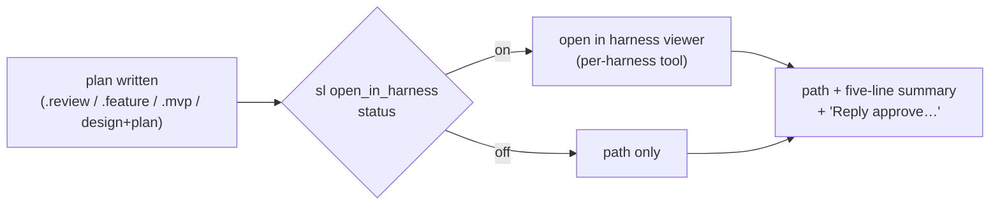

# Feature: Open finished plans in the harness

## Goal

When superlite finishes writing a plan the user is meant to read (a review plan, a feature plan, an MVP plan, a combined design+plan doc), the harness opens that file in its own viewer instead of leaving only a path in chat. Who it is for: the human orchestrator who must read and approve the plan, on any harness superlite supports.

Today only feature **specs** do this, and only when `agent_specs` is on (`open_in_harness`, default on). Plans, the thing the human actually approves, never open.

**Out of scope:** agent-format machine plans and `.proto.md` prototype plans (orchestrator-only, never shown for approval); task-local spec notes; changing how approval itself works.

## What changes

**Target kind:** agent-orchestrated CLI (skills, commands, `sl` tool, per-harness tool mappings). No web UI.

| Piece | Change |
|---|---|
| Setting | `open_in_harness` stops being a specs-only flag. It governs plans **and** specs, default **on**, same precedence as today: env `SUPERLITE_AGENT_SPECS_OPEN` (alias `SUPERLITE_OPEN_IN_HARNESS`) > project `.superlite/agent-specs.json` > `preferences.json` > on. |
| `sl agent_specs status` | Always prints `open_in_harness: on|off` (today it is hidden when specs are off). |
| `sl agent_specs open on|off` | Unchanged toggle; help text says it covers plans and specs. |
| Skills / commands | Every "show the path and a five-line summary" step for a human-facing plan first opens the file when `open_in_harness` is on: `drafting` (after writing), `inventing` (review plan), `commands/feature.md` step 3, `commands/approve.md`, `commands/mvp.md` / `mvp-prototype` (the `.mvp.md`; the HTML page keeps its own open step). AI orchestrator: open too (the human may be watching), never wait on it. |
| One hook point | Every plan-based flow writes its plan through `superlite:drafting`, so the open rule lives in drafting's "After writing" step and each flow's show-the-plan step points at it. A new plan-based flow inherits it for free. |
| Per-harness mapping | One row "Open a plan or spec for the user (`open_in_harness`)" in every `references/<harness>-tools.md`. Claude Code desktop: `mcp__ccd_view__show_pane` (file); Claude Code CLI: clickable markdown link `[path](path)`; Cursor: `open_resource`; others: the harness's open-file tool if it has one, else path + summary. Unknown tool → fall back silently, never fail the step. |
| Docs | `docs/feature-flow.md`, `writing-specs` "Open in harness" section, help command list the wider scope. |

### Flows covered

Rule: every flow that writes a plan doc opens it once it is written, whichever orchestrator is running.

| Flow | Plan opened | Human | AI |
|---|---|---|---|
| Regular, architectural | `<date>-<topic>.review.md` (human) / combined design+plan `<date>-<topic>.md` (AI) | opened before "Reply approve…" | opened after lint, no wait |
| Regular, bounded | none (design shown in chat, no plan doc) | — | — |
| MVP | `<date>-<topic>.mvp.md` (the HTML page keeps its own open step) | before the approve ask | after `mvp_check`, no wait |
| Feature | `<date>-<topic>.feature.md` (+ `.spec.md` when specs on) | before the approve ask | after research, no wait |
| Resume | the plan being resumed | in the two-line report | same |
| Approve (`/superlite:approve`) | the review plan being approved | before the summary | — |
| Debug, Small, Review | none (no plan doc) | — | — |

Orchestrator-only plans (the machine plan after approval, `.proto.md`, the feature integration plan) are not opened: they are task graphs, not for reading.

## Acceptance checks

- `sl agent_specs status` with specs off prints `open_in_harness: on` on a clean project.
- `sl agent_specs open off` then `status` prints `open_in_harness: off`; `SUPERLITE_OPEN_IN_HARNESS=1` overrides it back to on.
- Start `/superlite:feature <anything>` in Claude Code desktop as human orchestrator: when the `.feature.md` is written, it opens in the file pane before the "Reply approve…" message.
- Same in a regular architectural build: human mode opens the `.review.md`; AI mode (`sl orchestrator set ai`) opens the combined `<date>-<topic>.md` without waiting.
- Same in `/superlite:mvp` (the `.mvp.md`) and `/superlite:resume` (the resumed plan).
- A regular bounded change, `/superlite:small`, `/superlite:debug` and `/superlite:review` open nothing.
- With `sl agent_specs open off`, the same flows show only path + summary and open nothing.
- Every `skills/using-superlite/references/*-tools.md` has the open row; `tests/scripts` passes (`python -m pytest tests/scripts`).
- `skills/using-superlite/SKILL.md` is not grown.

## Code map

- **Entry points.** No app to stand up: superlite is skills + commands read by the harness, plus `skills/swarm/scripts/sl <tool>` which execs `<tool>.py` (`sl:34-41`), so no wiring is needed for `agent_specs`.
- **Setting logic.** `skills/swarm/scripts/agent_specs.py` — `open_in_harness()` :82-97 (env > project > prefs > on), `status_lines()` :123-128 (hides the flag when specs are off), CLI `open` :151-156, usage :5 and :170.
- **Tests.** `tests/scripts/test_agent_specs.py` (calls the script directly; 6 tests), `test_session_start.py:42-46`. Run `uv run pytest tests/scripts` (CI: `.github/workflows/tests.yml`, Python 3.12).
- **Human-facing plan steps to touch** (insert "open it when `open_in_harness` is on" before the summary): `skills/drafting/SKILL.md:23`, `skills/drafting/review-plan.md:8`, `skills/inventing/SKILL.md:44`, `skills/mvp-prototype/SKILL.md:63`, `commands/mvp.md:15`, `docs/mvp-flow.md:14`, `commands/feature.md:10,14,21`, `commands/approve.md:7`, `commands/resume.md:7-9`, `skills/swarm/orchestrator.md:7,49`, `docs/feature-flow.md:42`.
- **Spec wording to widen.** `skills/writing-specs/SKILL.md:14,27`, `agents/implementer.md:13`, `docs/tools.md:22`.
- **Per-harness rows.** `skills/using-superlite/references/{claude-code,codex,cursor,gemini,hermes,muse,pi,antigravity}-tools.md`; only cursor:13 has an open row today. Two-column `| Skill says | <Harness> |` tables.
- **Frozen interfaces.** CLI `sl agent_specs on|off|status|open on|off|prefer on|off`; JSON keys `agent_specs`, `open_in_harness` in `.superlite/agent-specs.json` and `preferences.json`; env `SUPERLITE_AGENT_SPECS_OPEN`; status line `agent_specs: on|off` stays first.
- **Size limits (tested).** `using-superlite/SKILL.md` ≤ 2,000 chars (1,839 now) — do not touch it; `swarm/SKILL.md` ≤ 12,500 (122 free) — do not touch it; the literal "five-line summary" must remain (`test_orchestrator.py:273`).
- **Conventions.** LF endings, terse imperative skill prose, versions only via `scripts/bump-version.sh`.

## Prototype scope

L1. Keep `agent_specs.py` and its tests, plus `skills/drafting/SKILL.md` and `references/claude-code-tools.md` as the one-skill, one-harness slice. Stub nothing else. Tasks: (1) status always prints `open_in_harness`, env alias; (2) tests for the acceptance CLI checks; (3) drafting + Claude Code row wording. Try-out: run the CLI checks and read the drafting step.

## Integration outline

1. `agent_specs.py` + tests (ported from the prototype).
2. Skills: drafting, review-plan, inventing, mvp-prototype, writing-specs, swarm/orchestrator.md, agents/implementer.md.
3. Commands: feature, approve, mvp, resume.
4. Per-harness reference rows (8 files).
5. Docs: feature-flow, mvp-flow, tools.
6. Seam check: grep that every "five-line summary" plan step for a human-facing plan names `open_in_harness`; full `pytest tests/scripts`.
