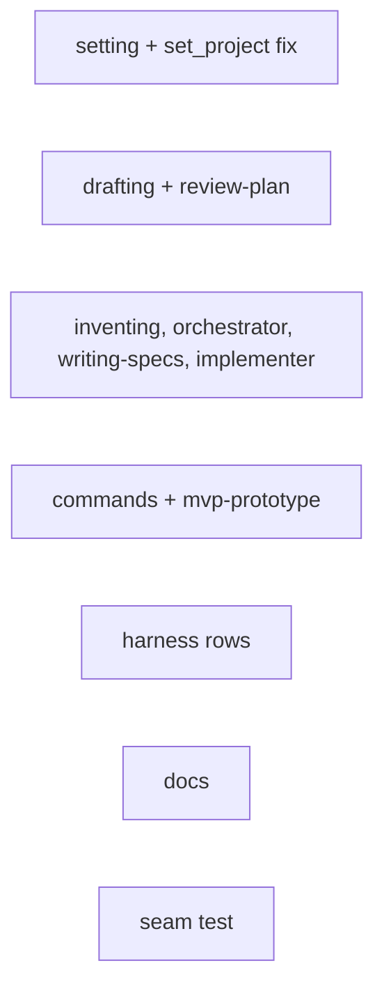

# Integration: open finished plans in the harness

**Goal:** Every plan-based flow opens the human-facing plan it writes in the harness when `open_in_harness` is on; the setting covers plans and specs and always shows in status.
**Architecture:** `agent_specs.py` owns the switch; `superlite:drafting` "After writing" owns the rule; each flow's show-the-plan step points at it; each `references/<harness>-tools.md` names the open tool.
**Tech stack:** Python stdlib, pytest, markdown skills and commands
**Spec:** /Users/iheatuwogu/Projects/superlite/docs/plans/2026-10-31-open-plans.feature.md
**Review plan:** /Users/iheatuwogu/Projects/superlite/docs/plans/2026-10-31-open-plans.feature.md
**Detail:** tests
**Target-min:** 20

## Global constraints

- language: python
- test command: `uv run python -m pytest tests/scripts -q`
- Port from the prototype diff `.superlite/proto.diff` (prototype branch `superlite/open-plans-proto`); never merge it.
- FROZEN: CLI `agent_specs on|off|status|open on|off|prefer on|off`; JSON keys `agent_specs`, `open_in_harness`; env `SUPERLITE_AGENT_SPECS_OPEN`; status line 1 starts `agent_specs: `; line 2 is `open_in_harness: on|off`.
- Canonical step sentence (adapt the subject only): "When `open_in_harness` is on (`sl agent_specs status`), open the plan for the user first (`superlite:drafting`, After writing)." AI orchestrator: open it too and do not wait.
- Opened: `.review.md`, `.feature.md`, `.mvp.md`, combined `<date>-<topic>.md`, `.spec.md`, the plan being resumed. Never opened: machine plan after approval, `.proto.md`, integration plan, task-local notes.
- Do not edit `skills/using-superlite/SKILL.md` or `skills/swarm/SKILL.md` (tested size caps). Keep every literal "five-line summary". Do not add `open_in_harness` to `commands/small.md`, `commands/debug.md`, `commands/review.md`.
- LF line endings; terse imperative prose matching each file.

```mermaid
%% schedule
gantt
  title Predicted schedule (mm:ss)
  dateFormat X
  axisFormat %M:%S
  section lane 1
  T1 setting and set_project fix :t1, 0, 88s
  section lane 2
  T7 seam test :t7, 0, 88s
  section lane 3
  T3 inventing  orchestrator  writing-spec :t3, 0, 82s
  section lane 4
  T4 commands and mvp-prototype :t4, 0, 82s
  section lane 5
  T2 drafting and review-plan :t2, 0, 82s
  section lane 6
  T5 harness open rows :t5, 0, 81s
  section lane 7
  T6 docs :t6, 0, 81s
```

critical path: T1 (1.5 min) · peak width 7 · predicted build 1.5 min · predicted total ≈ 16.1 min (target ✓)

### T1 setting and set_project fix · Complexity 3 · Est. context 24k
**Owns:** skills/swarm/scripts/agent_specs.py, tests/scripts/test_agent_specs.py
**Components:** 1
**LOC owned:** 70
**Tests:** fast
**Model:** sonnet
**Kind:** logic
**Depends on:** —
**Produces:** `agent_specs status` line 2 `open_in_harness: on|off` always; `set_project(open_flag=...)` leaves `agent_specs` unset
e.g. clean project, specs off -> stdout lines ["agent_specs: off", "open_in_harness: on", "source: default (off)"]
e.g. prefer on, then `open off` -> status line 1 "agent_specs: on", line 2 "open_in_harness: off"
**Consumes:** —
**Verify:** uv run python -m pytest tests/scripts/test_agent_specs.py tests/scripts/test_session_start.py -q
**Done when:** the prototype's agent_specs.py and test changes are ported (status line, `SUPERLITE_OPEN_IN_HARNESS` alias with the old name winning, docstring and usage say plans and specs, tests `test_open_shown_when_specs_off` and `test_open_alias_env`); `set_project` no longer writes `"agent_specs": false` when only `open_flag` is given (and no longer writes `open_in_harness` when only `on` is given); new test `test_open_toggle_keeps_prefer` covers the second e.g.; `test_project_on_off` still passes (it may assert `open_in_harness` via status instead of the JSON key); all listed tests pass

### T2 drafting and review-plan · Complexity 2 · Est. context 16k
**Owns:** skills/drafting/SKILL.md, skills/drafting/review-plan.md
**Components:** 1
**LOC owned:** 12
**Tests:** fast
**Model:** sonnet
**Kind:** logic
**Depends on:** —
**Produces:** drafting "After writing" holds the open rule (the list of opened and never-opened plans); its human show step and review-plan.md:8 open first
**Consumes:** —
**Verify:** grep -n "open_in_harness" skills/drafting/SKILL.md skills/drafting/review-plan.md
**Done when:** the prototype's two drafting edits are ported verbatim from `.superlite/proto.diff`; `review-plan.md` line 8's show step starts with the canonical sentence; both files contain `open_in_harness`; "five-line summary" still present in both

### T3 inventing, orchestrator, writing-specs, implementer · Complexity 3 · Est. context 24k
**Owns:** skills/inventing/SKILL.md, skills/swarm/orchestrator.md, skills/writing-specs/SKILL.md, agents/implementer.md
**Components:** 1
**LOC owned:** 16
**Tests:** fast
**Model:** sonnet
**Kind:** logic
**Depends on:** —
**Produces:** regular flow opens its plan in both orchestrator modes; spec wording points at the shared rule
**Consumes:** —
**Verify:** uv run python -m pytest tests/scripts/test_orchestrator.py tests/scripts/test_agent_files.py -q
**Done when:** `inventing/SKILL.md` step 1 (AI writes ONE combined doc) says to open it after writing with no wait, and step 3 (human review plan) opens it before the five-line summary, both with the canonical sentence; `swarm/orchestrator.md` lines 7 and 49 open the review plan first; `writing-specs/SKILL.md` lines 14 and 27 say the flag now covers plans and specs and the harness's open row is in `using-superlite/references/<harness>-tools.md` (drop the inline Cursor-only wording); `agents/implementer.md` line 13 points at the same reference row; listed tests pass

### T4 commands and mvp-prototype · Complexity 3 · Est. context 24k
**Owns:** commands/feature.md, commands/approve.md, commands/mvp.md, commands/resume.md, skills/mvp-prototype/SKILL.md
**Components:** 1
**LOC owned:** 14
**Tests:** fast
**Model:** sonnet
**Kind:** logic
**Depends on:** —
**Produces:** feature, MVP, approve and resume flows open their plan
**Consumes:** —
**Verify:** uv run python -m pytest tests/scripts/test_feature_flow.py tests/scripts/test_mvp_check.py -q
**Done when:** `commands/feature.md` line 10 says `open_in_harness` covers the spec and the feature plan, step 3 opens the `.feature.md` before the summary (AI mode: after research, no wait), line 21 lists `open on|off` as covering plans and specs; `commands/approve.md` opens the review plan before its summary; `commands/mvp.md` step 4 and `mvp-prototype/SKILL.md:63` open the `.mvp.md` first (the HTML page keeps its own step); `commands/resume.md` step 3 opens the plan being resumed alongside the two-line report; each uses the canonical sentence; listed tests pass

### T5 harness open rows · Complexity 2 · Est. context 20k
**Owns:** skills/using-superlite/references/antigravity-tools.md, skills/using-superlite/references/claude-code-tools.md, skills/using-superlite/references/codex-tools.md, skills/using-superlite/references/cursor-tools.md, skills/using-superlite/references/gemini-tools.md, skills/using-superlite/references/hermes-tools.md, skills/using-superlite/references/muse-tools.md, skills/using-superlite/references/pi-tools.md
**Components:** 1
**LOC owned:** 10
**Tests:** fast
**Model:** sonnet
**Kind:** logic
**Depends on:** —
**Produces:** each file's table has a row whose first cell is exactly "Open a plan or spec for the user (`open_in_harness`)"
**Consumes:** —
**Verify:** grep -c "Open a plan or spec for the user" skills/using-superlite/references/*-tools.md
**Done when:** claude-code row ported verbatim from `.superlite/proto.diff`; cursor's existing "Open a markdown spec" row is replaced by the new first cell with `open_resource` on the workspace path, else path + five-line summary; the other six get the row naming that harness's open-file tool only when its file or live tool list already names one, else "no open tool: path + five-line summary in chat"; never invent a tool name; one row per file

### T6 docs · Complexity 2 · Est. context 18k
**Owns:** docs/feature-flow.md, docs/mvp-flow.md, docs/tools.md
**Components:** 1
**LOC owned:** 10
**Tests:** fast
**Model:** sonnet
**Kind:** logic
**Depends on:** —
**Produces:** design docs describe the wider `open_in_harness`
**Consumes:** —
**Verify:** grep -n "open_in_harness" docs/feature-flow.md docs/mvp-flow.md docs/tools.md
**Done when:** `docs/feature-flow.md:42` says the spec and the feature plan open when `open_in_harness` is on, and step 3's description opens the plan; `docs/mvp-flow.md:14` opens the `.mvp.md` before the summary; `docs/tools.md:22` row says `open on|off` covers plans and specs and status always shows it; all three files contain `open_in_harness`

### T7 seam test · Complexity 3 · Est. context 20k
**Owns:** tests/scripts/test_open_in_harness.py
**Components:** 1
**LOC owned:** 70
**Tests:** fast
**Model:** sonnet
**Kind:** logic
**Depends on:** —
**Produces:** tests/scripts/test_open_in_harness.py
e.g. `open_in_harness` missing from commands/resume.md -> test_flow_steps_open fails naming the file
**Consumes:** —
**Verify:** uv run python -m pytest tests/scripts/test_open_in_harness.py -q
**Done when:** `test_flow_steps_open` asserts `open_in_harness` appears in skills/drafting/SKILL.md, skills/drafting/review-plan.md, skills/inventing/SKILL.md, skills/swarm/orchestrator.md, skills/mvp-prototype/SKILL.md, skills/writing-specs/SKILL.md, agents/implementer.md, commands/feature.md, commands/approve.md, commands/mvp.md, commands/resume.md, docs/feature-flow.md, docs/mvp-flow.md, docs/tools.md; `test_harness_rows` asserts each `skills/using-superlite/references/*-tools.md` (8 files) has exactly one line starting "| Open a plan or spec for the user (`open_in_harness`) |"; `test_planless_flows_open_nothing` asserts `open_in_harness` is absent from commands/small.md, commands/debug.md, commands/review.md; `test_five_line_summary_kept` asserts "five-line summary" still in drafting/SKILL.md, inventing/SKILL.md, swarm/orchestrator.md; paths resolved from the repo root (`Path(__file__).resolve().parents[2]`); it may fail until T2-T6 land, which is expected

## Review Focus

- App type: cli plugin scripts and skill prose
- T1: env and file precedence; `set_project` partial writes; `test_session_start.py`
- T2-T6: one canonical sentence, terse, no growth of the two capped SKILL.md files, "five-line summary" kept, no invented harness tool names
- T7: assertions match the plan's file lists exactly
