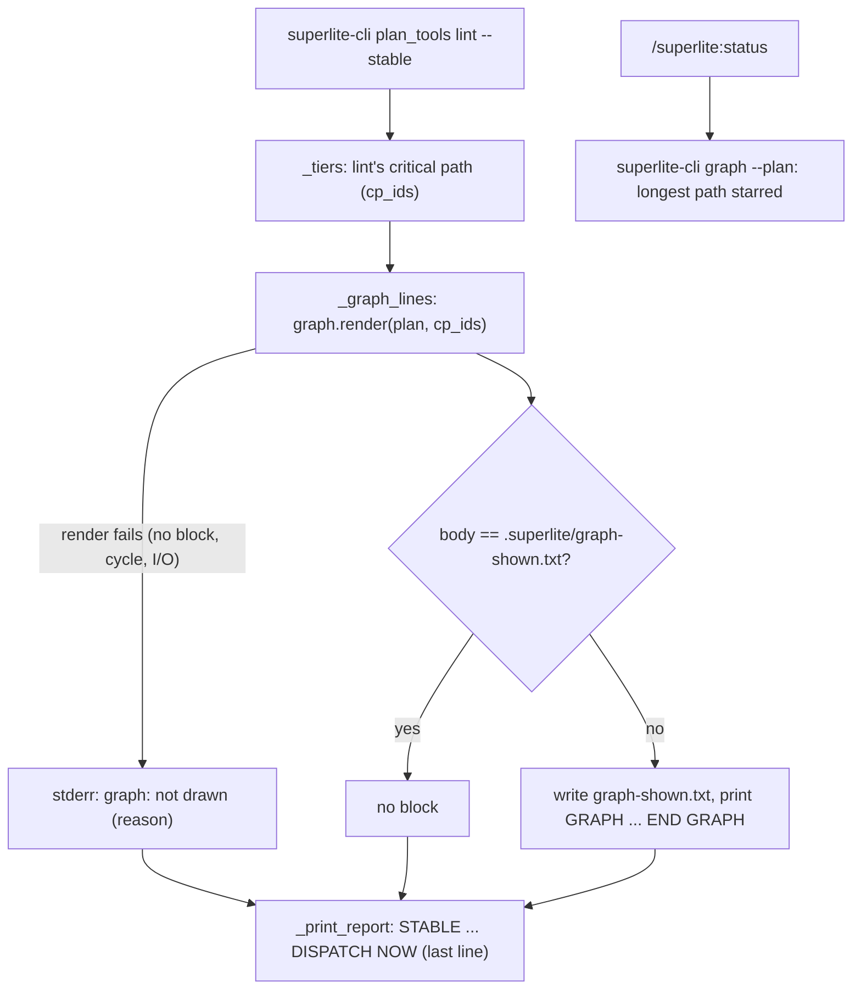

# Feature plan: show the ASCII task graph when a run starts

## Goal

When a superlite build starts, the person running it sees the plan's task graph as an ASCII diagram in the chat: which tasks run side by side, which wait, and the critical path. For anyone running an orchestrated build (regular, MVP, feature prototype and integration, review). `superlite-cli graph` already draws it (`skills/swarm/scripts/graph.py`, from the 2026-10-22 session-cost plan, Part 2), but nothing calls it, so it never shows.

## What changes

- **`plan_tools lint --stable` output**: prints the graph near the top, before `STABLE:`, framed so the coordinator can pass it on:

  ```text
  GRAPH (show the user verbatim in a text block):
  [T1*]  [T5]
    v
  [T2*]  [T3]
    v
  [T4*]
  * = critical path
  END GRAPH
  ```

  It prints on the first `lint --stable` of a run and again only when the drawing changes (an edge or a task added or removed). Re-lints after small fixes that leave the graph the same print nothing extra. `DISPATCH NOW:` stays the last line. If the graph can't be drawn, lint prints one `graph: not drawn (<reason>)` line to stderr and goes on.
- **Critical path matches lint.** Called from lint, the `*` marks lint's own critical path (time-weighted, the one in the schedule line), not the task-count longest path, so the two never disagree. `superlite-cli graph --plan` on its own keeps today's behavior.
- **`/superlite:status`**: when a plan exists, also runs `superlite-cli graph --plan <plan>` and shows the graph in a text block, below the status lines.
- **`skills/swarm/SKILL.md`**: a few words in the fixed-order line: lint's `GRAPH` block is shown to the user verbatim. Stays at or under 12,500 characters (12,363 with the phrase).
- **Docs**: a `graph` row in `docs/tools.md`, `graph` added to the tool list in the `superlite-cli` header comment.

Not in scope: lanes, batches and a legend from Part 2 of the old plan; the drawing stays as it is today (levels plus `*`).

## Acceptance checks

- Run `superlite-cli plan_tools lint --plan <fixture> --stable` on an approved fixture plan with edges `T1->T2, T1->T3, T2->T4, T3->T4, T5->T4`: the output holds a `GRAPH` block with three levels and `END GRAPH`, before `STABLE:`, and the last line is still `DISPATCH NOW: ...`.
- Run the same lint again with no plan change: no `GRAPH` block.
- Edit only a task's prose and re-lint: no `GRAPH` block. Add an edge and re-lint: the block prints again with the new levels.
- The tasks marked `*` in the block are the ones in lint's `critical path:` line.
- A plan whose `%% taskgraph` block can't be parsed: lint still finishes with `DISPATCH NOW:`, and stderr has the `graph: not drawn` line.
- Start a real feature or regular run here: the graph shows up in the chat as a text block right after the first lint.
- Run `/superlite:status` during a run: the graph shows below the status.
- Existing tests pass (`test_stable_split.py` last-line checks included), and `skills/swarm/SKILL.md` stays at or under 12,500 characters.

## Flow



## Code map

Re-mapped after PR #27 (launcher `sl` renamed `superlite-cli`; scripts split into a shared base and tool areas).

- **Entry points.** `skills/swarm/scripts/superlite-cli <tool>` runs `<tool>.py`. The coordinator runs `superlite-cli plan_tools lint --plan $PLAN --spec SPEC --stable` at the start of every orchestrated build and after each fix round (`skills/swarm/SKILL.md`, "Planning check"). Human mode blocks it before approval (`orchestrator.require`), so the graph only ever prints for an approved plan.
- **Where the print goes.** `lint --stable` now lives in `plan_lint.py:cmd_lint_stable` (`plan_tools.py` is the entry and plan model; it re-exports `plan_lint` names). `_tiers` returns `cp_ids` (saved to `stable.json` as `critical_path`); `_print_report` prints `STABLE:`, `FIX:`, `TIERS:`, `DISPATCH NOW:` in that order. The new `_graph_lines(plan_path, run_dir, critical)` runs between them and keeps the last shown drawing in `.superlite/graph-shown.txt`.
- **Renderer.** `graph.py`: `render(plan_path, critical=None) -> str` (cached in `.superlite/graph.txt`; first line `# hash: <plan sha256>`, plus ` critical: <ids>` when ids are given), `_parse_graph` (now raises `ValueError` on a cycle), `_longest_path`, `_tiers`, `_draw(deps, critical)`. Lint strips the `# hash:` line before printing.
- **Status.** `commands/status.md` is prose instructions only (`superlite-cli orchestrator status`, `metrics`, `budget`); it now also runs `superlite-cli graph --plan <plan>`.
- **Touched files.** `graph.py`, `plan_lint.py` (`_graph_lines`, one call in `cmd_lint_stable`), `commands/status.md`, `skills/swarm/SKILL.md` (one phrase), `docs/tools.md`, `skills/swarm/scripts/superlite-cli` (comment), tests `tests/scripts/test_graph.py` and `tests/scripts/test_stable_split.py`.
- **Interfaces that must not change.** `graph.render(plan_path)` with one argument and `superlite-cli graph --plan` output; `stable.json` keys; lint's line formats and `DISPATCH NOW:` as the last line; `lint-log.jsonl` entries.
- **Conventions.** Stdlib only; complexity notes (`# O(...)`) on function header lines only; lint side steps never block a lint (`base.advisory_errors()`, print to stderr); deterministic output, ASCII, drawn lines at most 79 wide; LF endings; pytest under `tests/scripts/`. Version bumps only via `scripts/bump-version.sh` (not part of this feature).
- **UI component set.** None; output is plain text.

## Prototype scope

Keep: the real `graph.py` and `cmd_lint_stable`, run on a fixture plan in the prototype worktree. Stub: nothing beyond a fixture plan and an approved orchestrator state. Level L1. Tried by running lint twice (graph, then no graph), editing an edge, and running a real small build in the worktree to see the block in chat. About 3 tasks: `critical` argument, lint print with the "shown" marker, tests.

## Integration outline

1. `graph.py`: optional `critical` argument, cache keyed on it, tests in `test_graph.py` (one-argument behavior unchanged).
2. `plan_tools.py:cmd_lint_stable`: print the framed block before `STABLE:` when the drawing differs from the last one shown, fail open; tests in `test_stable_split.py` (first lint prints, re-lint doesn't, edge change reprints, `DISPATCH NOW:` last, bad graph fails open).
3. Wording: `skills/swarm/SKILL.md` phrase (cap test), `commands/status.md`, `docs/tools.md`, `superlite-cli` comment.
4. Seam check: a full `lint --stable` on a bench plan end to end; `test_orchestrator.py`, `test_mvp_check.py`, `test_wave0.py`, `test_metrics_history.py` pass.
