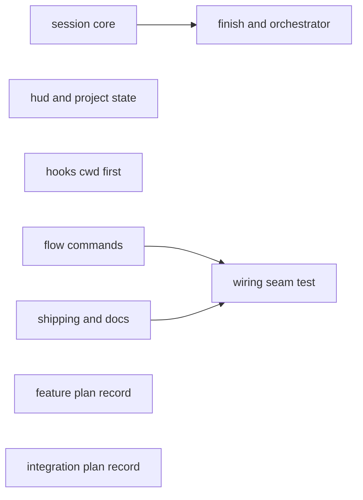

# Integration: session auto-start

**Goal:** Port the approved session auto-start prototype into the real tree, wire every flow to `sl session ensure`, end flows with `sl session close`, and document it.
**Architecture:** `session.py` gains `ensure`, `close`, `untracked`, `mark_run`, the untracked gate and `hide_superlite`; the main checkout is the host; rows carry `run`/`finished_at`; HUD and project state read the session's run; `finish` marks it; `orchestrator set` warns; five hooks find the run from `cwd` first.
**Tech stack:** Python stdlib, bash (3.2-safe builtins), pytest
**Spec:** docs/plans/2026-10-31-session-autostart.feature.md
**Review plan:** docs/plans/2026-10-31-session-autostart.feature.md
**Prototype:** .superlite/sandboxes/session-autostart-proto (branch superlite/session-autostart-proto; approved by the human 2026-10-31). Port from its working tree file by file; it holds no stubs or fakes (L1, pure scripts).
**Detail:** tests
**Target-min:** 25

## Global constraints

- language: python
- test command: `uv run pytest tests/scripts -q`
- FROZEN: existing `session` subcommands' flags and output lines (new lines only where the feature plan says: untracked notes, `run:` field, `worktree (removed)`); `REDIRECT worktree=… slug=… branch=…` + exit 3; exit 2 = error; new exit 4 = ASK; existing `sessions.json` fields; `STATIONARY`; `split`'s `gitignore.ensure` call
- FROZEN: HUD fields `superlite session: <slug> | branch … | worktree … | <status> | stash:…`, only `| run:open|finished` appended
- FROZEN: `sl orchestrator set` exit code and orchestrator.json contents; `orchestrator.require` untouched
- Stdlib only; every script line carries a `# O(...)` comment; LF endings; hooks use bash builtins only and run under /bin/bash 3.2
- Every existing test passes unchanged; the prototype's new tests are the acceptance target and are ported verbatim unless a task says otherwise
- `skills/using-superlite/SKILL.md` is not touched (1,500-character cap); no version bump
- Do not touch `bench/` or other `docs/plans/` files

```mermaid
%% schedule
gantt
  title Predicted schedule (mm:ss)
  dateFormat X
  axisFormat %M:%S
  section lane 1
  T5 flow commands :t5, 0, 217s
  T7 wiring seam test :t7, 217, 87s
  section lane 2
  T1 session core :t1, 0, 195s
  section lane 3
  T4 hooks find the run from cwd first :t4, 0, 182s
  section lane 4
  T6 shipping and docs :t6, 0, 156s
  section lane 5
  T2 HUD and project state :t2, 0, 143s
  section lane 6
  T3 finish and orchestrator :t3, 0, 113s
```

critical path: T5 → T7 (5.1 min) · peak width 6 · predicted build 5.1 min · predicted total ≈ 18.8 min (target ✓)

### T1 session core · Complexity 7 · Est. context 50k
**Owns:** skills/swarm/scripts/session.py, tests/scripts/test_session_ensure.py
**Components:** 3
**LOC owned:** 600
**Tests:** fast
**Model:** sonnet
**Kind:** logic
**Depends on:** —
**Produces:** `session.mark_run(cwd: Path, state: str) -> str | None`; `session.py ensure|close|untracked` subcommands as in the prototype
e.g. mark_run(repo, "finished") -> "demo"
e.g. ensure --slug demo in a fresh repo on main -> last line `SESSION worktree=<repo> slug=demo branch=superlite/sessions/demo`
**Consumes:** —
**Verify:** uv run pytest tests/scripts/test_session_ensure.py tests/scripts/test_session.py tests/scripts/test_session_split.py -q
**Done when:** session.py and test_session_ensure.py match the prototype's working tree; one change on top: `adopt_legacy` reuses the slug from a `superlite/sessions/<x>` branch instead of `free_slug` renaming it `x-2` (add a test); all ported tests and existing session/split tests pass

### T2 HUD and project state · Complexity 4 · Est. context 30k
**Owns:** skills/swarm/scripts/session_hud.py, hooks/session-start, skills/swarm/scripts/suggest_flow.py, tests/scripts/test_session_run_state.py
**Components:** 3
**LOC owned:** 160
**Tests:** fast
**Model:** sonnet
**Kind:** logic
**Depends on:** —
**Produces:** HUD `| run:open|finished`; `superlite session: none here (main checkout) | <N> sessions`; project state from the session's run
e.g. host row parked, no active -> none-here line
**Consumes:** sessions.json rows with optional `run` ("open" | "finished"); a missing `run` means open
**Verify:** uv run pytest tests/scripts/test_session_run_state.py tests/scripts/test_session.py tests/scripts/test_session_start.py tests/scripts/test_suggest_flow.py tests/scripts/test_hooks_bash32.py -q
**Done when:** the four files match the prototype; existing tests pass

### T3 finish and orchestrator · Complexity 3 · Est. context 20k
**Owns:** skills/swarm/scripts/finish.py, skills/swarm/scripts/orchestrator.py, tests/scripts/test_session_finish_mark.py
**Components:** 2
**LOC owned:** 90
**Tests:** fast
**Model:** sonnet
**Kind:** logic
**Depends on:** T1
**Produces:** `sl finish` prints `session: <slug> finished`; `orchestrator set` stderr warning
**Consumes:** —
**Verify:** uv run pytest tests/scripts/test_session_finish_mark.py tests/scripts/test_orchestrator.py tests/scripts/test_human_gate.py tests/scripts/test_wave0.py -q
**Done when:** finish.py calls T1's `session.mark_run(cwd, "finished")` (see T1 Produces); the three files match the prototype; fail-open preserved; existing tests pass

### T4 hooks find the run from cwd first · Complexity 3 · Est. context 24k
**Owns:** hooks/record-human-reply, hooks/block-coordinator-edits, hooks/capture-agent-launch, hooks/capture-agent-stop, hooks/compact-nudge, tests/scripts/test_hooks_cwd_first.py
**Components:** 5
**LOC owned:** 120
**Tests:** fast
**Model:** sonnet
**Kind:** logic
**Depends on:** —
**Produces:** cwd-first run lookup in five hooks
e.g. CLAUDE_PROJECT_DIR=hub, cwd=session worktree with a human run -> reply lands in the worktree
**Consumes:** —
**Verify:** uv run pytest tests/scripts/test_hooks_cwd_first.py tests/scripts/test_human_gate.py tests/scripts/test_capture_hooks.py tests/scripts/test_hooks_bash32.py tests/scripts/test_block_coordinator_edits.py -q
**Done when:** the six files match the prototype; record-human-reply byte-identical to the installed plugin's patched copy; every hook passes `/bin/bash -n`; existing tests pass

### T5 flow commands · Complexity 3 · Est. context 24k
**Owns:** commands/start.md, commands/small.md, commands/mvp.md, commands/feature.md, commands/debug.md, commands/review.md, skills/inventing/SKILL.md
**Components:** 7
**LOC owned:** 50
**Tests:** fast
**Model:** sonnet
**Kind:** logic
**Depends on:** —
**Produces:** every flow entry runs `sl session ensure --slug <topic>` before its first other `sl` call and handles `SESSION`, `REDIRECT` and `ASK untracked` (exit 4)
**Consumes:** —
**Verify:** uv run pytest tests/scripts/test_session_split.py tests/scripts/test_feature_flow.py tests/scripts/test_flow_diagrams.py -q
**Done when:** start.md and small.md match the prototype; mvp.md, feature.md (before its `sl orchestrator set`), debug.md and review.md (before loading the skill) and inventing/SKILL.md (before its `orchestrator set` sentence) each get at most 3 lines in the same wording: run ensure, follow SESSION/REDIRECT, on ASK ask the four-choice question then rerun; no other wording changes; existing tests pass

### T6 shipping and docs · Complexity 3 · Est. context 26k
**Owns:** skills/shipping/SKILL.md, docs/sessions.md, docs/tools.md, README.md
**Components:** 4
**LOC owned:** 90
**Tests:** fast
**Model:** sonnet
**Kind:** logic
**Depends on:** —
**Produces:** shipping ends with `sl session close --slug <slug> --keep-branch` from the main checkout (after merge/PR/keep, before worktree cleanup); docs for main-checkout host, auto-start, run status, ensure, close, untracked
**Consumes:** —
**Verify:** uv run pytest tests/scripts/test_session_split.py tests/scripts/test_agent_files.py -q
**Done when:** shipping step added (handles ASK the same way as T5's text); docs/sessions.md gains an "Auto-start" section (main checkout as host, ensure table, run status, close, untracked setting and ASK) and command-table rows for ensure, close and untracked, keeping its existing mermaid diagrams; docs/tools.md `session` row lists ensure/close/untracked; README.md one line on sessions starting automatically; existing tests (incl. `test_sessions_doc_has_mermaid_and_is_indexed`) pass

### T7 wiring seam test · Complexity 2 · Est. context 14k
**Owns:** tests/scripts/test_flow_session_wiring.py
**Components:** 1
**LOC owned:** 60
**Tests:** fast
**Model:** sonnet
**Kind:** logic
**Depends on:** T5, T6
**Produces:** test that each flow file runs ensure first and shipping closes
**Consumes:** —
**Verify:** uv run pytest tests/scripts/test_flow_session_wiring.py -q
**Done when:** for commands/start.md, small.md, mvp.md, feature.md, debug.md, review.md and skills/inventing/SKILL.md the first `sl <tool>` mention that is not `sl session` comes after the first `sl session ensure`; each mentions `ASK untracked`; skills/shipping/SKILL.md mentions `sl session close`; feature check 12

### T8 feature plan record · Complexity 1 · Est. context 4k
**Owns:** docs/plans/2026-10-31-session-autostart.feature.md
**Components:** 1
**LOC owned:** 0
**Tests:** fast
**Model:** sonnet
**Kind:** logic
**Depends on:** —
**Produces:** the approved feature plan committed with the integration
**Consumes:** —
**Verify:** test -f docs/plans/2026-10-31-session-autostart.feature.md
**Done when:** the feature plan approved on 2026-10-31 (with the try-out changes) is recorded unchanged; coordinator bookkeeping, no agent work

### T9 integration plan record · Complexity 1 · Est. context 4k
**Owns:** docs/plans/2026-10-31-session-autostart.md
**Components:** 1
**LOC owned:** 0
**Tests:** fast
**Model:** sonnet
**Kind:** logic
**Depends on:** —
**Produces:** this integration plan committed with the work
**Consumes:** —
**Verify:** test -f docs/plans/2026-10-31-session-autostart.md
**Done when:** the plan is recorded; coordinator bookkeeping, no agent work

## Review Focus

- App type: cli plugin scripts, bash hooks and agent instruction text
- Risks: drift from the approved prototype while porting; data loss on the main checkout's branch switch; bash 3.2; guard weakening; instruction text that contradicts start.md
