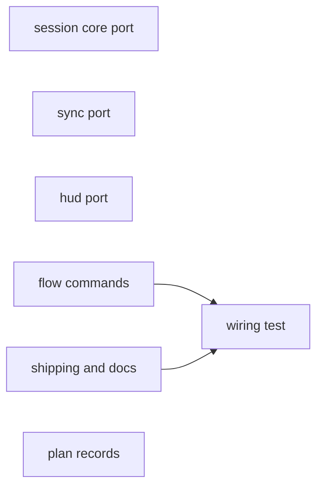

# Integration: session move-out and sync with main

**Goal:** Port the approved move-out and sync prototype onto the PR #25 branch, wire `ASK move` and the sync offer into every flow and shipping, and document it.
**Architecture:** `session.py` moves the open host session out on a second ensure (`ASK move`, untracked gate, `_split_move` rollback) and records `base_sha`/`moved_from`/`moved_at`; `session_sync.py` implements `sl session sync` (ff, merge, CONFLICT exit 5, `--continue`, `--abort`, `--later`); `session_hud.py` adds `| main:+N`, `| needs-sync`, the moved-out line and the offer line; `hooks/session-start` reads only the first HUD line for project state.
**Tech stack:** Python stdlib, bash (3.2-safe builtins), pytest
**Spec:** docs/plans/2026-10-31-session-sync.feature.md
**Review plan:** docs/plans/2026-10-31-session-sync.feature.md
**Prototype:** .superlite/sandboxes/session-sync-proto (branch superlite/session-sync-proto; approved by the human 2026-10-31). Port from its working tree file by file; it holds no stubs.
**Detail:** tests
**Target-min:** 20

## Global constraints

- language: python
- test command: `uv run pytest tests/scripts -q`
- FROZEN: `split` behaviour and output; `REDIRECT` + exit 3; exit 2 = error; exit 4 = ASK (`ASK untracked`, `ASK move`); exit 5 = CONFLICT; `SESSION worktree=… slug=… branch=…` as ensure's last line; HUD existing fields (only `| main:+N`, `| needs-sync`/`| conflict`, the moved-out line and the offer line added)
- No command ever runs `git fetch`, `git push`, `git pull`, `git rebase` or a force option
- Stdlib only; every script line carries a `# O(...)` comment; LF endings; hooks bash builtins only and run under /bin/bash 3.2
- Every test from before PR #25 passes unchanged; round-1 tests of this PR may only gain `--move yes` in their setup (as in the prototype)
- `skills/using-superlite/SKILL.md` is not touched; no version bump; do not touch `bench/` or other `docs/plans/` files

```mermaid
%% schedule
gantt
  title Predicted schedule (mm:ss)
  dateFormat X
  axisFormat %M:%S
  section lane 1
  T4 flow commands :t4, 0, 215s
  T6 wiring test :t6, 215, 84s
  section lane 2
  T1 session core port :t1, 0, 149s
  section lane 3
  T5 shipping and docs :t5, 0, 133s
  section lane 4
  T2 sync port :t2, 0, 119s
  section lane 5
  T3 HUD port :t3, 0, 119s
  section lane 6
  T7 plan records :t7, 0, 80s
```

critical path: T4 → T6 (5.0 min) · peak width 6 · predicted build 5.0 min · predicted total ≈ 18.7 min (target ✓)

### T1 session core port · Complexity 4 · Est. context 40k
**Owns:** skills/swarm/scripts/session.py, tests/scripts/test_session_moveout.py, tests/scripts/test_session_ensure.py, tests/scripts/test_session_finish_mark.py
**Components:** 2
**LOC owned:** 400
**Tests:** fast
**Model:** sonnet
**Kind:** logic
**Depends on:** —
**Produces:** session.base_sha_of(root, reg, row) -> str; ensure move-out with `--move yes`; `session.py sync …` delegation
e.g. ensure --slug b while host session a is open -> `ASK move slug=a: …`, exit 4
**Consumes:** —
**Verify:** uv run pytest tests/scripts/test_session_moveout.py tests/scripts/test_session_ensure.py tests/scripts/test_session_finish_mark.py tests/scripts/test_session.py tests/scripts/test_session_split.py -q
**Done when:** the four files are byte-identical to the prototype's; all listed tests pass

### T2 sync port · Complexity 3 · Est. context 30k
**Owns:** skills/swarm/scripts/session_sync.py, tests/scripts/test_session_sync.py
**Components:** 1
**LOC owned:** 330
**Tests:** fast
**Model:** sonnet
**Kind:** logic
**Depends on:** —
**Produces:** session_sync.main(argv) -> int
e.g. conflict on the same line -> `CONFLICT b: app.py`, exit 5
**Consumes:** —
**Verify:** uv run pytest tests/scripts/test_session_sync.py -q
**Done when:** both files byte-identical to the prototype's; tests pass (they need T1's session.py in the tree; run after it lands or note it)

### T3 HUD port · Complexity 2 · Est. context 20k
**Owns:** skills/swarm/scripts/session_hud.py, hooks/session-start, tests/scripts/test_session_hud_sync.py
**Components:** 2
**LOC owned:** 140
**Tests:** fast
**Model:** sonnet
**Kind:** logic
**Depends on:** —
**Produces:** HUD `| main:+N`, `| needs-sync`, moved-out line, offer line
**Consumes:** —
**Verify:** uv run pytest tests/scripts/test_session_hud_sync.py tests/scripts/test_session_run_state.py tests/scripts/test_session.py tests/scripts/test_session_start.py tests/scripts/test_hooks_bash32.py -q
**Done when:** the three files byte-identical to the prototype's; hooks/cost-report unchanged; tests pass

### T4 flow commands · Complexity 3 · Est. context 24k
**Owns:** commands/start.md, commands/small.md, commands/mvp.md, commands/feature.md, commands/debug.md, commands/review.md, skills/inventing/SKILL.md
**Components:** 7
**LOC owned:** 30
**Tests:** fast
**Model:** sonnet
**Kind:** logic
**Depends on:** —
**Produces:** every flow handles `ASK move` and the `superlite sync:` offer
**Consumes:** —
**Verify:** uv run pytest tests/scripts/test_flow_session_wiring.py tests/scripts/test_session_split.py tests/scripts/test_feature_flow.py -q
**Done when:** start.md byte-identical to the prototype's; small.md, mvp.md, feature.md, debug.md, review.md and inventing/SKILL.md each gain at most 2 lines reusing start.md's `ASK move` and `superlite sync:` wording, placed right after their existing `ASK untracked` line; no other wording changes

### T5 shipping and docs · Complexity 3 · Est. context 26k
**Owns:** skills/shipping/SKILL.md, docs/sessions.md, docs/tools.md
**Components:** 3
**LOC owned:** 80
**Tests:** fast
**Model:** sonnet
**Kind:** logic
**Depends on:** —
**Produces:** shipping shows `sl session status` after a local merge and handles `ASK move`; docs for move-out and sync
**Consumes:** —
**Verify:** uv run pytest tests/scripts/test_session_split.py tests/scripts/test_agent_files.py tests/scripts/test_flow_session_wiring.py -q
**Done when:** shipping step 5 "Merge locally" ends with `sl session status` and one sentence that each session behind main is offered the update in its own chat (nothing is synced automatically); shipping's close step handles `ASK move` like `ASK untracked`; docs/sessions.md gains "Move-out" and "Sync with main" sections (ASK move + `--move yes`, moved-out HUD line, base_sha, `main:+N`, offer line and `--later`, `sync` ff/merge, CONFLICT exit 5, `--continue`/`--abort`, needs-sync, never fetches), the ensure table row "main checkout, active session open" now says both move out, and the sync row in the command table; docs/tools.md `session` row lists `sync`; mermaid diagrams kept

### T6 wiring test · Complexity 2 · Est. context 14k
**Owns:** tests/scripts/test_flow_session_wiring.py
**Components:** 1
**LOC owned:** 30
**Tests:** fast
**Model:** sonnet
**Kind:** logic
**Depends on:** T4, T5
**Produces:** wiring test covers ASK move and the shipping status step
**Consumes:** —
**Verify:** uv run pytest tests/scripts/test_flow_session_wiring.py -q
**Done when:** each flow file mentions `ASK move` and `superlite sync:`; skills/shipping/SKILL.md mentions `ASK move` and `sl session status`; existing cases kept; a tmp_path negative case per new assertion

### T7 plan records · Complexity 1 · Est. context 4k
**Owns:** docs/plans/2026-10-31-session-sync.feature.md, docs/plans/2026-10-31-session-sync.md
**Components:** 1
**LOC owned:** 0
**Tests:** fast
**Model:** sonnet
**Kind:** logic
**Depends on:** —
**Produces:** the round-2 feature and integration plans committed with the work
**Consumes:** —
**Verify:** test -f docs/plans/2026-10-31-session-sync.feature.md
**Done when:** coordinator bookkeeping, no agent work

## Review Focus

- App type: cli plugin scripts, bash hooks and agent instruction text
- Risks: drift from the approved prototype; instruction text that contradicts start.md or the shipped exit codes; docs that promise a fetch or automatic sync
