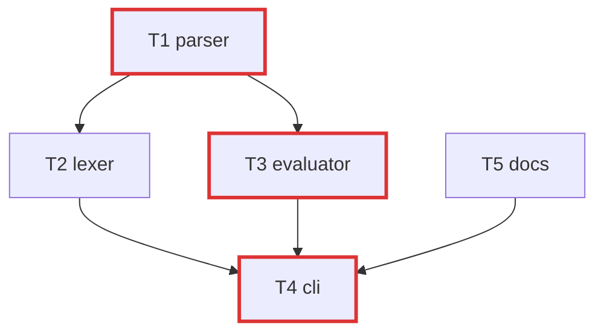
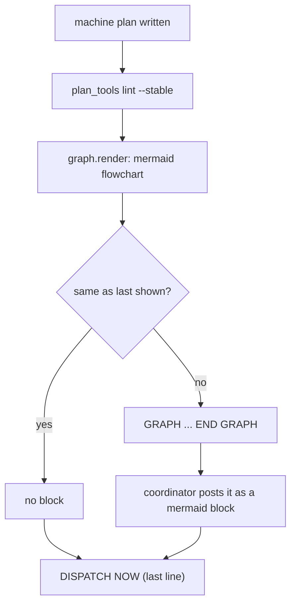

# Feature plan: show the machine plan's diagram in the chat

## Goal

As soon as a machine plan is generated, the person running the build sees its task graph in the chat as a mermaid flowchart. It shows which tasks run side by side, which wait on others, and which ones form the critical path. This is standard for every orchestrated build (regular, MVP, feature prototype and integration, review), with nothing to turn on. For now the form is always a mermaid `flowchart`, on every host. The mermaid `graph` keyword is never used because it doesn't render in Claude Code.

## What changes

- **When it shows.** The coordinator always runs `plan_tools lint --plan $PLAN --spec SPEC --stable` right after it writes the machine plan. That lint prints a framed `GRAPH ... END GRAPH` block, and the coordinator posts its body to the user as a fenced `mermaid` block before dispatching. The block prints again only when the flowchart changes, such as a task or edge being added after a fix round. `DISPATCH NOW:` stays the last line.
- **What it prints:** a `GRAPH (show the user as a mermaid block):` line, then the flowchart, then `END GRAPH`. The coordinator posts only the flowchart, which looks like this:

  Nodes are labelled with the task id and title. Edges come from the `%% taskgraph` block. Lint's critical path (the one it saves in `stable.json`) gets the red, thick `critical` style. A task with no edges still shows as a lone node. Output is deterministic (nodes in id order, T2 before T10). Characters that break a label become plain look-alikes (`"` and `` ` `` to `'`, `[ ] < >` to `( )`, `#` to `no. `), because the chat shows mermaid entity codes such as `#34;` as literal text. Accents and other non-ASCII characters pass through.
- **Fail open:** if the flowchart can't be drawn, lint prints `graph: not drawn (<reason>)` on stderr and finishes as usual.
- **`superlite-cli graph --plan <plan>`:** prints the same flowchart on demand.
- **`/superlite:status`:** shows the flowchart in a `mermaid` block below the status lines.
- **`skills/swarm/SKILL.md`:** one phrase says to show lint's `GRAPH` block to the user as a mermaid block. The skill stays at or under 12,500 characters.
- **Docs:** the `graph` row in `docs/tools.md` describes the flowchart.

Not in scope: the ASCII drawing (it goes away), picking a form per host, rendering images or artifacts, and opening the plan in a pane.

## Acceptance checks

- The first `lint --stable` on a fixture with edges `T1->T2, T1->T3, T2->T4, T3->T4, T5->T4` prints a `GRAPH` block. It holds `flowchart TD`, the five edges and `class T1,T3,T4 critical`, and the last line is `DISPATCH NOW: ...`.
- The coordinator posts the block in the chat and Claude Code draws it, with the critical path in red.
- No output from lint, `graph` or `/superlite:status` contains the mermaid `graph` keyword.
- Re-linting an unchanged plan prints no block, and adding an edge prints it again.
- Titles with `"`, `[` or `]` still give a flowchart that renders.
- An unparseable `%% taskgraph` still lets lint finish with `DISPATCH NOW:`, and stderr has `graph: not drawn`.
- `graph --plan P` prints the flowchart.
- `/superlite:status` shows the diagram.
- Existing tests pass, and `skills/swarm/SKILL.md` stays at or under 12,500 characters.

## Flow

## Code map

- **Entry points.** `skills/swarm/scripts/superlite-cli <tool>` runs `<tool>.py`. Right after writing the plan, and after each fix round, the coordinator runs `plan_tools lint --stable` (`skills/swarm/SKILL.md`, "Planning check"). In human mode, lint is blocked until the plan is approved (`orchestrator.require`).
- **Lint seam.** `plan_lint.py:_graph_lines(plan_path, run_dir, critical)` draws the flowchart, compares it with `.superlite/graph-shown.txt`, and returns the framed lines. `cmd_lint_stable` prints them before `_print_report`. Only the header wording changes here.
- **Renderer.** In `graph.py`, `render(plan_path, critical=None)` returns the mermaid flowchart instead of the ASCII drawing. It is still cached in `.superlite/graph.txt` with its `# hash:` head line. `_parse_graph` (deps; raises `ValueError` on a missing block or a cycle) and `_longest_path` stay. `_tiers`, `_draw` and `_cell` go if nothing else uses them. Titles come from `planfile.Plan(text).tasks` (`Task.title`), and mermaid labels need `"` and `[]` escaped.
- **Touched files.** `graph.py`, `plan_lint.py` (`_graph_lines` header), `commands/status.md`, `skills/swarm/SKILL.md` (one phrase), `docs/tools.md`, `tests/scripts/test_graph.py` and `tests/scripts/test_stable_split.py`.
- **Interfaces that must not change.** These stay as they are: `graph.render(plan_path[, critical])`, `superlite-cli graph --plan`, `stable.json` keys, lint's report lines with `DISPATCH NOW:` last, `lint-log.jsonl` entries, and the `graph: not drawn (<reason>)` stderr line.
- **Conventions.** Stdlib only. Guard clauses first and nesting at most 3. Complexity notes go on function header lines only. Lint side steps fail open via `base.advisory_errors()`. Behavior tests are subprocess lint runs on fixture plans, never markdown greps. No back-compat shims, so the ASCII path is deleted rather than kept. Shipped text says "checkpoint", never "commit".
- **UI component set.** None. The output is text that the harness renders.

## Prototype scope

Keep the real `graph.py` and `_graph_lines`, run on a fixture plan in the prototype worktree. Nothing is stubbed. Level L1. To try it, run lint and post the block here to see it draw. About 2 tasks: the mermaid `render` with tests, then the lint header and the status and skill wording.

## Integration outline

1. `graph.py`: the mermaid `render`, label escaping, and removal of the ASCII helpers. Tests in `test_graph.py` cover edges, the critical class, lone nodes, escaping and determinism.
2. `plan_lint.py:_graph_lines` header. Tests in `test_stable_split.py` cover the block on the first lint, no block on re-lint, the block again on a change, fail-open, and `DISPATCH NOW:` staying last.
3. Wording: the `skills/swarm/SKILL.md` phrase, `commands/status.md` and `docs/tools.md`.
4. Seam check: a full `lint --stable` on a bench plan, then `test_name_scan.py`, `test_code_shape.py` and the full suite.
