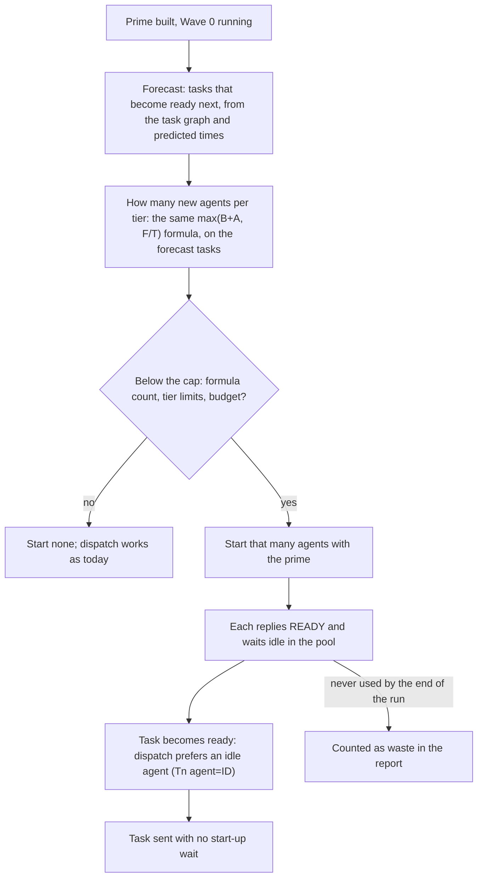

# Early agents: draft plan (stored for later)

**Status:** draft, not approved. Build after the simplify-bloat restructure lands, on the new dispatch area.

## Summary
Today an implementer is created only once a task is ready: dispatch prints `Tn fresh`, the coordinator sends the prime,
waits for `READY`, then sends the task. Start-up and the prime read therefore sit on the critical path for every fresh
agent. This feature starts the agents the next tasks will need while those tasks still wait on their inputs, so each
task goes to an agent that is already primed and idle.

## How it works

## What changes
| Part | Change |
|---|---|
| Dispatch | A `forecast` step: predicted ready times for not-yet-ready tasks, and the agent count the formula would pick for them, per tier |
| Dispatch output | A new line kind, `prespawn tier=T agent=TYPE count=N`, printed once after the prime is built and again when a wave's forecast changes |
| Pool | Agents started early carry `early: true` until their first task, so the report can count unused ones |
| Swarm skill | One line: start `prespawn` agents in the same message as the other dispatches; send nothing but the prime |
| Report | Early agents started, used and unused, plus the prime cost of the unused ones |

## Guards
- Never more early agents than the formula picks for the forecast tasks, and never past a tier's limits.
- None when the run is over budget (`WARN` or `OVER CAP`).
- None for critical-path tasks predicted more than one prime read away, since the forecast is least reliable there.
- Off with `--no-prespawn` or a config switch, so the timing test below can compare on and off.

## How we will know it works
- Scheduler property test: over random graphs, early agents never exceed the formula's count or a tier's limits, and
  dispatch never sends a task before its inputs are checkpointed.
- Fake-agent swarm run: the run completes and every early agent is either used or reported as unused.
- Fake-agent timing test: the scripted run is given a fixed start-up and prime-read delay per agent. With early agents
  on, the critical path shrinks by that delay for each early agent used, and cost counts only one prime per agent
  started. It is deterministic and costs no model calls.
- One-turn instruction test: an implementer given only the prime replies `READY` and waits, and starts its task when
  the task message arrives. About $0.02.

## Open questions
- How far ahead to forecast: only the next wave (default), or the whole run?
- Should an unused early agent be released after a time, or kept until the run ends?
- Does the Cursor host swarm path need its own variant?

## Rough time and cost
Build: about 30 to 60 minutes and $10 to $25. Tests: no benchmark; one-turn instruction test about $0.02.
