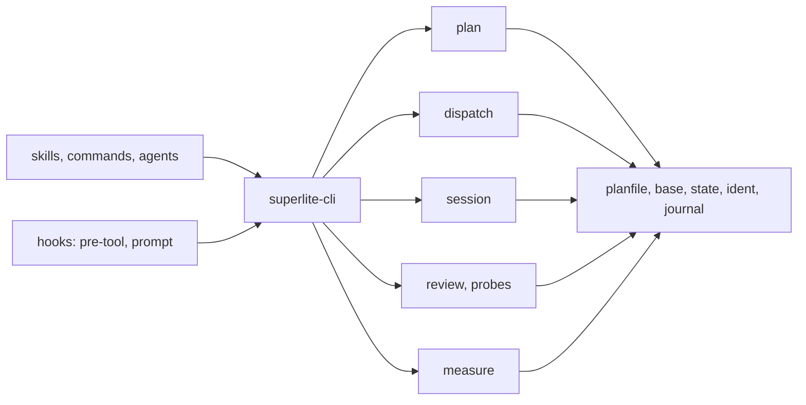
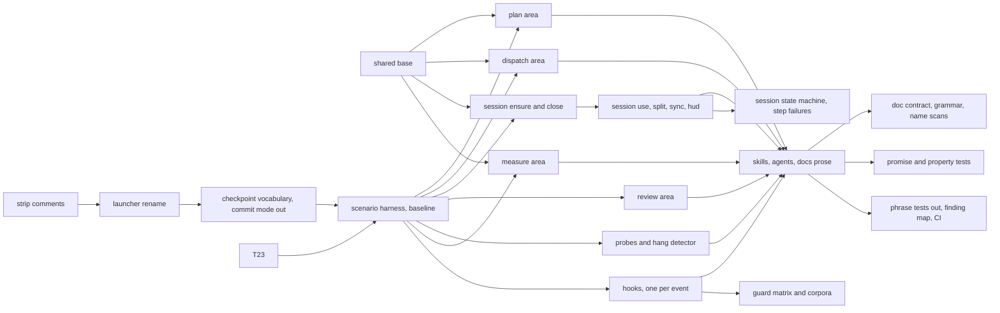

# Simplify superlite: machine plan

**Review plan:** docs/plans/2026-11-01-simplify-bloat.review.md
**Goal:** restructure superlite's runtime and tests as the review plan says; no behavior change except the listed removals.
**Architecture:** one plan reader and one base module under `skills/swarm/scripts/`; tool areas plan, dispatch, session, review, measure on top; hooks one process per event.
**Tech stack:** Python 3.10+ stdlib (runtime), bash 3.2 (hooks), pytest (+ hypothesis, tests only).
**Spec:** docs/plans/2026-11-01-simplify-bloat.review.md
**Detail:** contracts
**Target-min:** 40
**Budget-usd:** 160

## Global constraints
- Test command: `uv run pytest tests/scripts -q`. Runtime stays stdlib only; LF endings; hooks run under bash 3.2.
- Launcher is `skills/swarm/scripts/superlite-cli`; the brief variable is `$CLI`. No `sl`, `$SL`, `scripts/sl`, alias table or old tool name anywhere shipped (`docs/plans/`, `docs/specs/`, `bench/` excepted).
- No backward compatibility: no aliases, migrations or old-format detection.
- superlite's own vocabulary is "checkpoint", never "commit". The only commit is at session finish, on `superlite/sessions/<slug>`, after the user's yes.
- Functions: guards first (preconditions return or raise at once with a clear message), nesting at most 3, catch-everything only at a tool's or hook's entry point, and it logs what it swallowed.
- Complexity comments: only on `def` lines, and only when not `O(1)`. No "Complexity notation" legends.
- After T4, only `state.py` spells a `.superlite` path; paths compare whole via `ident.same_path`; slugs and stashes match exactly.
- Frozen output lines: `DISPATCH NOW:`, `STABLE:`, `FIX:`, `TIERS:`, `SESSION worktree=`, `REDIRECT`, `ASK untracked=`, `ASK move`, `CONFLICT`, `SUSPECT HANG`, `Tn <sha>`, `Verdict:`.
- No script file over 600 lines. Each task removes phrase-grep asserts from the test files it owns.

## Main diagram

## Task graph

```mermaid
%% schedule
gantt
  title Predicted schedule (mm:ss)
  dateFormat X
  axisFormat %M:%S
  section lane 1
  T4 shared base :t4, 0, 238s
  T5 scenario harness and baseline :t5, 378, 216s
  T6 plan area :t6, 593, 252s
  T17 session state machine and step failu :t17, 1083, 182s
  section lane 2
  T1 strip complexity comments :t1, 0, 85s
  T2 launcher rename :t2, 85, 127s
  T3 checkpoint vocabulary  commit mode ou :t3, 213, 165s
  T10 review area :t10, 593, 252s
  T14 skills  agents  docs prose :t14, 1083, 149s
  T16 promise and property tests :t16, 1232, 227s
  section lane 3
  T8 session ensure and close :t8, 593, 251s
  T9 session use  split  sync  hud :t9, 844, 239s
  T15 doc contract  grammar  name scans :t15, 1232, 165s
  section lane 4
  T11 probes and hang detector :t11, 593, 239s
  T19 phrase tests out  finding map  CI :t19, 1232, 165s
  section lane 5
  T12 measure area :t12, 593, 228s
  section lane 6
  T7 dispatch area :t7, 593, 195s
  T18 guard matrix and corpora :t18, 788, 155s
  section lane 7
  T13 hooks  one per event :t13, 593, 195s
```

critical path: T1 → T2 → T3 → T5 → T8 → T9 → T14 → T16 (24.3 min) · peak width 7 · predicted build 24.3 min · predicted total ≈ 33.2 min (target ✓)
Ruling: accept plan size over 15k - 19 tasks with exact Owns lists; the prime stays slim (5.3k) - cost if wrong: slower lint and task reads
`Ruling: sequential [chain-7a83] - T1, T2, T3 each rewrite most files and must land alone before any area moves; T5 records today's behavior before the areas change it - cost if wrong: about 10 minutes of critical path.`

## Tasks

### T1 strip complexity comments · Complexity 2 · Est. context 30k
**Owns:** skills/swarm/scripts/**/*.py, skills/swarm/probes/**/*.py, skills/swarm/scripts/sl, hooks/**, tests/**/*.py
**Components:** 1
**LOC owned:** 80
**Tests:** fast
**Kind:** mechanical
**Model:** haiku
**Produces:** none
**Steps:** a one-off script in the scratchpad (not committed to the repo) removes every trailing `# O(...)` and `| O(...)` fragment except on `def` lines whose note is not `O(1)`, keeps any text before `|`, and deletes "Complexity notation" legend blocks.
**Test code:** `test_no_complexity_comments` (new, tests/scripts/test_code_shape.py): no non-`def` line in those globs matches `#.*\bO\(`; a `def f():  # O(n)` line is kept; `x = 1  # Review Focus: rounding | O(1)` becomes `x = 1  # Review Focus: rounding`. Full suite still green.

### T2 launcher rename · Complexity 3 · Est. context 45k
**Owns:** skills/swarm/scripts/sl, skills/swarm/scripts/superlite-cli, skills/**/*.md, commands/*.md, agents/*.md, hooks/**, .opencode/plugins/superlite.js, .pi/extensions/superlite.ts, index.js, GEMINI.md, README.md, docs/*.md, tests/**/*.py, assets/flows/*.txt
**Components:** 1
**LOC owned:** 400
**Tests:** fast
**Model:** sonnet
**Produces:** `superlite-cli <tool> [args]` (same exit codes as `sl`: 2 unknown tool, 3 no Python)
**Steps:** `git mv` sl to superlite-cli; replace every `sl <tool>`, `$SL`, `scripts/sl` with `superlite-cli`, `$CLI`, `scripts/superlite-cli`; update the gate pattern in hooks/block-coordinator-edits and the command built in hooks/rewrite-test-runs.
**Test code:** `test_cli_runs_a_tool`: `superlite-cli orchestrator status` exits 0; `test_sl_is_gone`: `skills/swarm/scripts/sl` does not exist; `test_gate_blocks_new_name`: human mode unapproved, a Bash call `bash x/superlite-cli dispatch --plan p` is denied by block-coordinator-edits.

### T3 checkpoint vocabulary, commit mode out · Complexity 4 · Est. context 60k
**Owns:** skills/swarm/scripts/autocommit.py, skills/swarm/scripts/commit_task.py, commands/commit.md, skills/swarm/scripts/checkpoint.py, skills/swarm/scripts/finish.py, skills/swarm/scripts/session_sync.py, skills/swarm/scripts/models_refresh.py, skills/swarm/probes/adapter_template.py, skills/shipping/SKILL.md, skills/drafting/review-plan.md, tests/scripts/test_autocommit.py, tests/scripts/test_checkpoint_rename.py, tests/scripts/test_models_refresh.py, tests/scripts/test_session_sync.py, tests/scripts/test_run_scripts.py
**Components:** 3
**LOC owned:** 350
**Tests:** fast
**Model:** sonnet
**Produces:** `finish.summary(...)` text says "checkpoint" only · `session_sync` fast-forward only
**Steps:** delete autocommit, commit_task, commands/commit.md, models_refresh, adapter_template and their tests; checkpoint always writes hidden refs; ledger line `- checkpoint Tn <sha>` only; shipping asks once at session end "Commit to <branch>" / "Leave uncommitted" and commits only on the session branch; review-plan template loses the Commits decision; sync does `merge --ff-only` and prints `session: needs a merge commit; not synced` (exit 2) otherwise.
**Test code:** `test_checkpoint_never_moves_head` (HEAD, index and branch unchanged after checkpoint), `test_sync_refuses_merge_commit` (diverged branch: exit 2, branch sha unchanged), `test_finish_text_has_no_commit_word`.

### T4 shared base · Complexity 6 · Est. context 55k
**Owns:** skills/swarm/scripts/planfile.py, skills/swarm/scripts/base.py, skills/swarm/scripts/state.py, skills/swarm/scripts/ident.py, skills/swarm/scripts/journal.py, tests/scripts/test_base.py
**Components:** 5
**LOC owned:** 600
**Tests:** fast
**Model:** sonnet
**Produces:** `planfile.read(path: str) -> Plan` · `Plan.tasks -> dict[str, Task]` · `Plan.edges -> list[tuple[str, str]]` · `Plan.waited_edges() -> list[tuple[str, str]]`
  e.g. `read("p.md").waited_edges()` -> `[("T1", "T3")]` when T1 -> T2 has e.g. examples for every interface T2 consumes and T1 -> T3 does not
**Produces:** `Task.owns -> list[str]` · `Task.produces -> list[str]` · `Task.consumes -> list[str]` · `Task.examples -> list[str]`
  e.g. `read("p.md").tasks["T2"].owns` -> `["src/a.py", "tests/test_a.py"]` (braces expanded)
**Produces:** `base.git(*args: str, cwd: Path, check: bool = True) -> subprocess.CompletedProcess` (raises `base.GitError`, never exits) · `base.read_json(path: Path, default) -> object` · `base.write_json(path: Path, data) -> None` (atomic) · `base.kill_tree(pid: int) -> None` · `base.spawn_background(argv: list[str], log: Path) -> int` · `base.flag(env: str, path: Path, key: str, default: bool) -> bool`
  e.g. `base.read_json(Path("missing.json"), {})` -> `{}`
**Produces:** `state.run_dir(start: Path) -> Path` · `state.hub_root(start: Path) -> Path` · `state.path(start: Path, name: str) -> Path`
  e.g. `state.path(Path("/r/wt"), "pool.json")` -> `Path("/r/wt/.superlite/pool.json")`
**Produces:** `ident.same_path(a: Path, b: Path) -> bool` · `ident.within(child: Path, parent: Path) -> bool`
  e.g. `ident.within(Path("/r/host-extra"), Path("/r/host"))` -> `False`
**Produces:** `journal.Journal()` context manager: `.undo(fn)` registers an undo; on an exception the undos run newest first and the error is re-raised naming the failed step · `base.locked_update(path: Path, fn) -> dict` (lock, read, fn, atomic write)
  e.g. `locked_update(p, lambda d: {**d, "a": 1})` on `{}` -> `{"a": 1}`
**Review Focus:** state: two processes running `locked_update` 50 times each end with 100 increments; file: `write_json` leaves no partial file when killed mid-write.
**Test code:** each `e.g.` above as a test; `test_journal_undoes_newest_first`; `test_git_error_does_not_exit`.

### T5 scenario harness and baseline · Complexity 5 · Est. context 60k
**Owns:** tests/scripts/scenario.py, tests/scripts/fake_agent.py, tests/scripts/test_flows.py, tests/scripts/fixtures/flow_plan.md
**Components:** 3
**LOC owned:** 500
**Tests:** slow
**Model:** sonnet
**Produces:** scenario.Repo(tmp_path: Path) -> Repo
  e.g. scenario.Repo(tmp).cli("session", "ensure", "--slug", "x").code -> 0
**Produces:** fake_agent.do(task_id: str, plan: Path, repo: Repo) -> None
**Notes:** Repo is a temp git repo with one commit; `Repo.cli(*args)` returns `(code, out, err)`; `Repo.state(name)` reads a run-state file. `fake_agent.do` writes the task's Owns files from its e.g. examples.
**Test code:** `test_flow_<mode>` for regular, mvp, feature, debug, small, review: the flow's command sequence ends with the session finished, the checkout back on its base and exit codes as recorded; `test_fake_swarm_run`: lint, dispatch, fake work, checkpoint until done, packet and finish; ledger lists every task once, report written, `git log` unchanged.

### T6 plan area · Complexity 6 · Est. context 75k
**Owns:** skills/swarm/scripts/plan_tools.py, skills/swarm/scripts/plan_lint.py, skills/swarm/scripts/plan_schedule.py, skills/swarm/scripts/plan_stubs.py, skills/swarm/scripts/shape.py, skills/swarm/scripts/task.py, skills/swarm/scripts/wave0.py, skills/swarm/scripts/graph.py, skills/swarm/scripts/routing.py, skills/swarm/config/routing.json, tests/scripts/test_plan_tools.py, tests/scripts/test_stable_split.py, tests/scripts/test_shape.py, tests/scripts/test_routing.py, tests/scripts/test_wave0.py, tests/scripts/test_graph.py
**Components:** 4
**LOC owned:** 900
**Tests:** fast
**Model:** sonnet
**Consumes:** planfile.read(path: str) -> Plan (T4)
**Produces:** `superlite-cli plan lint|schedule|stubs|taskgraph|adapter|packet|contract` (output lines unchanged; `prune` removed)
**Steps:** plan_tools.py becomes the entry over plan_lint, plan_schedule, plan_stubs; shape folds into plan_schedule; schedule, lint and stable use `waited_edges`; the plan file is never rewritten; routing drops per-rule evidence fields.
**Test code:** `test_example_edge_not_waited`, `test_no_prune_command` (exit 2), `test_lint_mutations` (missing Owns, overlapping Owns, cycle, Produces/Consumes mismatch, oversized task: each gives its own code; clean plan all STABLE).

### T7 dispatch area · Complexity 5 · Est. context 60k
**Owns:** skills/swarm/scripts/dispatch.py, skills/swarm/scripts/next_tasks.py, skills/swarm/scripts/assign.py, skills/swarm/scripts/split.py, tests/scripts/test_dispatch_swarm.py, tests/scripts/test_batching.py, tests/scripts/test_spawn_free.py
**Components:** 3
**LOC owned:** 600
**Tests:** fast
**Model:** sonnet
**Consumes:** planfile.read(path: str) -> Plan (T4)
**Produces:** `superlite-cli dispatch [--plan P] [--cap N] [--batch 1]` and `dispatch ready|assign` subcommands (line formats unchanged)
**Steps:** merge next_tasks, assign and split into dispatch (split's brute-force oracle moves to tests); batch keys `max_tasks`, capacity and weights removed; reuse limit only from the tier config; the fix reuse limit becomes `fix_reuse` in the tier config.
**Test code:** `test_five_equal_tasks_split_2_2_1`, `test_never_busy_agent`, `test_ready_respects_waited_edges`.

### T8 session ensure and close · Complexity 7 · Est. context 75k
**Owns:** skills/swarm/scripts/session.py, skills/swarm/scripts/session_ensure.py, skills/swarm/scripts/session_registry.py, tests/scripts/test_session_ensure.py, tests/scripts/test_session_moveout.py, tests/scripts/test_session_finish_mark.py
**Components:** 3
**LOC owned:** 800
**Tests:** slow
**Model:** sonnet
**Consumes:** state.path(start: Path, name: str) -> Path (T4) · ident.same_path(a: Path, b: Path) -> bool (T4)
**Produces:** session_registry.read(root: Path) -> dict
  e.g. session_registry.read(Path("/r")) -> {"sessions": [], "base": "main"}
**Produces:** session_registry.update(root: Path, fn) -> dict
  e.g. session_registry.update(Path("/r"), lambda d: {**d, "base": "dev"}) -> {"sessions": [], "base": "dev"}
**Notes:** also uses T4's `journal.Journal` and `base.locked_update`; registry writes go only through `update`.
**Steps:** session.py becomes the entry; ensure, create and close move to session_ensure; registry I/O to session_registry; all checks run before the first change; multi-step changes run in a Journal; `ASK move` and `ASK untracked` print the exact question text to ask; legacy host and adoption paths deleted; the `sync` help text says fast-forward only.
**Test code:** `test_move_then_untracked_asked_before_any_change`, `test_keep_leaves_untracked_on_main`, `test_failed_switch_restores_everything` (git fails at each step in turn).

### T9 session use, split, sync, hud · Complexity 6 · Est. context 70k
**Owns:** skills/swarm/scripts/session.py, skills/swarm/scripts/session_switch.py, skills/swarm/scripts/session_sync.py, skills/swarm/scripts/session_hud.py, skills/swarm/scripts/exclusive.py, tests/scripts/test_session.py, tests/scripts/test_session_split.py, tests/scripts/test_session_sync.py, tests/scripts/test_session_hud_sync.py, tests/scripts/test_session_run_state.py, tests/scripts/test_exclusive.py
**Components:** 3
**LOC owned:** 700
**Tests:** slow
**Consumes:** session_registry.update(root: Path, fn) -> dict (T8)
**Notes:** multi-step changes use T4's `journal.Journal`.
**Model:** sonnet
**Produces:** `superlite-cli session use|split|discard|sync|status` (lines unchanged)
**Steps:** use, split and discard move to session_switch on the Journal; stashes found by object id; hud and peer suspension use `locked_update`; tests/scripts/test_session.py stops calling the deleted hook files (hooks/prompt replaced cost-report and the HUD hook).
**Test code:** `test_auth_never_takes_auth_api_stash`, `test_split_rolls_back_on_failure`, `test_peers_released_after_last_run`.

### T10 review area · Complexity 6 · Est. context 75k
**Owns:** skills/swarm/scripts/pt_review.py, skills/swarm/scripts/review_packet.py, skills/swarm/scripts/review_contract.py, skills/swarm/scripts/review_adapter.py, skills/swarm/scripts/incident.py, tests/scripts/test_pt_review.py, tests/scripts/test_incident.py
**Components:** 4
**LOC owned:** 900
**Tests:** fast
**Model:** sonnet
**Consumes:** planfile.read(path: str) -> Plan (T4)
**Produces:** `superlite-cli plan adapter|packet|contract` bodies (output unchanged)
**Steps:** pt_review's own Plan, Task, parse_plan, expand_braces and split_top are deleted in favour of planfile; split into the three review modules.
**Test code:** `test_packet_caps` (120 lines per file, 600 overall, under the token cap on a large diff), `test_seam_mismatch_is_incident`.

### T11 probes and hang detector · Complexity 5 · Est. context 70k
**Owns:** skills/swarm/probes/probe_run.py, skills/swarm/probes/pack/*.py, skills/swarm/scripts/testprobe.py, skills/swarm/scripts/run_tests.py, skills/swarm/scripts/testcmd.py, skills/swarm/scripts/_pyrun.py, tests/scripts/test_probe_run.py, tests/scripts/test_testprobe.py, tests/scripts/test_rewrite_test_runs.py
**Components:** 3
**LOC owned:** 700
**Tests:** slow
**Model:** sonnet
**Consumes:** base.kill_tree(pid: int) -> None (T4) · base.spawn_background(argv: list[str], log: Path) -> int (T4)
**Produces:** none new (lines `SUSPECT HANG`, `TIMEOUT` unchanged)
**Steps:** probe_run splits under 600 lines; process kill and background start come from base; `--commit` flag removed; `_pyrun` folds into run_tests.
**Test code:** `test_sleeping_test_is_blocked`, `test_spinning_test_is_spinning` (thresholds lowered by env), `test_not_killed_by_default`.

### T12 measure area · Complexity 5 · Est. context 65k
**Owns:** skills/swarm/scripts/metrics.py, skills/swarm/scripts/history.py, skills/swarm/scripts/report.py, skills/swarm/scripts/predict.py, skills/swarm/scripts/budget.py, skills/swarm/scripts/cost.py, skills/swarm/scripts/cost_live.py, skills/swarm/scripts/cost_table.py, skills/swarm/scripts/host_cost.py, skills/swarm/scripts/project_config.py, skills/swarm/scripts/agent_specs.py, skills/swarm/scripts/orchestrator.py, skills/swarm/scripts/proto.py, tests/scripts/test_metrics_history.py, tests/scripts/test_report.py, tests/scripts/test_cost_table.py, tests/scripts/test_host_cost.py, tests/scripts/test_orchestrator.py, tests/scripts/test_agent_specs.py, tests/scripts/test_project_config.py
**Components:** 4
**LOC owned:** 700
**Tests:** fast
**Model:** sonnet
**Consumes:** base.read_json(path: Path, default) -> object (T4) · base.flag(env: str, path: Path, key: str, default: bool) -> bool (T4)
**Produces:** cost.line(run_dir: Path) -> str | None
**Produces:** cost.table(run_dir: Path) -> str
**Steps:** cost_live, cost_table and host_cost merge into cost.py; orchestrator, proto, agent_specs and project_config use base for state; the legacy home lookup is removed.
**Test code:** `test_budget_lines_69_70_100` (nothing, `WARN`, `OVER CAP`, each printed once), `test_cost_line_matches_old_output`.

### T13 hooks, one per event · Complexity 5 · Est. context 55k
**Owns:** hooks/**, .opencode/plugins/superlite.js, .pi/extensions/superlite.ts, tests/scripts/test_block_coordinator_edits.py, tests/scripts/test_block_unsafe_kill.py, tests/scripts/test_human_gate.py, tests/scripts/test_capture_hooks.py, tests/scripts/test_hooks_bash32.py, tests/scripts/test_session_start.py, tests/scripts/test_compact_due.py
**Components:** 3
**LOC owned:** 600
**Tests:** fast
**Model:** sonnet
**Produces:** `hooks/pre-tool` (unsafe kill, coordinator edits, test-run rewrite, in that order) · `hooks/prompt` (human reply, compact nudge, cost and session lines only when changed) · `hooks/_preamble` (sourced)
**Steps:** register two hooks per harness instead of six; capture hooks keep their events; the gate pattern and test_human_gate drop `commit_task`.
**Test code:** `test_one_process_per_bash_call`, `test_prompt_lines_only_on_change`, existing guard tests unchanged in outcome.

### T14 skills, agents, docs prose · Complexity 4 · Est. context 60k
**Owns:** skills/**/*.md, commands/*.md, agents/*.md, docs/*.md, README.md, AGENTS.md, assets/flows/*.txt
**Components:** 2
**LOC owned:** 400
**Tests:** fast
**Model:** sonnet
**Steps:** flows keep one line "follow what `session ensure` prints"; fixer and implementer files keep only model and tier lines and point at the guides; prune step and "up to 3 tasks" text removed; tool names match the new areas; AGENTS.md size limit says 2,000; `using-superlite` stays at most 2,000 characters; every `autocommit`, `/superlite:commit` and `commit_task` mention goes and superlite's own steps say "checkpoint".
**Test code:** `test_skill_sizes` (using-superlite at most 2,000 characters, swarm at most 12,500).

### T15 doc contract, grammar, name scans · Complexity 4 · Est. context 45k
**Owns:** tests/scripts/test_doc_contract.py, tests/scripts/test_line_grammar.py, tests/scripts/test_name_scan.py
**Components:** 3
**LOC owned:** 350
**Tests:** fast
**Model:** sonnet
**Test code:** `test_every_cli_call_is_real` (tool, subcommand, flags and choices checked against each tool's parser); `test_made_up_command_fails`; `test_named_lines_are_declared`; `test_no_old_names`; `test_no_commit_word` (git command names in code allowed).

### T16 promise and property tests · Complexity 6 · Est. context 65k
**Owns:** tests/scripts/test_promises.py, tests/scripts/test_properties.py, tests/scripts/test_code_shape_rules.py
**Components:** 3
**LOC owned:** 600
**Tests:** slow
**Model:** sonnet
**Consumes:** scenario.Repo(tmp_path: Path) -> Repo (T5) · fake_agent.do(task_id: str, plan: Path, repo: Repo) -> None (T5)
**Test code:** one test per promise row in the review plan (D7/D48, D11, D4/D36, D34, D29/D30/D36, D6/D39, D13, D20/D25, D46/D47, D37, session start in every harness, peers, resume, stop, lean budgets); scheduler and checkpoint properties over random graphs; determinism (same bytes twice, other folder, shuffled env); `test_nesting_at_most_3`, `test_broad_except_only_at_entry`, `test_no_file_over_600_lines`.

### T17 session state machine and step failures · Complexity 6 · Est. context 55k
**Owns:** tests/scripts/test_session_machine.py, tests/scripts/test_step_failures.py, pyproject.toml, uv.lock
**Components:** 2
**LOC owned:** 400
**Tests:** slow
**Model:** sonnet
**Consumes:** scenario.Repo(tmp_path: Path) -> Repo (T5)
**Test code:** a hypothesis rule-based machine over ensure, use, split, sync, close, discard and file edits; invariants: no edited file lost, each branch checked out once, registry equals `git worktree list`, no session reads another's state; `test_each_step_fails_cleanly` for use, split, close and move-out.

### T18 guard matrix and corpora · Complexity 5 · Est. context 50k
**Owns:** tests/scripts/test_guard_matrix.py, tests/scripts/fixtures/guard_matrix.json
**Components:** 2
**LOC owned:** 450
**Tests:** fast
**Model:** sonnet
**Test code:** every run state times every event against the table; a pairing missing from the table fails; bypass corpus (quoted, `bash -c`, `$(...)`, env prefix, `cd x &&`, full path, multi-line) all denied; read-only corpus all allowed; malformed and oversized input allowed fast with no stdout junk; Claude, Cursor and OpenCode event forms give one decision; plan-text injection changes nothing.

### T19 phrase tests out, finding map, CI · Complexity 3 · Est. context 45k
**Owns:** tests/scripts/test_flow_session_wiring.py, tests/scripts/test_flow_diagrams.py, tests/scripts/test_open_in_harness.py, tests/scripts/test_feature_flow.py, tests/scripts/test_mvp_check.py, tests/scripts/test_slim_prime.py, tests/scripts/test_0_3_1_scripts.py, tests/scripts/test_gitignore.py, tests/scripts/test_tail.py, tests/live/test_fixer_tier.py, tests/live/test_final_reviewer_format.py, docs/plans/2026-11-01-simplify-bloat.findings.md, .github/workflows/tests.yml
**Components:** 3
**LOC owned:** 350
**Tests:** fast
**Model:** sonnet
**Steps:** delete the pure phrase files and the phrase asserts in the others; map all 122 Copilot findings (list in the coordinator's scratchpad, passed in the brief) to the test that covers them; add a Windows job; two one-turn live tests (fixer refuses a lower tier; final reviewer findings format), at most $0.02 and 30 s each.
**Test code:** `test_no_phrase_asserts_remain` lives in T15's name scan; the findings map has 122 rows with no empty test column.

### T21 launcher rename leftovers · Complexity 1 · Est. context 20k
**Owns:** .opencode/INSTALL.md, assets/help.txt, tests/scripts/fixtures/run_plan/fake_cli, tests/scripts/fixtures/run_plan/fake_sl, .cursor/rules/feature-worktrees.mdc, .kimi-plugin/plugin.json
**Components:** 1
**LOC owned:** 20
**Tests:** fast
**Model:** sonnet
**Produces:** none
**Notes:** files T2 renamed that its frozen Owns list missed; done by T2's agent, checkpointed as its own task.

### T22 commit mode removal leftovers · Complexity 1 · Est. context 20k
**Owns:** tests/scripts/test_gitignore.py, skills/swarm/scripts/superlite-cli
**Components:** 1
**LOC owned:** 40
**Tests:** fast
**Model:** sonnet
**Produces:** none
**Notes:** T3's edits outside its frozen Owns: the autocommit tests in test_gitignore.py go with autocommit; the launcher's tool list drops autocommit and commit_task. Done by T3's agent. The gate pattern and test_human_gate drop `commit_task` in T13.

### T23 tests that assumed real commits · Complexity 2 · Est. context 30k
**Owns:** tests/scripts/test_spawn_free.py, tests/scripts/test_stable_split.py, tests/scripts/test_wave0.py, tests/scripts/conftest.py, assets/help.txt, assets/intro.txt
**Components:** 1
**LOC owned:** 60
**Tests:** fast
**Model:** sonnet
**Produces:** none
**Notes:** fix F-T3-1: after T3, checkpoint writes hidden refs only; these tests read `git log` or HEAD for checkpoints and conftest sets the dead `SUPERLITE_AUTOCOMMIT`. Must be green before T5 records the baseline.

### T24 measure area leftovers · Complexity 1 · Est. context 25k
**Owns:** tests/scripts/test_cost_live.py, tests/scripts/test_superlite_home.py
**Components:** 1
**LOC owned:** 60
**Tests:** fast
**Model:** sonnet
**Produces:** none
**Notes:** test_cost_live moves onto cost.py (or merges into test_cost_table); the legacy ~/.superlite home test goes. Done by T12's agent.

### T25 dispatch area leftovers · Complexity 1 · Est. context 25k
**Owns:** tests/scripts/test_split.py, tests/scripts/test_run_scripts.py
**Components:** 1
**LOC owned:** 40
**Tests:** fast
**Model:** sonnet
**Produces:** none
**Notes:** split.py merged into dispatch.py; its tests move with it. Done by T7's agent.

### T26 hook rename leftovers · Complexity 2 · Est. context 30k
**Owns:** tests/scripts/test_rewrite_test_runs.py, tests/scripts/test_session_cost_rewrite.py, tests/scripts/test_hooks_cwd_first.py, skills/swarm/scripts/proto.py, assets/help.txt
**Components:** 1
**LOC owned:** 80
**Tests:** fast
**Model:** sonnet
**Produces:** none
**Notes:** fix F-T13-1: T13 merged six hooks into hooks/pre-tool and hooks/prompt; these tests and texts still name the deleted hook files.

### T27 T12 review fix · Complexity 1 · Est. context 20k
**Owns:** skills/swarm/scripts/agent_specs.py, tests/scripts/test_agent_specs.py
**Components:** 1
**LOC owned:** 20
**Tests:** fast
**Model:** sonnet
**Produces:** none
**Notes:** the T12 reviewer's fix (open_in_harness env alias). Its own task because re-checkpointing T12, which deleted files, fails in the installed checkpoint tool.

### T28 planfile Owns notes · Complexity 1 · Est. context 25k
**Owns:** skills/swarm/scripts/planfile.py, tests/scripts/test_base.py
**Components:** 1
**LOC owned:** 30
**Tests:** fast
**Model:** sonnet
**Produces:** none
**Notes:** fix F-T4-1: planfile's Owns parsing drops parenthetical notes exactly as next_tasks.parse_owns did.

### T29 T7 review fix · Complexity 1 · Est. context 20k
**Owns:** tests/scripts/test_spawn_free.py
**Components:** 1
**LOC owned:** 10
**Tests:** fast
**Model:** sonnet
**Produces:** none
**Notes:** the T7 reviewer's test-isolation fix (plan copied into tmp_path). Own task because T7 deleted files and cannot be re-checkpointed.

### T30 orchestrator test after prune removal · Complexity 1 · Est. context 20k
**Owns:** tests/scripts/test_orchestrator.py
**Components:** 1
**LOC owned:** 20
**Tests:** fast
**Model:** sonnet
**Produces:** none
**Notes:** fix F-T6-1.

### T31 guard gaps · Complexity 4 · Est. context 45k
**Owns:** hooks/pre-tool, hooks/_kill, hooks/_edits, hooks/_rewrite, hooks/_preamble, hooks/hooks-cursor.json, tests/scripts/test_guard_matrix.py, tests/scripts/fixtures/guard_matrix.json
**Components:** 2
**LOC owned:** 120
**Tests:** fast
**Model:** sonnet
**Produces:** none
**Notes:** fix F-T18-1: linear-time Bash guards, Cursor Shell covered, gate word-end and line-continuation bypasses closed.

### T32 finish order · Complexity 1 · Est. context 20k
**Owns:** skills/swarm/scripts/finish.py, tests/scripts/test_finish_order.py
**Components:** 1
**LOC owned:** 30
**Tests:** fast
**Model:** sonnet
**Produces:** none
**Notes:** fix F-T9-1: mark the run finished before releasing peers.

### T33 help text and launcher comment · Complexity 1 · Est. context 20k
**Owns:** assets/help.txt, skills/swarm/scripts/superlite-cli
**Components:** 1
**LOC owned:** 20
**Tests:** fast
**Model:** sonnet
**Produces:** none
**Notes:** fix F-T14-1.

### T34 T14's docs, checkpointed by file · Complexity 1 · Est. context 20k
**Owns:** AGENTS.md, README.md, agents/fixer-opus.md, agents/fixer-sonnet-high.md, agents/fixer-sonnet.md, agents/implementer-haiku.md, agents/implementer.md, agents/package-reviewer.md, assets/flows/mvp.txt, assets/flows/regular.txt, commands/ai.md, commands/approve.md, commands/debug.md, commands/feature.md, commands/human.md, commands/mvp.md, commands/report.md, commands/resume.md, commands/review.md, commands/setup.md, commands/small.md, commands/start.md, commands/status.md, commands/tail.md, docs/README.md, docs/README.opencode.md, docs/config.md, docs/example-review-plan.md, docs/feature-flow.md, docs/gates.md, docs/hooks.md, docs/how-a-run-works.md, docs/mvp-flow.md, docs/sessions.md, docs/tools.md, skills/diagnosis/SKILL.md, skills/drafting/SKILL.md, skills/drafting/review-plan.md, skills/feature-prototype/SKILL.md, skills/inventing/SKILL.md, skills/mvp-prototype/SKILL.md, skills/mvp-prototype/feedback-schema.md, skills/proof/SKILL.md, skills/shipping/SKILL.md, skills/swarm/SKILL.md, skills/swarm/fixing.md, skills/swarm/metrics.md, skills/swarm/orchestrator.md, skills/swarm/implementing.md, skills/testing/SKILL.md, skills/using-superlite/SKILL.md, skills/using-superlite/references/antigravity-tools.md, skills/using-superlite/references/codex-tools.md, skills/using-superlite/references/cursor-tools.md, skills/using-superlite/references/gemini-tools.md, skills/using-superlite/references/hermes-tools.md, skills/using-superlite/references/muse-tools.md, skills/writing-specs/SKILL.md
**Components:** 1
**LOC owned:** 0
**Tests:** fast
**Model:** sonnet
**Produces:** none
**Notes:** T14's prose, recorded by explicit file list: T14's commands/*.md glob matches commands/commit.md, deleted in T3, which the installed checkpoint tool cannot re-add.

### T35 tests for uncovered past findings · Complexity 4 · Est. context 50k
**Owns:** tests/scripts/test_past_findings.py, docs/plans/2026-11-01-simplify-bloat.findings.md
**Components:** 1
**LOC owned:** 400
**Tests:** slow
**Model:** sonnet
**Produces:** none
**Notes:** fix F-T19-1: one regression test per past Copilot finding that had none.

### T36 checkpoint vocabulary in code, precise name scan · Complexity 2 · Est. context 40k
**Owns:** skills/swarm/scripts/dispatch.py, skills/swarm/scripts/next_tasks.py, skills/swarm/scripts/budget.py, tests/scripts/test_wave0.py, tests/scripts/test_run_scripts.py, tests/scripts/test_0_3_1_scripts.py, tests/scripts/test_spawn_free.py, tests/scripts/test_name_scan.py, assets/intro.txt
**Components:** 2
**LOC owned:** 120
**Tests:** fast
**Model:** sonnet
**Produces:** none
**Notes:** fix F-T15-1.

### T37 past findings that are back · Complexity 3 · Est. context 50k
**Owns:** skills/swarm/scripts/review_adapter.py, skills/swarm/scripts/session_switch.py, commands/mvp.md, skills/mvp-prototype/SKILL.md, skills/swarm/scripts/checkpoint.py, README.md, tests/scripts/test_past_findings.py, tests/scripts/test_pt_review.py, tests/scripts/test_session_split.py, tests/scripts/test_run_scripts.py
**Components:** 4
**LOC owned:** 150
**Tests:** fast
**Model:** sonnet
**Produces:** none
**Notes:** fix F-T35-1: rows 41, 67, 74, 75-77, 119.

### T38 split failure leaves .gitignore block · Complexity 2 · Est. context 40k
**Owns:** skills/swarm/scripts/session_registry.py, skills/swarm/scripts/session_ensure.py, skills/swarm/scripts/session_switch.py, tests/scripts/test_step_failures.py
**Components:** 1
**LOC owned:** 50
**Tests:** slow
**Model:** sonnet
**Produces:** none
**Notes:** fix F-T17-1: hide_superlite runs inside the journal with an undo.

### T39 shape rules: probes and test runner · Complexity 3 · Est. context 50k
**Owns:** skills/swarm/probes/probe_worker.py, skills/swarm/probes/probe_run.py, skills/swarm/probes/probe_pool.py, skills/swarm/probes/probe_common.py, skills/swarm/probes/probe_store.py, skills/swarm/probes/probe_regress.py, skills/swarm/scripts/testprobe.py, skills/swarm/scripts/run_tests.py, skills/swarm/scripts/testcmd.py, skills/swarm/scripts/_pyrun.py
**Components:** 2
**LOC owned:** 200
**Tests:** slow
**Model:** sonnet
**Produces:** none
**Notes:** fix F-T16-1 group A.

### T40 shape rules: plan, dispatch, review, checkpoint · Complexity 3 · Est. context 55k
**Owns:** skills/swarm/scripts/plan_lint.py, skills/swarm/scripts/plan_stubs.py, skills/swarm/scripts/plan_tools.py, skills/swarm/scripts/planfile.py, skills/swarm/scripts/task.py, skills/swarm/scripts/dispatch.py, skills/swarm/scripts/next_tasks.py, skills/swarm/scripts/checkpoint.py, skills/swarm/scripts/review_adapter.py, skills/swarm/scripts/review_packet.py, skills/swarm/scripts/pt_review.py, skills/swarm/scripts/incident.py, skills/swarm/scripts/build_prime.py, skills/swarm/scripts/base.py, skills/swarm/scripts/journal.py, tests/scripts/test_promises.py
**Components:** 3
**LOC owned:** 250
**Tests:** fast
**Model:** sonnet
**Produces:** none
**Notes:** fix F-T16-1 group B, plus the D7 review-plan checkpoint bug.

### T41 shape rules: sessions · Complexity 3 · Est. context 50k
**Owns:** skills/swarm/scripts/session_registry.py, skills/swarm/scripts/session_switch.py, skills/swarm/scripts/session_ensure.py, skills/swarm/scripts/session_sync.py, skills/swarm/scripts/session_hud.py, skills/swarm/scripts/session.py, skills/swarm/scripts/exclusive.py, skills/swarm/scripts/suggest_flow.py, skills/swarm/scripts/compact_due.py
**Components:** 2
**LOC owned:** 150
**Tests:** slow
**Model:** sonnet
**Produces:** none
**Notes:** fix F-T16-1 group C.

### T42 shape rules: measure and the rest · Complexity 3 · Est. context 50k
**Owns:** skills/swarm/scripts/predict.py, skills/swarm/scripts/metrics.py, skills/swarm/scripts/report.py, skills/swarm/scripts/orchestrator.py, skills/swarm/scripts/finish.py, skills/swarm/scripts/budget.py, skills/swarm/scripts/mvp_check.py, skills/swarm/scripts/tail.py, skills/swarm/scripts/proto.py, skills/swarm/scripts/history.py, skills/swarm/scripts/host_models.py, skills/swarm/scripts/cost.py, skills/swarm/scripts/agent_specs.py, skills/swarm/scripts/project_config.py, skills/swarm/scripts/gitignore.py, skills/swarm/scripts/graph.py, skills/swarm/scripts/wave0.py, skills/swarm/scripts/routing.py, skills/swarm/scripts/plan_schedule.py
**Components:** 3
**LOC owned:** 200
**Tests:** fast
**Model:** sonnet
**Produces:** none
**Notes:** fix F-T16-1 group D.

### T43 shape test allow-lists emptied · Complexity 1 · Est. context 25k
**Owns:** tests/scripts/test_code_shape_rules.py, skills/swarm/scripts/state.py
**Components:** 1
**LOC owned:** 40
**Tests:** fast
**Model:** sonnet
**Produces:** none
**Notes:** after T39-T42: allow-lists hold only the four ruled boundaries; state.py's DIR_NAME (added by T42/T41) is recorded here.

### T44 final suite fix · Complexity 1 · Est. context 15k
**Owns:** skills/swarm/scripts/session_ensure.py, hooks/_preamble
**Components:** 1
**LOC owned:** 2
**Tests:** fast
**Model:** sonnet
**Produces:** none
**Notes:** fix F-FINAL-1: two leftover complexity comments.

### T20 coordinator and user files (held, never dispatched)
**Status:** draft
**Owns:** docs/plans/2026-10-31-open-plans.feature.md, docs/plans/2026-10-31-open-plans.md, docs/plans/2026-10-31-run-graph.feature.md, docs/plans/2026-10-31-run-widget.feature.md, docs/plans/2026-11-01-early-agents.draft.md, docs/plans/2026-11-01-simplify-bloat.review.md, docs/plans/2026-11-01-simplify-bloat.md, .claude/settings.local.json
**Components:** 1
**LOC owned:** 0
**Tests:** fast
**Model:** sonnet
**Notes:** files that exist outside every build task (older plans, this run's plans, local settings); listed so checkpoints leave them alone.

## Review Focus
- Package superlite-cli (CLI): protocol, encoding, state, file. Risks: a renamed command missed in a hook (the gate); partial session changes; registry races; path prefix matching.
**Probe entry:** run=bash skills/swarm/scripts/superlite-cli

## Self-review
Coverage: every review-plan row maps to T1 to T19. Shared files are ordered by edges (T1 -> T2 -> T3; T14 after the code areas). The plan is under 15k characters.
