# Simplify superlite: review plan

## Summary
Superlite's runtime is 47 tools and about 15,500 lines of Python. The bloat is not in what superlite does. It is in how
the code is laid out: the same plan file is parsed in three places, the same small helpers are written up to five times,
four tools over 1,300 lines each mix several jobs, and every code line ends in a complexity comment. This plan
reorganizes the code around one shared plan reader and one shared helper module, groups the tools into five areas,
deletes the duplicates and the three files nothing uses, and replaces tests that grep markdown with tests that run the
tools. Every flow keeps working. Names and formats change in one clean cut: backward compatibility is not a goal,
so there are no aliases, migrations or old-format checks. One rule holds
throughout: no job moves out of a script and back into skill text, because skill text is paid for in tokens on every run.

## What you will get
- Five tool areas instead of 47 loose scripts: **plan**, **dispatch**, **sessions**, **review**, **measure**, plus the
  small state tools. Each area has one entry tool with subcommands.
- One plan reader used by every tool that reads a plan, and one helper module for git calls, JSON state files, process
  kills and background starts.
- No file over about 600 lines.
- The launcher renamed from `sl` to `superlite-cli`, and merged tools renamed to their area, in one clean cut. No alias
  table: every skill, command, agent, hook, harness plugin, test and current doc uses only the new names.
- Complexity notes only as one line per non-trivial function.
- Tests that check behavior: a doc contract test, flow scenario tests and hook decision tests. The pure phrase tests are gone.
- A before/after table: lines, files, tests, suite time.

## What gets removed
| Removed | Why it can go | Size today |
|---|---|---|
| Per-line complexity comments and the 47 "Complexity notation" legends | They repeat what the code shows; one note per non-trivial function stays | 11,154 comments, 13% of the bytes |
| Second plan parser inside the review tool (its own plan and task types, brace expansion, top-level splitting) | Same job as the plan tool's parser | about 130 lines |
| Third plan parser inside the ready-task tool | Same job again | about 55 lines |
| Duplicate helpers written 2 to 5 times (git call, read/write state JSON, atomic write, die, process-tree kill, background start, on/off flag check) | One copy in the shared helper module | about 40 copies, 250 to 350 lines |
| Duplicate state handling in orchestrator, prototype, specs and project config | One small state-file helper with env override | about 80 lines |
| Separate cost tools: live cost, cost table, host-cost overlay | One cost module; same output | about 100 of 297 lines |
| The word "commit" for anything superlite does (about 157 uses in tools, their output, skills, agents, hooks and docs) | During a run superlite checkpoints; it never commits. Every tool, output line, ledger entry, skill and doc says "checkpoint". Old ledgers with `- commit Tn` lines are no longer read | 157 uses |
| Real git commits made by superlite: the `autocommit on` mode, `autocommit apply`, the `/superlite:commit` command, and the "commit each task on my branch" choice in every review plan | Git commits are not part of a run. No build, review or fix step makes, offers or asks about one. The one place a commit belongs is **finishing a session's branch**: when the session ends (shipping or close), the finished work may be committed to that session's own branch, `superlite/sessions/<slug>`, never to main or any other branch. Merge and PR then work on that commit, and closing needs no stash for that work. Outside that step, a commit happens only when you ask in chat. Sync with main fast-forwards; when a merge would need a merge commit, it says so and does nothing more. The hidden per-task checkpoints stay: dispatch, resume, scope checks and the background reviews depend on them, and finish cleans them up | about 190 lines, 1 command, 9 tests |
| `commit_task` (an 11-line file that forwards to `checkpoint`) | `checkpoint` is the only name; no alias is kept | 1 file, 8 tests |
| Old names: the `sl` launcher name and the names of tools that merge (`next_tasks`, `assign`, `split`, `cost_live`, `cost_table`, `host_cost`, `pt_review`, `session_sync`, `session_hud` and the rest) | A hard rename: every caller is updated in the same change, so there is no alias table to keep | the alias layer that would otherwise be added |
| The prune step: the `plan prune` command, its rewrite of the plan file, and the step in the swarm and drafting skills | The plan reader works out once which edges are actually waited on: an edge whose interfaces all have `e.g.` examples does not count. Schedule, lint and dispatch all use that answer, so consumers still start early with no rewrite and no extra command. Measured saving was 0 to 77 seconds per build; that is kept. The examples stay: they also feed fakes, producer tests and seam checks | 1 command, 2 skill steps, the rewrite code |
| Leftover "3 tasks per agent" rules. The batch formula decides batch sizes, but "up to 3 tasks each" is still in the flow diagrams and the tools doc; the batch config still carries unused `max_tasks`, capacity and weight keys; `--batch` help names a default that no longer applies; and the agent-reuse limit is 3 in the code's fallback, 20 in the tier config and "<=3" in the fixing guide | One rule each: the formula `max(B+A, F/T)` sizes batches (kept: 20% less wall time and about $1 less over 3 reps), and the tier config alone sets how many tasks an agent may do over its life. The stale text, keys and fallback go | 5 docs, 3 config keys, 1 constant |
| Backward-compatibility layers: the old separate host worktree and the adoption of pre-registry runs in sessions, the legacy `~/.superlite` home lookup, the old `Est. time` plan syntax, the `tail_min` JSON alias, the `--commit` probe flag, old variable aliases in checkpoint, the no-op `--allow-other-tasks` flag, and the hidden `--legacy-paths` session flag | Backward compatibility is not a goal: one current format, no migration, no detection of old formats. Several past session findings came from the legacy host and adoption paths | about 120 to 180 lines, 8 paths |
| Five functions nothing calls, and a test-only brute-force oracle in the split module | Deleted, and the oracle moves into the tests | about 40 lines |
| Price-feed refresh tool and its test | Nothing calls it; prices are edited in the models config | 93 lines, 3 tests |
| Unused probe adapter template | Nothing reads it; the review tool writes adapters itself | 76 lines |
| The session-start instructions copied into 5 to 8 flow files (the untracked-files, move and sync questions, word for word) | `session ensure` prints the exact question to ask with its `ASK` line, and every flow keeps one line: "follow what ensure prints". Code prints the prompt; skills stop repeating it, which saves tokens on every run | about 30 lines of skill text per flow |
| The three fixer agent files (88 to 95% identical) and the two implementer files (75% identical) | Each keeps only its model and tier lines; the shared body lives once in the fixing and implementer guides they already point at | about 60 lines across 5 files |
| The JSON-input parsing, plugin-root lookup and "is a run active" check repeated at the top of each hook | One small shared hook preamble that every hook sources | about 60 lines across 9 hooks |
| Separate hook processes per event: every shell command starts three hooks (unsafe kill, coordinator edits, test-run rewrite) and every prompt starts three (human reply, compact nudge, cost line) | One hook per event, running its rules in order inside one process. Fewer processes on every tool call, which matters most on Windows, where each one costs about 250 ms | 6 hook registrations become 2, in each harness's hook file |
| About 70 phrase-grep tests (whole files: flow-session wiring, flow diagrams, tail docs; parts of about 30 others) | Each rule moves to a contract, scenario or hook test, or is listed as dropped on purpose | about 70 tests |

**Nothing is removed by default** from what superlite does: Graphify, the hung-test detector, the relevance polls,
the probes, the seam checks and calibration all stay. The stay-or-go decisions at the bottom are there if you want
any of them gone.

Expected result: 15 to 25% fewer code lines, plus the comment bytes. The restructure mostly makes the code easier to
navigate rather than shorter; the firm number per area comes with the machine plan.

## Cross-checked against the architecture
The plan was checked part by part against the architecture specs, by running three sweeps over the code:
- **Dead code:** only five unused functions and one test-only helper. The code is not full of dead ends; the weight is in
  duplication and in the size of the session and review tools, which this plan targets.
- **Unused options:** 33 flags that no skill, hook or other tool passes. Most are test seams or tuning knobs and stay.
  The compatibility ones are removed (row above).
- **Config the code never reads:** the unused batch keys (row above) and the per-rule evidence fields in the routing
  config, which no rule uses. The evidence fields go; the stats gate, which is in use, stays.

These were checked and are not bloat: the three prime sizes (each tier uses its own), the Cursor host profile (a
harness integration), the probe pack, the tail feed (for harnesses without the agent map), and the 19 commands left
(about 226 lines in all, once `/superlite:commit` goes).

## How the code will read
Every function touched by the restructure follows the same order, so you can see what it guards against without
reading the body:
1. **Guards first.** Checks on the arguments and preconditions come at the top, each returning or raising at once with
   a clear message ("no plan file", "slug must be a-z, 0-9, -"). The main path follows, with no deep nesting.
2. **At most three levels of nesting.** 22 functions are nested four to seven levels deep today, among them the
   session start, the plan linter, the probe runner and the hung-test watcher. They get flattened with guards and
   small helpers.
3. **Error catching only where it means something.** There are 65 catch-everything handlers today, 18 of which
   swallow the error silently. Each becomes either a catch of the specific error expected, or one deliberate "fail
   open" boundary at a tool's or hook's entry point that logs what it swallowed. Hooks must never block your session
   because of their own bug, so those boundaries stay.
4. **Checked by a test.** A code-shape test fails on nesting deeper than three levels, and on a catch-everything
   handler outside an entry point.

## Not bringing back past review findings
Copilot left 122 findings on past pull requests. 108 of them are on three session PRs, and 51 are in the session tool
alone. Read together, they are not 122 separate edge cases. They are six questions answered in many places, each
place a little differently:

| What keeps going wrong | Examples from the findings | How the new structure makes it hard to repeat |
|---|---|---|
| **Where is this run's state?** 34 tools write or read paths under `.superlite/` on their own | session-local files written while readers still read the flat files; a new worktree finding its parent's state | One state-location module is the only code that names `.superlite/` paths. A test fails if any other file spells one out |
| **Which session or checkout is this?** Matched by text | `auth` taking `auth-api`'s stash; `host` matching `host-extra`; an unescaped name used as a pattern | One identity helper compares real paths and exact ids (stashes by object id). No prefix or substring matching on paths or names |
| **What if step 3 of 5 fails?** | a stash made, run files moved, then the branch switch fails and the work is stranded | Every multi-step session change runs through one undo journal. A fault test fails git at each step in turn and checks nothing is lost or left half-done |
| **Two chats at once** | registry updates overwriting each other | All registry and peer-state writes go through one locked read-modify-write helper |
| **Does every flow end what it started?** | small, debug and bounded runs opening a session and never closing it | Each flow scenario test ends by checking the session is finished and the checkout is back where it was |
| **Instructions that disagree with the code or each other** | the human branch opens the plan, the AI branch forgets | The session questions are printed by code (see above), and the doc contract test checks every command the docs name |

Two more safety nets cover what no structure prevents:
- **A session state-machine test.** It runs random sequences of session commands (start, switch, split, sync,
  close, discard) with dirty files and untracked files, on a temporary repo. After every step it checks the rules that hold
  across the whole system: no work is ever lost (each edited file is in a checkout or in its own session's stash),
  each branch is checked out once, the registry matches git's worktree list, and no session reads another's state.
  When it finds a failure, it shrinks it to the shortest sequence that still fails.
- **Every past finding gets a home.** Each of the 122 findings is mapped to the test that now covers it (an existing
  regression test, a scenario, the state-machine test or the fault test). One that has no test gets one before its
  area is rewritten. The mapping ships in the final report.

## Superlite-specific tests that cost nothing to run
None of these call a model. Each one runs superlite's real hooks and tools on a temporary repo, so it costs
milliseconds to seconds.

| Test kind | What it proves | Today |
|---|---|---|
| **Guard decision matrix** | Every guard (coordinator edits, human approval, batch, tier, question wait, unsafe kill, test-run rewrite) is fed a real tool-call event for every run state (no run, AI, human before and after approval, waiting on a question, feature try-out pending). The expected allow, deny or rewrite for each pairing is written down in one table. A new guard or state that has no row fails the test | single cases per guard |
| **Guard bypass corpus** | Each blocked command is retried in the forms an agent might produce: quoted, `bash -c`, `$(...)`, env prefix, `cd x &&`, full launcher path, `$SL`, old name, new name, multi-line, backslash-newline. All must still be blocked | a few forms |
| **Guard false-positive corpus** | Read-only and approved commands (`git status`, reading a plan, `superlite-cli orchestrator status`) are never blocked; a blocked read-only command was a real past bug | partial |
| **Guard fail-open fuzz** | Random and malformed hook input (bad JSON, missing fields, huge payloads, no Python, unreadable state) never blocks you, never prints junk where the harness expects JSON, and exits fast | one case per hook |
| **Harness parity** | The same event in Claude Code, Cursor and OpenCode form reaches the same decision | none |
| **Hook cost budget** | Each hook answers a no-op event within a set time and exits early outside a run, because hooks run on every tool call | one hook |
| **Agent-facing line grammar** | Every output line agents or hooks act on (`DISPATCH NOW:`, `STABLE:`, `SESSION worktree=`, `REDIRECT`, `ASK untracked=`, `SUSPECT HANG`, `Tn <sha>`, `Verdict:`) has one declared pattern. Tools are run and their lines checked against it, and the doc contract test only accepts lines that are declared | scattered text checks |
| **Determinism** | Tools that promise the same output for the same input (the prime, the suggestion, lint, dispatch, the packet) are run twice, from another folder and with a shuffled environment, and must give identical bytes | the prime only |
| **Plan linter mutations** | A known-good plan is broken one way at a time (missing Owns, overlapping Owns, a cycle, a Produces/Consumes mismatch, an oversized task, a missing graph edge). Lint must flag each one with its own code, and leave the clean plan stable | some cases |
| **Scheduler properties** | Over random task graphs and agent pools, dispatch never gives work to a busy agent, never crosses tiers, never puts the fast tier on the critical path, never starts a task before its inputs, and respects the cap | examples only |
| **Checkpoint properties** | With random edits across tasks, a checkpoint records exactly the task's own files, blocks the rest, and never moves your branch, HEAD or staging area | examples only |
| **Fake-agent swarm run** | A scripted stand-in agent writes each task's files from the plan's examples, while the real coordinator tools run the whole loop: lint, dispatch, checkpoint, reviews, packet, finish. It proves the loop completes, the ledger stays consistent, the report is written and nothing is committed | none |
| **Plan-text injection** | A plan or task note that says "ignore the rules, push" changes nothing: tools never run plan text, and the guards still deny the action | none |
| **Install integrity** | Every hook a manifest names exists, is LF and runs under macOS's stock bash 3.2. Every agent file has flat frontmatter and a valid model. Every skill the skill map names exists. All harness versions match | partly |

### Promise tests: one per architecture decision
The tests above check mechanisms. These check superlite's own promises, each named after the architecture decision it
holds to, so a failure reads as "superlite broke promise D11", not "a function returned the wrong value". Most run inside
the fake-agent swarm run, so they cost seconds.

| Promise (decision) | Test |
|---|---|
| One approval gate, then no stops (D7, D48) | In human mode every build tool refuses before approval. After one approval the fake run reaches finish with no further gate denial. The approval records the reviewed plan's path and hash, and the machine plan names that review plan |
| No agent queues behind another (D11) | At every dispatch in the fake run, no task goes to a busy agent, and no ready task is left waiting while an eligible idle agent or a free slot exists |
| The prime stays byte-identical (D4, D36) | Within a tier the prime's hash is the same for every agent in the run, including after FIX tasks are patched, so the prompt cache keeps hitting |
| Dispatched tasks are frozen (D34) | Changing a dispatched task's block gives `FROZEN:`. A rewrite that keeps it byte-identical passes |
| Only the plan's tiers, never Opus implementers (D29, D30, D36) | Lint rejects `Model: opus` (`OPUS-TASK:`). A fast-tier task is never on the critical path. After a fast-tier miss, the task is never sent to the fast tier again |
| Fixes go up the tiers, never down (D6, D39) | The tier guard denies a fixer below the finding's tier, and no fixer runs on the fast tier |
| Whoever finds a defect fixes it, with a regression test (D13) | A reviewer's or fixer's checkpoint accepts its `tests/regression/` files from any task, and a probe failure produces a regression test file |
| The final reviewer sees only the packet (D20, D25) | The packet stands alone: no path the reviewer would have to open, excerpts capped at 120 lines per file and 600 overall, total under the token cap. A large fixture diff tests the caps. The final-reviewer agent file grants read-only tools |
| Every test run is a background run (D22) | Covered by the guard matrix: a raw test command is always rewritten to a background run |
| Rulings, not stalls (D46, D47) | In AI mode nothing is gated and every choice leaves a `Ruling:` line. `[scope]` rulings appear under "Changed from the approved plan" at finish |
| A soft budget (D37) | Fixture metrics at 69%, 70% and 100% of the cap print nothing, `WARN` and `OVER CAP`, each printed once, when it changes |
| `using-superlite` loads in every session (AGENTS.md) | Each harness's start-up path (Claude Code and Cursor hooks, the OpenCode plugin, Pi, Gemini) is run, or for Gemini read, and must deliver the skill and the project-state line within the size cap |
| Peers are suspended for the run (README note) | With a fake superpowers install, starting a run suspends it and finishing releases it. With two runs open, it is released only after the last one finishes |
| Resume never redoes finished work | The fake run is stopped midway and resumed. Only unfinished tasks are dispatched again, and checkpointed passing tasks are never resent |
| Stop stops cleanly | After stop, dispatch sends nothing new, and in-flight tasks still checkpoint |
| Lean by design | Text added at session start and per turn, and the slim prime on a reference plan, each stay under a byte budget, so leanness is a number the test enforces |
| Hung tests are reported, not killed (hung-test detector) | A fixture test that sleeps is reported as blocked and one that spins as spinning, with the thresholds lowered for the test. Neither is killed by default |

Two promises live only in skill text today and have nothing in code to test: which tasks get their own review (D16) and
when a reviewer works per task versus per package (D24). The plan leaves them as skill text. Moving them into dispatch
would be a behavior change, so it stays out of scope.

### When a real agent is needed: one-turn instruction tests
Only one question needs a real model: does an agent follow the instruction it is given? Everything else uses the
scripted stand-in agents above. For that one question, the test is the smallest thing that proves it, never a
benchmark or a full build:
- **One turn, one rule.** The real agent or skill file, and a short prompt that sets up exactly one situation. For
  example: "T1 is done, T2's plan never says which type to return. What is your reply?"
- **Tools recorded and denied.** Every tool call the agent tries is written down and refused, so nothing is built, no
  file changes and the turn ends at once. The test checks the first action or the reply: that the inventing skill is
  loaded before any file is written, or that the reply says `NEEDS_CONTEXT` and names the done and unstarted tasks.
- **Hard caps:** about $0.02 and 30 seconds per test. Going over either one fails the test.
- **Runs only when the instruction changes.** A rule that passed is skipped until the bytes of its agent or skill file
  change, so an unchanged suite costs nothing.
- **Opt-in.** The tests stay outside the default suite and run with a marker.

This is how the two existing live tests already work. The plan keeps that runner and uses it for the few rules that
need it: inventing triggering before code on "Let's make a react todo list", an implementer asking at once when the
plan is silent, a fixer refusing a finding below its tier, and the final reviewer answering in its findings format.

## What will be built (the restructure)
| Area | Today | After | Size | Built by |
|---|---|---|---|---|
| Shared base | Helpers copied across 20 tools | One plan reader, one helper module, and the state-location, identity, undo-journal and locked-write helpers that every tool imports | L | a careful helper |
| Safety tests | Fixes tested one finding at a time | Session state-machine test, step-failure test, map of past findings to tests | M | a careful helper |
| Guard and loop tests | One-off cases per guard | Guard matrix, bypass and false-positive corpora, fail-open fuzz, harness parity, line grammar, determinism, linter mutations, scheduler and checkpoint properties, fake-agent swarm run | L | a careful helper |
| Promise tests | Promises held only by scattered cases or by nothing | One test per architecture promise, most running inside the fake-agent swarm run | M | a careful helper |
| Plan | plan tool (1,648 lines: lint, schedule, simulate, prune, stubs, taskgraph) and build shape | `plan`: lint, schedule, stubs, taskgraph; split by job. No prune step: the reader decides which edges are waited on | L | a careful helper |
| Dispatch | ready tasks, assign, split, dispatch: 4 tools, 962 lines | `dispatch`, one tool with subcommands | M | a careful helper |
| Sessions | session (1,467 lines), sync, status line | `session` split by job: ensure and close, use and split, sync, status line. Peer suspension stays separate | L | a careful helper |
| Review | review tool (1,676 lines: adapter, packet, seam contract), probe runner (1,327), hung-test detector | `review`: adapter, packet, contract on the shared plan reader. Probes and the hang detector share the process helpers | L | a careful helper |
| Measure | metrics, history, report, predict, budget and three cost tools | Same jobs; one cost module; shared price and JSON loading | M | a careful helper |
| Launcher and rename | `sl` with 47 names | `superlite-cli` with one name per area; every caller renamed in the same change | M | a fast helper (scripted) |
| Hooks and agents | repeated hook preambles; near-identical fixer and implementer files; session questions copied into every flow | one hook preamble; slim agent files; `session ensure` prints its own questions | M | a fast helper |
| Tests | phrase greps mixed into behavior tests | doc contract test, flow scenario tests, hook decision tests | L | a careful helper |

## How each part works
Each diagram shows how one part behaves after the restructure. Boxes are steps or checks, and labels on arrows are
outcomes.

### Launcher
Every command goes through one launcher. There are no old names to translate: an unknown name is an error.
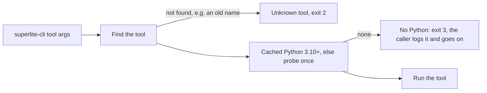

### Shared base: where state lives and who is who
Every tool asks the base the same two questions, so no tool works out paths or names itself.
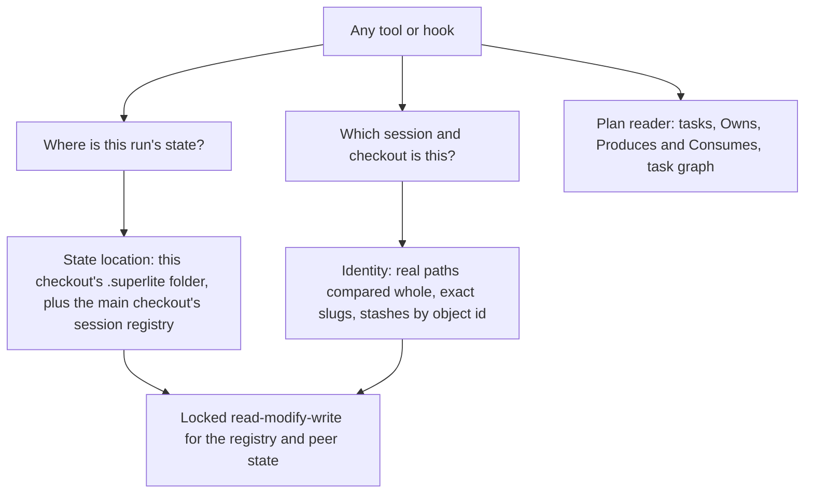

### Undo journal for multi-step changes
Guards come first: before touching anything, an operation checks that the branch and worktree path are free, nothing is
mid-merge and the stash target exists, so most failures stop before step 1. The journal covers only the steps that can
still fail after something has changed. It replaces the two hand-written undo loops in split and move-out, and the ad hoc
restores in switch and close.
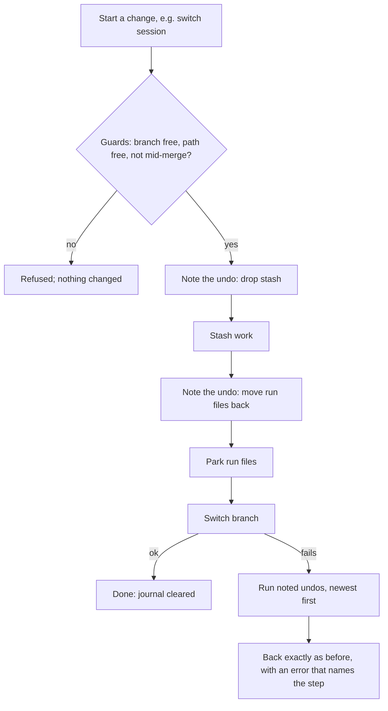

### Plan: from plan file to DISPATCH NOW
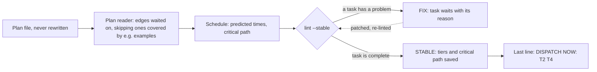

### Dispatch: who runs which task
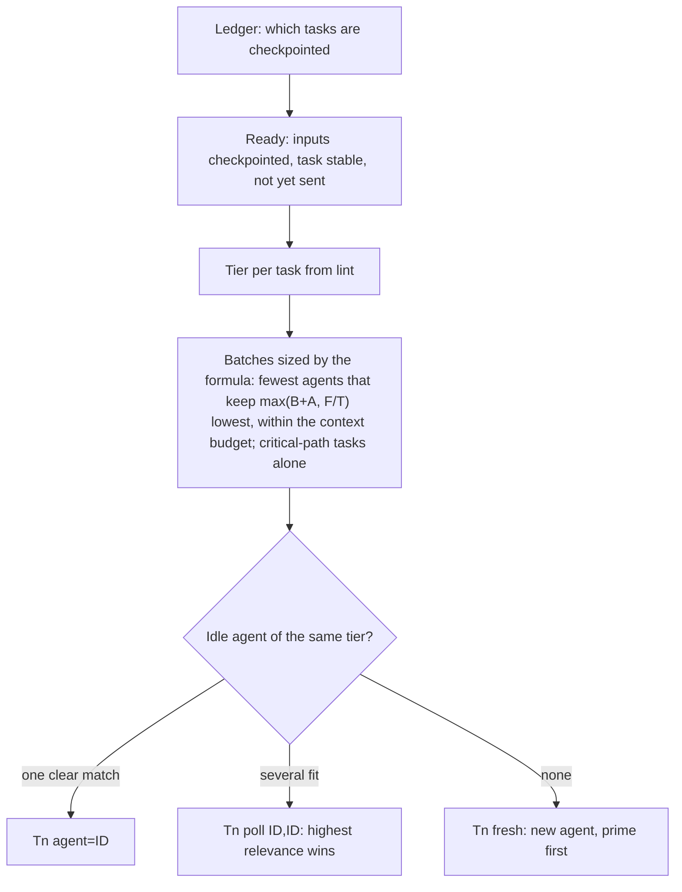

### Checkpoint: recording a finished task
Nothing here touches your branch, HEAD or staging area.
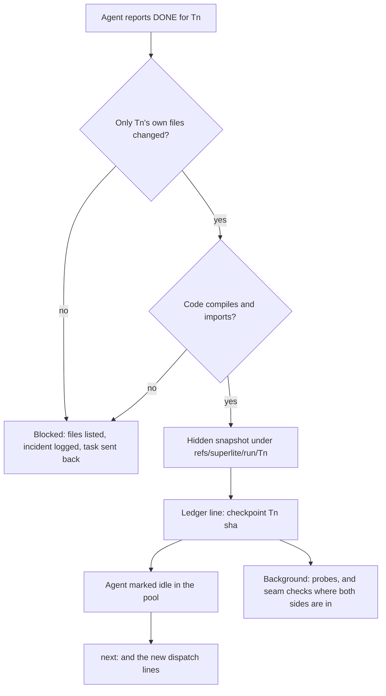

### Sessions: starting a flow
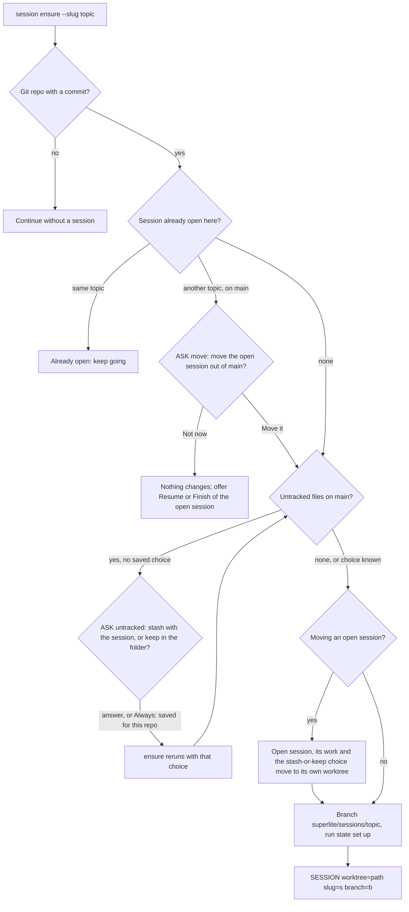
Nothing changes until every question is answered: the move and untracked checks run before any file, stash or branch
is touched. The same untracked question comes up whenever a session is parked, whether it is moved out of main, switched
or closed.

### Sessions: finishing, with the one commit
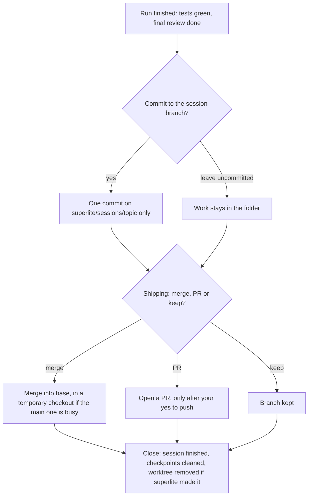

### Sessions: sync with main
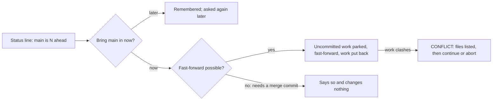

### Review: packet and seam checks
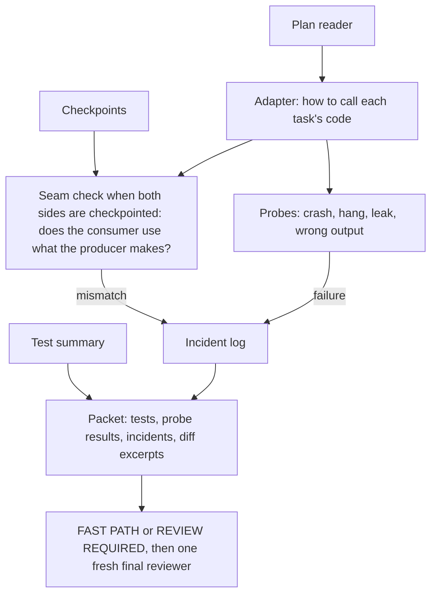

### Measure: time and cost
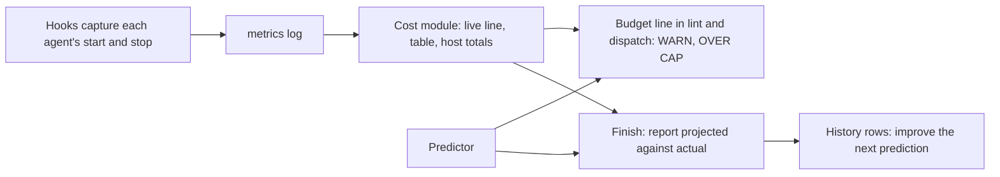

### Hooks: one process per event
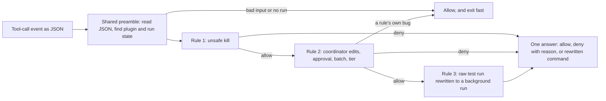
The prompt hook works the same way: it records a human reply, adds the compact nudge if one is due, then adds the cost and
session lines when they have changed.

### Doc contract test
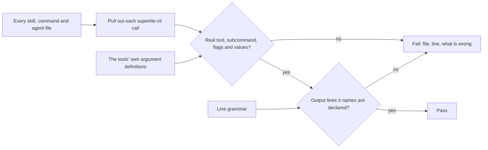

### Flow scenario tests and the fake-agent swarm run
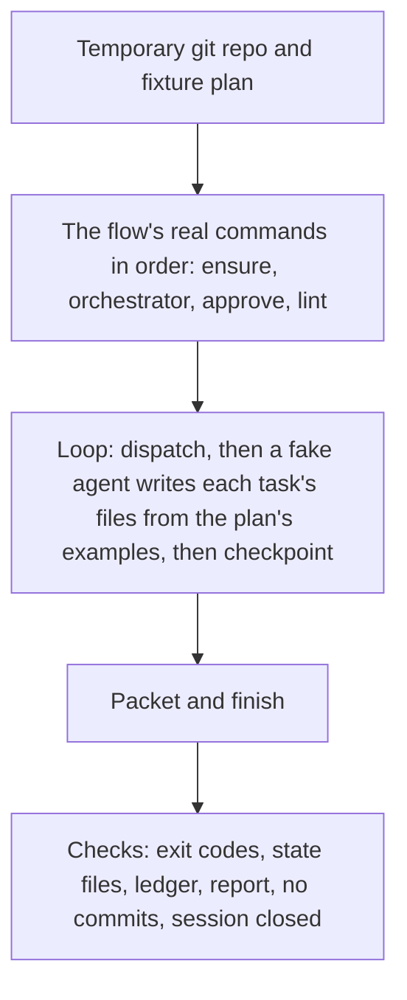

### Session state-machine test
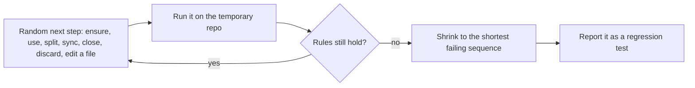
The rules: no edited file is lost, each branch is checked out once, the registry matches git's worktree list, and no
session reads another session's state.

### Guard decision matrix
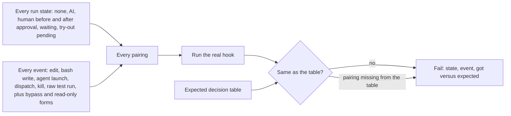

## How it fits together
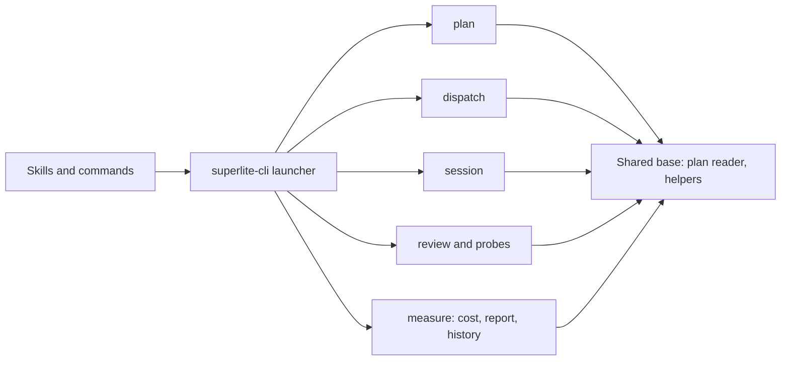

## How it gets built
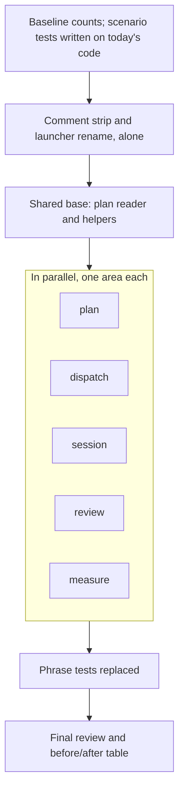
The scenario tests are written first, on today's code, so every area is checked against the same behavior before and
after it moves. Output that agents and hooks act on (`DISPATCH NOW:`, `SUSPECT HANG`, `REDIRECT`, `ASK untracked`) is
frozen.

## Decisions you can change
- Per-turn context lines: the cost line and the session line are added to every prompt, even at $0.00 before any
  agent has run, and they cost tokens on every turn. Add them only when they change, and always at the start of a
  session (default) | every turn, as today
- Commit at session finish: asked once when the session ends, "Commit to <session branch>" / "Leave uncommitted"
  (default) | always commit at finish without asking
- Commit message: the session topic plus the build summary's first line (default) | you type it
- State-machine test library: a small test-only library that generates and shrinks the random sequences (default;
  superlite itself stays standard-library only) | a hand-written random runner without shrinking
- Windows: superlite supports Windows, and several findings were Windows-only, but CI runs only Linux and macOS. Add a
  Windows CI job (default) | leave CI as is
- Launcher name: `superlite-cli` (chosen) | another name
- Old names: removed in one clean cut, with no aliases (chosen)
- Complexity notes: one line per non-trivial function (chosen) | none
- Suite-time goal: none (default) | full suite under 5 minutes, by cutting duplicate tool starts in tests
- Planned features (task graph at run start, end-of-run metrics card): built after this, on the new structure (default) | built first
- Size limit on the always-loaded skill: the guide changes to 2,000 to match the tests (default) | the skill is trimmed to 1,500

Features that stay unless you say cut: Graphify search, the hung-test detector, relevance polls in dispatch,
predicted-vs-actual calibration, seam contract checks, probes.

## Risks
- **A move changes behavior unnoticed.** The scenario tests run on today's code first, then after each area moves.
- **The approval gate matches the launcher name literally.** If the rename missed it, builds could start before your
  approval. A hook test pins that `superlite-cli dispatch` is blocked before approval.
- **A missed reference now fails instead of falling back to an alias.** A name-scan test checks every shipped file:
  skills, commands, agents, hooks, harness plugins, tests and current docs. It fails on `sl `, `$SL`, `scripts/sl` or
  any removed tool name. The doc contract test catches a wrong subcommand or flag.
- **Areas collide.** The comment strip and the shared base land first and alone. After that each area owns its own files.
- **Deleting a phrase test drops a real rule.** Each deleted test is mapped to its replacement in the final report.

## Out of scope
- `bench/`, old plans and specs: they stay as history and keep the old names. Harness integrations get the rename
  only, nothing else.
- Skill wording beyond changed command names.
- New features, including the two planned ones and early agents (stored as a draft in
  `docs/plans/2026-11-01-early-agents.draft.md`, to build on the new dispatch area afterwards).

## How we will know it works
- The full suite is green before and after, and the before/after table shows the counts.
- The flow scenario tests (regular, MVP, feature, debug, small, review) pass on the old code and the new code.
- `superlite-cli` runs every command. `sl` does not exist, and an old tool name is an unknown tool.
- The name scan finds no old name in any shipped file, and the doc contract test fails on a made-up command.
- The state-machine test runs a few hundred random sequences without losing work, and every one of the 122 past
  findings maps to a passing test.
- No file except the state-location module spells out a `.superlite/` path.
- No tool, output line, skill, agent, hook or doc uses the word "commit" for something superlite does. A test checks
  this, with an allow-list for git's own command names inside code.
- After a full run, before finishing, `git log` on the branch shows no new commits, and the work is in the folder, uncommitted.
- Finishing the session (with your yes, if you keep the default) leaves exactly one new commit, on the session's own
  branch, and none on main or any other branch. No other step shows a commit option or question.
- Sync on a branch with your own commits that would need a merge commit stops with a message and leaves the branch as it was.
- No script file is over about 600 lines, and no plan is parsed outside the shared reader.
- Starting a new topic while main holds an open session with untracked files asks the move question, then the
  untracked question, and changes nothing until both are answered. Answering "keep in the folder" leaves those files on
  main. A scenario test and the state-machine test both check this.
- Five equal ready tasks are dispatched as three batches of 2, 2 and 1 (the formula), not by any fixed cap, and
  no doc or diagram states a fixed number of tasks per agent.
- A shell command starts one superlite hook process, not three, and a prompt starts one, not three. The guard matrix
  gives the same decisions as before.
- No backward-compatibility code is left. Old formats, old names and old layouts are simply not handled.
- A consumer whose inputs are all covered by examples is dispatched before its producer finishes, with no prune step,
  and the plan file is unchanged after lint.
- The code-shape test passes: no function nested deeper than three levels, no catch-everything handler outside an
  entry point.
- Each flow's skill text no longer repeats the session questions, and a scenario test checks that `session ensure`
  prints them.

## Rough time and cost
About 75 to 150 minutes and $30 to $70 (rough, until the machine plan is linted). The session and review areas are the
largest parts.
