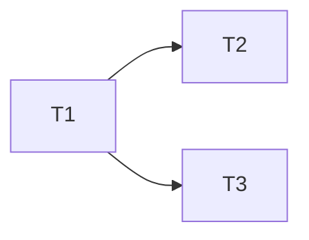

# Integration plan: the machine plan's flowchart in the chat

**Goal:** after the machine plan is generated, show its task graph to the user in the chat as a mermaid `flowchart TD`, with the critical path in red.
**Review plan:** docs/plans/2026-11-01-chat-graph.feature.md
**Built inline:** this is a small change (5 files, one chain) ported from the approved prototype on `superlite/chat-graph-proto`. The prototype had no stubs, so the port is the whole diff.

### T1 mermaid render · Complexity 3 (O-1) · Est. context 30k
**Owns:** skills/swarm/scripts/graph.py, tests/scripts/test_graph.py
**Est. time:** 6 min
**Produces:** graph.render(plan_path, critical=None) -> str

`render` returns `flowchart TD`. Every task, in id order (T2 before T10), is a node labelled with its id and title, followed by one `a --> b` line per edge and a `critical` class on the given ids (or else the longest path). Labels swap `"`, `` ` ``, `[`, `]`, `<`, `>` and `#` for plain look-alikes. The ASCII helpers (`_tiers`, `_draw`, `_cell`, `WIDTH`) are removed. FROZEN: the signature of `render`, the `graph.txt` cache and its `# hash:` head, and `superlite-cli graph --plan`.

### T2 lint header · Complexity 2 (O-1) · Est. context 20k
**Owns:** skills/swarm/scripts/plan_lint.py, tests/scripts/test_stable_split.py
**Est. time:** 3 min
**Consumes:** graph.render(plan_path, critical=None) -> str

`_graph_lines` frames the flowchart as `GRAPH (show the user as a mermaid block):` ... `END GRAPH`. It prints on the first lint and again when the flowchart changes, `DISPATCH NOW:` stays the last line, and if the graph can't be drawn lint prints `graph: not drawn (...)` and carries on.

### T3 wording · Complexity 1 (O-1) · Est. context 15k
**Owns:** skills/swarm/SKILL.md, commands/status.md, docs/tools.md
**Est. time:** 3 min

The swarm skill and `/superlite:status` say to show the flowchart as a mermaid block, and the `graph` row in `docs/tools.md` describes it. `skills/swarm/SKILL.md` stays at or under 12,500 characters.
