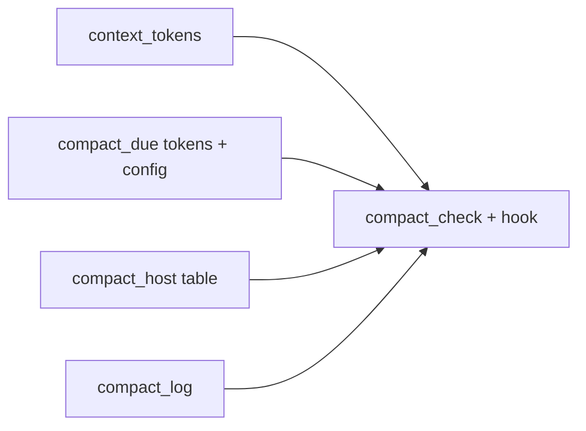

# Prototype: compact by token count (main-session path)

**Goal:** Prove that the prompt hook nudges on live context tokens, names the host's compact command, re-triggers until a compact is confirmed, and logs nudge/done/missed.
**Architecture:** Pure stdlib helpers (`context_tokens`, `compact_host`, `compact_log`, token additions to `compact_due`) glued by `compact_check.py`, which `hooks/_nudge` calls with the hook's `transcript_path`.
**Tech stack:** Python stdlib, pytest, bash hook
**Spec:** docs/plans/2026-11-02-compact-by-tokens.feature.md
**Detail:** contracts
**Target-min:** 10
**Review plan:** docs/plans/2026-11-02-compact-by-tokens.feature.md

## Global constraints

- language: python
- test command: `python -m pytest tests/scripts/test_context_tokens.py tests/scripts/test_compact_tokens.py tests/scripts/test_compact_host.py tests/scripts/test_compact_log.py tests/scripts/test_compact_flow.py tests/scripts/test_compact_due.py -q`
- FROZEN: `compact_due.is_due(sl_dir, now, window_s)`, `compact_due.nudge_line()`, the `compact_due.py <sl_dir>` CLI exit contract (0 plus text when due, else 1), `SUPERLITE_NO_AUTOCOMPACT`, hook fail-open, the three hook output shapes
- Token default limit 150000; `superlite.json` key `compact_tokens`; env `SUPERLITE_COMPACT_TOKENS` wins
- Context size = last non-sidechain assistant message: input + cache_read + cache_creation tokens
- New files are stdlib only; LF endings; hooks use `printf`
- Prototype keep-set only: agent frontmatter, dispatch reuse, `compact status/enable`, other hosts are integration

### T1 context tokens · Complexity 3 · Est. context 22k
**Owns:** skills/swarm/scripts/context_tokens.py, tests/scripts/test_context_tokens.py
**Components:** 1
**LOC owned:** 70
**Tests:** fast
**Model:** sonnet
**Est. time:** 2.5 min (1 component, about 70 LOC, fast tests)
**Consumes:** none
**Produces:** context_tokens.current_context(path: str) -> int · context_tokens.last_compact_boundary(path: str) -> dict | None
e.g. current_context(t) where last assistant usage is {input_tokens: 10, cache_read_input_tokens: 150000, cache_creation_input_tokens: 5000} -> 155010
e.g. current_context("/missing.jsonl") -> 0
e.g. last_compact_boundary(t) with a system/compact_boundary line at line 7, compactMetadata {trigger: "auto", preTokens: 162000} -> {"line": 7, "pre_tokens": 162000, "trigger": "auto"}
**Review Focus:** `test_sidechain_ignored`: a later isSidechain assistant line does not change the result; `test_bad_json_line_skipped`: a corrupt line between two valid ones is skipped, never raises; `test_latest_boundary_wins`: two boundaries return the later line
**Test code (contracts):** test_last_assistant_sums_input_and_cache (155010 above) · test_no_assistant_is_zero · test_missing_file_is_zero · test_sidechain_ignored · test_bad_json_line_skipped · test_boundary_found (dict above) · test_latest_boundary_wins · test_no_boundary_is_none · test_summary_line_without_boundary_gives_pre_tokens_zero (isCompactSummary line only -> {"line": n, "pre_tokens": 0, "trigger": ""})
**Steps:** 1 failing tests, 2 run: FAIL, 3 implement, 4 run: PASS

### T2 token limit and nudge text · Complexity 3 · Est. context 22k
**Owns:** skills/swarm/scripts/compact_due.py, skills/swarm/scripts/project_config.py, tests/scripts/test_compact_tokens.py
**Components:** 2
**LOC owned:** 60
**Tests:** fast
**Model:** sonnet
**Est. time:** 2.5 min (2 components, about 60 LOC, fast tests)
**Consumes:** none
**Produces:** compact_due.limit(root: str) -> int · compact_due.token_nudge(tokens: int, limit: int, command: str, request: int = 1) -> str
e.g. limit(tmp) with no env and no superlite.json -> 150000
e.g. limit(tmp) with superlite.json {"version": 1, "compact_tokens": 50000} -> 50000
e.g. token_nudge(162000, 150000, "/compact") -> "Context is 162k tokens (limit 150k): run /compact now, then re-read .superlite/progress.md and continue."
e.g. token_nudge(170000, 150000, "/compact", request=2) -> "Compact still pending (request 2, 170k tokens, limit 150k): run /compact now before anything else."
**Review Focus:** `test_env_beats_config`: env 40000 and config 50000 -> 40000; `test_invalid_value_rejected`: compact_tokens "lots" or 0 raises ValueError naming the key; `test_old_api_unchanged`: nudge_line() text and is_due(...) results are the same as before
**Test code (contracts):** test_default_limit · test_config_limit · test_env_beats_config · test_invalid_value_rejected (config "lots", config 0, env "abc") · test_token_nudge_first · test_token_nudge_repeat · test_old_api_unchanged · test_project_config_accepts_compact_tokens (project_config.load accepts the key, still raises on an unknown key)
**Steps:** 1 failing tests, 2 run: FAIL, 3 implement, 4 run: PASS

### T3 host command table · Complexity 2 · Est. context 14k
**Owns:** skills/swarm/scripts/compact_host.py, skills/swarm/config/compact.json, tests/scripts/test_compact_host.py
**Components:** 1
**LOC owned:** 60
**Tests:** fast
**Model:** haiku
**Kind:** mechanical
**Est. time:** 2.0 min (1 component, about 60 LOC, fast tests)
**Consumes:** none
**Produces:** compact_host.command(host: str) -> str · compact_host.confidence(host: str) -> str
e.g. command("claude-code") -> "/compact"
e.g. command("cursor") -> "/summarize"
e.g. command("nonesuch") -> "your host's compact command (none known: write a handoff note and start a fresh session)"
e.g. confidence("cursor") -> "forum"
**Review Focus:** `test_json_is_data_only`: compact.json parses and every row has command and confidence; `test_unknown_host_fallback`: an unknown host and "" both give the fallback text, never raise
**Test code (contracts):** the table rows are: claude-code "/compact" docs · cursor "/summarize" forum · codex "/compact" docs · gemini "/compress" docs · opencode "/compact" docs · pi "/compact" docs · kimi "/compact" docs · hermes "/compress" docs · devin, antigravity, muse: no command, confidence "none". Tests: test_each_row_command · test_each_row_confidence · test_unknown_host_fallback · test_empty_host_fallback · test_json_is_data_only
**Steps:** 1 failing tests, 2 run: FAIL, 3 implement, 4 run: PASS

### T4 nudge ledger · Complexity 4 · Est. context 28k
**Owns:** skills/swarm/scripts/compact_log.py, tests/scripts/test_compact_log.py
**Components:** 1
**LOC owned:** 110
**Tests:** fast
**Model:** sonnet
**Est. time:** 3.0 min (1 component, about 110 LOC, fast tests)
**Consumes:** context_tokens.last_compact_boundary(path: str) -> dict | None (T1) · context_tokens.current_context(path: str) -> int (T1)
**Produces:** compact_log.record_nudge(sl_dir: str, tokens: int, limit: int, now: float, boundary_line: int = 0) -> int · compact_log.reconcile(sl_dir: str, transcript: str, now: float) -> str
e.g. three record_nudge calls with no compact between -> 1, 2, 3, and .superlite/compact.jsonl has one {"ev": "compact_missed"} line (written on the third)
e.g. reconcile(sl, t, now) after a nudge at 160000 when t now has a boundary line past boundary_line and a small last message (2000) -> "done", and one {"ev": "compact_done", "before": 160000, "after": 2000}
e.g. reconcile(sl, t, now) with no nudge on record -> "none"; nudge but no new boundary -> "pending"
**Review Focus:** `test_count_resets_after_done`: record_nudge after a "done" returns 1; `test_missed_written_once`: a fourth record_nudge does not add a second compact_missed; `test_unwritable_dir_never_raises`: a read-only sl_dir returns the count without raising
**Test code (contracts):** test_counts_1_2_3 · test_missed_once · test_reconcile_none · test_reconcile_pending · test_reconcile_done_logs_before_after · test_count_resets_after_done · test_unwritable_dir_never_raises (uses fake boundary lines through the T1 stub: fakes return the e.g. values above)
**Steps:** 1 failing tests, 2 run: FAIL, 3 implement, 4 run: PASS

### T5 compact_check and hook wiring · Complexity 5 · Est. context 36k
**Owns:** skills/swarm/scripts/compact_check.py, hooks/_nudge, tests/scripts/test_compact_flow.py
**Components:** 2
**LOC owned:** 110
**Tests:** fast
**Model:** sonnet
**Est. time:** 3.5 min (2 components, about 110 LOC, fast tests)
**Consumes:** context_tokens.current_context(path: str) -> int (T1) · context_tokens.last_compact_boundary(path: str) -> dict | None (T1) · compact_due.limit(root: str) -> int (T2) · compact_due.token_nudge(tokens: int, limit: int, command: str, request: int = 1) -> str (T2) · compact_host.command(host: str) -> str (T3) · compact_log.record_nudge(sl_dir: str, tokens: int, limit: int, now: float, boundary_line: int = 0) -> int (T4) · compact_log.reconcile(sl_dir: str, transcript: str, now: float) -> str (T4)
**Produces:** compact_check.run(sl_dir: str, transcript: str, host: str, now: float) -> str
e.g. run(sl, 160k-transcript, "claude-code", now) -> "Context is 160k tokens (limit 150k): run /compact now, then re-read .superlite/progress.md and continue."
e.g. run(sl, 90k-transcript, "claude-code", now) with a fresh last-compact -> ""
**Review Focus:** `test_missing_transcript_falls_back_to_timer`: no transcript_path in the payload and a stale window still gives the old time nudge, exit 0; `test_opt_out_env`: SUPERLITE_NO_AUTOCOMPACT=1 gives no nudge; `test_cursor_names_summarize`: hook_event_name beforeSubmitPrompt gives a nudge naming /summarize inside {"continue":true,"additional_context":...}
**Test code (contracts):** runs `hooks/prompt` through bash with stdin JSON and CLAUDE_PROJECT_DIR=tmp: test_nudges_over_limit (160k -> stdout has "160k" and "/compact") · test_silent_under_limit_with_fresh_last_compact · test_renudges_with_count (second prompt has "request 2") · test_confirms_compact (append a compact_boundary line plus a 2k assistant message: no nudge, compact.jsonl has compact_done) · test_missing_transcript_falls_back_to_timer · test_opt_out_env · test_cursor_names_summarize · test_existing_prompt_hook_tests_still_pass (runs tests/scripts/test_compact_due.py in-process)
**Steps:** 1 failing tests, 2 run: FAIL, 3 implement, 4 run: PASS

## Review Focus

- App type: library + bash hook plugin scripts. Categories: file (transcript and ledger reads), encoding (bad JSON lines), state (count and reset), protocol (three hook output shapes).
- Risks: hook errors blocking a prompt (must fail open), nudge repeating after a compact, ledger write failing silently, wrong host command.
- **Probe entry:** call=context_tokens.current_context · call=compact_check.run

## Self-review

- 5 tasks, prototype keep-set only; T1-T4 run in parallel against stubs, T5 integrates
- Every Consumes matches a Produces line; FROZEN interfaces listed in constraints
- Acceptance checks 1-7 and 12 of the feature plan are covered by T1, T2, T4, T5, T3
