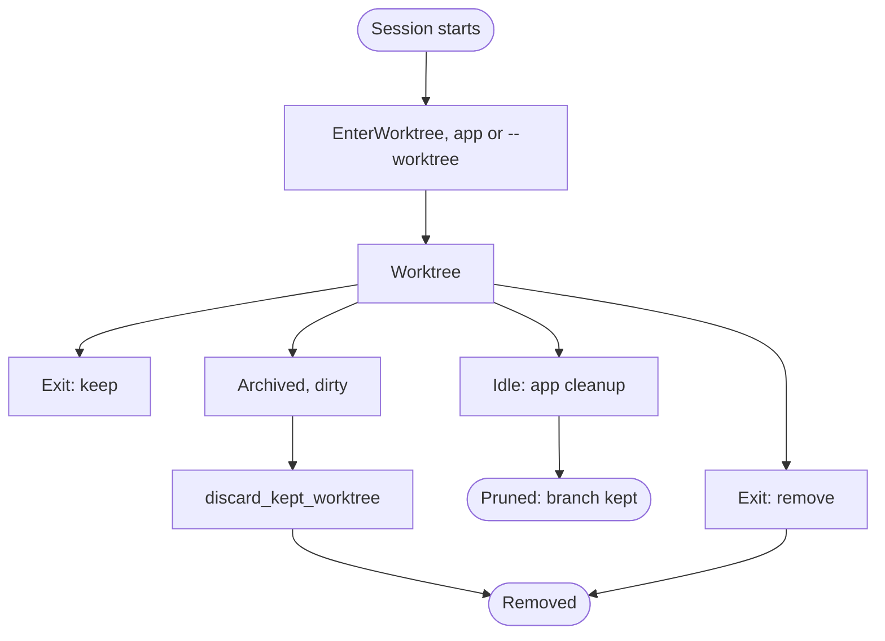
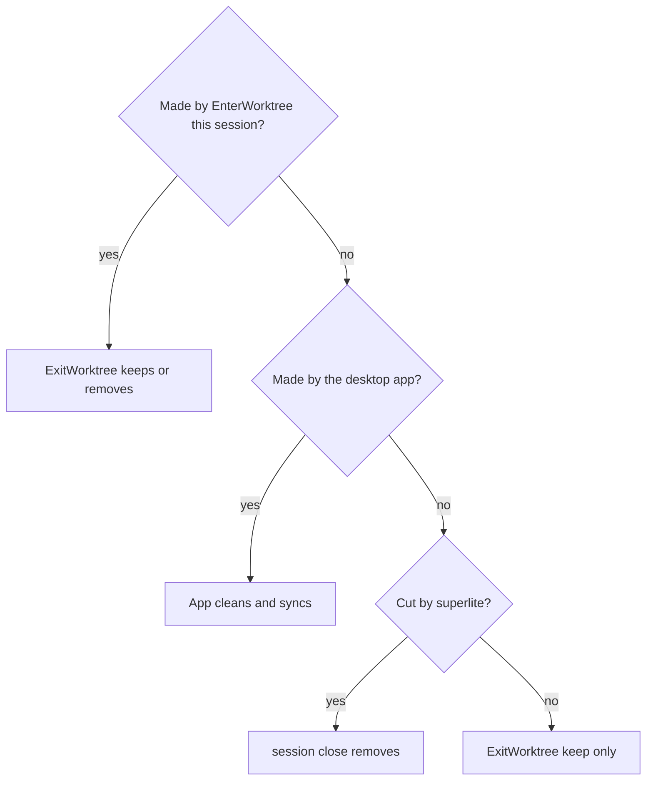
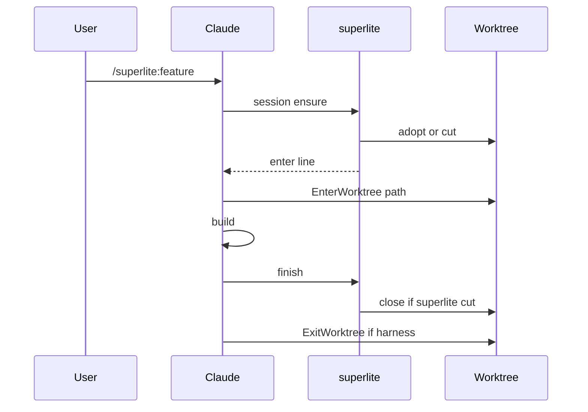
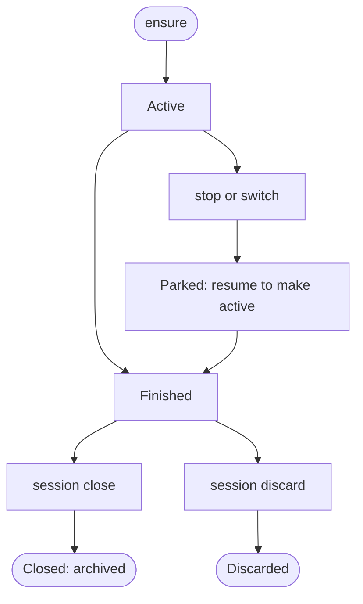
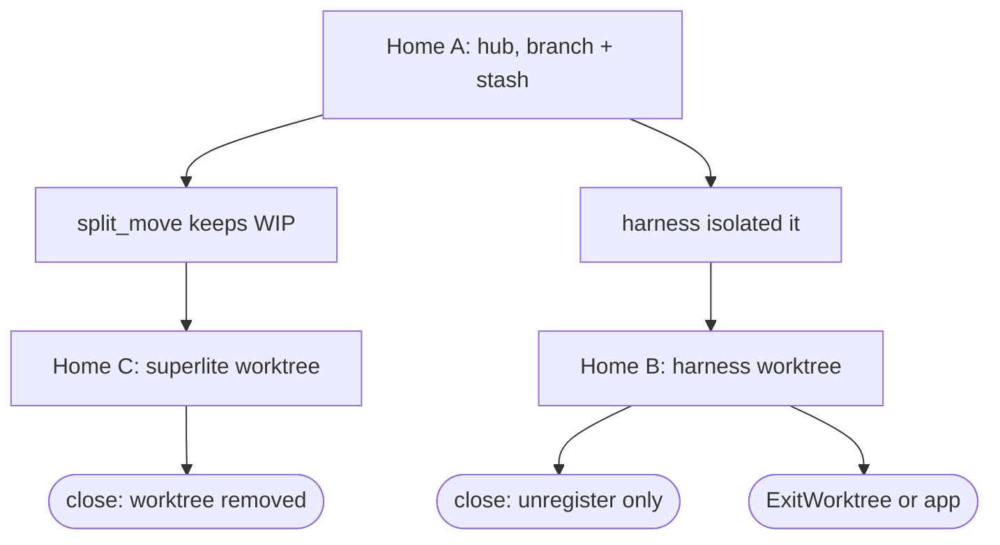

# Feature plan: superlite sessions wrap Claude Code worktrees

Status: draft, awaiting human approval. Orchestrator: human.
Target codebase: the superlite plugin (`iha2/superlite`, v3.2.0), not this vault. Research read the installed copy at `~/.claude/plugins/cache/superlite-dev/superlite/3.2.0`.

## Goal and who it is for

A superlite user running inside a Claude Code worktree (desktop app worktree session, `claude --worktree`, `EnterWorktree`, or a subagent with `isolation: worktree`) gets a superlite session that **wraps that worktree**: it adopts the worktree and its branch as-is instead of cutting a second one, never deletes what the harness owns, and hands cleanup back to the harness. Outside a harness worktree, behaviour is unchanged.

## Design principle (set by the user, 2026-11-07)

When running under Claude Code, **prefer the harness's worktree abstractions for everything superlite needs a worktree for**: `EnterWorktree` / `ExitWorktree` for the session, feature and integration worktrees; the desktop app's worktree sessions and `sync_with_base_branch` / `clean_up_worktrees` for sync and cleanup. Superlite's own `git worktree add/remove` paths remain only as the fallback for other harnesses (Codex, Cursor, Gemini, and so on) or when a Claude Code tool is unavailable. Superlite adds the session registry, branch/base bookkeeping and HUD on top; it does not duplicate what the harness does.

## What the user will see or do differently

- `superlite-cli session ensure --slug <topic>` run inside a harness worktree prints a `SESSION worktree=<that path> ... branch=<harness branch>` line. No `superlite/sessions/<slug>` branch and no `.superlite/worktrees/sessions/<slug>` worktree is created.
- The session HUD line names the harness branch (for example `worktree-foo`) and marks it harness-owned.
- Started from the hub with the harness not yet in a worktree, the flow no longer instructs a bare `git worktree add`. It tells the agent to use `EnterWorktree` (where available) and then run `ensure`.
- `session close` / `discard` / shipping in an adopted worktree: never `git worktree remove`, never `branch -D`; the finish message says to use `ExitWorktree` (keep or remove) instead.
- `proto start` and the integration worktree stay superlite-cut (they are extra, nested sandboxes), but `proto discard` / `session close` never touch the adopted worktree.
- Docs and commands stop saying "move the agent root" without a mechanism; they say "already there" for adopted worktrees and "use EnterWorktree" otherwise.
- **Registry matches git.** `superlite-cli session reconcile` prints one line per drift between `sessions.json` and what `git worktree list` / `git for-each-ref refs/heads` show, and `--apply` rewrites the registry only. The same check runs (report-only, cheap) at the start of `ensure`, `use` and `status`, so a stale row is visible before any switch.
- **Aware of every worktree, owned or not.** `sessions.json` gains a `worktrees` inventory: one entry per linked worktree git knows (path, branch or detached sha, `kind`, `owner`, `session` slug if any, `last_seen`). `session status` shows them under the sessions, grouped by kind. Knowing a worktree is not owning it: only `owned:true` session rows can be removed by superlite.
- **A finished session leaves the registry.** `session close` (and `finish`) saves the session's own state into its archive (`.superlite/session-store/<slug>/`: run files, a `session.json` manifest that is the row, and WIP as a private ref `refs/superlite/wip/<slug>` instead of an entry in the shared stash list), then removes its row. `sessions.json` lists only live sessions (active, parked, parallel). `session use <slug>` or `ensure --slug <slug>` on an archived slug restores from the manifest.

## Acceptance checks

1. In a linked worktree under `<hub>/.claude/worktrees/<name>` on branch `worktree-<name>`, `session ensure --slug x` registers it in place: row has `owned:False`, `adopted_branch:True`, correct `base` and `base_sha` (merge-base with the default base), and `git worktree list` and `git branch` are unchanged.
2. Same, for a worktree outside the repo tree and for a detached-HEAD worktree (registers; branch shown as detached; close never deletes anything).
3. `session close` and `session discard` on an adopted worktree remove no worktree and delete no branch, and say to use `ExitWorktree`. The harness branch survives.
4. From the hub with another session open, `ensure` does not split into a second superlite worktree when the harness has isolated the session (flag or detection); the existing move-out and `ASK` flows still work when it has not.
5. A subagent with `isolation: worktree` that runs `ensure` registers its worktree as a child of the parent session, not as a new top-level session (or is explicitly skipped, per decision D4).
6. HUD, `finish` (`mark_run`), `sync` and `exclusive` all resolve the right row for an adopted worktree.
7. Docs and commands (`commands/*.md`, `AGENTS.md`, `docs/sessions.md`, `docs/feature-flow.md`, `skills/shipping`, `skills/swarm`) agree: no instruction to hand-run `git worktree add` for the session worktree; "move the agent root" replaced.
8. Under Claude Code, the docs, commands and shipping skill instruct `EnterWorktree` / `ExitWorktree` first for session, feature and integration worktrees, and `git worktree add` appears only as a labelled fallback for other harnesses. With the harness absent, the old path still works unchanged.
9. Dropped with D7 (user, 2026-11-10): agents keep working in the shared checkout; no agent runs with `isolation: worktree`.
10. Every worktree superlite cuts (parallel session, proto sandbox, integration, merge checkout) lands under `<hub>/.claude/worktrees/`; the hub reports no untracked files for it, `git stash -u` leaves it alone, `owned:true` rows there are closable by superlite, and `EnterWorktree path=` accepts it from a pinned agent. Sessions registered at old `.superlite/worktrees/...` paths still close and discard correctly.
11. For each home (A hub, B adopted harness worktree, C superlite-cut worktree) the full lifecycle works and is tested: create, stop/park, resume, close, discard. In A, WIP is stashed under a slug tag and restored by oid with branch switches; in B and C no stash is used and WIP stays in the worktree; stopping a dirty worktree never removes it; moving A to C via `split_move` keeps WIP; two parked sessions' stashes never cross.
12. All existing tests in `tests/scripts/` pass; `test_line_grammar.py` still accepts every emitted line.
13. **Reconcile reports each drift class** in a temp repo: row whose worktree directory is gone but branch exists (`pruned`), row whose branch and worktree are both gone (`gone`), row whose branch is checked out at a different path than recorded (`moved`), linked worktree with no row (`unregistered`), row whose `stash_oid` is no longer in the stash list or WIP ref missing (`lost-wip`), `active` naming a missing row. Report-only by default: `sessions.json`, worktrees, branches and stashes are byte-for-byte unchanged.
14. **`reconcile --apply`** fixes only the registry: `pruned` marked (D11), `moved` path updated, `gone` rows with no WIP and no store dropped, `gone` rows with WIP or a store archived (row removed, manifest kept), dangling `active` cleared. It never removes a worktree, deletes a branch, drops a stash or registers an `unregistered` worktree (that stays `ensure`'s job). Running it twice is a no-op.
15. **Close archives, then unregisters.** After `session close` in homes A and C, the row is gone from `sessions.json`, `.superlite/session-store/<slug>/session.json` holds the row, run files are there, and dirty WIP is at `refs/superlite/wip/<slug>` (not in `git stash list`). `session use <slug>` restores the branch, run files and WIP exactly; the WIP ref is deleted only after a clean apply. Home B close archives run state and unregisters, and never touches the harness worktree or branch (D2).
16a. **Inventory covers all worktrees.** In a temp repo with a session worktree, a proto sandbox, a nested sandbox inside another worktree, a `.claude/worktrees/x` harness worktree, a detached worktree and a hand-made `git worktree add` elsewhere, `reconcile --apply` lists all six in `worktrees` with the right `kind` (`session`, `proto`, `integration`, `harness`, `unknown`) and `owner` (`superlite`, `harness`, `user`). A removed worktree drops out of the inventory on the next reconcile; nothing in git changes. Against this repo's current state it lists the 8 linked worktrees.
16b. **Live check on the superlite repo itself** (`C:/Users/CWogu/source/repos/superlite`, the hub; state as of 2026-11-09: 2 session rows, 8 linked worktrees, 2 detached, 1 nested sandbox). The prototype's `superlite-cli` is pointed at this hub (`--root`), so the user's checkout stays untouched apart from `.superlite/sessions.json`:
   1. Snapshot first: copy `sessions.json` to `.superlite/sessions.json.bak-<date>`, and record `git worktree list --porcelain`, `git branch -a`, `git stash list` and `git for-each-ref refs/superlite` into a scratch file.
   2. `session reconcile` (report-only): lists all 8 worktrees with sensible kinds (`.superlite/worktrees/*` as `session`/`unknown`, `.superlite/sandboxes/*` and the nested `project-extendability-proto` as `proto`, the 2 detached ones flagged detached), reports drift for `session-json-sync` and the leaked global base, and changes nothing (compare against the snapshot).
   3. `session reconcile --apply`: `sessions.json` gains the inventory; the git snapshot from step 1 is identical afterwards; a second `--apply` is a no-op.
   4. `session status` shows the sessions and the 8 worktrees grouped by kind.
   5. Close and restore round trip on a throwaway session (`session create --slug dogfood-wip`, make an uncommitted edit, `session close`, confirm the row is gone and `refs/superlite/wip/dogfood-wip` exists, `session use dogfood-wip`, confirm the edit is back, then `session discard`).
   6. The user reviews the step 2 report before step 3 runs (human mode). Restore from the `.bak` if anything looks wrong.
16. Two sessions closed with WIP, then a `git stash clear` by the user: both sessions' WIP survives (private refs), and neither restore picks up the other's work.

## Code map (from research)

Sources: two read-only agent reports of the cached plugin; the docs agent used targeted greps, so details outside the cited lines are unverified.

- CLI: `skills/swarm/scripts/session.py` re-exports `session_registry.py` (helpers, registry `sessions.json` v2 at hub `.superlite/`), `session_ensure.py` (ensure/create/close), `session_switch.py` (use/discard/split/status), `session_sync.py`, `session_hud.py`.
- **Existing hook point:** `_register_linked` (`session_ensure.py:219-231`) already adopts an unregistered linked worktree in place (`owned:False`, branch = current branch, `hide_superlite`). Trigger at line 163. `_ensure_branch` / `register_in_place` (181-251) adopt a named branch with `adopted_branch:True`.
- **Gaps to close:**
  - `_register_linked` sets `owned:False` but not `adopted_branch`, so `discard` / `close` may still `branch -D` a harness branch (`session_switch.py:149-153`, `session_ensure.py:582-584`).
  - `base` comes from `base_now` (`reg.base` or `main`), not the harness branch's real parent.
  - `_go_parallel` (`session_ensure.py:296-313`) and `split_move` (`session_registry.py:523-587`) cut `superlite/sessions/<slug>` plus `.superlite/worktrees/sessions/<slug>` even when the harness already isolated the session; `_move_gate` refuses when the harness holds `main`.
  - `fresh_base` (`session_ensure.py:118,124`) treats a Claude-created hub branch as the session base; `slug_from_branch` turns `worktree-foo` into slug `worktree-foo`.
  - `session_hud.row_for` gives no row (no HUD line) for an unregistered nested worktree (`session_hud.py:69-102`).
  - Docs tell the agent to run `git worktree add -b superlite/<topic> .superlite/worktrees/<topic> <base>`: `commands/feature.md:20`, `AGENTS.md:18`, `skills/swarm/SKILL.md:19`, `.cursor/rules/feature-worktrees.mdc:10`; shipping removes worktrees via `git worktree remove` (`skills/shipping/SKILL.md:44-61`).
  - "Move the agent root" (`commands/{mvp,debug,feature,small}.md`, `docs/sessions.md:84,127`) has no mechanism.
  - **Registry drift (seen in this repo, 2026-11-09):** `git worktree list` shows 8 linked worktrees (`.superlite/worktrees/*`, `.superlite/sandboxes/*`, one nested sandbox, two detached) and `sessions.json` has a row for none of them. Nothing compares the two; the only cleanup is `git worktree prune` inside close/discard (`session_ensure.py:578`, `session_switch.py:150`).
  - **Rows outlive their session:** `_close` (`session_ensure.py:494-508`) only marks `run: finished` and keeps the row; `_close_host` keeps it too; `_close_owned` (543-595) drops it only when the branch deletes cleanly with no stash and no run files. Parked WIP lives in the repo-wide stash list (`stash_push`, matched by `stash_oid`), which every worktree and the user's own `git stash` share.
  - `session create --base X` rewrote the registry's global `base` to `X` (seen: `"base": "superlite/claude-code-worktree-compat-plan"`). `reg["base"] = base` is written at five sites (`session_ensure.py:285,349,420,453`, `session_switch.py:257`), and `base_now` reads it back for the next row, so one session's base leaks into the next.
  - Agents (`agents/*.md`) have no `isolation`; the edit guard (`hooks/_edits`) and `capture-agent-*` walk up to the nearest run, so an isolated subagent resolves a different `.superlite/`.
- Detection primitives already there: `state.hub_root` (`state.py:27-35`, works from any worktree via `git-common-dir`), `worktree_map`/`branch_owner` (skip detached), hook cwd resolution `hooks/_preamble:194-215` (`CLAUDE_PROJECT_DIR`, then cwd, `up_to_run`). No `CLAUDE_WORKTREE*` env var is used; none was found.
- Do not change: `SESSION` / `REDIRECT` / `ASK` line grammar (`test_line_grammar.py`), `STATIONARY` set, the registry schema version (add fields only), ownership gate `owned_worktree` (`session_registry.py:460-465`).
- Tests to extend: `tests/scripts/test_session_ensure.py:181` (unregistered linked worktree), `test_session.py`, `test_session_moveout.py`, `test_session_run_state.py:180`, `test_hooks_cwd_first.py`, `test_past_findings.py`. Run with the repo's own test command (`superlite-cli run_tests`).
- Toolchain: Python scripts under `skills/swarm/scripts`, pytest in `tests/`, `uv.lock`.

## Decisions (recommended; change any on approval)

- D1. **Detect, do not require.** A harness worktree is any linked worktree (`.git` is a file) that is not superlite-owned; path under `.claude/worktrees/` is a hint, not a requirement (desktop app and `--worktree` may place it elsewhere). Detached HEAD is supported.
- D2. **Adopt, never own.** Adopted rows get `owned:False` and `adopted_branch:True` always; superlite never removes the worktree or deletes the branch. Cleanup is `ExitWorktree`.
- D3. **Real base.** Record `base` / `base_sha` from the merge-base of the adopted branch with the default base; fall back to `reg.base`.
- D4. **Isolated subagents:** register as children of the parent session (`parent` field), no HUD line change; do not auto-run `ensure` from agents. Smallest option; revisit if needed.
- D5. **Claude creates, superlite adopts (revised by the user, 2026-11-10). Claude Code only (`CLAUDECODE=1`); other harnesses keep superlite's `git worktree add` path unchanged.**
  - Session, integration and prototype worktrees are created with `EnterWorktree name=<slug>` from the hub; superlite adopts them (`session ensure` / `proto start --adopt`). The merge checkout needs an existing branch, so it is entered with `EnterWorktree path=`.
  - Base: the repo sets `"worktree": {"baseRef": "head"}` in `.claude/settings.json`, and superlite checks the hub is on the needed base (the user's branch for a prototype, the starting branch for integration) before the agent calls `EnterWorktree`. No reset after creation: a reset makes `ExitWorktree remove` treat every base commit as unmerged work (probe, 2026-11-10).
  - Branch name: asked once, the first time a flow needs a worktree (keep Claude's `worktree-<slug>`, switch to `superlite/sessions/<slug>`, or the user's own pattern); saved in superlite preferences, changeable later.
  - Cleanup: Claude owns it (`ExitWorktree remove` / the desktop app). `session close` and `proto discard` archive and unregister only.
  - Probe facts (2026-11-10, this repo, WSL): `EnterWorktree name=x` creates `<hub>/.claude/worktrees/x` on `worktree-x`; it refuses when the session cwd is a worktree whose `.git` file holds a Windows path, so it is called from the hub; with the default `fresh` it cut from `fa77b90` (main); `ExitWorktree remove` of a worktree with no new commits succeeds without `discard_changes`. The `baseRef: head` setting applies from the next session start (not to a running session); a fresh session then cut `worktree-x` from the hub's HEAD (`fd5bc3a`), and `ExitWorktree remove` without `discard_changes` deleted it and its branch. With the `superlite` branch choice (`git switch -c superlite/sessions/<slug>` inside the Claude worktree): `ExitWorktree remove` with no new commits deletes the worktree and `worktree-<slug>` and keeps the superlite branch; with commits on it, remove refuses and asks for confirmation ("removing keeps that branch, so no commit is lost"), and `keep` leaves it on disk.
- D7. **Dropped (user, 2026-11-10).** No `isolation: worktree` for implementers or fixers, per call or in frontmatter. Superlite already keeps parallel agents apart with `Owns`, `exclusive.py` and per-task checkpoints in one shared checkout; an isolated worktree would add a checkout per agent, a reset off origin's default branch and a land step for no extra safety.
- D8. **Cleanup and sync.** Under Claude Code, shipping tells the agent to call `ExitWorktree` (keep or remove) and, in the desktop app, `sync_with_base_branch` / `clean_up_worktrees`, instead of `git worktree remove` and `session sync`. `session sync` stays as the fallback.
- D6. **Build target.** The build runs in a clone of `iha2/superlite` (on its own session/worktree), not in this vault. Needs a clone path from you, or I clone to a scratch location.

## How Claude Code manages worktrees (reference)

Source: the tool descriptions loaded in this session (`EnterWorktree`, `ExitWorktree`, the desktop app's `sync_with_base_branch`, `clean_up_worktrees`, `discard_kept_worktree`, and the Agent tool's `isolation: "worktree"`). Anything marked **unverified** comes from general knowledge, not those descriptions, and must be confirmed in the prototype.

### The four ways a worktree appears

| Path in | Who creates it | Where and which branch | Who removes it |
|---|---|---|---|
| `EnterWorktree` with `name` | The agent, mid-session | `.claude/worktrees/<name>`, new branch. Base from setting `worktree.baseRef`: `fresh` (default) = origin/<default-branch>, `head` = current local HEAD | `ExitWorktree` `keep` or `remove`; otherwise prompted on session exit |
| `EnterWorktree` with `path` | Someone else (for example `git worktree add`) | Any path in `git worktree list`; a pinned agent may only switch to one under `.claude/worktrees/` | `ExitWorktree` never removes it; `keep` only returns to the launch directory |
| Subagent `isolation: "worktree"` | The harness, per subagent | Its own worktree (path and branch name **unverified**; a bench fixture shows branches named `worktree-agent-<id>`) | Auto-cleaned if the subagent changed nothing; otherwise kept for the parent |
| Desktop app Code session | The app, per session | App-managed worktree on a session branch; the base is the open PR's base or the branch it was cut from | App: archive, `clean_up_worktrees` (inactive 30/60/90 days; branches and conversations stay), `discard_kept_worktree` (archived sessions with uncommitted work) |
| `claude --worktree` (CLI flag) | The CLI at launch | **Unverified**: expected `.claude/worktrees/<name>`; prompts keep or remove on exit | CLI prompt on exit |

### Lifecycle (mermaid)

`ExitWorktree keep` returns to the hub and leaves the directory and branch. A resumed session checks a pruned branch out again. In the desktop app, `sync_with_base_branch` merges the base into a worktree.

### Ownership rules that constrain superlite (mermaid)

### Where superlite plugs in (mermaid)

### Facts that change the design

1. **`EnterWorktree` is gated.** It may be used only when the user says "worktree" or project instructions (CLAUDE.md, memory) direct it. Superlite's `AGENTS.md` / `CLAUDE.md` and flow commands must therefore contain an explicit "use a worktree" instruction under Claude Code, or the agent will (correctly) refuse to call it. See D9.
2. **`ExitWorktree` only handles worktrees `EnterWorktree` made this session.** A superlite-cut or desktop-app worktree is invisible to it. Superlite must never tell the agent to `ExitWorktree` a worktree it did not enter that way; for the desktop app, cleanup is the app's job.
3. **Pinned agents are limited.** A subagent with a pinned cwd can only `EnterWorktree path=` into worktrees under `.claude/worktrees/` of the same repository. Superlite's `.superlite/worktrees/...` and `.superlite/sandboxes/...` are out of reach for such agents. See D10.
4. **`sync_with_base_branch` needs a worktree of its own** and refuses sessions without one, uncommitted changes, content-filtered files and in-progress git operations. It replaces `session sync` only for harness-owned worktrees on the desktop app.
5. **Base branch semantics differ.** `worktree.baseRef=fresh` bases on origin's default branch, not local HEAD, so a harness worktree can start behind local work. Superlite records `base` from the merge-base (D3) and must not assume local `main`.
6. **Cleanup keeps branches.** `clean_up_worktrees` removes the directory but keeps the branch and session, and a resumed session re-checks the branch out. Superlite's registry must treat a missing worktree directory with a surviving branch as "pruned, resumable", not as corruption.

Further decisions from this section:

- D9. Add an explicit Claude-Code-only instruction block in `AGENTS.md` and `CLAUDE.md` (and the flow commands) authorising `EnterWorktree` for session, feature and integration work, so the gate is satisfied by project instructions.
- D10. **Default location (decided by the user, 2026-11-07).** Every worktree superlite cuts itself (parallel session, proto sandbox, integration, merge checkout) goes under `<hub>/.claude/worktrees/<name>`, on every harness, not only as a Claude Code fallback. This makes `EnterWorktree path=` work for the lead and for pinned subagents, and puts all worktrees where the harness expects them. Naming: `sessions-<slug>`, `<topic>-proto`, `<topic>`, `merge-<base>`; branch names stay `superlite/...`. State (`sessions.json`, `session-store/`, run files) stays under `.superlite/`. Existing `.superlite/worktrees/...` and `.superlite/sandboxes/...` rows keep working: the registry stores absolute paths, so old sessions are not moved, and only new worktrees use the new location.
  - Consequences to handle: add `.claude/worktrees` to the common-dir `info/exclude` via `hide_superlite` (otherwise `git stash -u` and the untracked gate sweep it up); treat it as stationary like `.superlite/worktrees` in `STATIONARY` and `park_active`; the `owned_worktree` gate (`session_registry.py:460-465`) must also accept paths under `.claude/worktrees/` when the row says `owned:true`, because they are no longer recognisable by path alone; `hooks/_kill:84` already refuses to pattern-kill that directory.
  - Because these worktrees live where the harness looks, `ExitWorktree` still ignores them (not made by `EnterWorktree` this session), and the desktop `clean_up_worktrees` only touches worktrees the app made, so superlite's `owned:true` rows must not be assumed prunable by either. Ownership stays recorded in the registry.
- D11. Treat `Pruned` as a registry state: worktree directory missing, branch present, row kept and marked `pruned`; `ensure` on resume re-adopts instead of recreating a session. Reconcile (D13) is what detects it.
- D13. **Reconcile against git, registry-only writes.** One function, `reconcile(root, reg) -> list[Drift]`, built from `worktree_map` plus one `for-each-ref refs/heads refs/superlite/wip` (O(W + B)). Classes as in acceptance check 13. Report-only on `ensure` / `use` / `status` (one `session: drift ...` line per item, grammar added to `test_line_grammar.py`); `session reconcile --apply` writes. Git state is never changed by reconcile: removing worktrees or branches stays with close/discard, adopting stays with `ensure`. `unregistered` worktrees are never auto-adopted as sessions, because a nested proto sandbox or a harness worktree is not necessarily a session, but every one of them is recorded in the `worktrees` inventory (D17).
- D17. **Worktree inventory, separate from sessions.** `sessions.json` adds a top-level `worktrees` list (new field; schema version unchanged, per the "add fields only" rule), rebuilt by every `reconcile --apply` and refreshed by `ensure` / `close` / `proto start` / `proto discard` when they add or remove one. Classification, first match wins: a session row's worktree, then `kind:session`; a path under `.superlite/sandboxes/` or a `*-proto` branch, then `kind:proto`; a path recorded by the integration step, then `kind:integration`; a path under `.claude/worktrees/` or a `worktree-*` / `claude/*` branch, then `kind:harness, owner:harness`; anything else, then `kind:unknown, owner:user`. Nested worktrees (a sandbox inside another worktree) are found through the hub's `git worktree list`, which already includes them. The inventory is awareness only: guards (`owned_worktree`, `_move_gate`, untracked gate) read it to avoid touching a worktree another owner holds, but removal rules stay on session rows. Parked sessions stay in `sessions` (only finished ones leave, D14).
- D14. **A session owns and carries its state; the registry holds only live sessions.** On close (and on `finish`), in this order inside the existing `Journal`: (1) WIP to a private ref: `git stash create` (with untracked per the gate) then `update-ref refs/superlite/wip/<slug> <oid>`, then clean the checkout; (2) run files to `session-store/<slug>/` (existing `park_run_state`); (3) write `session-store/<slug>/session.json` (the row plus `closed_at`, `wip_ref`); (4) remove the row and clear `active` if it named it. Any failed step undoes the earlier ones (existing journal pattern). Restore (`use` / `ensure --slug` on an archived slug) reverses it and deletes the WIP ref only after a clean apply. Parking stays as today (row kept, status `parked`); only finished sessions leave the registry. Moving parked WIP from the stash list to private refs too is included, since it removes the shared-stash collision risk for every home.
- D15. **Global base stays global.** `create --base` sets the row's `base` only; the registry-level `base` changes only via the existing base setter.
- D16. The parked session `session-json-sync` (no commits over `superlite/compact-by-tokens`, run files only) is this same idea started earlier; it is superseded by D13/D14 and can be discarded once this plan is approved.

## Session modes: stop, park, branch and stash flow (same flow, three homes)

The existing serial model stays first-class. A session is a branch plus parked state; it may live in the hub (branch switch and stash) or in a worktree. Stopping, parking, resuming and closing behave the same way from the user's side in all three homes. Source for the current behaviour: `enter_session`, `park_active`, `_close_host`, `_close_owned`, `_discard_on_host`, `split_move` (`session_ensure.py`, `session_registry.py`, `session_switch.py`); stashes are tagged `superlite-session:<slug>` and matched by recorded `stash_oid`, and git's stash is shared across all worktrees of the repo.

| Home | Created by | Stop / park | Resume | Close | Discard |
|---|---|---|---|---|---|
| **A. Hub (serial)** | `ensure`: `git switch -c superlite/sessions/<slug>` in the main checkout | `park_active`: `stash -u` tagged with the slug, run files moved to `.superlite/session-store/<slug>/`, hub switched to the next branch or base | `enter_session`: `git switch <branch>`, restore run files, `stash apply` by recorded oid | `_close_host`: switch hub back to base; branch kept unless merged | `_discard_on_host`: `reset --hard`, `clean -fd`, `switch --detach` (hub only, never a worktree) |
| **B. Adopted harness worktree** | Harness (`EnterWorktree`, desktop app, `--worktree`) | Nothing to park: the worktree stays on disk; run state is its own `.superlite/`. Row set to `parked` or `finished`. WIP stays in the worktree (no stash needed) | `EnterWorktree path=` or reopen the app session; `ensure` re-adopts (or re-adopts after `Pruned`, D11) | Mark finished; never remove the worktree or delete the branch (D2). Hand-off: `ExitWorktree` or the app | Same: unregister only; leave directory and branch |
| **C. Superlite-cut worktree** | `ensure` or `split_move` under `.claude/worktrees/` (D10) | Worktree stays; if the user wants the hub back, `split_move` stashes (`stash -u`), switches the hub to base, and cuts the worktree | `EnterWorktree path=` into it, or `session use` returns a `REDIRECT worktree=` | `_close_owned`: `git worktree remove` (no `--force`), keep a branch with unmerged commits | `_discard`: `remove --force`, `prune`, `branch -D` unless `adopted_branch` |

### Stop, park and resume (mermaid)

Resume moves a parked session back to Active. Parking in home A stashes WIP (tag `superlite-session:SLUG`) and moves run files to `session-store/SLUG`; in homes B and C the worktree and its WIP stay on disk. Close: A puts the hub back on base, B only unregisters, C runs `git worktree remove`. Discard: A resets the hub, B only unregisters, C removes the worktree and deletes the branch.

### Moving between homes (mermaid)

### Rules that keep the three homes consistent

1. One `ensure` decision tree, in this order: already registered here, then unregistered linked worktree (home B), then hub busy and no harness isolation (home C via `split_move`), else hub (home A). Today's order, plus the harness check from D1.
2. **Branch creation:** home A and C create `superlite/sessions/<slug>`; home B keeps the harness's branch and never renames it.
3. **Stash** only ever happens when a branch switch in the hub would carry WIP (homes A and the A-to-C move). Homes B and C never stash for parking. Because the stash list is shared across worktrees, every stash stays slug-tagged and is dropped only by recorded oid (existing behaviour, test-covered).
4. **Stopping a worktree** (end of the chat, `/superlite:stop`, app archive) never loses work: dirty worktrees are kept (existing keep rule in `_close_owned` and shipping), clean owned ones may be removed, harness-owned ones are left to the harness.
5. **Untracked gate** (`ASK untracked`, exit 4) still runs before any park in the hub, and `.claude/worktrees` is excluded from it (D10).
6. `discard` on the hub never runs while `row.worktree` is not the hub (existing safeguard `same(row.worktree, host)`); the new tests assert it for adopted rows.
7. **Close in every home ends the same way (D14):** WIP to `refs/superlite/wip/<slug>`, run files and the `session.json` manifest to `session-store/<slug>/`, row removed. Only what happens to the checkout differs: A switches the hub to base, B leaves the harness worktree, C removes the superlite worktree. This replaces the "Close" and "Stash" cells above for finished sessions.
8. **Reconcile first (D13):** `ensure`, `use` and `status` compute drift before deciding anything, so a `pruned` or `moved` row is resolved from git's view, not from a stale path.

New decision:

- D12. Do not remove or weaken the hub branch-and-stash path. Homes A, B and C ship together behind one `ensure`, and the acceptance checks below run each lifecycle (create, stop/park, resume, close, discard) in all three homes.

## Prototype scope

Smallest runnable slice, in a sandbox worktree of the superlite repo: ensure-in-harness-worktree adoption plus close/discard safety (checks 1, 2, 3, 6) driven by a temp git repo test that creates a worktree with `git worktree add .claude/worktrees/x -b worktree-x`, runs `ensure`, `status`, `close`. L1: real git, no stubs for git. No doc changes in the prototype.

Also in the prototype: `reconcile` report-only plus `--apply` (checks 13, 14) and close-archives-then-unregisters for home A with a dirty WIP and restore via `use` (checks 15, 16), in the same temp-repo harness. These are pure git plus `sessions.json`, so they need no Claude Code behaviour confirmed first and can be built first. The try-out (step 5 of the flow) is acceptance check 16b: the prototype run against the superlite repo's own hub, with the user reading the report-only output before `--apply`.

## Integration build outline (one task per touched module, existing interfaces frozen)

0. New `session_reconcile.py`: `reconcile()` drift classes, report lines, `--apply`; wired into `session.py` as `session reconcile` and called report-only from `ensure` / `use` / `status` (D13); the `worktrees` inventory, its classifier and the `status` listing (D17).
0b. `session_registry.py` + `session_ensure.py` + `session_switch.py`: WIP as private refs (`wip_save` / `wip_restore` replacing `stash_push` / `restore_stash` for new rows, old `stash_oid` rows still restore), archive manifest write/read, close removes the row, `use` / `ensure` restore an archived slug (D14); `create --base` stops writing the global base (D15).
1. `session_registry.py`: harness-worktree detection helper, merge-base `base` helper, `adopted_branch` default for adopted rows.
2. `session_ensure.py`: `_register_linked` sets adoption fields and real base; `_ensure` skips `_go_parallel` / move-out when already in an isolated harness worktree; `close` message.
3. `session_switch.py`: `_discard` / `close` guard (never delete adopted branch or worktree); message pointing to `ExitWorktree`.
4. `session_hud.py` and `session_sync.py`: row resolution and base for adopted worktrees; HUD marks harness-owned.
5. Hooks: no change (D7 dropped); the walk-up already finds the hub run from any worktree under the hub.
6. Docs/commands: replace `git worktree add` instructions and "move the agent root"; document EnterWorktree / ExitWorktree / `--worktree` behaviour in `docs/sessions.md` and `docs/feature-flow.md`.
7. Tests: new cases next to `test_session_ensure.py:181` and the files listed above, including detached and out-of-tree worktrees.
8. Seam checks: adopted-worktree session plus `proto start` plus `finish`; every existing test still passes.

## Open risks

- D10 moves superlite-cut worktrees into `.claude/worktrees/`, a directory other tools also write to. Name collisions (`sessions-<slug>` versus a harness-chosen name) and the untracked/stash sweep are the main risks; both get tests in the prototype. Old `.superlite/worktrees` paths must stay valid.

- No Claude Code worktree has been exercised yet; behaviour of `EnterWorktree` (branch name, path, cwd change, `.git` file) is assumed from the research and must be confirmed in the prototype.
- The research agents read only targeted lines; the full file contents of hooks and shipping flow need a read during the prototype.
