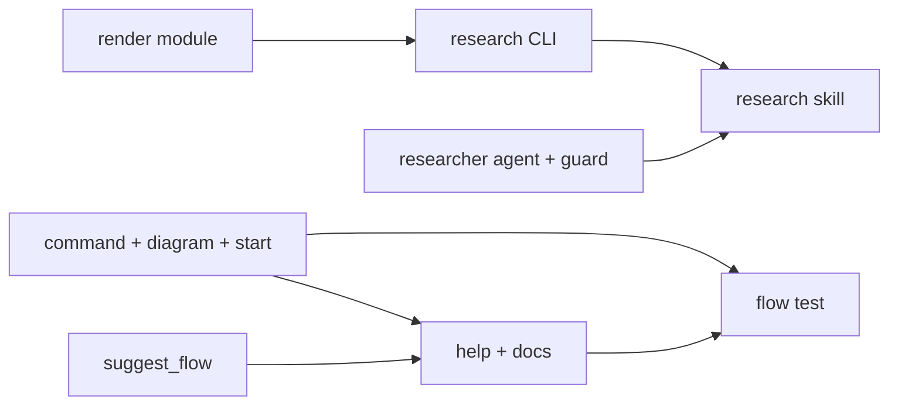

# Research mode (integration)

**Goal:** Add the `/superlite:research` mode: ledger tool, level render with parity, researcher agent, skill, command, flow diagram, suggest_flow, help and docs.
**Architecture:** `research.py` owns the level-free JSON ledger and CLI; `research_render.py` renders a level report and checks parity against the ledger; a `researcher` agent gathers evidence; the `research` skill drives the flow.
**Tech stack:** Python 3.12 stdlib, pytest, markdown, bash hooks
**Spec:** docs/plans/2026-11-07-research-mode.feature.md
**Detail:** tests
**Target-min:** 30
**Ignore:** .superlite/, __pycache__/, .pytest_cache/
**Review plan:** docs/plans/2026-11-07-research-mode.feature.md
**Prototype:** /Users/iheatuwogu/Projects/superlite/.superlite/sandboxes/research-mode-proto (read its research.py, research_render.py and tests to port; never copy its gaps)

## Global constraints

- language: python
- test command: `uv run pytest tests/scripts -q`
- FROZEN: every existing `superlite-cli` tool, hook behavior and mode flow; the 2000-character cap on skills/using-superlite/SKILL.md (leave that file alone)
- Port from the prototype, never merge it; its stubs and the grade A-D limit stay behind (tiers are user-defined)
- Ledger is level-free; every level shows the same claim ids, citations, numbers, open and resolved contradictions with causes
- All new help, intro, diagram and doc lines at most 80 columns; LF endings; any superlite-cli call in docs must be a real tool, subcommand and flag
- No agent trailers on commits; the coordinator checkpoints, nothing is committed by agents

### T1 render module · Complexity 4 · Est. context 30k
**Owns:** skills/swarm/scripts/research_render.py, tests/scripts/test_research_render.py
**Components:** 1
**LOC owned:** 220
**Tests:** fast
**Model:** sonnet
**Kind:** logic
**Depends on:** —
**Produces:** research_render.render(ledger, level) -> str; research_render.parity(texts, ledger=None) -> list of mismatch strings; LEVELS = (director, vp, researcher, simple)
e.g. parity({"vp": text_without_C1}, ledger) -> ["vp: missing claim/source id C1"]
**Consumes:** ledger JSON: topic, tiers (list), sources (id,url,date,grade,kind,file_url,size), claims (id,text,sources), contradictions (claims,cause,status resolved|open)
**Verify:** python -m pytest tests/scripts/test_research_render.py -q
**Done when:** ported from the prototype; resolved contradictions render with their cause as well as open ones; parity with a ledger also flags an item missing from every render; unknown level raises ValueError; wording differs per level but ids, citations, numbers and contradiction causes are identical

### T2 research CLI · Complexity 5 · Est. context 36k
**Owns:** skills/swarm/scripts/research.py, tests/scripts/test_research.py, tests/fixtures/research/ledger.json
**Components:** 2
**LOC owned:** 340
**Tests:** fast
**Model:** sonnet
**Kind:** logic
**Depends on:** T1
**Produces:** research.main(argv) with init, source, claim, contradiction, lint [--parity FILE...], render --level L, downloads, download --yes; research.lint_ledger(data) -> list of problems
e.g. research lint --ledger L --parity vp.md simple.md -> exit 1 naming a claim id missing from a file
**Consumes:** the whole research_render module from T1 (its render, parity and LEVELS, read with task T1 and test_research_render.py)
e.g. research_render.parity({"vp": text_without_C1}, ledger) -> ["vp: missing claim/source id C1"]
**Verify:** python -m pytest tests/scripts/test_research.py -q
**Done when:** ported from the prototype; init takes --tiers and a source grade is checked against the ledger tiers only when set (no fixed A-D); lint flags unknown source, claim without source, contradiction without cause or with bad status; lint --parity compares files to the ledger; render prints the level report; downloads lists name, source and size for sources with file_url and never fetches; download refuses without --yes and fetches only listed files with --yes; the fixture has 3 sources (one recent high-grade paper, one with file_url and size), 5 claims with numbers, 2 contradictions (one resolved, one open, both with causes)

### T3 researcher agent and guard · Complexity 4 · Est. context 30k
**Owns:** agents/researcher.md, hooks/_edits, .opencode/plugins/superlite.js, .kimi-plugin/plugin.json, tests/scripts/test_researcher_agent.py
**Components:** 3
**LOC owned:** 80
**Tests:** fast
**Model:** sonnet
**Kind:** logic
**Depends on:** —
**Produces:** agent superlite:researcher (flat frontmatter, name equals file stem, tools Read, Write, Grep, Glob, Bash, WebSearch, WebFetch); hooks/_edits allows superlite:researcher beside Explore
e.g. an Agent call with subagent_type superlite:researcher during an active run is not blocked; general-purpose still is
**Consumes:** —
**Verify:** python -m pytest tests/scripts/test_researcher_agent.py tests/scripts/test_agent_files.py -q
**Done when:** agent file passes test_agent_files; body tells it to add sources and claims only through superlite-cli research, one sub-question per agent, record date, grade and link for every source, flag conflicting evidence rather than resolve it silently; hooks/_edits allowlist (the case on claude-code-guide near line 166) gains superlite:researcher and the guard test proves general-purpose is still denied; opencode AGENT_NOTE and kimi skillInstructions name researcher

### T4 research skill · Complexity 4 · Est. context 30k
**Owns:** skills/research/SKILL.md, docs/research-flow.md
**Components:** 2
**LOC owned:** 220
**Tests:** fast
**Model:** sonnet
**Kind:** logic
**Depends on:** T2, T3
**Produces:** skill research (frontmatter name and description starting "Use when"); docs/research-flow.md
e.g. skill steps: ask, plan, critical questions, approve, fan out researchers, contradiction pass, lint, write at level, opt-in download
**Consumes:** research CLI subcommands init, source, claim, contradiction, lint, render, downloads, download; agent superlite:researcher
**Verify:** python -m pytest tests/scripts/test_doc_contract.py tests/scripts/test_name_scan.py -q
**Done when:** skill follows the nine-step diagram; outputs docs/plans/<date>-<topic>.research.md, .sources.md, .contradictions.md; human mode approves the plan first; tiers are asked of the user; levels render from the ledger without re-research; download only after a yes with name, source and size listed; every superlite-cli call matches the real CLI; skills/using-superlite is untouched

### T5 command, diagram and start · Complexity 3 · Est. context 22k
**Owns:** commands/research.md, assets/flows/research.txt, commands/start.md
**Components:** 3
**LOC owned:** 90
**Tests:** fast
**Model:** sonnet
**Kind:** logic
**Depends on:** —
**Produces:** /superlite:research command; assets/flows/research.txt; research listed in start's modes and menus
e.g. start.md argument-hint becomes [regular|mvp|feature|debug|small|review|research]
**Consumes:** —
**Verify:** python -m pytest tests/scripts/test_doc_contract.py -q
**Done when:** commands/research.md modeled on commands/debug.md (prints the diagram verbatim, asks for the request, session ensure with ASK handling, loads the research skill, ends with superlite-cli finish); the diagram is exactly the approved nine-step ASCII flow from the plan conversation (ASK, PLAN, QUESTIONS, APPROVE, RESEARCH fan-out, CONTRADICTIONS looping back, LINT, WRITE, DOWNLOAD) within 80 columns; start.md lists research in description, hint, mode words, menu and the state menus for existing code and empty folder

### T6 suggest_flow · Complexity 3 · Est. context 22k
**Owns:** skills/swarm/scripts/suggest_flow.py, tests/scripts/test_suggest_flow.py
**Components:** 1
**LOC owned:** 70
**Tests:** fast
**Model:** sonnet
**Kind:** logic
**Depends on:** —
**Produces:** suggest_flow suggests research
e.g. suggest_flow --text "research how solid-state batteries compare to lithium-ion" -> suggest: research
**Consumes:** —
**Verify:** python -m pytest tests/scripts/test_suggest_flow.py tests/scripts/test_properties.py -q
**Done when:** FLOWS gains research; WORDS gains research trigger words (research, investigate, survey, literature, compare, sources); existing rows keep their suggestions (debug and review keep precedence); table rows added for empty and existing-code states; docstring updated

### T7 help, intro and docs · Complexity 3 · Est. context 26k
**Owns:** assets/help.txt, assets/intro.txt, README.md, docs/tools.md, docs/sessions.md, docs/skills-and-agents.md, docs/README.md, docs/feature-flow.md, skills/swarm/scripts/superlite-cli
**Components:** 4
**LOC owned:** 90
**Tests:** fast
**Model:** sonnet
**Kind:** logic
**Depends on:** T5, T6
**Produces:** /superlite:research listed in help, intro, README; research tool and flow in docs
e.g. docs/tools.md suggest_flow row lists research
**Consumes:** commands/research.md; research CLI tool name
**Verify:** python -m pytest tests/scripts/test_session_start.py tests/scripts/test_doc_contract.py tests/scripts/test_name_scan.py -q
**Done when:** help.txt and intro.txt list /superlite:research within 80 columns; README adds a use-case row, the start row and a command row; docs/tools.md documents the research tool and the suggest_flow flows; sessions.md, skills-and-agents.md, feature-flow.md and docs/README.md mention research; the superlite-cli header comment lists research; no other lines change

### T8 flow test and seams · Complexity 3 · Est. context 22k
**Owns:** tests/scripts/test_flows.py
**Components:** 1
**LOC owned:** 40
**Tests:** slow
**Model:** sonnet
**Kind:** logic
**Depends on:** T5, T7
**Produces:** test_flow_research
**Consumes:** commands/research.md; assets/flows/research.txt
**Verify:** python -m pytest tests/scripts/test_flows.py -q
**Done when:** test_flow_research follows test_flow_debug (ensure, end_flow, assert_closed_clean) and passes; the full suite uv run pytest tests/scripts tests/bench passes

## Review Focus

- App type: cli plugin scripts, markdown flows, bash hooks
- Seams: research.py to research_render.py; hooks/_edits allowlist; help/intro versus commands/*.md
