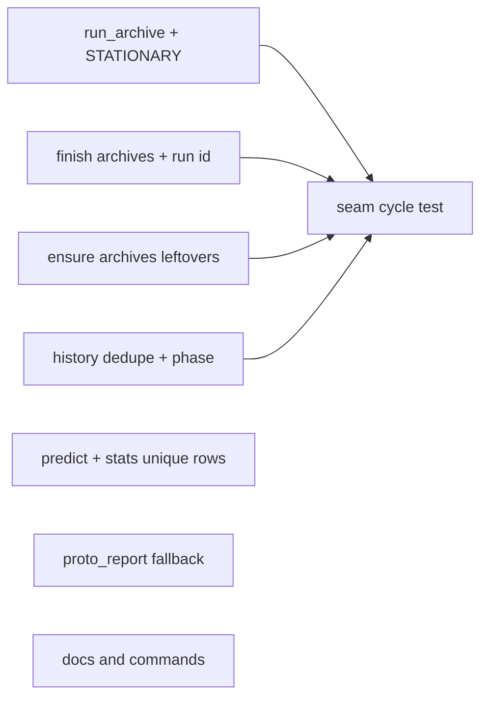

# Run archive: integration build

**Goal:** Every run starts with an empty ledger; finished and unfinished runs are kept in `<hub>/.superlite/runs/<id>/`; history rows link to their archive, are never recorded twice, and predict refits on unique non-prototype rows.
**Architecture:** `run_archive.py` picks, names and moves a run's files into the hub's `runs/` (in `STATIONARY`). `finish` archives last and passes the archive id to history; `session ensure` archives leftovers when a new flow starts. `history` gains dedupe, `phase` and `unique_rows`; `predict` and stats use `unique_rows` and skip prototype rows; `proto_report` falls back to the archive.
**Tech stack:** Python 3 stdlib, pytest, bash
**Spec:** /mnt/c/Users/CWogu/source/repos/superlite/.claude/worktrees/sessions-run-archive/docs/plans/2026-11-10-run-archive.feature.md
**Review plan:** docs/plans/2026-11-10-run-archive.feature.md
**Detail:** contracts
**Target-min:** 12

## Global constraints

- language: python
- test command: `python3 -m pytest tests/scripts -q --ignore=tests/scripts/test_session_machine.py` (no `uv`, no `hypothesis` here); per task run only its own test files.
- Port, never merge: the approved prototype lives in `/mnt/c/Users/CWogu/source/repos/superlite/.claude/worktrees/run-archive-proto` (read its `skills/swarm/scripts/run_archive.py`, `finish.py`, `session_ensure.py` and their tests as reference). Copy its behaviour task by task; no stub, fake or try-out script from it.
- FROZEN: `finish.py` CLI flags and every existing summary line (new lines only after the existing output); `session_registry` helper signatures; `session ensure` exit codes and its `SESSION ...` line; existing history row fields (new fields are added only); `predict.load_coef(path=None) -> dict`; `report.write_report`; `proto.proto_report(st: dict) -> dict | None`.
- Archive id `YYYYMMDD-HHMMSS-<slug>` (local time), slug `run` without a session, `-unfinished` for leftovers, `-2`/`-3` on a clash. Home: `state.hub_root(checkout)/.superlite/runs`, outside git `<checkout>/.superlite/runs`.
- Never archived: `session_registry.STATIONARY`, `runs`, `research`, `test-cmd.json`, `agent-specs.json`, `host-models.json`, `peers.json`, any `*.lock`.
- `run.json`: `{"id", "slug", "checkout", "plan", "archived_at", "status": "finished"|"unfinished", "files"}`.
- Stdlib only; LF endings. Git has no identity on this machine: tests that commit set `GIT_AUTHOR_*`/`GIT_COMMITTER_*` env vars.

## File structure

- `skills/swarm/scripts/run_archive.py`: one run's files to `runs/<id>/` with `run.json`; slug lookup.
- `skills/swarm/scripts/session_registry.py`: `STATIONARY` gains `runs`.
- `skills/swarm/scripts/finish.py`: archive id before history; archive last.
- `skills/swarm/scripts/session_ensure.py`: archive leftovers when a new flow starts, undoable.
- `skills/swarm/scripts/history.py`: run-id dedupe, `phase`, `unique_rows`.
- `skills/swarm/scripts/predict.py`: refit on unique non-proto rows.
- `skills/swarm/scripts/proto.py`: `proto_report` reads the archive when the worktree's report is gone.
- Docs: `skills/swarm/SKILL.md`, `commands/feature.md`, `docs/sessions.md`, `README.md`.

### T1 run archive module · Complexity 3 · Est. context 26k
**Owns:** skills/swarm/scripts/run_archive.py, skills/swarm/scripts/session_registry.py, tests/scripts/test_run_archive.py
**Components:** 1
**LOC owned:** 130
**Tests:** fast
**Model:** sonnet
**Est. time:** 3.0 min (1 component, about 130 LOC, fast tests)
**Consumes:** none
**Produces:** run_archive.run_id(slug: str | None, now: datetime, unfinished: bool = False) -> str · run_archive.entries(sl: Path) -> list[Path] · run_archive.runs_dir(checkout: Path) -> Path · run_archive.archive(sl: Path, slug: str | None = None, unfinished: bool = False, plan: str | None = None, now: datetime | None = None, rid: str | None = None) -> Path | None · run_archive.current_slug(checkout: Path) -> str | None · run_archive.restore(dest: Path, sl: Path) -> None
e.g. run_id("export", datetime(2026, 11, 10, 14, 3, 9)) -> "20261110-140309-export"
e.g. run_id(None, datetime(2026, 11, 10, 14, 3, 9), unfinished=True) -> "20261110-140309-run-unfinished"
e.g. archive(sl with progress.md, test-cmd.json, "export", now=datetime(2026, 11, 10, 14, 3, 9)) -> <hub>/.superlite/runs/20261110-140309-export; archive(..., rid="X1") -> <hub>/.superlite/runs/X1
e.g. archive(sl holding only test-cmd.json) -> None
e.g. current_slug(<checkout registered as session "export">) -> "export"; current_slug(<plain dir>) -> None
e.g. restore(<runs/X1 holding progress.md, run.json>, sl) -> progress.md back in sl, runs/X1 removed
**Review Focus:** `test_linked_worktree_archives_to_hub`; `test_id_clash_suffix`; `test_keeps_locks_and_research`; `test_stationary_has_runs` (`run_entries` skips `runs/`); `test_current_slug_takes_no_lock` (works while `registry_lock` is held)
**Test code (contracts):** port the prototype's 11 tests, plus test_rid_overrides_id · test_current_slug_registered · test_current_slug_none · test_current_slug_takes_no_lock · test_restore_moves_back
**Steps:** 1 failing tests, 2 run: FAIL, 3 implement, 4 run: PASS
**Notes:** `current_slug` reads the registry without the lock (`session_registry.read` + `row_at` + `resolve_host`), never raises (None on any error). `run.json` written last via temp file + `os.replace`.

### T2 finish archives the run · Complexity 3 · Est. context 28k
**Owns:** skills/swarm/scripts/finish.py, tests/scripts/test_finish_archive.py, tests/scripts/test_metrics_history.py, tests/scripts/test_run_widget.py, tests/scripts/test_orchestrator.py
**Components:** 1
**LOC owned:** 80
**Tests:** fast
**Model:** sonnet
**Est. time:** 2.5 min (1 component, about 80 LOC, fast tests)
**Consumes:** run_archive.archive(sl: Path, slug: str | None = None, unfinished: bool = False, plan: str | None = None, now: datetime | None = None, rid: str | None = None) -> Path | None · run_archive.run_id(slug: str | None, now: datetime, unfinished: bool = False) -> str · run_archive.current_slug(checkout: Path) -> str | None (T1)
**Produces:** finish.main(argv=None) -> int (unchanged signature)
**Review Focus:** `test_summary_unchanged`; `test_history_run_is_archive_id` (with `--plan`, `history.record_run` gets `run_id` equal to the archive folder name; fake record_run to capture); `test_non_superlite_ledger_dir_not_archived`; `test_widget_follows_archive`; `test_archive_error_exits_zero`
**Test code (contracts):** port the prototype's finish tests (fixing `test_nothing_to_archive_no_line`, which failed once there), plus test_history_run_is_archive_id · test_archive_error_exits_zero
**Steps:** 1 failing tests, 2 run: FAIL, 3 implement, 4 run: PASS
**Notes:** At the start of `main` compute `rid = run_archive.run_id(run_archive.current_slug(checkout), now)` once; `history_section` passes `run_id=rid` to `history.record_run`; the end of `main` archives with `rid=rid` after `mark_run` and `exclusive.release`, only when the run folder is named `.superlite`.

### T3 ensure archives leftovers · Complexity 4 · Est. context 32k
**Owns:** skills/swarm/scripts/session_ensure.py, tests/scripts/test_ensure_archive.py, tests/scripts/test_session_ensure.py
**Components:** 1
**LOC owned:** 70
**Tests:** fast
**Model:** sonnet
**Est. time:** 3.0 min (1 component, about 70 LOC, fast tests)
**Consumes:** run_archive.archive(sl: Path, slug: str | None = None, unfinished: bool = False, plan: str | None = None, now: datetime | None = None, rid: str | None = None) -> Path | None · run_archive.restore(dest: Path, sl: Path) -> None (T1)
**Produces:** none
**Review Focus:** port the prototype's 5 tests and its two updated `test_session_ensure.py` tests; plus `test_failed_enter_restores_leftovers`: when `enter_session` raises in `start_in_host`, the leftovers are back in the live folder and no `runs/*-unfinished` folder remains
**Test code (contracts):** test_open_here_archives_unfinished · test_unregistered_leftovers_archived · test_config_survives · test_no_auto_session_untouched · test_clean_checkout_no_line · test_failed_enter_restores_leftovers
**Steps:** 1 failing tests, 2 run: FAIL, 3 implement, 4 run: PASS
**Notes:** In `start_in_host` archive inside the `Journal` and register `j.undo(lambda: run_archive.restore(dest, live), "archive")`.

### T4 history dedupe and phase · Complexity 3 · Est. context 28k
**Owns:** skills/swarm/scripts/history.py, tests/scripts/test_history_archive.py
**Components:** 1
**LOC owned:** 70
**Tests:** fast
**Model:** sonnet
**Est. time:** 2.5 min (1 component, about 70 LOC, fast tests)
**Consumes:** none
**Produces:** history.unique_rows(rows: list[dict]) -> list[dict] · history.record_run(plan_path, sl_dir=".superlite", run_id=None) -> list (unchanged signature; skips duplicates)
e.g. unique_rows([a, a2]) where a2 equals a except "run" -> [a]
e.g. unique_rows([a, b]) with different task -> [a, b]
**Review Focus:** `test_record_run_twice_records_once`: same run_id twice -> the global and project files each hold the rows once; `test_phase_proto` (in a checkout that `proto.originating_run` finds, rows get `"phase": "proto"`, else `"build"`); `test_stats_use_unique_rows`
**Test code (contracts):** test_unique_rows_drops_content_duplicates · test_unique_rows_keeps_distinct · test_record_run_twice_records_once · test_phase_build_default · test_phase_proto · test_stats_use_unique_rows · test_old_rows_without_phase_read_fine
**Steps:** 1 failing tests, 2 run: FAIL, 3 implement, 4 run: PASS
**Notes:** Content key for `unique_rows`: (date, task, duration_s, tokens.in, tokens.out, model). `record_run` skips rows whose (run, task) is already in the target file. `write_stats` reads through `unique_rows`.

### T5 predict refits on unique build rows · Complexity 2 · Est. context 24k
**Owns:** skills/swarm/scripts/predict.py, tests/scripts/test_predict_history.py
**Components:** 1
**LOC owned:** 40
**Tests:** fast
**Model:** sonnet
**Est. time:** 2.0 min (1 component, about 40 LOC, fast tests)
**Consumes:** history.unique_rows(rows: list[dict]) -> list[dict] (T4)
**Produces:** predict.load_coef(path=None) -> dict (unchanged)
**Review Focus:** `test_duplicates_same_coef`: a history with every row doubled (different run ids) gives the same coefficients as single; `test_proto_rows_ignored`: adding 40 `phase: proto` rows changes nothing and does not reach the 30-row threshold
**Test code (contracts):** test_duplicates_same_coef · test_proto_rows_ignored · test_threshold_counts_unique_build_rows (29 unique + 29 duplicates -> shipped coefficients)
**Steps:** 1 failing tests, 2 run: FAIL, 3 implement, 4 run: PASS

### T6 proto report fallback · Complexity 2 · Est. context 22k
**Owns:** skills/swarm/scripts/proto.py, tests/scripts/test_proto_report_archive.py
**Components:** 1
**LOC owned:** 40
**Tests:** fast
**Model:** sonnet
**Est. time:** 2.0 min (1 component, about 40 LOC, fast tests)
**Consumes:** none
**Produces:** proto.proto_report(st: dict) -> dict | None (unchanged)
**Review Focus:** `test_report_from_archive`: worktree `.superlite/report.json` gone, `runs/A/run.json` with checkout == worktree and `runs/A/report.json` present -> its headline; `test_newest_archive_wins`; `test_other_checkout_ignored`
**Test code (contracts):** test_report_from_archive · test_newest_archive_wins · test_other_checkout_ignored · test_saved_proto_report_still_first
**Steps:** 1 failing tests, 2 run: FAIL, 3 implement, 4 run: PASS
**Notes:** Find the archive folder as `state.hub_root(worktree) / ".superlite" / "runs"` (the T1 rule; do not import run_archive, so this task needs no T1 code). Pick the newest `runs/*/run.json` by `archived_at` whose `checkout` is the worktree and whose folder holds `report.json`; read its headline the same way as the live file.

### T7 docs and commands · Complexity 1 · Est. context 18k
**Owns:** skills/swarm/SKILL.md, commands/feature.md, docs/sessions.md, README.md, tests/scripts/test_docs_run_archive.py
**Components:** 1
**LOC owned:** 40
**Tests:** fast
**Kind:** mechanical
**Model:** haiku
**Est. time:** 1.5 min (1 component, about 40 LOC, fast tests)
**Consumes:** none
**Produces:** none
**Review Focus:** none
**Test code (contracts):** test_swarm_no_manual_archive (SKILL.md no longer contains "Archive `.superlite/incidents.jsonl`"; contains ".superlite/runs/") · test_feature_integration_finish_plan (commands/feature.md contains "superlite-cli finish --plan" in step 6) · test_sessions_doc_runs_stationary (docs/sessions.md mentions ".superlite/runs/" and that sessions never move it) · test_readme_mentions_runs
**Steps:** 1 failing tests, 2 run: FAIL, 3 implement, 4 run: PASS
**Notes:** SKILL.md:99: replace the archive sentence with "`finish` moves the run's files into `.superlite/runs/<id>/`." feature.md step 6: "run `superlite-cli finish --plan <integration plan>`". sessions.md: one row in the concept table, `runs/` | `<hub>/.superlite/runs/`, archived runs, never moved by sessions. README: one sentence next to the progress.md line.

### T8 seam cycle · Complexity 3 · Est. context 26k
**Owns:** tests/scripts/test_run_archive_cycle.py
**Components:** 1
**LOC owned:** 90
**Tests:** slow
**Model:** sonnet
**Est. time:** 2.5 min (1 component, about 90 LOC, slow tests)
**Consumes:** none
**Produces:** none
**Review Focus:** `test_cycle`: in a temp repo through `skills/swarm/scripts/superlite-cli`: ensure first, ledger, finish (archived, live empty); ensure second, ledger, ensure second again (`-unfinished` archive); `session close --slug first` and `discard --slug second` leave both archives in the hub's `runs/`
**Test code (contracts):** test_cycle · test_worktree_session_archive_survives_close (a `--worktree` session's finish archives to the hub; after close the folder is still there)
**Steps:** 1 failing tests, 2 run: FAIL, 3 implement, 4 run: PASS

## Review Focus

- Package `run archive` (file I/O, CLI): file, state, protocol. Risks: moving files another session reads; worktree archives landing outside the hub; summary drift; ensure archiving the current flow's own files; partial moves on failure.
- Package `history/predict` (data): numeric, state. Risks: duplicate rows skewing the fit; old rows without `phase`.

**Probe entry:** call=run_archive.archive · run=bash skills/swarm/scripts/superlite-cli finish
