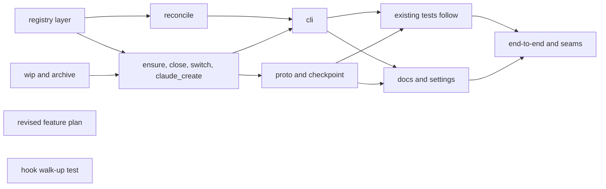

# Integration: sessions reconcile with git, archive on close, and wrap Claude Code worktrees

**Goal:** Port the approved prototype (`superlite/session-reconcile-proto`, try-out approved 2026-11-10) into superlite module by module: reconcile and worktree inventory, WIP on private refs, archive-on-close, harness-worktree adoption, the `.claude/worktrees/` home, and Claude-created worktrees under Claude Code (D5 revised). D7 is dropped.
**Architecture:** New stdlib modules `session_reconcile`, `session_wip`, `session_archive`, `session_close`, `worktree_home`, `harness`, `claude_create` beside the session scripts; `session.py` wires `reconcile` and `branch-name`; `proto.py` gains Claude-created sandboxes; docs tell Claude Code to use EnterWorktree/ExitWorktree.
**Tech stack:** Python stdlib, real git in temp repos, pytest
**Spec:** docs/plans/2026-11-07-claude-code-worktree-compat.feature.md
**Detail:** contracts
**Target-min:** 20
**Review plan:** docs/plans/2026-11-07-claude-code-worktree-compat.feature.md

## Global constraints

- language: python
- test command: `python -m pytest tests/scripts tests/regression -q`
- Source: port each owned file from the prototype working tree `C:/Users/CWogu/source/repos/superlite/.superlite/sandboxes/session-reconcile-proto` (WSL: `/mnt/c/...`), never merge its branch. Review each file against the feature plan while porting; leave behind prototype-only leftovers. Never port `skills/swarm/scripts/land.py`, `tests/scripts/test_land.py`, `tests/regression/test_probe_*_1.py` (voided), `docs/plans/*.proto.md`
- FROZEN: `SESSION` / `REDIRECT` / `ASK` line shapes, the `STATIONARY` set, registry `"v": 2` (fields added only), `owned_worktree(root, row)`, `stash_entries`, existing `session` subcommands and flags, the interfaces exactly as the prototype built them (the prototype's tests are the target)
- Every existing test passes; stdlib only; LF endings; files at most 600 lines; only `state.py` spells the run folder; no broad `except` outside entry points; hooks use printf
- Claude Code behaviour only when `CLAUDECODE=1`; with it unset every command behaves as before
- WSL git cannot read Windows-written worktrees: never run git inside the integration worktree from WSL; tests build temp repos

### T1 registry layer: ident, worktree_home, session_registry · Complexity 4 · Est. context 30k
**Owns:** skills/swarm/scripts/ident.py, skills/swarm/scripts/worktree_home.py, skills/swarm/scripts/session_registry.py, skills/swarm/scripts/harness.py, tests/scripts/test_worktree_home.py, tests/scripts/test_branch_pref.py, tests/scripts/test_harness_hint.py, tests/regression/test_registry_keeps_worktrees.py, tests/regression/test_registry_lock_retries.py
**Components:** 2
**LOC owned:** 260
**Tests:** fast
**Model:** sonnet
**Est. time:** 3.0 min (2 components, port of about 260 LOC, fast tests)
**Consumes:** none
**Produces:** ident.git_path(p: str) -> str · ident.native(p) -> Path · worktree_home.home(root: Path) -> Path · worktree_home.session_dir(root: Path, slug: str) -> Path · worktree_home.proto_dir(root: Path, topic: str) -> Path · worktree_home.harness_worktree(path, branch) -> bool · worktree_home.superlite_cut(root: Path, path) -> bool · harness.under_claude_code(env: dict | None = None) -> bool · harness.enter_line(path: Path, cwd: Path) -> str | None · harness.branch_pref() -> str | None · harness.set_branch_pref(value: str) -> None · harness.session_branch(pref: str, slug: str, harness_branch: str) -> str · session_registry keeps the `worktrees` list
e.g. session_branch("superlite", "a", "worktree-a") -> "superlite/sessions/a"; session_dir(hub, "a") -> hub/".claude"/"worktrees"/"sessions-a"; ident.git_path("/mnt/c/r/.git/worktrees/a/C:/x") -> "C:/x" off Windows
**Review Focus:** session_registry.py at most 600 lines; old `.superlite/worktrees` rows still owned
**Test code (contracts):** the owned tests pass
**Steps:** 1 port, 2 run: PASS

### T2 WIP on private refs and the archive manifest · Complexity 3 · Est. context 24k
**Owns:** skills/swarm/scripts/session_wip.py, skills/swarm/scripts/session_archive.py, tests/scripts/test_session_wip.py, tests/scripts/test_session_archive.py, tests/regression/test_wip_save_failure.py
**Components:** 2
**LOC owned:** 150
**Tests:** fast
**Model:** sonnet
**Est. time:** 2.5 min (2 components, port of about 150 LOC, fast tests)
**Consumes:** none
**Produces:** session_wip.save(cwd: Path, slug: str, untracked: bool = True) -> str | None · session_wip.restore(cwd: Path, slug: str) -> bool · session_archive.write(root: Path, row: dict, wip_ref: str | None, now_ms: int) -> Path · session_archive.read(root: Path, slug: str) -> dict | None
e.g. save(wt, "a") with a dirty file -> 40-hex oid, `refs/superlite/wip/a` set, stash list unchanged
**Review Focus:** never touches `git stash list`
**Test code (contracts):** the owned tests pass
**Steps:** 1 port, 2 run: PASS

### T3 reconcile and worktree inventory · Complexity 4 · Est. context 30k
**Owns:** skills/swarm/scripts/session_reconcile.py, tests/scripts/test_session_reconcile.py, tests/scripts/test_session_reconcile_gaps.py
**Components:** 1
**LOC owned:** 150
**Tests:** fast
**Model:** sonnet
**Est. time:** 2.5 min (1 component, port of about 150 LOC, fast tests)
**Consumes:** worktree_home.harness_worktree(path, branch) -> bool (T1)
**Produces:** session_reconcile.inventory(root: Path, reg: dict) -> list[dict] · session_reconcile.drift(root: Path, reg: dict) -> list[dict] · session_reconcile.apply(root: Path, reg: dict) -> tuple[dict, list[dict]] · session_reconcile.drift_line(d: dict) -> str
e.g. a second apply writes the same bytes; a leaked registry base -> drift class base; an adopted Claude worktree -> kind harness
**Review Focus:** reads git, never changes it
**Test code (contracts):** the owned tests pass
**Steps:** 1 port, 2 run: PASS

### T4 ensure, close, switch and Claude-created worktrees · Complexity 6 · Est. context 45k
**Owns:** skills/swarm/scripts/session_ensure.py, skills/swarm/scripts/session_close.py, skills/swarm/scripts/session_switch.py, skills/swarm/scripts/claude_create.py, tests/scripts/test_session_close_archive.py, tests/scripts/test_session_adopt.py, tests/scripts/test_session_adopt_discard.py, tests/scripts/test_claude_create.py
**Components:** 3
**LOC owned:** 520
**Tests:** fast
**Model:** sonnet
**Est. time:** 5.0 min (3 components, port of about 520 LOC, fast tests)
**Consumes:** session_wip.save (T2) · session_archive.write (T2) · worktree_home.session_dir (T1)
**Produces:** claude_create.create_line(name: str, base: str) -> str · claude_create.hub_on_base(root: Path, base: str) -> bool · close archives then unregisters; ensure adopts harness worktrees; under CLAUDECODE=1 `ASK branch-name`, `session: create EnterWorktree name=<n> base=<ref>` or the superlite-cut fallback with the enter line
e.g. create_line("a", "main") -> "session: create EnterWorktree name=a base=main"; hub_on_base(hub, "main") -> True when the hub's HEAD is main's revision
e.g. CLAUDECODE=1, pref superlite, hub on base: `ensure --slug a` -> create line, nothing changed
**Review Focus:** session_ensure.py at most 600 lines; frozen line shapes
**Test code (contracts):** the owned tests pass
**Steps:** 1 port, 2 run: PASS

### T5 CLI · Complexity 3 · Est. context 26k
**Owns:** skills/swarm/scripts/session.py, tests/scripts/test_session_reconcile_cli.py, tests/scripts/test_line_grammar.py
**Components:** 2
**LOC owned:** 300
**Tests:** fast
**Model:** sonnet
**Est. time:** 3.0 min (2 components, port of about 300 LOC, fast tests)
**Consumes:** session_reconcile.drift (T3) · session_reconcile.apply (T3)
**Produces:** CLI `session reconcile [--apply]`, `session branch-name`, `--branch-name` on ensure/create
e.g. `session reconcile` -> "session: reconcile ok (0 drift, N worktrees)"
**Review Focus:** output byte-identical with CLAUDECODE unset
**Test code (contracts):** the owned tests pass
**Steps:** 1 port, 2 run: PASS

### T6 proto and checkpoint · Complexity 3 · Est. context 24k
**Owns:** skills/swarm/scripts/proto.py, skills/swarm/scripts/checkpoint.py, tests/scripts/test_proto_adopt.py
**Components:** 2
**LOC owned:** 120
**Tests:** fast
**Model:** sonnet
**Est. time:** 2.5 min (2 components, port of about 120 LOC, fast tests)
**Consumes:** claude_create.hub_on_base(root: Path, base: str) -> bool (T4) · worktree_home.proto_dir (T1)
**Produces:** `proto start` prints `proto: create EnterWorktree name=<T>-proto base=<ref>` under CLAUDECODE=1 on base; `--adopt`; discard of an adopted sandbox unregisters only; checkpoint ignores `.claude/worktrees/`
e.g. `proto start --topic x --adopt` inside `.claude/worktrees/x-proto` -> hub feature.json names it
**Review Focus:** feature.json always in the hub run folder; reuse claude_create.create_line instead of the prototype's local copy
**Test code (contracts):** the owned tests pass
**Steps:** 1 port, 2 run: PASS

### T7 existing tests follow the new behaviour · Complexity 3 · Est. context 30k
**Owns:** tests/scripts/conftest.py, tests/scripts/scenario.py, tests/scripts/test_dispatch_swarm.py, tests/scripts/test_exclusive.py, tests/scripts/test_feature_flow.py, tests/scripts/test_finish_order.py, tests/scripts/test_flows.py, tests/scripts/test_orchestrator.py, tests/scripts/test_past_findings.py, tests/scripts/test_run_scripts.py, tests/scripts/test_session.py, tests/scripts/test_session_ensure.py, tests/scripts/test_session_finish_mark.py, tests/scripts/test_session_machine.py, tests/scripts/test_session_moveout.py, tests/scripts/test_session_split.py, tests/scripts/test_session_sync.py, tests/scripts/test_step_failures.py
**Components:** 1
**LOC owned:** 150
**Tests:** fast
**Model:** sonnet
**Est. time:** 3.0 min (1 component, port of about 150 LOC, fast tests)
**Consumes:** none
**Produces:** tests only
e.g. a closed session is asserted through its manifest; new worktrees under `.claude/worktrees/`
**Review Focus:** only stale expectations change
**Test code (contracts):** the owned tests pass
**Steps:** 1 port, 2 run: PASS

### T8 docs and Claude Code settings · Complexity 3 · Est. context 30k
**Owns:** AGENTS.md, CLAUDE.md, commands/feature.md, commands/mvp.md, commands/debug.md, commands/small.md, commands/start.md, commands/research.md, commands/review.md, docs/sessions.md, docs/feature-flow.md, skills/shipping/SKILL.md, skills/swarm/SKILL.md, .cursor/rules/feature-worktrees.mdc, skills/using-superlite/references/claude-code-tools.md, tests/scripts/test_worktree_docs.py, .claude/settings.json, .gitignore
**Components:** 1
**LOC owned:** 140
**Tests:** fast
**Model:** sonnet
**Est. time:** 3.0 min (1 component, port of about 140 LOC, fast tests)
**Consumes:** none
**Produces:** docs ported; `.claude/settings.json` holds `{"worktree": {"baseRef": "head"}}` (no `enabledPlugins`, that is per user); `.gitignore` ignores `.claude/worktrees/` and `.claude/settings.local.json`
e.g. AGENTS.md has the "Worktrees under Claude Code" block
**Review Focus:** skills/using-superlite/SKILL.md untouched; swarm SKILL.md under its cap
**Test code (contracts):** the owned tests pass
**Steps:** 1 port, 2 run: PASS

### T9 end-to-end tests and seams · Complexity 3 · Est. context 30k
**Owns:** tests/scripts/test_session_dogfood.py, tests/scripts/test_session_adopt_dogfood.py, tests/scripts/test_worktree_home_e2e.py, tests/scripts/test_claude_create_e2e.py
**Components:** 1
**LOC owned:** 680
**Tests:** fast
**Model:** sonnet
**Est. time:** 3.0 min (1 component, port of about 680 LOC, fast tests)
**Consumes:** none
**Produces:** tests only
e.g. Claude-created session lifecycle passes through the real CLI
**Review Focus:** every ported module exercised end to end
**Test code (contracts):** the owned tests pass
**Steps:** 1 port, 2 run: PASS

### T10 carry the revised feature plan (coordinator) · Complexity 1 · Est. context 8k
**Owns:** docs/plans/2026-11-07-claude-code-worktree-compat.feature.md
**Components:** 1
**LOC owned:** 120
**Tests:** fast
**Model:** sonnet
**Est. time:** 1.0 min (1 component, plan text only)
**Consumes:** none
**Produces:** the feature plan with D5 revised, D7 dropped, check 9 dropped and the innomd-renderable diagrams
e.g. D5 reads "Claude creates, superlite adopts (revised by the user, 2026-11-10)"
**Review Focus:** none
**Test code (contracts):** none
**Steps:** 1 run: PASS

### T11 hook walk-up test for adopted worktrees (coordinator port) · Complexity 1 · Est. context 8k
**Owns:** tests/scripts/test_hooks_cwd_first.py
**Components:** 1
**LOC owned:** 30
**Tests:** fast
**Model:** sonnet
**Est. time:** 1.0 min (1 component, copy of the reviewed prototype file)
**Consumes:** none
**Produces:** tests only
e.g. test_harness_worktree_under_hub_uses_hub_run: a worktree at `<hub>/.claude/worktrees/x` resolves the hub's run by walk-up
**Review Focus:** none
**Test code (contracts):** the owned test passes
**Steps:** 1 port, 2 run: PASS

## Review Focus

- App type: CLI plugin scripts over git. Categories: state (registry vs git), file (manifest, sessions.json), protocol (line grammar).
- Risks: a port drops a prototype fix; CRLF on Windows; registry drift; Claude Code lines leaking when CLAUDECODE is unset.
- **Probe entry:** call=skills.swarm.scripts.ident.git_path

## Self-review

- Each task ports one module group; the prototype's tests are the acceptance target; D7 code and voided probe tests stay behind
