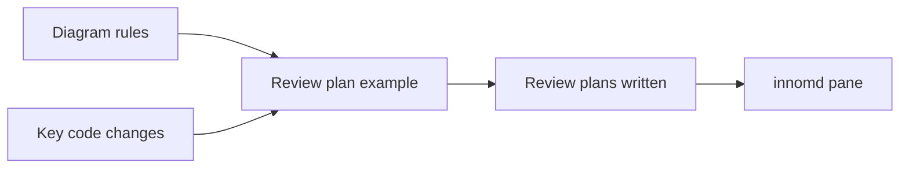
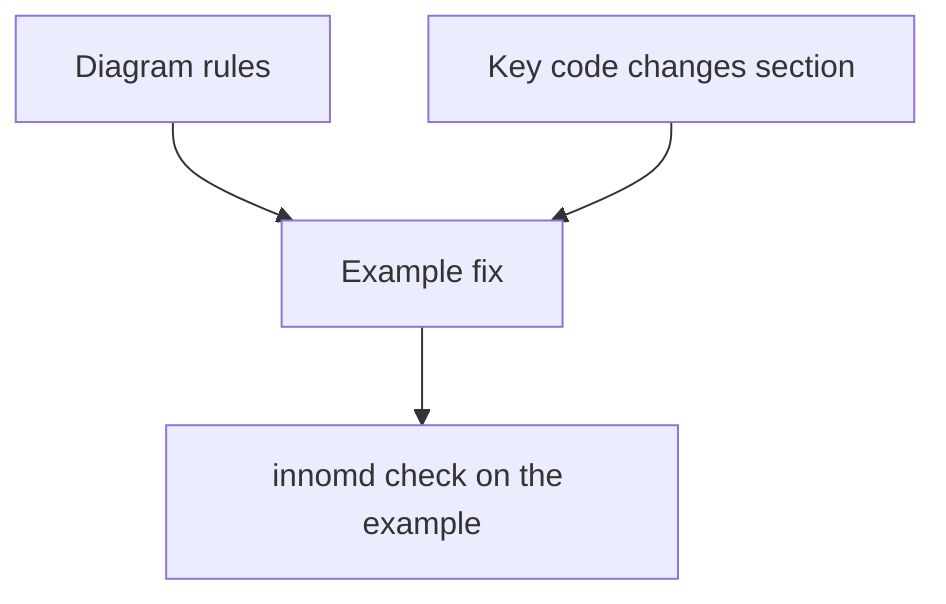

# innomd-friendly diagrams and code snippets in the review plan: review plan

## Summary
The review plan is the one plan you read, and you read it in innomd, which silently shows raw mermaid source for syntax it
cannot draw. This change makes the review plan use only diagrams innomd draws, and adds a short "Key code changes" section,
so it reads from the architecture down to the few lines of code that carry the idea. No other plan, spec or lint changes.

## What you will get
- Review plan diagram rules: the mermaid types innomd 0.5.1 draws, and what to use instead of the ones it does not.
- A review plan example that follows them (today's example uses `TB` and `subgraph`, which innomd cannot draw).
- A new "Key code changes" section in every review plan: 1 to 4 short snippets, each with one sentence on why it matters.

## What will be built
| Part | What it does | Size | Built by |
|---|---|---|---|
| Diagram rules | States the allowed types and the swaps for the banned ones | S | inline |
| Key code changes | Adds the section and replaces the "No code" rule | S | inline |
| Example fix | Rewrites the example's diagrams and adds a sample snippet section | S | inline |

## How it fits together


## Key code changes
The diagram rule the review plan template will state, as tested against innomd 0.5.1:

```text
Draws:    flowchart TD | flowchart LR | sequenceDiagram | gantt | classDiagram
          shapes ([ ]) { } [( )] (( )), edge labels, -.-> and ==>, quoted labels
Fallback: flowchart TB, subgraph, stateDiagram-v2, erDiagram
Instead:  TB -> TD; subgraph -> a label like A["Wave 1: parser"];
          state machine -> flowchart LR with labelled edges
```

The new section, placed after "How it fits together":

```text
## Key code changes
1-4 snippets, about 15 lines each, in the target language: a before/after of the
critical change, or a sketch of the main idea (a signature, a data shape, the key
branch). One plain sentence above each says why it matters. Illustrative only:
the machine plan's stubs and tests stay the contract.
```

The "Do not" rule changes from "No code, ..." to:

```text
- No full implementations, no %% taskgraph, no Produces/Consumes lines, no e.g.
  examples, no agent or model names.
```

The example's build diagram changes from a `subgraph` to labels:

```text
flowchart TD
  A["Wave 1: Counting"] --> T["Tests: wait for both"]
  B["Wave 1: Command line"] --> T
```

## How it gets built


## Decisions you can change
- Snippet count: 1 to 4 per plan (default) | as many as needed
- Files touched: the review plan template and the one line in the drafting skill that says "no code" (default) | template only

## Risks
- innomd gains support later and the rules go stale: the rule names the version tested (0.5.1).
- Snippets drift from what is built: they are marked illustrative; the machine plan stays the contract.

## Out of scope
- Machine plans, feature and MVP plans, specs, the swarm skill's diagrams, lint.
- Rewriting old plans in `docs/plans/`.

## How we will know it works
- The example in the template renders in innomd with every diagram drawn (no raw mermaid lines in the output).
- The next review plan superlite writes has a "Key code changes" section and only innomd-drawable diagrams.

## Rough time and cost
About 5 to 10 minutes inline, under $1 (rough).
