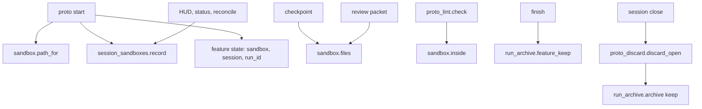
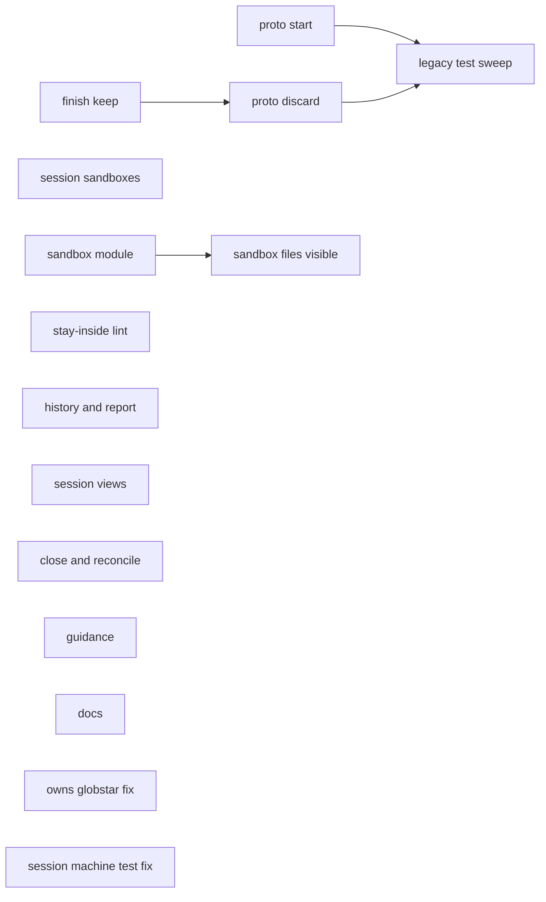

# proto-sandbox: machine plan

**Review plan:** docs/plans/2026-11-11-proto-sandbox.review.md
**Spec:** docs/plans/2026-11-11-proto-sandbox.spec.md
**Goal:** feature-mode prototypes live in `.superlite/sandboxes/<session>/<topic>/` inside the current checkout, linked to their session and run, instead of a git worktree.
**Architecture:** new `sandbox` (paths, file listing, inside check) and `session_sandboxes` (session row list) modules; `proto` starts sandboxes, `proto_discard` removes them; `run_archive`/`finish` keep the feature state; checkpoint, packet, history, lint, HUD, close and reconcile learn about sandboxes; docs drop the prototype branch.
**Tech stack:** Python 3.12, stdlib only; pytest (`tests/scripts`).
**Detail:** contracts
**Full suite:** yes
**Target-min:** 14
**Ignore:** .superlite/, __pycache__/, .claude/settings.json, docs/plans/

## Global constraints

- Scripts in `skills/swarm/scripts/`, tests in `tests/scripts/` importing via `sys.path.insert(0, SCRIPTS)` like `tests/scripts/test_proto_report_archive.py`. Spell `.superlite` only as `state.DIR_NAME` (code-shape rule); no file over 600 lines; nesting at most 3; no bare `except Exception` outside entry points.
- Sandbox path: `<checkout>/.superlite/sandboxes/<session>/<topic>/`; `<session>` is this checkout's session row slug, `host` without a registry or row. Repo-relative posix strings in state and messages.
- State file `feature.json` (run dir) for a new prototype: `{"v": 1, topic, plan, sandbox (abs posix), session, run_id, run, reach, level, status, rounds, started, tryout_time, tryout_approved}`; no `worktree`, `branch`, `base`, `adopted`. A legacy state has `worktree` and no `sandbox`.
- `run_id` = `run_archive.read_current_run(sl)["id"]` at the first `start` (create one with `run_archive.ensure_run(sl, topic, slug)` when missing); kept across fix rounds.
- Open prototype: `feature.json` exists with `status` in `building`, `tryout`, `approved`.
- Session-row writes never break `proto`: any failure is swallowed, `session reconcile` reports drift.
- Prototype tests run by path: `run_tests --fast <sandbox>/tests`.

## Main diagram

## Task graph

## Package A: sandbox core

App type: CLI + library. Categories: file, state, encoding.
**Probe entry:** call=sandbox.inside · run=python skills/swarm/scripts/proto.py

### T1 sandbox module · Complexity 3 · Est. context 28k
**Owns:** skills/swarm/scripts/sandbox.py, tests/scripts/test_sandbox.py
**Components:** 1
**LOC owned:** 110
**Tests:** fast
**Kind:** design
**Model:** sonnet
**Produces:** sandbox.path_for(checkout: Path, session: str, topic: str) -> Path · sandbox.session_of(checkout: Path) -> str · sandbox.files(checkout: Path, sb: Path) -> list[str] · sandbox.inside(sb_rel: str, path: str) -> bool · sandbox.open_sandbox(sl: Path) -> str | None
e.g. path_for(Path("/r"), "host", "export") -> Path("/r/.superlite/sandboxes/host/export")
e.g. inside(".superlite/sandboxes/host/x", ".superlite/sandboxes/host/x/a.py") -> True ; inside(".superlite/sandboxes/host/x", "src/a.py") -> False
e.g. open_sandbox(sl) with feature state {"status": "building", "sandbox": "/r/.superlite/sandboxes/host/x"} -> ".superlite/sandboxes/host/x"
**Review Focus:** `test_inside_rejects_dotdot`: `inside(sb, sb + "/../../y.py")` is False; `test_inside_backslash`: `sb.replace("/", "\\") + "\\a.py"` is True; `test_files_skips_deps`: files under `node_modules/`, `.venv/`, `__pycache__/` are not listed, others are, sorted repo-relative; `test_session_of_no_registry`: plain temp git repo gives `"host"`; `test_open_sandbox_discarded_none`: status `discarded` gives None; legacy state with only `worktree` gives None.
**Notes:** `session_of` reads the registry via `session_registry` (row whose worktree is this checkout); any error gives `host`. `open_sandbox` returns the path relative to `sl.parent`.

### T2 session sandboxes list · Complexity 3 · Est. context 30k
**Owns:** skills/swarm/scripts/session_sandboxes.py, tests/scripts/test_session_sandboxes.py
**Components:** 1
**LOC owned:** 90
**Tests:** fast
**Kind:** design
**Model:** sonnet
**Produces:** session_sandboxes.record(checkout: Path, topic: str, **fields) -> bool · session_sandboxes.open_entries(row: dict) -> list[dict]
e.g. record(root, "export", path=".superlite/sandboxes/host/export", run_id="20261111-140000-feat", status="building") -> True, row["sandboxes"] == [{"topic": "export", "path": ".superlite/sandboxes/host/export", "run_id": "20261111-140000-feat", "status": "building", "started": "<iso>", "ended": None}]
e.g. record(plain_dir, "export", status="building") -> False
e.g. open_entries({"sandboxes": [{"topic": "a", "status": "building"}, {"topic": "b", "status": "discarded"}]}) -> [{"topic": "a", "status": "building"}]
**Review Focus:** `test_record_upserts_by_topic`: a second record with `status="discarded"` updates the same entry and sets `ended`; `test_record_under_lock`: uses the registry lock and atomic replace of `sessions.json`; `test_record_corrupt_registry_false`: unreadable `sessions.json` returns False, no raise.

### T3 proto start on a sandbox · Complexity 5 · Est. context 45k
**Owns:** skills/swarm/scripts/proto.py, tests/scripts/test_proto_sandbox.py, tests/scripts/test_proto_adopt.py, tests/scripts/test_proto_report_archive.py, tests/scripts/test_feature_flow.py
**Components:** 2
**LOC owned:** 200
**Tests:** fast
**Kind:** design
**Model:** sonnet
**Consumes:** sandbox.path_for(checkout: Path, session: str, topic: str) -> Path (T1) · sandbox.session_of(checkout: Path) -> str (T1) · session_sandboxes.record(checkout: Path, topic: str, **fields) -> bool (T2) · proto_discard.discard_open(sl: Path, reason: str = "discard") -> dict | None (T4)
**Produces:** proto.main(argv: list[str]) -> int
**Review Focus:** `test_start_makes_sandbox_no_branch`: temp git repo, `start --topic export` creates the folder, `git worktree list` and `git branch` unchanged, state has `sandbox`, `session`, `run_id`, no `worktree`; prints `proto: export building, sandbox <path>`; `test_start_under_claude_code_no_enter_line`: with `CLAUDECODE=1` no `EnterWorktree` line; `test_fix_round_keeps_run_id`; `test_tryout_run_line_cds_into_sandbox`: prints `run: cd "<sandbox>" && <cmd>`; `test_status_prints_session_and_run`; `test_report_found_by_run_id`: two archived runs of one checkout, `proto_report` picks the one whose `run.json` id equals `run_id`; `test_sees_uncommitted_code`: sandbox entry imports a modified uncommitted module and runs.
**Notes:** Remove `cmd_adopt`, `pending`, `originating_run`, `--adopt`, `--path`, `--base`, `--keep-branch`, the `claude_create`/`worktree_home` path. `cmd_discard` calls `proto_discard.discard_open(sl)` (import inside the function: `proto_discard` imports `proto`). Every state change calls `session_sandboxes.record`. Delete `tests/scripts/test_proto_adopt.py`; move its still-valid cases. Rewrite worktree assertions in the other owned tests. Update the module docstring.

### T4 proto discard · Complexity 4 · Est. context 38k
**Owns:** skills/swarm/scripts/proto_discard.py, tests/scripts/test_proto_discard.py
**Components:** 1
**LOC owned:** 120
**Tests:** fast
**Kind:** design
**Model:** sonnet
**Consumes:** session_sandboxes.record(checkout: Path, topic: str, **fields) -> bool (T2)
**Produces:** proto_discard.discard_open(sl: Path, reason: str = "discard") -> dict | None
e.g. discard_open(sl) with an open sandbox -> {"status": "discarded", "discarded": <ms>, "discard_reason": "discard", ...}; the sandbox folder is gone
e.g. discard_open(sl) with no state or status discarded -> None
**Review Focus:** `test_discard_removes_folder_and_archives_markers`: live `stable.json`, `pool.json`, `prime.md` land in a `runs/*-unfinished/` folder, feature state and `orchestrator.json` stay live; `test_discard_after_finish_no_archive`: only feature state left, no new runs folder; `test_legacy_worktree_discard`: state with `worktree`/`branch` removes the worktree and deletes the branch as before; `test_discard_records_session`: row entry status `discarded`; `test_discard_keeps_proto_report`.
**Notes:** Saves `proto.proto_report(st)` into the state first. Archive call: `keep=("feature.json", "orchestrator.json")`, `unfinished=True`.

### T5 finish keeps the feature state · Complexity 4 · Est. context 36k
**Owns:** skills/swarm/scripts/run_archive.py, skills/swarm/scripts/finish.py, tests/scripts/test_finish_feature_keep.py
**Components:** 2
**LOC owned:** 70
**Tests:** fast
**Kind:** design
**Model:** sonnet
**Produces:** run_archive.archive(sl: Path, slug: str | None = None, unfinished: bool = False, plan: str | None = None, now: datetime | None = None, rid: str | None = None, reserved: Path | None = None, copy: bool = False, keep: tuple = ()) -> Path | None · run_archive.feature_keep(sl: Path) -> set[str]
e.g. feature_keep(sl) with feature state status "building" -> {"feature.json", "orchestrator.json"}
e.g. feature_keep(sl) with status "discarded" or no file -> set()
**Review Focus:** `test_finish_with_open_proto_keeps_feature_state`: `finish` archives `progress.md`, `report.json`, `stable.json`, while feature state and `orchestrator.json` stay live; `test_finish_without_proto_unchanged`; `test_archive_keep_only_returns_none`: only kept files present gives None; `test_run_json_has_sandbox`: with an open sandbox, `run.json` has `sandbox` and `run_id`.

## Package B: visibility and checks

App type: library. Categories: file, state, protocol.
**Probe entry:** call=proto_lint.check

### T6 sandbox files visible to checkpoint and packet · Complexity 4 · Est. context 42k
**Owns:** skills/swarm/scripts/checkpoint.py, skills/swarm/scripts/review_packet.py, tests/scripts/test_checkpoint_sandbox.py
**Components:** 2
**LOC owned:** 80
**Tests:** fast
**Kind:** design
**Model:** sonnet
**Consumes:** sandbox.open_sandbox(sl: Path) -> str | None (T1)
**Review Focus:** `test_checkpoint_saves_owned_sandbox_files`: task owning `.superlite/sandboxes/host/x/**` checkpoints; the shadow commit tree contains its files (`git add -f`); `test_sandbox_files_never_unowned`: another task's sandbox files do not FAIL this task; `test_run_bookkeeping_still_ignored`: `.superlite/stable.json` never staged; `test_packet_lists_sandbox_files`: packet has `## Sandbox files` with each path.
**Notes:** `hard_ignored` exempts paths under `<DIR_NAME>/sandboxes/`. Sandbox files join `changed_files` only when `keep(path)` claims them.

### T7 stay-inside lint · Complexity 3 · Est. context 32k
**Owns:** skills/swarm/scripts/proto_lint.py, skills/swarm/scripts/plan_lint.py, tests/scripts/test_proto_lint.py
**Components:** 1
**LOC owned:** 80
**Tests:** fast
**Kind:** design
**Model:** sonnet
**Consumes:** sandbox.open_sandbox(sl: Path) -> str | None (T1) · sandbox.inside(sb_rel: str, path: str) -> bool (T1)
**Produces:** proto_lint.check(plan_path: str, owns: dict[str, list[str]], sl: Path) -> list[str]
e.g. check("docs/plans/x.proto.md", {"T2": ["src/app.py"]}, sl) -> ["SANDBOX: T2 writes src/app.py outside .superlite/sandboxes/host/x"]
e.g. check("docs/plans/x.md", {"T2": ["src/app.py"]}, sl) -> []
**Review Focus:** `test_proto_plan_outside_fails_lint`: `plan_lint` on a `.proto.md` with one outside Owns path exits non-zero naming task and path; `test_relative_to_sandbox_ok`: Owns written relative to the sandbox plan folder resolve inside; `test_no_open_sandbox_no_check`.
**Notes:** Plans under the sandbox resolve Owns against the repo root first, then against the sandbox. Keep `plan_lint.py` under 600 lines: the hook is a few lines.

### T8 history and report carry the run · Complexity 3 · Est. context 34k
**Owns:** skills/swarm/scripts/history.py, skills/swarm/scripts/report.py, tests/scripts/test_history_proto_phase.py
**Components:** 2
**LOC owned:** 60
**Tests:** fast
**Kind:** design
**Model:** sonnet
**Consumes:** sandbox.open_sandbox(sl: Path) -> str | None (T1)
**Review Focus:** `test_phase_proto_when_sandbox_open`: `phase_of` is `proto` while feature state status is `building` with a sandbox, `build` otherwise; `test_rows_carry_run_id_and_sandbox`; `test_report_json_has_run_id_and_sandbox`; `test_legacy_worktree_phase_still_proto`.
**Notes:** `phase_of` no longer calls `proto.originating_run` (removed by T3); legacy: a state whose `worktree` is this checkout gives `proto`.

## Package C: sessions

App type: CLI. Categories: state, file.
**Probe entry:** run=python skills/swarm/scripts/session.py status

### T9 HUD and status show sandboxes · Complexity 3 · Est. context 32k
**Owns:** skills/swarm/scripts/session_hud.py, skills/swarm/scripts/session_switch.py, tests/scripts/test_session_sandbox_views.py
**Components:** 2
**LOC owned:** 60
**Tests:** fast
**Kind:** design
**Model:** sonnet
**Consumes:** session_sandboxes.open_entries(row: dict) -> list[dict] (T2)
**Review Focus:** `test_hud_shows_open_proto`: row with an open `export` sandbox adds `proto:export building`; `test_hud_no_sandbox_unchanged`; `test_status_lists_sandboxes_with_run_id`; `test_switch_keeps_each_sessions_sandbox`: park A, restore B, A's folder stays, B's `proto status` shows only B.

### T10 close discards, reconcile reports · Complexity 4 · Est. context 38k
**Owns:** skills/swarm/scripts/session_close.py, skills/swarm/scripts/session_reconcile.py, tests/scripts/test_session_close_sandbox.py
**Components:** 2
**LOC owned:** 80
**Tests:** fast
**Kind:** design
**Model:** sonnet
**Consumes:** proto_discard.discard_open(sl: Path, reason: str = "discard") -> dict | None (T4) · session_sandboxes.open_entries(row: dict) -> list[dict] (T2)
**Review Focus:** `test_close_with_open_sandbox_discards_first`: `discard_open(sl, "session close")` runs before the run is archived; `test_reconcile_orphan_folder`: folder with no row entry gives one drift line, nothing deleted; `test_reconcile_missing_folder`: row entry with no folder gives one drift line.
**Notes:** Fake `discard_open` in tests with its `e.g.` results.

## Package D: words

App type: docs. Categories: file.
**Probe entry:** run=grep -rn sandbox skills/feature-prototype/SKILL.md

### T11 prototype guidance · Complexity 2 · Est. context 22k
**Owns:** skills/feature-prototype/SKILL.md, tests/scripts/test_proto_guidance_doc.py
**Components:** 1
**LOC owned:** 70
**Tests:** fast
**Kind:** design
**Model:** sonnet
**Review Focus:** `test_guidance_names_sandbox_path`: text contains `.superlite/sandboxes/<session>/<topic>/`; `test_guidance_no_worktree`: no `worktree` and no `--adopt`; `test_guidance_ecosystems`: mentions Python, Node, Go, Rust, JVM, .NET; `test_guidance_tests_by_path`: contains `run_tests --fast <sandbox>/tests`.
**Notes:** Per ecosystem, one line on referencing real code in place (PYTHONPATH or path insert; tsconfig paths or relative import; `replace` in go.mod; path dependency in Cargo.toml; project reference; source set). Inject stand-ins at the sandbox entry point; copy one real file only when it hard-wires a dependency, and say so in the plan.

### T12 flow docs · Complexity 2 · Est. context 26k
**Owns:** commands/feature.md, docs/feature-flow.md, docs/tools.md, docs/sessions.md, skills/shipping/SKILL.md, AGENTS.md, CLAUDE.md, assets/help.txt, .cursor/rules/feature-worktrees.mdc, skills/using-superlite/references/claude-code-tools.md, tests/scripts/test_proto_docs.py
**Components:** 1
**LOC owned:** 70
**Tests:** fast
**Kind:** design
**Model:** sonnet
**Review Focus:** `test_no_proto_branch_in_docs`: none of the owned docs contain `-proto` branch, `proto: create`, `--adopt` or `proto discard --keep-branch`; `test_feature_md_sandbox`: `commands/feature.md` step 4 says `proto start` makes `.superlite/sandboxes/<session>/<topic>/` and tests run by path.

### T13 legacy test sweep · Complexity 3 · Est. context 40k
**Owns:** tests/scripts/test_claude_create_e2e.py, tests/scripts/test_flows.py, tests/scripts/test_session_dogfood.py, tests/scripts/test_worktree_home.py, tests/scripts/test_history_archive.py, tests/scripts/test_doc_contract.py
**Components:** 1
**LOC owned:** 80
**Tests:** slow
**Kind:** design
**Model:** sonnet
**Review Focus:** `test_doc_contract` and flow tests pass against T12's docs; no test calls `proto start --adopt` or expects a `-proto` worktree.
**Notes:** Rewrite or delete only assertions about the worktree prototype; keep every other case.

### T14 owns globstar fix · Complexity 2 · Est. context 25k
**Owns:** skills/swarm/scripts/next_tasks.py, tests/scripts/test_owns_match_globstar.py
**Components:** 1
**LOC owned:** 30
**Tests:** fast
**Kind:** design
**Model:** sonnet
**Review Focus:** `test_owns_match_globstar`: `owns_match("a/b/c.py", ["a/**"])` is True; `owns_match("ab/c.py", ["a/**"])` is False.
**Notes:** Follow-up to T6 (fix F-T6-1, already built): a bare or trailing `**` in an Owns glob matches any depth.

### T15 session machine test fix · Complexity 2 · Est. context 25k
**Owns:** tests/scripts/test_session_machine.py
**Components:** 1
**LOC owned:** 30
**Tests:** slow
**Kind:** design
**Model:** sonnet
**Review Focus:** `test_discarding_a_parallel_session_drops_only_its_tokens`: discarding session b drops only b's tokens.
**Notes:** Follow-up fix F-T9-1 (already built): the test's holdings walk skips `.claude/worktrees` as well as the `.superlite` worktrees folder.

## Review Focus

- sandbox/proto: path traversal in topic and Owns (`..`, backslashes), legacy state, run id stable across rounds.
- run_archive/finish: feature state never archived while a prototype is open; nothing archived twice.
- checkpoint: ignored-folder files saved only when owned; run bookkeeping never staged.
- sessions: registry corruption never breaks `proto`; switch keeps sandboxes apart.

## Self-review

Spec map: Intent (T1, T3), Done looks like (T2-T13), Decided (T1, T3, T4, T7), Left to the builder / plan (T6, T7, T9, T13), Diagrams (main diagram).
Ruling: [scope] checkpoint saves owned sandbox files (T6) - `.superlite/` is git-excluded so prototype tasks would checkpoint nothing - one fix round.
Ruling: [scope] T11, T12 on sonnet, not haiku - their tests are named, not verbatim, so they fail the mechanical rule - about $0.30 more.
Ruling: [scope] T14 added after dispatch to own fix F-T6-1 (next_tasks globstar) - checkpoint saves only Owns files - none.
Ruling: [scope] T15 added to own fix F-T9-1, a pre-existing test bookkeeping bug (session worktrees moved to .claude/worktrees in #47) - full suite must pass - none.
Ruling: T4 calls the real `run_archive.archive(..., keep=...)` (T5, checkpointed) and T6 the real `sandbox.files` (T1, checkpointed) through edges, not example fakes - both producers are built - none.
Ruling: accept the plan over the 15k cap - the dispatched task blocks are frozen and hold most of the text - a larger prime.
Ruling: accept predicted 19.1 min - T13 rewrites tests for T3's and T4's real behaviour, so it must follow them - about 4 min over target.
