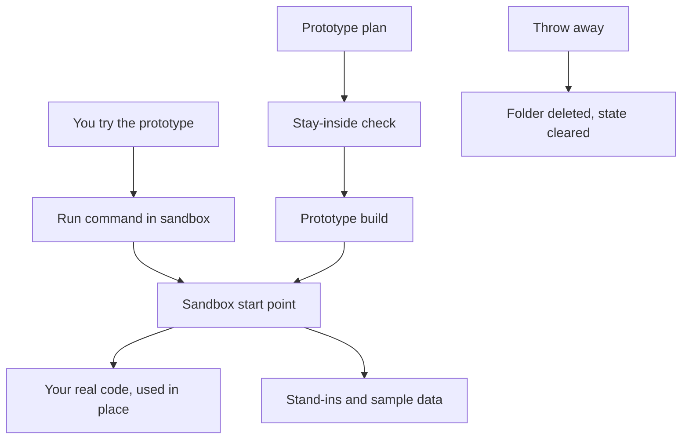
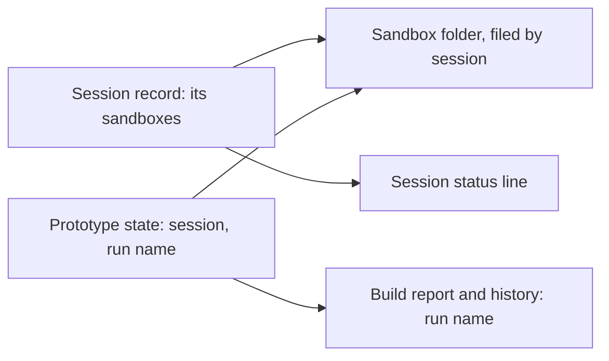
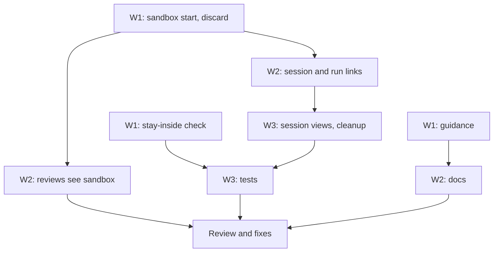

# Prototype sandbox: review plan

Spec: `docs/plans/2026-11-11-proto-sandbox.spec.md`

## Summary
In feature mode, the prototype you try before the real change is built today in a second full copy of the repository, on its own branch. This replaces that with a small sandbox folder inside the copy you already have. The sandbox holds only the prototype's own pieces (its starting point, stand-ins for services, sample data, its tests and its plan) and uses the real code where it is, so nothing is duplicated and there is no extra branch to clean up.

## What you will get
- Starting a prototype makes one hidden folder in your current checkout instead of a second checkout and branch. The folder is filed under the session it belongs to.
- Each sandbox is linked to its session and to its build run: the session's record lists its sandboxes, the prototype's state names its session and run, and the prototype's build report, history and run archive folder carry the same run name. The run name is the one superlite already gives every run, not a new kind of name.
- The session status line shows the prototype and where it stands, and the session overview lists each session's sandboxes.
- Closing a session also cleans up its open sandbox. Switching sessions leaves each session's sandbox in place and shows only the current session's prototype.
- A session check reports sandboxes that have lost their session, or sessions that point at a missing sandbox. It reports them and never deletes them.
- The prototype sees your real code, including changes you have not committed yet.
- It runs on its own: its own run command, test settings, ports and, when real data shapes matter, its own installed packages and sample database, all inside the folder.
- A check that refuses a prototype plan if any of its steps would write outside the sandbox.
- Finishing the prototype build archives its own run but leaves the feature's state (the prototype record and the plan approval) in place, so the try-out and the integration build still work. Today `finish` would archive those too, because the prototype now shares the checkout's run folder.
- The prototype's tests run by explicit path. The affected-tests run skips hidden folders, so it never picks up sandbox tests, and the guidance says to test the sandbox by path.
- Throwing the prototype away deletes the folder and moves its build state into the normal run archive (`.superlite/runs/`), the same way `finish` archives any run.
- Updated guidance on how a prototype uses real code in each common language, and docs that no longer mention a prototype branch.

## What will be built
| Part | What it does | Size | Built by |
|---|---|---|---|
| Sandbox start and discard | Creates and removes the sandbox folder and records it in the prototype state | M | a careful helper |
| Remove the second-checkout path | Deletes the branch, handoff and adopt steps the old prototype needed | S | a careful helper |
| Session link | Files each sandbox under its session and keeps the session's record of its sandboxes up to date | M | a careful helper |
| Run link | Reuses the build's run name so the prototype state, build report, history and run archive all carry it; the saved prototype report is found by run name, not by checkout | S | a careful helper |
| Finish keeps the feature state | `finish` of the prototype build leaves the prototype record and plan approval live | S | a careful helper |
| Session views and cleanup | Status line and overview show sandboxes; closing a session cleans up its sandbox; the session check finds orphans | M | a careful helper |
| Old prototypes still close | A prototype started the old way can still be tried and thrown away | S | a careful helper |
| Stay-inside check | Plan check that fails when a prototype step writes outside its sandbox | M | a careful helper |
| Reviews see sandbox files | The review summary lists the sandbox's files, which the normal change listing cannot see | S | a careful helper |
| Clear build state on discard | Moves the prototype build's leftover run files into the run archive so the checkout is free again | S | a careful helper |
| Prototype guidance | How to use real code in place per language, plug in stand-ins at the sandbox's own start, copy one file only when there is no other way | S | a fast helper |
| Docs and flow text | Feature-mode steps, tool list, session and shipping notes, contributor notes | S | a fast helper |
| Tests | Rewrite the prototype tests for the sandbox, add tests for the check, discard, session and run links, switching and closing sessions, drop the adopt tests | M | a careful helper |

## How it fits together

How a sandbox is linked to its session and run:

## How it gets built

## Decisions you can change
- Sandbox location: a hidden folder per prototype under superlite's own state folder (default) | a visible folder at the project root, hidden from git locally
- Keeping writes inside: plan check only (default, your answer) | plan check plus a hook that blocks stray writes
- Build state: shared with your checkout (default) | the sandbox keeps its own
- Old second-checkout option: removed (default) | kept behind a flag
- Discarded build state: moved into the run archive like any run (default) | deleted
- Whole test suite at the end of this build: yes, once at finish (default, because it changes sessions and finish) | affected tests only
- Sandbox folders: filed by session, then topic (default) | one flat folder per topic
- Closing a session with an open sandbox: clean it up automatically (default) | refuse to close until it is thrown away

## Risks
- A real module that hard-wires a service cannot take a stand-in from outside. The guidance says to copy just that one file into the sandbox and say so in the plan.
- Some test runners and build tools skip hidden folders. The sandbox always runs and tests by explicit path; this also keeps its tests out of your main test run.
- Prototype stand-ins could leak into real code if an agent ignores its plan. The plan check catches planned writes; reviewers check the rest. A hook would be stronger and is listed above as a change you can ask for.
- Because the build state is shared, a leftover "run in progress" marker could block normal edits in this checkout. Discard archives it, and a test covers that.
- Because the prototype build and the feature flow share one run folder, a plain `finish` would archive the feature's state mid-flow. The finish change and a test cover that.
- Two runs from the same checkout now land in one archive. Finding the prototype's report by checkout could pick the wrong run, so it is found by run name.
- Session switching keeps sandboxes in place while the prototype state moves with the session. Filing sandboxes by session keeps them apart, and a test switches between two sessions that each have one.
- Updating the session record could fail if that record is damaged. The prototype commands carry on regardless, and the session check reports the mismatch later.
- Removing the old flags breaks scripts that call them. They are only used inside superlite's own flow text, and that text is updated in the same change.

## Out of scope
- Any change to how the try-out is approved, how the report splits prototype and integration, or how the integration build gets its own checkout.
- Language-specific code in the tool: per-language advice lives in the guidance only.

## How we will know it works
- Starting a prototype creates the sandbox folder and no new branch or checkout, including under Claude Code.
- The prototype can import a file from your checkout that you changed but did not commit.
- A prototype plan with a step that writes outside the sandbox fails the check and names the step.
- Trying it out prints a run command that runs inside the sandbox.
- Finishing the prototype build leaves the prototype record and the plan approval in place, and the try-out still works.
- Throwing it away removes the folder, its build state appears in `.superlite/runs/`, and editing normal files in the checkout is no longer blocked.
- A prototype started the old way can still be thrown away cleanly.
- The session status line shows the prototype; the session overview lists it with its run name.
- Two sessions in the same checkout each keep their own sandbox when you switch between them.
- Closing a session with an open sandbox removes the sandbox and records it as thrown away.
- The prototype's build report, history and run archive folder show the same run name as its sandbox.
- The full test suite passes.

## Rough time and cost
About 40 to 65 minutes and $10 to $17 (rough, until linted).
