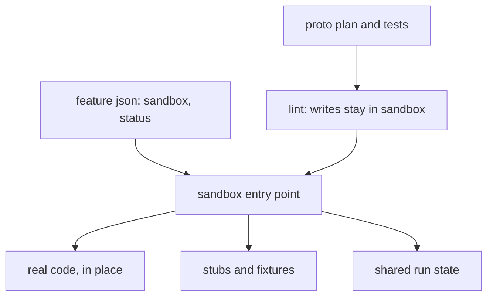
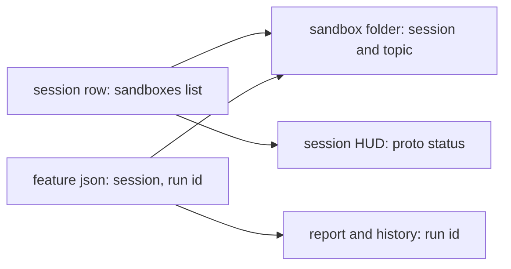
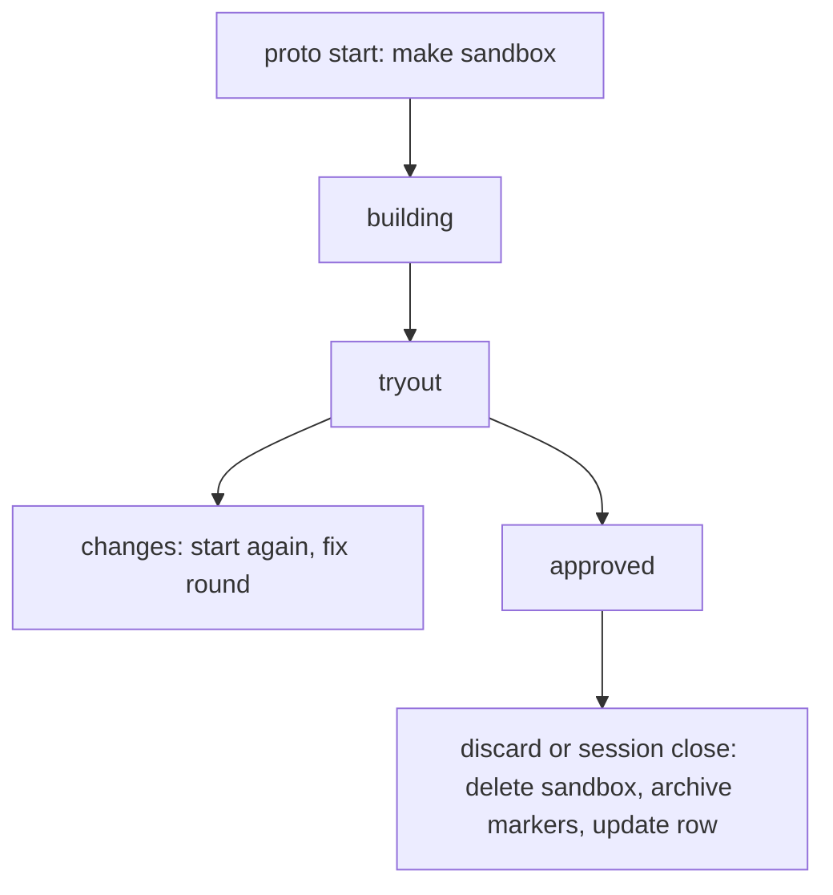

# Spec: proto-sandbox

## Intent

Feature mode's prototype today is a git worktree on its own branch (`proto start` runs `git worktree add`, and under Claude Code an `EnterWorktree` round trip with `--adopt`). That is a full second checkout for a small throwaway. The prototype becomes a **sandbox folder inside the current checkout** that holds only the prototype's own files (entry point, stubs, fakes, fixtures, tests, plan) and references the real code where it is, so nothing is duplicated and nothing is branched.

## Goals

- `superlite-cli proto start --topic T` creates `.superlite/sandboxes/<session>/T/` in the current checkout, where `<session>` is the slug of this checkout's session row (`host` when there is no registry or row). No worktree, no branch, no `EnterWorktree` line.
- The sandbox references the checkout's real code in place (import paths, path dependencies, project references); it copies a real file only when that file hard-wires a dependency the prototype must stub.
- The sandbox has its own run context: its own entry point, run command, config with test values, ports, and (L2) its own dependency install and fixture data, all inside the folder.
- Prototype edits stay inside the sandbox: plan lint rejects a `.proto.md` plan whose tasks write outside it.
- `proto discard` deletes the folder and ends the prototype build's run state in this checkout.
- Every sandbox maps both ways to its session and its run: the session row lists its sandboxes, `feature.json` names its session and run id, and the prototype build's report and history rows carry that run id.

## Non-goals

- A worktree option (`--worktree`), a nested run-state folder for the sandbox, or a hook that blocks writes outside the sandbox.
- Changing the try-out gate, the human-reply check, the report's two parts, or the integration build (it keeps its own worktree).
- Language-specific tooling in the CLI: how to reference real code is guidance in the skill, not code.

## Constraints

- Stdlib only; no language assumed (existing `proto.py` rule).
- The sandbox lives under `.superlite/` (already git-ignored, and `hooks/_edits` already treats `.superlite/sandboxes/**` as project code, so the coordinator cannot write it during a run but implementers can).
- The prototype build shares this checkout's `.superlite` (plan state, checkpoints, report). The integration build runs in its own worktree, so the prototype is the only build here.
- A `feature.json` written by the old worktree flow (has `worktree`, `branch`) still works for `status`, `tryout` and `discard` (discard removes that worktree and branch as before).
- `sandboxes/` is a stationary hub entry (`session_registry.STATIONARY`): it is never parked or moved with run state, while `feature.json` is. The session slug in the path is what keeps in-place sessions from colliding.
- Registry writes from `proto` go through `session_registry.update` under `registry_lock` and never fail a `proto` command (the same fail-soft rule as `mark_run`).
- Tools that skip dot-folders (pytest discovery, Go `./...`, some bundlers) are expected: the sandbox runs and tests by explicit path, which also keeps its tests out of the main suite.

## Done looks like

- `proto start --topic export` in a git repo creates `.superlite/sandboxes/<session>/export/`, writes `feature.json` with `sandbox`, `session` and `run_id` (no `worktree`/`branch`), status `building`, and prints `proto: export building, sandbox <path>` plus the lint hint for `<sandbox>/docs/plans/<date>-export.proto.md`. `git worktree list` and `git branch` are unchanged.
- The same run under `CLAUDECODE=1` prints no `proto: create` / `session: enter` line and writes no `proto-pending.json`.
- Uncommitted changes in the checkout are visible to the prototype (no "cut from HEAD" note).
- `proto start` again on the same topic is a fix round (rounds +1, status building); on a different topic while one is open it refuses as today.
- `proto tryout` prints `run: cd "<sandbox>" && <cmd>`; `--start` launches with cwd = sandbox.
- `last_checkpoint_ms` and `proto_report` read this checkout's `checkpoints.json` / `report.json`.
- `plan_tools lint` on a `.proto.md` plan fails, naming the task and path, when any task's written files (Files/Owns) resolve outside the open prototype's sandbox; reads from the real code are allowed.
- The prototype build's review packet lists the sandbox's files (git diff cannot see an ignored folder).
- `proto discard` removes the sandbox folder, moves the prototype build's remaining run files (`stable.json`, `prime.md`, `pool.json`, `dispatch.json` and the rest of `run_archive.entries`) into `.superlite/runs/` through `run_archive` so hooks no longer see an active run, keeps `proto_report` in `feature.json`, and sets status `discarded`. `--keep-branch` is removed; on a legacy worktree `feature.json` discard behaves as before.
- **Session map.** `proto start`, `tryout`, `tryout --approve` and `discard` keep a `sandboxes` list on the session row in `sessions.json` up to date: `{topic, path, run_id, status, started, ended}`. With no registry nothing is written and `proto` still works.
- **Run map.** `run_id` is the id in `.superlite/current-run.json` (`run_archive`, format `YYYYmmdd-HHMMSS-<slug>`), recorded at the first `start` and kept across fix rounds. The prototype build's `report.json`, its history rows and its `runs/<id>/run.json` carry `run_id` and `sandbox`, and `proto_report` saved in `feature.json` keeps them. `proto_report` finds an archived report by `run_id`, not by checkout (two runs of one checkout share the archive).
- **Finish keeps the feature state.** While `feature.json` has an open prototype (status not `discarded`), `finish` archives the run but leaves `feature.json` and `orchestrator.json` live, so `proto tryout` and the integration build still read them.
- **Prototype tests by path.** The prototype build runs its tests with `run_tests --fast <sandbox>/tests`; `--affected` skips dot-folders and never selects sandbox tests.
- **HUD and status.** The session HUD adds `proto:<topic> <status>` when its row has an open sandbox. `session status` (or list) shows each session's sandboxes. `proto status` prints the session and run id.
- **Session switch in place.** Parking session A and restoring session B leaves A's sandbox on disk under `sandboxes/A/`; B's `proto status` shows only B's prototype. Restoring A brings back its `feature.json`, which still points at its sandbox.
- **Session close.** `session close` on a session with an open sandbox saves the prototype's report headline, deletes the sandbox and marks it `discarded` on the row (the same steps as `proto discard`), before archiving the session.
- **Reconcile.** `session reconcile` reports a sandbox folder with no row entry and a row entry with no folder. It reports them and never deletes them.
- `--adopt`, `--path`, `--base` and `proto-pending.json` are gone; `originating_run` is gone.
- `skills/feature-prototype/SKILL.md` explains referencing real code in place, per ecosystem (Python, Node/TS, Go, Rust, JVM, .NET), injection at the sandbox entry point, and the copy-one-file fallback.
- `commands/feature.md`, `docs/feature-flow.md`, `docs/tools.md`, `docs/sessions.md`, `skills/using-superlite/references/claude-code-tools.md`, `skills/shipping/SKILL.md`, `skills/swarm/orchestrator.md`, `AGENTS.md`, `CLAUDE.md` and the `hooks/_edits` comment no longer describe a prototype worktree or `proto: create`.
- The full test suite passes; tests that asserted the worktree prototype are rewritten for the sandbox, and `test_proto_adopt.py` is removed.

## Decided

| Item | Value |
|---|---|
| Sandbox path | `<checkout>/.superlite/sandboxes/<session>/<topic>/` (`host` when no session) |
| Session map | `sandboxes` list on the session row: `{topic, path, run_id, status, started, ended}` |
| Run map | `feature.json` `session`, `run_id`; report and history rows carry `run_id`, `sandbox` |
| Run id | `proto-<topic>-<YYYYmmdd-HHMMSS>`, stable across fix rounds |
| Proto plan path | `<sandbox>/docs/plans/<date>-<topic>.proto.md` |
| `feature.json` key | `sandbox` (absolute posix path); no `branch`, `base`, `adopted` for new prototypes |
| Write guard | plan lint only, `.proto.md` plans |
| Run state | shared with the checkout |
| Removed flags | `start --adopt --path --base`, `discard --keep-branch` |
| Reference strategy | in place; inject at sandbox entry point; copy a single file only as fallback |

## Left to the builder / plan

- How lint finds the sandbox (from `feature.json`, or from the plan path being under `.superlite/sandboxes/<topic>/`).
- Where archived run markers go (for example `.superlite/sandboxes/archive/<topic>-<ts>/` or reuse of `session_close`'s archive helper).
- Where the shared row update lives (a small helper in `session_registry`, used by `proto` and `session_close`).
- How the HUD fits the extra field without making the line too long.
- How the review packet gathers sandbox files (list plus bounded excerpts).
- Test layout and which existing tests change.

## Diagrams

