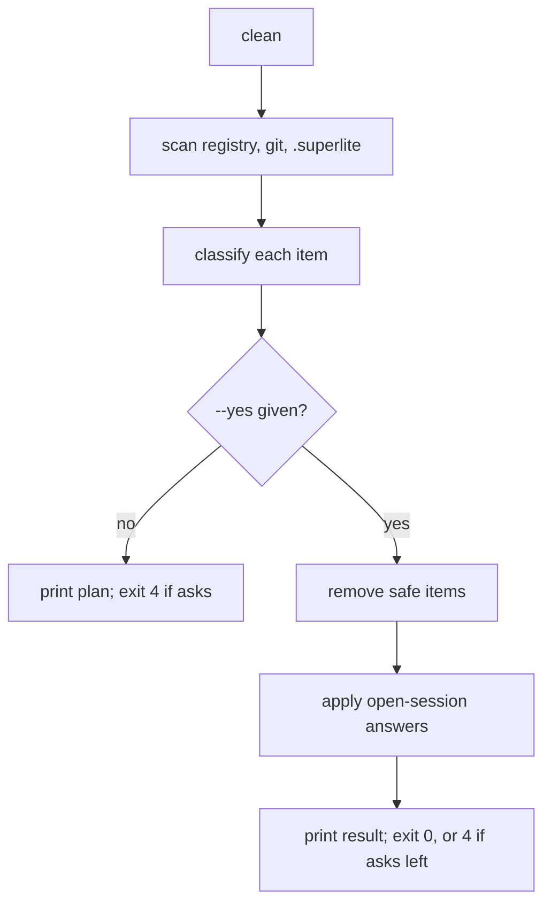
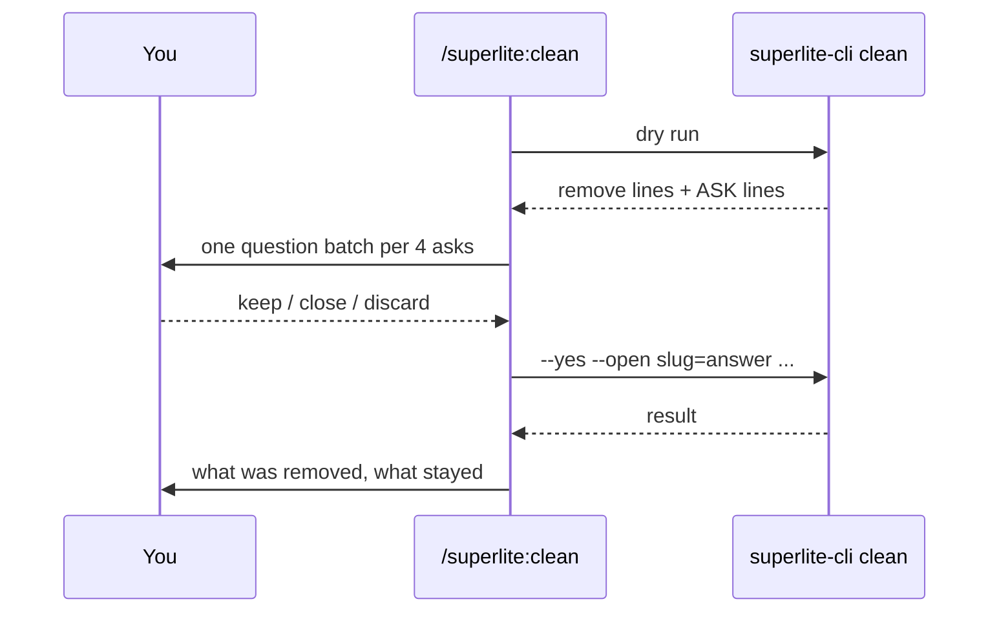

# Review plan: superlite clean

**Spec:** docs/plans/2026-11-11-superlite-clean.spec.md

## What you get

- `superlite-cli clean` finds every superlite leftover in the repo and says what it would do with each. It changes nothing unless you add `--yes`.
- `/superlite:clean` runs the dry run, asks you about open sessions and anything holding unsaved or unmerged work, then applies your answers.

## What it looks at

| Item | Default action |
|---|---|
| Finished session, branch merged into its base | remove (row, store folder, stash, WIP ref, branch, worktree superlite made) |
| Finished session, branch has unmerged commits | ask: keep / discard |
| Open session (not the one running clean) | ask: keep / close / discard |
| The session running clean | keep, always |
| Registry row whose branch and worktree are gone | remove the row (reconcile repair) |
| Row whose worktree folder is gone | fix the row (reconcile repair) |
| `superlite/sessions/*` worktree with no row, no changes | remove |
| Same, with uncommitted changes | ask |
| `superlite/sessions/*` branch with no row and no worktree, merged | remove |
| Same, unmerged | ask |
| `session-store/<slug>` folder with no row and no archive manifest | remove |
| Sandbox folder `.superlite/sandboxes/<session>/` for a session that no longer exists | remove |
| `refs/superlite/wip/<slug>` or a superlite stash with no session | remove |
| Claude-created (harness) worktree | report, with the `ExitWorktree remove` hint |
| Stale git worktree entry (folder gone) | report, with the command; clean never runs `git worktree prune` |
| Anything else unexpected under `.superlite/` | report only |
| `runs/` (archived runs), config (`test-cmd.json`, `test-map.json`, `agent-specs.json`, `host-models.json`, `peers.json`), `research/` | never touched |

## Run files and human replies

Run files are everything in a `.superlite/` folder that `run_archive` counts as a run: `human-replies.jsonl` (your replies, the approval evidence), `orchestrator.json` (mode and plan approval), `current-run.json`, `metrics.jsonl`, checkpoints, feature and prototype state. A session's run files are either live (in the checkout it runs in) or parked (in `session-store/<slug>/`).

Rule: **clean never deletes run files. It archives them into `.superlite/runs/<id>/` with `run.json`, the same way `finish` does,** before anything else for that session is removed. That keeps your replies and approvals visible in `/superlite:report` history.

| Where | Default |
|---|---|
| Live run files of an open session | untouched unless you answer close or discard for it; either way they are archived first |
| Live run files left behind by a finished session (finish didn't archive them) | archive as `<id>-unfinished` |
| Parked run files in `session-store/<slug>/` of a session being removed | archive, then remove the folder |
| Run files in a checkout no session claims | ask: archive / keep |
| Run files of the session running clean | never touched |

Effect on the approval gate: once a finished run's `human-replies.jsonl` and `orchestrator.json` are archived, an old "approve" can no longer approve a new plan. The next run starts with no replies and asks again.

Note: `discard` today deletes the active session's run files outright. Clean archives first and only then calls discard, so that behaviour doesn't reach your history.

## How it runs

## Tasks

1. **Scan** (new `clean_scan.py`): build the item list from the registry, reconcile's inventory and drift, git branches, stashes, WIP refs and the `.superlite/` folders. Reads only.
2. **Apply** (new `clean_apply.py`): archive each session's run files (live or parked) into `runs/` first, then run the removals through the existing discard, close and reconcile code. Never a second copy of discard.
3. **CLI** (new `clean.py`): flags `--yes`, `--open SLUG=keep|close|discard` (repeatable), `--root`; prints the lines; exit 0, 2 or 4.
4. **Skill and command**: `skills/clean/SKILL.md`, `commands/clean.md`, plus `docs/tools.md`, `docs/sessions.md` and `assets/help.txt` rows.

Tasks 1 to 3 run in parallel against agreed interfaces; task 4 follows the CLI's flags. Tests use throwaway git repos, like the existing session tests.

## Decisions

- Decided: dry run unless `--yes`; exit 4 means questions are left.
- Decided: finished but unmerged work is asked about, never silently deleted.
- Decided: the work happens on `superlite/sessions/superlite-clean`, cut from main; proto-sandbox is untouched. Sandboxes are found by their folder path, so the code doesn't depend on the proto-sandbox code.
- Assumption: "merged" means the branch tip is already in the session's base branch.

Reply approve to start, or tell me what to change.
