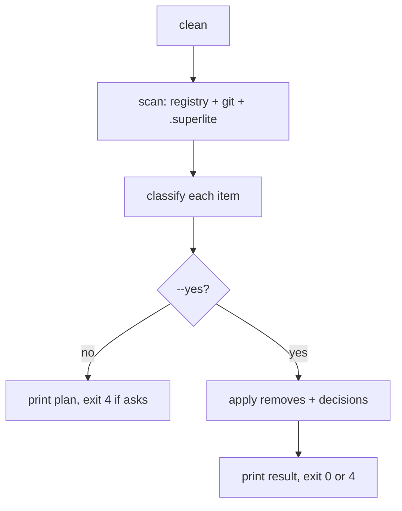

# Spec: superlite-clean

## Intent

Sessions, worktrees, sandboxes, stashes and WIP refs pile up as superlite runs. Today they go one `session discard` at a time, and strays (rows for deleted branches, worktrees with no row, orphaned store folders) need manual digging. One command, driven by one skill, should find all of it, remove what is safe, and ask about the rest.

## Goals

- `superlite-cli clean` lists every superlite artifact in the repo and classifies it: remove, ask, keep or report.
- It removes finished sessions whose work is merged, and strays superlite made that nothing points to.
- It asks about open sessions and about anything holding unmerged or uncommitted work, offering keep, close or discard for each.
- It is a dry run unless `--yes` is given.
- A `superlite:clean` skill and a `/superlite:clean` command run the dry run, ask the user, then apply.

## Non-goals

- Never deletes `.superlite/runs/`, `research/`, or config files (`run_archive.KEEP`).
- Never deletes run files (`run_archive.entries`: `human-replies.jsonl`, `orchestrator.json`, `current-run.json`, `metrics.jsonl`, checkpoints, feature state). It archives them into `runs/<id>/` through `run_archive` before removing anything else of that session, live or parked in `session-store/<slug>/`.
- Never removes harness (Claude-created) worktrees; it reports them with the `ExitWorktree` hint.
- Never runs `git worktree prune` (from Windows it deletes WSL worktrees' metadata); stale entries are reported with the command.
- Never touches non-superlite branches, stashes or worktrees.

## Constraints

- Reuse `session_reconcile` (inventory, drift) and `session_switch._discard`/`session_close` for removal. No second copy of discard logic.
- All registry writes go through `registry_lock` and `session_registry.update`.
- The session running `clean` (cwd's session) is never removed or closed.
- Works from the hub or from a linked worktree (resolves the hub via `hub_root`).
- Stdlib only, Python 3.10+, matches the repo's script style.

## Done looks like

- Dry run on a repo with one finished+merged session, one open session and one orphaned store folder prints one `clean: remove` per removable item, one `ASK open slug=<s>` line, and exits 4; nothing on disk or in git changes.
- `clean --yes` with no open-session decisions removes the removable items, leaves open sessions untouched, prints `ASK` for them and exits 4.
- `clean --yes --open S=discard` (or `=close`, `=keep`) applies that decision to S.
- A finished session whose branch has commits not in its base is `ask`, not `remove`.
- An unregistered `superlite/sessions/*` worktree with uncommitted changes is `ask`; a clean one is `remove`.
- Running `clean --yes` twice: the second run prints `clean: nothing to remove` and exits 0 (when no asks remain).
- Unknown entries under `.superlite/` are `report` lines only.
- Removing a finished session with parked run files leaves a new `runs/<id>/` holding them (including `human-replies.jsonl`) and no `session-store/<slug>/`.
- `--open S=discard` on an open session archives its live run files as `<id>-unfinished` before discarding.
- Loose run files left by a finished session are archived as `<id>-unfinished`; the cwd session's run files are untouched.
- `/superlite:clean` asks the open-session questions in one AskUserQuestion batch (up to 4 per batch) and reruns with the answers.

## Decided

| Item | Value |
|---|---|
| Tool | `superlite-cli clean [--yes] [--open SLUG=keep\|close\|discard]... [--root R]` |
| Exit codes | 0 done or nothing to do, 2 error, 4 ASK left |
| Line format | `clean: <action> <kind> <target> - <reason>`; asks as `ASK open slug=<s>: <reason>` / `ASK stray path=
: <reason>` |
| Actions | `remove`, `ask`, `keep`, `report` |
| Merged test | branch tip reachable from the row's base (`git merge-base --is-ancestor`) |
| Skill | `skills/clean/SKILL.md`, command `commands/clean.md` |

## Left to the builder / plan

Module split, the exact stray kinds' internal names, test fixtures.

## Diagrams

