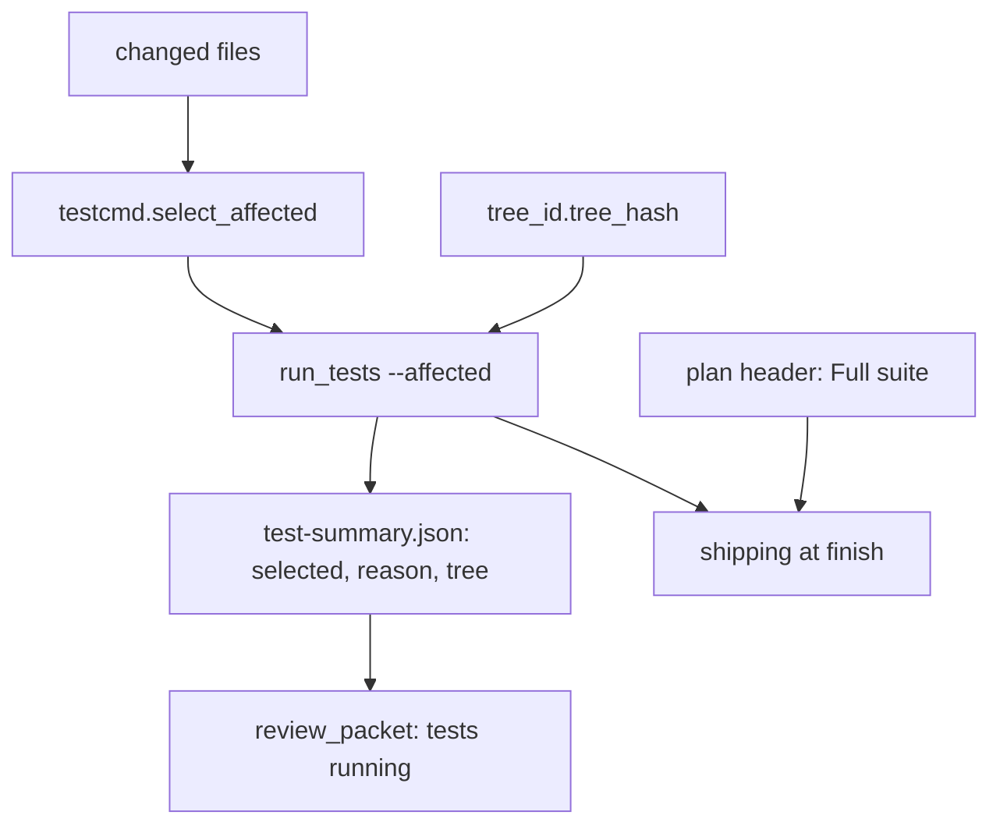
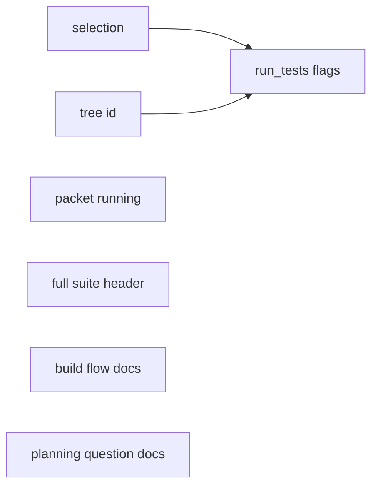

# test-scope: machine plan

**Review plan:** docs/plans/2026-11-11-test-scope.review.md
**Spec:** docs/plans/2026-11-11-test-scope.spec.md
**Goal:** run only affected tests, never block a build on a test run, and make the whole suite an opt-in asked during planning.
**Architecture:** `testcmd` gains selection, `tree_id` gives a working-tree fingerprint, `run_tests` gains `--affected/--base/--files/--reuse`, `review_packet` says when tests are still running, `plan_tools`/`plan_lint` read `**Full suite:**`; flow docs change.
**Tech stack:** Python 3.10+, stdlib only; pytest for tests (`tests/scripts`).
**Detail:** contracts
**Full suite:** no
**Target-min:** 12
**Ignore:** .superlite/, __pycache__/

## Global constraints

- Stdlib only, no language assumed. Scripts live in `skills/swarm/scripts/`, tests in `tests/scripts/` and import scripts via `sys.path.insert(0, SCRIPTS)` like `tests/scripts/test_testcmd.py`.
- Paths are posix, relative to the repo root (`replace("\\", "/")`).
- Selection over-selects: when unsure, select.
- Whole-suite trigger names (basename match): `conftest.py pyproject.toml setup.cfg pytest.ini tox.ini package.json package-lock.json yarn.lock pnpm-lock.yaml uv.lock poetry.lock go.mod go.sum Cargo.toml Cargo.lock`, any `*.csproj`, and `.superlite/test-cmd.json`; plus `test-map.json` key `"_full"` (list of globs).
- `test-map.json` is `.superlite/test-map.json`: `{"<glob>": ["<test path or glob>", ...], "_full": ["<glob>", ...]}`; globs use `fnmatch` on posix paths.
- `--fast PATHS` behaviour and the background summary/pointer/`--wait` contract stay unchanged.

## Main diagram

## File structure

| File | Responsibility |
|---|---|
| skills/swarm/scripts/testcmd.py | add `changed_files`, `select_affected`, `is_full_trigger` |
| skills/swarm/scripts/tree_id.py | new: `tree_hash(root)` |
| skills/swarm/scripts/run_tests.py | `--affected --base --files --reuse`, summary fields |
| skills/swarm/scripts/review_packet.py | `tests: running` from the pointer |
| skills/swarm/scripts/plan_tools.py, plan_lint.py | `header_full_suite()`, missing-line NOTE |
| skills/*, agents/*, commands/*, docs/tools.md | flow wording |

## Task graph

## Package A: selection and runner

App type: CLI + library. Categories: file, state, protocol, encoding.
**Probe entry:** call=testcmd.select_affected · run=python skills/swarm/scripts/run_tests.py

### T1 affected-test selection · Complexity 5 · Est. context 40k
**Owns:** skills/swarm/scripts/testcmd.py, tests/scripts/test_test_scope_select.py
**Components:** 2
**LOC owned:** 190
**Tests:** fast
**Kind:** design
**Model:** sonnet
**Produces:** testcmd.changed_files(root: str, base: str | None) -> list[str] · testcmd.is_full_trigger(path: str, root: str = ".") -> bool · testcmd.select_affected(root: str, changed: list[str]) -> dict
e.g. select_affected(".", ["tests/scripts/test_x.py"]) -> {"full": False, "selected": ["tests/scripts/test_x.py"], "reasons": {"tests/scripts/test_x.py": "changed"}, "untested": []}
e.g. select_affected(".", ["skills/swarm/scripts/foo.py"]) -> {"full": False, "selected": ["tests/scripts/test_foo_bar.py"], "reasons": {"tests/scripts/test_foo_bar.py": "mention"}, "untested": []}
e.g. select_affected(".", ["pyproject.toml"]) -> {"full": True, "selected": [], "reasons": {}, "untested": [], "trigger": "pyproject.toml"}
**Review Focus:** `test_mention_whole_word`: changed `src/cost.py`; test text `import cost` selects, `costly = 1` alone does not. `test_deleted_file_selects_mentions`: a changed path that no longer exists still selects tests mentioning its stem. `test_untested_listed`: changed `src/lonely.py` with no matching test gives `selected == []`, `untested == ["src/lonely.py"]`. `test_map_glob`: map `{"src/*.py": ["tests/test_all.py"]}` selects `tests/test_all.py` with reason `map`. `test_full_trigger_map_extra`: map `{"_full": ["db/*.sql"]}` and changed `db/a.sql` gives `full: True`, `trigger: "db/a.sql"`. `test_changed_files_untracked`: in a temp git repo, a new untracked file and an edited tracked file both appear; a git-ignored file does not. `test_non_python_suffix`: changed `web/cart.ts`, test `web/cart.test.ts` mentions `cart`, selected.
**Notes:** `changed_files`: `git diff --name-only <base or HEAD>` plus `git ls-files --others --exclude-standard`, deduped, sorted; not a repo returns `[]`. Changed test files (`is_test_path`) select themselves (reason `changed`). Sources select `resolve_related` hits (reason `related`, swallow FileNotFoundError), then test files whose text contains the stem as a whole word, `\b<stem>\b` (reason `mention`). Test files come from a walk of the root that skips `SKIP_DIRS` and dot-dirs, keeps `is_test_path` files, and is capped at 5000 files. Map hits have reason `map`. First reason wins; `selected` is sorted. A source with no hit goes to `untested`. Any `is_full_trigger` hit returns `full: True` at once with `trigger`.

### T2 working-tree fingerprint · Complexity 2 · Est. context 22k
**Owns:** skills/swarm/scripts/tree_id.py, tests/scripts/test_tree_id.py
**Components:** 1
**LOC owned:** 70
**Tests:** fast
**Kind:** mechanical
**Model:** haiku
**Produces:** tree_id.tree_hash(root: str) -> str
e.g. tree_hash(".") -> "3f9a0c1d2e4b5a69" (16 lowercase hex chars)
e.g. tree_hash("/not/a/repo") -> ""
**Review Focus:** `test_stable`: two calls on an unchanged repo are equal. `test_edit_changes`: editing a tracked file changes it. `test_untracked_changes`: adding an untracked, not-ignored file changes it; adding an ignored file does not. `test_not_repo_empty`: a plain temp dir gives `""`.
**Notes:** sha256 over `git rev-parse HEAD`, `git diff HEAD --binary`, then for each `git ls-files --others --exclude-standard` path (sorted) its path and bytes; first 16 hex chars. Any git error gives `""`.

### T3 run_tests --affected and --reuse · Complexity 5 · Est. context 45k
**Owns:** skills/swarm/scripts/run_tests.py, tests/scripts/test_run_tests_affected.py, tests/scripts/test_testprobe.py
**Components:** 2
**LOC owned:** 160
**Tests:** fast
**Kind:** design
**Model:** sonnet
**Consumes:** testcmd.select_affected(root: str, changed: list[str]) -> dict (T1) · tree_id.tree_hash(root: str) -> str (T2)
**Produces:** run_tests.main(argv: list[str]) -> int
**Review Focus:** `test_affected_runs_selected`: a temp pytest repo where `src/a.py` changed and `tests/test_a.py` mentions `a`; `--affected` runs 1 file, and the summary has `mode: "affected"`, `selected: ["tests/test_a.py"]`, `reason: "related"` or `"mention"`, `changed_count: 1`, and a non-empty `tree`. `test_affected_nothing`: only `README.md` changed gives exit 0, prints `0 0 0 0.0`, and the summary has `selected: []`, `untested: []`. `test_affected_trigger_full`: `conftest.py` changed runs everything, with summary `reason: "full: conftest.py"`. `test_files_flag`: `--affected --files src/a.py` ignores git changes. `test_reuse_hit`: a green full summary whose `tree` equals the current tree; `--full --reuse` prints `reused: <path>` and exits 0 without running pytest. `test_reuse_miss`: after an edit, `--full --reuse` runs. `test_fast_unchanged`: `--fast tests/test_a.py` still gives `mode: "fast"`.
**Notes:** Get the changed set from `testcmd.changed_files(root, base)` (a sorted list of posix paths, for example `["src/a.py"]`). `--affected` joins the `--fast/--full` exclusive group. `--base REF` defaults to the sha on the last `- start <sha>` line in `.superlite/progress.md`, else HEAD. `--files F...` replaces git changes. `reason` is `full: <trigger>` when full, else the distinct per-file reasons joined by `,`. Nothing selected writes a summary with zero counts, `untested`, no error, and exits 0. Every affected or full summary adds `tree`. `--reuse` reads `--summary`: reuse needs mode full, `failed == 0`, `passed > 0` and an equal `tree`. In `finish_run`, an empty run counts as green only for affected-with-nothing. `--background` passes the new flags through unchanged (argv is re-used).

## Package B: packet and plan header

App type: library. Categories: state, file.
**Probe entry:** call=review_packet.read_test_summary

### T4 packet says tests are running · Complexity 2 · Est. context 24k
**Owns:** skills/swarm/scripts/review_packet.py, tests/scripts/test_packet_running.py
**Components:** 1
**LOC owned:** 50
**Tests:** fast
**Kind:** mechanical
**Model:** haiku
**Produces:** review_packet.read_test_summary(path: Path) -> tuple[str, int]
e.g. pointer `test-summary.latest` names a missing run file -> ("- tests: running (newest run not finished; results reach the fixers)", 0)
**Review Focus:** `test_running_when_pointer_unfinished`: pointer JSON `{"id": "x", "summary": "<dir>/test-summary-x.json"}` with that file absent returns the running line and 0 failures. `test_finished_unchanged`: the pointed file exists, so the existing passed/failed rows are returned. `test_affected_shows_selected`: a summary with `mode: "affected"`, `selected: ["a","b"]` adds a row `- affected: 2 test files selected`. `test_no_summary_text`: no file returns a line that no longer says `--full`, namely `- no test summary recorded`.
**Notes:** The pointer is `path.with_name("test-summary.latest")`. Read it first; a missing or unreadable pointer falls back to today's behaviour.

### T5 Full suite plan header · Complexity 2 · Est. context 26k
**Owns:** skills/swarm/scripts/plan_tools.py, skills/swarm/scripts/plan_lint.py, tests/scripts/test_full_suite_header.py, tests/scripts/test_plan_tools.py
**Components:** 1
**LOC owned:** 40
**Tests:** fast
**Kind:** mechanical
**Model:** haiku
**Produces:** Plan.header_full_suite() -> bool | None
e.g. plan text has `**Full suite:** yes` -> True
e.g. plan text has `**Full suite:** no` -> False
e.g. no such line -> None
**Review Focus:** `test_header_values`: `yes`/`Yes`/`true` give True, `no`/`false` give False, any other value gives None. `test_lint_note_missing`: lint on a plan without the line prints `NOTE: no **Full suite:** header line; finish runs affected tests only (missing means no)`. `test_lint_quiet_present`: the line is present, so no such NOTE. `test_fenced_ignored`: the line inside a code fence is not read.
**Notes:** Mirror `header_ignore` (skip fenced lines). The NOTE goes in `PlanLint.header_notes`.

## Package C: flow docs

App type: docs. Categories: protocol (instructions agents follow).
**Probe entry:** run=python -m pytest tests/scripts/test_test_scope_docs.py

### T6 build-flow wording · Complexity 3 · Est. context 50k
**Owns:** skills/swarm/SKILL.md, skills/swarm/fixing.md, skills/swarm/implementing.md, skills/swarm/orchestrator.md, skills/testing/SKILL.md, skills/proof/SKILL.md, skills/shipping/SKILL.md, agents/package-reviewer.md, docs/tools.md, tests/scripts/test_test_scope_docs.py
**Components:** 2
**LOC owned:** 120
**Tests:** fast
**Kind:** design
**Model:** sonnet
**Review Focus:**
- `test_swarm_no_wait`: swarm SKILL has no `run_tests --wait` before the final checkpoint, its Final review diagram and steps say `run_tests --affected --background`, and "Coordinator batching" says the coordinator never waits on a test run.
- `test_task_verify_affected`: the task-message verify command is `run_tests --affected --files <owned files> --background`, then `--wait`.
- `test_testing_no_wave_full`: testing SKILL no longer contains "wave's".
- `test_shipping_full_suite_choice`: shipping reads `**Full suite:**`. `yes` runs `run_tests --full --reuse`; `no` or missing runs `run_tests --affected --base <start sha>`. Red blocks merge and PR.
- `test_proof_cites_run`: proof says to name which finish run applied.
- `test_tools_doc`: docs/tools.md mentions `--affected` and `--reuse`.
**Notes:** Keep each file's style. fixing.md, implementing.md and package-reviewer use `--affected --files <touched files> --background`, with `--fast PATHS` as the manual fallback. orchestrator.md's foreground-suite paragraph keeps `--background`.

### T7 planning-question wording · Complexity 3 · Est. context 40k
**Owns:** skills/inventing/SKILL.md, skills/drafting/SKILL.md, commands/feature.md, commands/debug.md, commands/mvp.md, commands/small.md, commands/review.md, tests/scripts/test_full_suite_question_docs.py
**Components:** 1
**LOC owned:** 70
**Tests:** fast
**Kind:** design
**Model:** sonnet
**Review Focus:**
- `test_inventing_asks`: inventing's one batch includes "Run the whole test suite at finish?" with `No, affected tests only (Recommended)` and `Yes, once at finish`, and bounded work asks it with the design.
- `test_ai_ruling`: inventing says the AI orchestrator does not ask and records `Ruling: full suite no`.
- `test_drafting_header`: drafting's header list includes `**Full suite:** yes | no` (missing means no).
- `test_modes_mention`: each of feature, debug, mvp, review names the question in its batch. small says it defaults to no.
- `test_review_plan_decision`: drafting or inventing says that without a batch the review plan lists it under "Decisions you can change".
**Notes:** Put one sentence per file at the existing question-batch spot. Do not restructure.

## Review Focus summary

A: file (temp git repos, ignored files, deleted paths), state (pointer and reuse), protocol (flag group). B: state (pointer race). C: protocol wording. Cases are copied into each task above.

## Self-review

Spec sections Intent, Done looks like, Decided, Left to the builder / plan and Diagrams are covered by T1-T7 as mapped below.

Coverage: spec Changed set, Selection, Triggers and Nothing selected map to T1. Summary fields and Reuse map to T3. Tree identity maps to T2. The packet change maps to T4. Recorded maps to T5. Swarm flow, Agents, Finish and Docs map to T6. Asking maps to T7. The edges are execution-only, and no files are shared between tasks.
