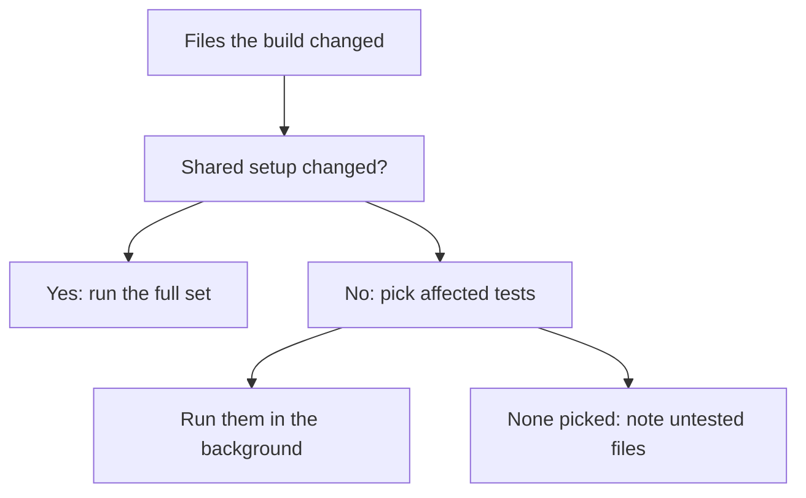
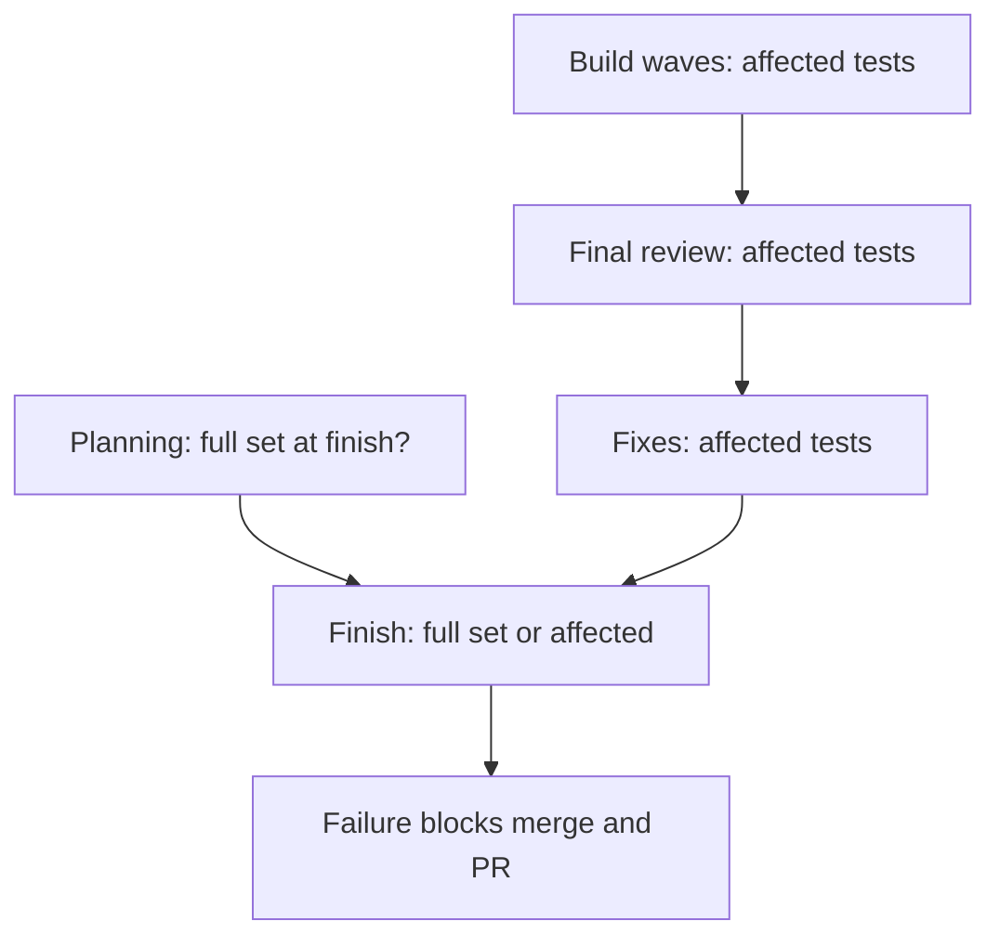
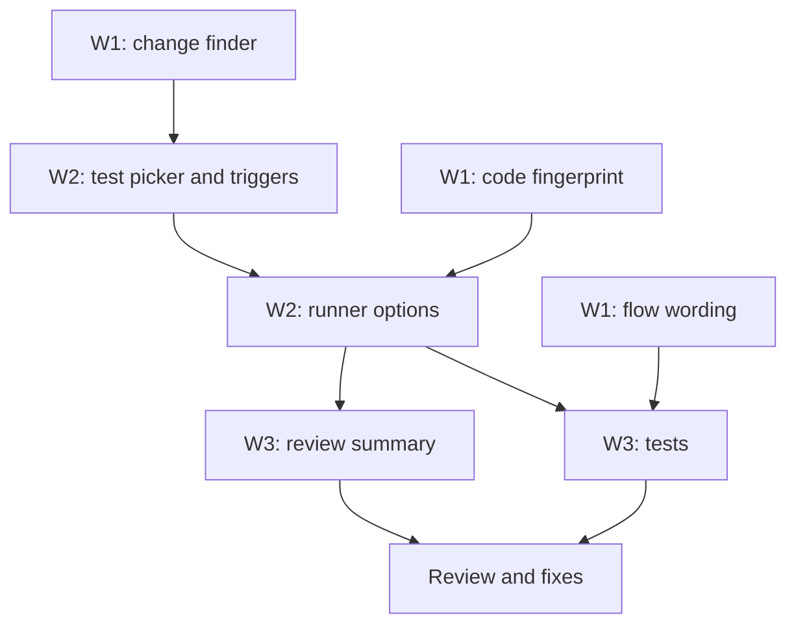

# Faster test runs: review plan

Spec: `docs/plans/2026-11-11-test-scope.spec.md`

## Summary
Builds currently run every test several times and stop to wait for the results, which is why they have become slow. This change runs only the tests a change can affect, and lets the build carry on while tests run. Whether to run the full set of tests at the end becomes a question you answer while the plan is made. A failing run at the end still stops a merge or pull request, so nothing broken ships.

## What you will get
- A test option that works out which tests a change touches and runs only those.
- It runs the full set when shared test setup changes (for example the test configuration or the package list), so it errs on the side of running more.
- Builds never pause for tests. Failures found along the way go to the fixers.
- While planning, superlite asks you once whether to run the full set at finish. The answer is written into the plan. An AI-run build doesn't ask and defaults to no.
- If you say yes, the full set runs once at finish, skipped if the code has not changed since the last full run passed. If you say no, finish runs the affected tests for everything the build changed.
- A failing run at finish blocks merging and opening a pull request.
- An optional map file per project for cases the automatic matching misses.

## What will be built
| Part | What it does | Size | Built by |
|---|---|---|---|
| Change finder | Lists the files a build changed, including new files not yet in git | S | a careful helper |
| Test picker | Picks the tests for those files: changed tests, matching test names, tests that mention the file, and the optional map | M | a careful helper |
| Full-run triggers | Switches to the full set when shared test setup changed | S | a careful helper |
| Code fingerprint | A fingerprint of the current code, so an unchanged, already-passed full run is reused | S | a careful helper |
| Test runner options | Adds "affected only" and "reuse if unchanged" to the test runner and records what was picked and why | M | a careful helper |
| Planning question | Adds "run the full set at finish?" to the one planning question batch in every mode, and records the answer in the plan | S | a fast helper |
| Finish choice | Finish reads the answer: full set once, or affected tests for the whole build | S | a careful helper |
| Review summary | Shows "tests still running" instead of waiting | S | a fast helper |
| Build flow wording | Build, testing, proof and finish instructions use affected runs and one full run at finish | S | a fast helper |
| Tests | Cover picking, triggers, fingerprint, reuse and the new wording | M | a careful helper |

## How it fits together

## How it gets built

## Decisions you can change
- What blocks a build: only a failing full run at finish (default, your answer) | never block
- When unsure which tests apply: run more (default) | run fewer and rely on the finish run
- Nothing picked for a change: run nothing and list the untested files (default) | run the full set
- Full set at finish: asked during planning; recommended answer no, affected tests only (default) | yes
- When nobody was asked (AI-run builds): no (default) | yes
- A full run you asked for: skipped if the code is unchanged since a passing full run (default) | always run it
- This build itself: no full set at finish (default) | yes. Tell me in your reply.

## Risks
- The picker can miss a test that reaches a file indirectly. The full run at finish catches it before anything merges, and the map file lets a project add the links it needs.
- Matching tests by the file's name can over-pick on common names. That only costs extra runtime, not correctness.
- Without a pause before the final review, the reviewer may see results from a slightly older run. The summary says "tests still running" so the reviewer knows.
- Projects whose tests can't run a chosen subset fall back to running everything for that step, as today.

## Out of scope
- Measuring coverage, splitting tests across machines, or caching individual test results.
- Changing which tests exist.
- The prototype sandbox change, which is a separate plan built after this one.

## How we will know it works
- Changing one source file runs only its tests, and the summary lists which tests ran and why.
- Changing the test configuration runs the full set and says why.
- A change with no matching tests runs nothing and lists the untested file.
- A build goes from start to final review without waiting on a test run.
- Planning asks the full-set question once, and the plan records the answer.
- With "no", finish runs only the build's affected tests. With "yes", it runs the full set, or reuses a passing run on unchanged code. A failure blocks merge and PR either way.
- The full test suite of this repo passes.

## Rough time and cost
About 30 to 50 minutes and $7 to $13 (rough, until linted).
