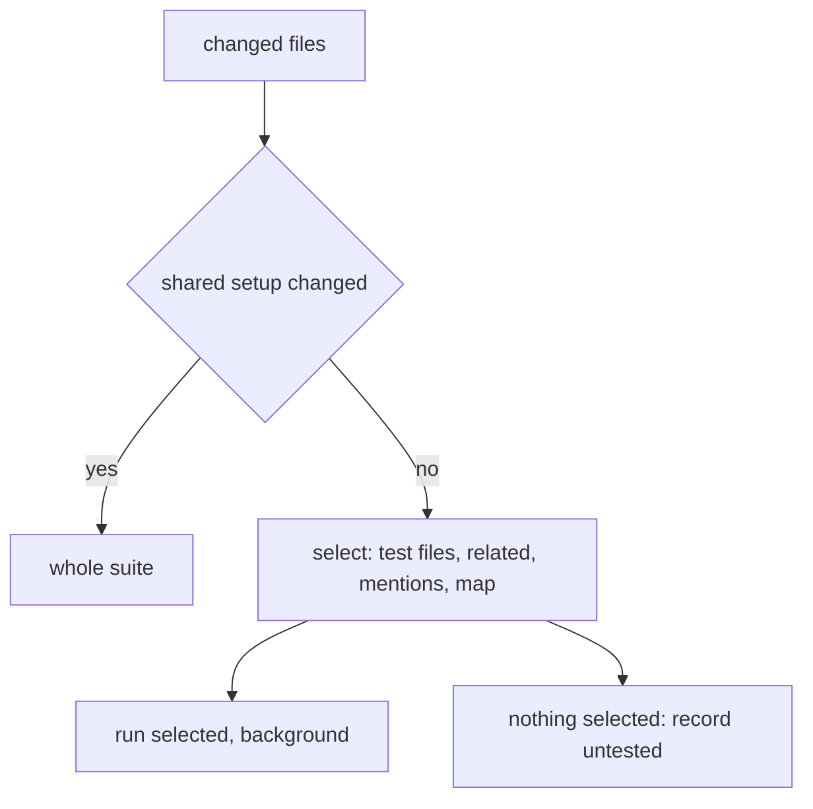
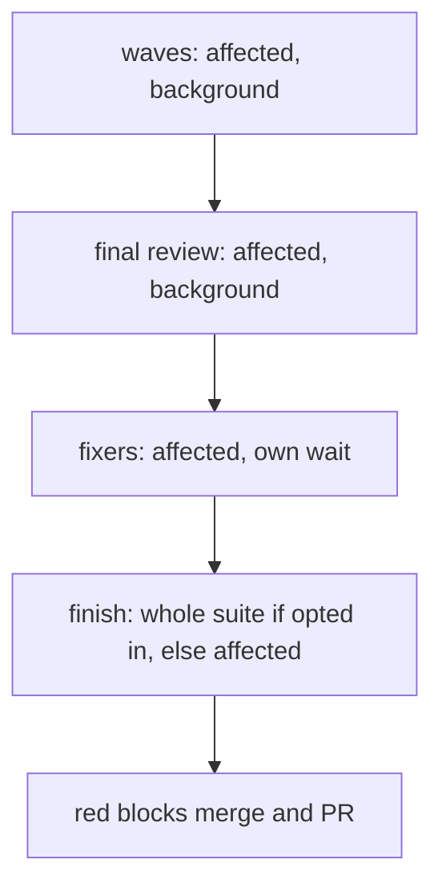

# Spec: test-scope

## Intent

Builds run the whole test suite too often and wait on it. Today every wave runs `run_tests --full`, the final-review stage starts another `--full`, the coordinator blocks on `run_tests --wait` before the final checkpoint, and `proof` and `shipping` each run `--full` again in the foreground. Implementers already use `--fast PATHS`, but they pick the paths by hand. This change runs only the tests a change affects and never makes the build wait on a test run. The whole suite runs only when the user asked for it during planning.

## Goals

- `run_tests --affected` selects the test files a change reaches and runs only those.
- No step of a build waits on a test run, except an agent's own focused run inside its task (the TDD loop needs its result).
- The whole suite is opt-in per build. The user is asked during planning, before or with the plan, and the answer is recorded in the plan. When the answer is yes, it runs once, at finish, and is skipped when the last green whole-suite run was on the same tree.
- A red result at finish blocks merge and PR. Finish runs the whole suite if opted in, else an affected run over everything the build changed since its start. Nothing earlier blocks; red mid-build results become findings for fixers.

## Non-goals

- Coverage-based or import-graph-exact selection, test sharding, parallel test runners, or caching individual test results.
- Changing the hung-test probe, junit parsing, or `testcmd` detection.
- Changing which tests exist or their content.

## Constraints

- Stdlib only; language-neutral (`testcmd` rule): selection works from file paths and text, with an optional per-project map, not from a language's import system.
- Selection must over-select rather than miss: when unsure, run more, and when shared test setup changes, run the whole suite.
- `--fast PATHS` keeps working unchanged.
- Background runs keep the existing summary, pointer and `--wait` contract.

## Done looks like

- **Changed set.** `--affected [--base REF] [--files F...]` takes the changed files as `--files` when given; otherwise it uses `git diff --name-only <base>` plus untracked, not-ignored files. `<base>` is `--base`, else the run's start sha recorded by the swarm, else `HEAD`.
- **Selection.** For each changed file:
  - a test file (`testcmd.is_test_path`) is selected itself;
  - a source file selects its `testcmd.resolve_related` tests;
  - a source file also selects test files whose text mentions its module stem as a whole word (bounded walk, `testcmd.SKIP_DIRS`);
  - `.superlite/test-map.json` `{"<glob>": ["<test path or glob>", ...]}` adds matches.
  A deleted file selects the tests that mention it.
- **Whole-suite triggers.** If any changed file matches a shared-setup pattern (default: `conftest.py`, `pyproject.toml`, `setup.cfg`, `pytest.ini`, `tox.ini`, `package.json`, lockfiles, `go.mod`, `Cargo.toml`, `*.csproj`, `.superlite/test-cmd.json`; extendable via `test-map.json` key `"_full"`), `--affected` runs the whole suite and the summary says why.
- **Nothing selected.** A change that selects nothing runs nothing and exits 0. The summary has `mode: "affected"`, `passed: 0`, `selected: []` and `untested: [<changed source files with no tests>]`.
- **Summary fields.** Every `--affected` summary adds `selected` (test files), `reason` (`map`, `related`, `mention`, `full: <file>`), `changed_count` and `tree`. `--full` summaries add `tree` too.
- **Tree identity.** `tree` is a hash of HEAD, the working-tree diff against HEAD, and the untracked not-ignored files' paths and contents.
- **Reuse.** `run_tests --full --reuse` exits 0 without running when the newest full summary is green and its `tree` equals the current tree, printing `reused: 
`.
- **Swarm flow.**
  - The per-wave run and the final-review-stage run become `run_tests --affected --background`.
  - The `run_tests --wait` before the final checkpoint is removed. The packet reads whatever summary exists and says `tests: running` when the newest run has not finished.
  - The SKILL diagram matches.
- **Agents.** The implementer task message, package-reviewer and fixing guidance use `run_tests --affected --files <owned or touched files> --background`, then `--wait`. `--fast PATHS` stays as the manual fallback.
- **Asking.**
  - `superlite:inventing` adds one question to its single planning batch: "Run the whole test suite at finish?", with options `No, affected tests only (Recommended)` and `Yes, once at finish`.
  - Bounded work asks it with the in-chat design.
  - When the batch was skipped, the human review plan lists it under "Decisions you can change", and the approving reply may set it.
  - The AI orchestrator does not ask; it records `Ruling: full suite no (because affected runs cover the change and the user was not asked)`.
  - Feature, debug, MVP, small and review modes ask it in their existing batch. Small, and debug with no batch, default to no and say so.
- **Recorded.** The machine plan header carries `**Full suite:** yes|no`. `plan_tools lint` warns when it is missing and treats a missing line as `no`. Swarm and shipping read it from the plan.
- **Finish.**
  - With `**Full suite:** yes`, `shipping` runs `run_tests --full --reuse` once.
  - With `no`, it runs `run_tests --affected --base <run start sha>` once.
  - Red blocks merge and PR either way: it reports the failures and offers fixers.
  - `proof` cites whichever finish run applied, and states which one it was ("affected, 41 tests" or "full suite").
- **User override.** The user can still ask for a whole-suite run at any time; `run_tests --full --background` is unchanged.
- **Docs.** `skills/testing/SKILL.md` no longer mentions "the wave's `--full` run". `skills/swarm/orchestrator.md`, `docs/tools.md` and the `run_tests.py` docstring describe `--affected` and `--reuse`.
- **Tests.**
  - Unit tests cover selection: test file, related, mention, map, deleted file, a whole-suite trigger, nothing selected.
  - They also cover the tree hash (changes on edit and on a new untracked file, stable otherwise), `--reuse` (reused versus rerun), and the packet's `tests: running`.
  - Text tests check the swarm, testing, proof and shipping wording.
  - The repo's own suite passes.

## Decided

| Item | Value |
|---|---|
| New flags | `run_tests --affected [--base REF] [--files F...]`, `run_tests --full --reuse` |
| Map file | `.superlite/test-map.json`, globs to test paths, `_full` for extra whole-suite triggers |
| Bias | over-select; shared setup change means whole suite |
| Blocking | only at finish: red whole suite blocks merge and PR |
| Mid-build waits | none for the coordinator; an agent waits only on its own focused run |
| Whole-suite runs | opt-in, asked during planning; if yes, one at finish, skipped on an unchanged green tree |
| Plan field | `**Full suite:** yes\|no`, missing means no |
| Default when not asked | no (affected only), as a `Ruling:` |

## Left to the builder / plan

- The mention scan's exact token rule and walk bound (reuse `WALK_LIMIT` or a larger one for test dirs).
- Where the selector lives (`testcmd.select_affected` is the expected home).
- How the swarm records the run's start sha for `--base`.
- Wording of the finish-blocking message.

## Diagrams

