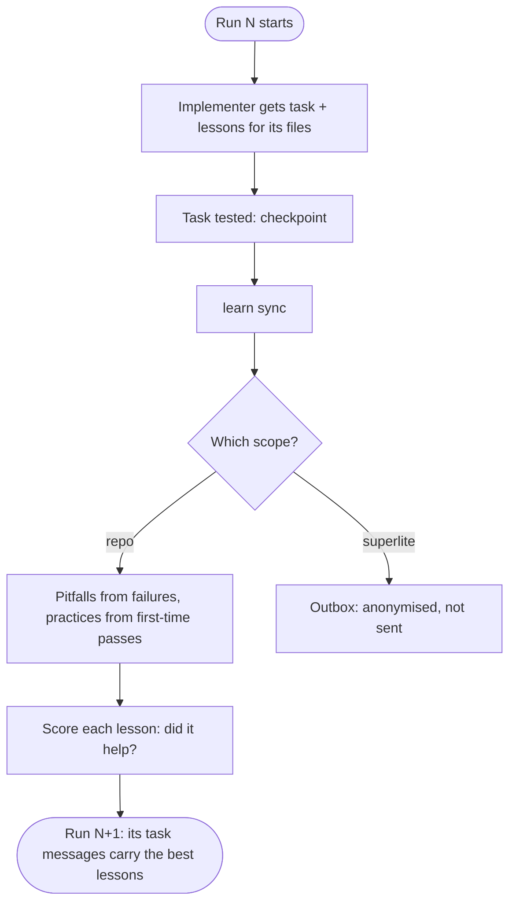
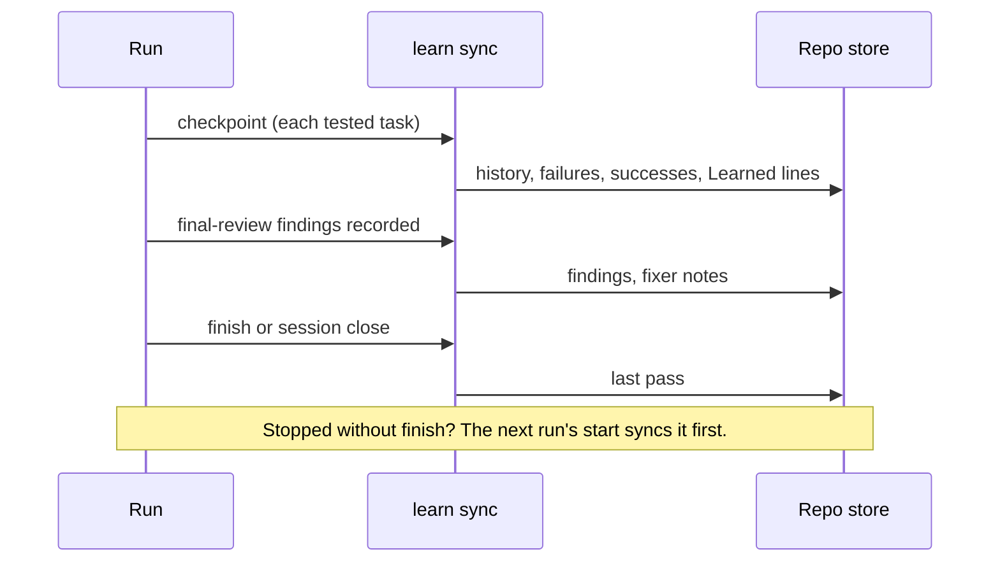
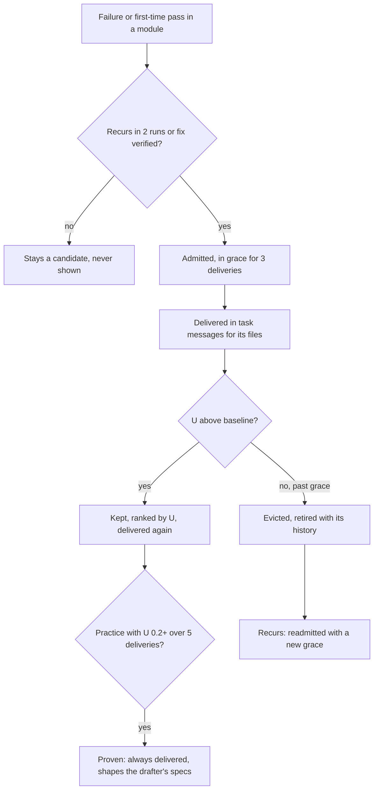
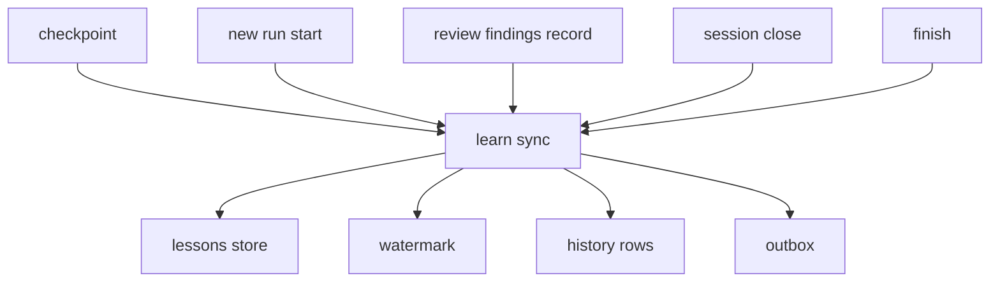

# Per-repo learning loop: feature plan

Source research: `docs/plans/2026-11-12-superlite-learning-loop.findings.md` (claims cited as C*/G*/R*).

## Goal

**Get the code right the first time in this repo, so fewer fixes are needed at the end, and the run costs less.** Each run in a repository should teach superlite how work is done well there, and the agents that write the code should get that knowledge before they start. They should not be corrected after the fact by reviewers and fixers.

Measured per repository, run over run:
- the share of tasks that pass first time goes up;
- rework dispatches, final-review findings and fixer dispatches go down;
- rework and fixer cost, as a share of the run's cost, goes down.

Today superlite records a lot per run (incidents, metrics, test summaries), but it archives that data and never reads it again. The only memory that carries over is global history, which pools aggregates across all repos (G1–G5). This feature closes the loop: what went wrong, and what worked, in this repo's past runs shapes what the next run's agents are told before they write, fix or review code there. **No human step in the learning loop.**

- **Lessons manage themselves.** They are admitted on evidence, ranked by measured usefulness, and evicted when they stop helping: an LRU cache keyed on *useful* rather than *recently used*.
- **The human can see everything and veto any lesson,** but nothing waits for them.

**The point is the injection.** Lessons are specific to this repo (its files, its test setup, its recurring mistakes), and they go into the agents on the critical path: first the implementers, who decide the first-time pass, then the fixers, the drafter and the reviewers. Model routing is not part of this feature.

For: anyone running superlite repeatedly on the same codebase, and superlite maintainers tuning defaults.

## The improvement cycle

**1. One run feeds the next.** Run N+1 starts again at the top, with what run N taught it. No step needs a human.



**2. When `learn sync` runs.** The store is updated as the run goes, so a run that never reaches `finish` still teaches the next one.



**3. A lesson's life.** Lessons are cached by usefulness (U), not by how recently they were used.



A full cache (50 lessons) also evicts its lowest-U lesson past grace to make room. `pin` keeps a lesson; `drop` removes one for good.

## What changes

Target kind: CLI (`superlite-cli`), skill/agent prompts, run files under `.superlite/`.

**Two kinds of learning, kept apart.**

| | Improving **this repo's runs** (this feature) | Improving **superlite itself** (later, server-side) |
|---|---|---|
| Signals | incidents on this repo's files, failing test files, final-review findings, fixer notes | hook rule-block/rule-rewrite rows, model mismatches |
| Where it goes | `.superlite/` in the repo (hub) | a local outbox, `$SUPERLITE_HOME/learn/outbox.jsonl`, for a future upload |
| Who acts | superlite, automatically, for this repo only | superlite maintainers, later, for all users |

`learn sync` tags every signal `scope: repo` or `scope: superlite`. Superlite-scope signals describe superlite, not this repo. They never become lessons and never change local behavior; they are only written to the outbox. Outbox rows are aggregates with no code, paths, file names or task text, and the repository id is hashed.

**Nothing is sent.** This feature has no network code. Upload, its opt-in and its server are a later feature.

**Boundary: superlite reads and learns from past runs; it never edits itself.**
- The learning loop writes only per-repo state under `.superlite/` (lessons, the store and its watermark) and the outbox.
- It never writes superlite's own code, hooks, skills, agents, config or bench, and never the project's `CLAUDE.md`/`AGENTS.md`.
- It never offers to, either: no drafts, stubs or suggested patches to superlite. For this reason R9 ("turn recurring failures into hooks or bench checks") is dropped. Recurring failures stay lessons and data.

1. **The store updates as the run goes, not only at finish.** Many runs never reach `finish`: people stop, switch tasks or close the terminal. So one idempotent step, `superlite-cli learn sync`, writes what the run has learned so far into the kept per-repo store. It runs:
   - after every checkpoint (a tested task);
   - straight away when final-review findings are recorded;
   - when a new run starts and the previous one never finished (before its leftovers are snapshotted);
   - on `session close`;
   - at `finish`, as a last pass;
   - by hand, at any time.

   Running it twice adds nothing twice. A task recorded early (for example before a review fix) is updated later, not duplicated: the newest row for a (repository, run, task) wins. Interrupted runs count toward recurrence and the trend like finished ones, marked `status: unfinished`.
2. **Better incident records (R5).** Each incident gains an ISO date, a run id, a module key and an optional `category`. `incident.py` stops dropping the rule-block/rule-rewrite rows the hooks already write: `incident summary` counts them, and sync sends them to the outbox, never to lessons. The hooks themselves do not change; sync adds a date and a run id to their rows when it folds them.
3. **Final-review findings are kept (R4).** A run file `review-findings.jsonl` holds tier, category, file and fixed/not for each finding. It is archived with the run, and the run's history rows carry the counts.
4. **A per-repo lessons store (R3, R8, R10).** The store is `.superlite/lessons.json` in the hub. It is kept across finish and across runs that never finish. Each `learn sync` folds new repo-scope signals into it, grouped by category and module, with the source failure, run ids and date.

   **Lessons manage themselves, as a cache evicted by least usefulness** (LRU where the "U" is *useful*, not *used*). There is no human approval step.
   - **Admission.** A lesson enters the cache when the same category and module recur in ≥2 runs, or when a fix is verified (a FIXED note plus passing tests). Below that it is a candidate and is never shown to agents.
   - **Delivery, hit and miss.** A delivery is a task or fixer whose message included the lesson. A delivery is a **hit** when the task passes first time and, for a pitfall, no finding or fix of the lesson's category lands in its files. Anything else is a **miss**.
   - **Usefulness U** = (decayed hit rate over its deliveries) − (baseline). The baseline is the same hit rate for tasks on those files in the runs before the lesson was admitted. Each delivery's weight halves every 10 runs, so a lesson that stops being delivered or stops helping fades.
   - **Grace.** A new or readmitted lesson ranks at U = 0.1 until scored, and cannot be evicted before 3 deliveries.
   - **Selection.** A task message takes lessons for that task's files in U order until 1000 chars are used. A reviewer brief does the same within 2000 chars.
   - **Eviction.** The cache holds 50 lessons.
     - A lesson past grace with U ≤ 0 (no better than baseline) is evicted at once.
     - A new lesson admitted to a full cache evicts the lowest-U lesson past grace. If every slot is in grace or pinned, the newcomer stays a candidate until a slot frees.
     - Evicted lessons are kept as `retired`, with their history. If the failure recurs, the lesson is readmitted with a new grace; its old deliveries still count.
   - **Human controls (optional, never waited on):** `drop` (a permanent veto), `pin` (never evicted), `restore` (undo a drop or eviction). The build report lists in one line what was admitted and evicted, and why.
   - **Why this is safe without approval (R7, R10).** The rules the research warns about are free-form, LLM-written context files. These lessons are evidence-gated, small, dated and traceable to their source failure. They are delivered only for their own files and measured, and a lesson that does not improve outcomes evicts itself. Nothing is written into CLAUDE.md or AGENTS.md.

   Lessons come in two kinds: **pitfalls** (what went wrong) and **practices** (what went well). Pitfalls come from incidents on this repo's files, review findings and failing test files.

   **What went well is stored too, and elevated when it keeps working.** Successes are recorded as carefully as failures:
   - **Success rows.** At each checkpoint, sync records every task that passed first time with no review finding: its module, the files it changed together, the test files and test command it ran, and its size.
   - **The implementer says what worked.** The implementer report gains one optional line, `Learned: <setup|test|pairing|convention>: <one line>`. It holds a repo-specific thing the implementer had to find out, or that made the task work. An example: "pairing: changes to `state.py` need `tests/scripts/test_state.py` and the `docs/files.md` table". Sync stores it with the task's success or failure.
   - **Fixes that worked.** A fixer's FIXED note, with its cause and fix, is a practice too: it is what finally passed.
   - **Admission.** A practice enters the cache by the same gate as a pitfall, on its module and tag. One of three things must happen: the same pattern succeeds in ≥2 runs, a `Learned:` line with the same tag recurs on the module, or a FIXED note is verified. The text kept is the latest one.
   - **Practice beside its pitfall.** When a module has both a pitfall and a practice that passed after it, they are delivered together. "Do Y" comes before "avoid Z", so the agent gets the way through, not only the warning.
   - **Elevation to `proven`.** A practice with U ≥ 0.2 over ≥ 5 deliveries becomes `proven`. A proven practice:
     - is always delivered for its module, ahead of the character budget's U order;
     - goes to the drafter, so the plan itself is written that way: paired files in one task's `Owns`, the named test file, the setup step in the task spec;
     - is listed under "what works here" in `lessons report`.

     It loses `proven` status when its U drops below 0.2, and it still evicts like any lesson.

   Commands: `superlite-cli lessons list|show|drop|pin|restore|brief|report`.
5. **Lessons reach the agents that write the code, first.**
   - Each implementer's task message ends with the cached lessons for the files that task owns ("in this repo, when touching X: do Y / avoid Z"), selected as in item 4 through `superlite-cli lessons brief --task Tn`.
   - Fixers get the same for their finding's file.
   - The drafter gets them for the plan's files, proven practices first, so task specs name the repo's real test files, paired files and setup steps, and its pitfalls. Better specs mean fewer one-shot misses.
   - Reviewers get them second: in the package-reviewer brief and as Review Focus categories.
6. **Is it working? A per-repo trend.**
   - `superlite-cli lessons report` prints failure counts by category across archived runs, plus a trend for this repo's last N runs, finished or not:
     - first-time pass;
     - rework dispatches;
     - final-review findings;
     - fixer dispatches;
     - rework and fixer cost as a share of total cost.
   - The build report gets the same trend line.
   - Each lesson shows its U, its deliveries, its hits against its baseline, and its rank. `lessons list` sorts by U.
7. **Test results get their own folder, and travel with the run.**
   - Today every test run leaves `test-summary.json`, `test-summary.latest`, and for each background run `test-summary-<id>.{json,log,done,suspect}`, plus `setup.done`, loose in the `.superlite/` root.
   - They move to `.superlite/tests/`:
     - `summary.json` (the published summary);
     - `latest` (the pointer);
     - `runs/<id>.{json,log,done,suspect}`;
     - `setup.done`.
   - Each summary row also carries the superlite run id from `current-run.json`.
   - At archive (finish or the unfinished snapshot), the folder lands as `runs/<run>/tests/`, next to that run's incidents and metrics.
   - `learn sync` reads it, so failing test files count toward lessons and the trend, even for runs that never finish.
## Acceptance checks

- Start a run, complete two checkpointed tasks, log an incident, then stop without `finish`. Start a new run in the same repo: global history has rows for both tasks with `status: unfinished`, and `lessons list` counts the incident. Nothing waits for a finish.
- Run `learn sync` twice in a row: the second run adds no history rows, incidents or findings. Re-record a task after a review fix: `history derive` counts it once, with the newer first-time-pass value.
- Kill the process mid-sync (simulated): the next sync completes, with no duplicates and no corrupted lines.
- Log an incident during a run. The row in `.superlite/incidents.jsonl` has `date` (ISO), `run`, `module`, and `category` when given. `incident hotspots` still works on old rows that have no date.
- A hook rule-block row is counted by `incident summary`, does not crash `incident hotspots`, and never becomes a lesson.
- After a final review, the run archive holds `review-findings.jsonl` with tier, category, file and fixed, and the history rows carry finding counts.
- Finish two runs that both log a `test-failure` in `skills/x/y.py`, same category. `superlite-cli lessons list` shows one lesson with recurrence 2 and both run ids. With no human step it enters the cache at the second run's sync, in grace. `.superlite/lessons.json` survives finish.
- Usefulness, with fixtures: L1 is delivered 4 times with 4 hits against a 50% baseline, and L2 4 times at the baseline rate. Sync gives L1 U > 0 and evicts L2 (U ≤ 0 past grace). A new lesson admitted to a full cache evicts the lowest-U lesson past grace, never one in grace or a `pin`ned one. If every slot is in grace or pinned, the newcomer stays a candidate.
- Decay: a lesson not delivered for 20 runs has a lower U than at its last delivery, and ranks below a lesson with the same hits that is recent.
- Selection: a task whose files match 5 lessons gets the highest-U ones that fit 1000 chars, in U order.
- An evicted lesson whose failure recurs is readmitted with a new grace and its old delivery count.
- Once L1 is in the cache (file `skills/x/y.py`), the next run's task message for a task owning `skills/x/y.py` ends with L1. A task not owning it gets no lessons block. `.superlite/prime.md` is byte-identical to the one built without lessons.
- On the next run, the package-reviewer brief and the plan's risk notes include cached lessons for the files the plan touches, and nothing for untouched files. CLAUDE.md and AGENTS.md are unchanged.
- A fixer note `FIXED` with a cause and fix in two runs on the same module yields a `practice` lesson citing both notes.
- Two runs where a task on `skills/x/` passes first time while changing `skills/x/y.py` and `tests/scripts/test_y.py` together yield a `practice` (pairing) lesson. Implementer reports in two runs with `Learned: setup: …` on the same module yield a `practice` (setup) lesson. A report with no `Learned:` line still parses as today.
- A module with a pitfall and a practice: the task message lists the practice first, then the pitfall.
- Elevation: a practice with U ≥ 0.2 over 5 deliveries is `proven`. It is delivered even when higher-U pitfalls fill the 1000 chars, it appears in the drafter brief, and `lessons report` lists it under "what works here". At U 0.1 it is no longer proven.
- `lessons report` prints failure counts by category across archived runs, plus the per-repo trend (first-time pass, rework and fixer dispatches, final-review findings, and rework+fixer cost share) for the last N runs, unfinished runs included. Each cached lesson shows its U, deliveries and hits against its baseline.
- Signal split: a run with a `model-mismatch` (a launch event in `metrics.jsonl` whose model differs from the tier in `dispatch.json`), a hook rule-block and a test failure in `skills/x/y.py` writes:
  - the test failure to repo lessons;
  - the mismatch and the hook block to `$SUPERLITE_HOME/learn/outbox.jsonl`, tagged `scope: superlite`, and to no lesson.

  Outbox rows contain no path, file name, code or task text; the repository id is a hash. Nothing opens a network connection (no socket/urllib/http import in the new scripts).
- After any number of runs, `git status` shows no change to superlite's own files (`skills/`, `agents/`, `hooks/`, `commands/`, `config/`, `bench/`) from the learning loop. Only `.superlite/` and the outbox change.
- Human cost: a cycle of two runs with a recurring failure, then a third run, asks the human nothing, in human and AI mode alike. The third run's task message for that file carries L1, and the build report names it.
- After a few foreground and background test runs, the `.superlite/` root has no `test-summary*` or `setup.done` file; they are all under `.superlite/tests/`. After finish, or after a new run snapshots an unfinished one, `runs/<run>/tests/summary.json` exists. `pt_review packet`, `report`, `proto discard` and `shipping`'s `--summary <dir>/…` still work on old archives that have `test-summary.json` at their root.
- `git diff main -- hooks/` changes only the two `.superlite/test-summary.json` path strings in `hooks/_rewrite` messages, and `CLAUDE.md`/`AGENTS.md` are unchanged.
- All existing tests pass (whole suite once at finish).

## Decisions

- Ruling: scope is the lessons side of the research (R3, R4, R5, R7, R8, R10). Dropped: R9 (it would have superlite edit itself) and the routing items R1, R2, R6, R11, R12 (the user: moving tasks off haiku is not worth optimising for); whole test suite once at finish; human orchestrator (the user's choices).
- Decided: no hook logic changes. The only edit under `hooks/` is the path text in two `hooks/_rewrite` messages (:202, :205), now `.superlite/tests/summary.json`. Hook rows are read as they are. Test files move to `.superlite/tests/`; readers fall back to the old root names.
- Decided: `lessons.json` and `learn-state.json` live in the hub `.superlite/` (shared by worktrees) and join `run_archive.KEEP`. `review-findings.jsonl` is a run file in the run's own `.superlite/` and is archived with it.
- Decided (the user): lessons self-manage as a usefulness-evicted cache: evidence-gated admission, U = decayed hit rate over baseline (half-life 10 runs), 3-delivery grace, 50 slots, evicted at U ≤ 0, no approval.
- Decided (the user): this repo's learning and superlite's own learning are separate. Repo scope acts locally; superlite scope (hook rows, model mismatches) only fills an anonymised local outbox for a future server upload. Sending is out of scope.
- Decided: progressive store. `learn sync` is idempotent, keeps a per-run watermark in `learn-state.json` (incident and findings byte offsets), writes under the existing lock, and fails open. Caps: 50 cached lessons, 1000 chars per task message, 2000 per reviewer brief.
- Decided: the newest row per (repository, run, task) wins in `derive`/`unique_rows`. Their signatures stay FROZEN; their behavior changes from first-wins to last-wins. Old history files are unaffected, because `record_run` skipped repeats, so they hold no duplicates.
- Decided (the user): successes are stored as well as failures. Sources are first-time-pass rows, an optional `Learned:` line in the implementer report (additive, so old reports still parse), and FIXED notes. A practice that keeps helping (U ≥ 0.2 over ≥ 5 deliveries) is elevated to `proven`: always delivered, and fed to the drafter so the plan is written that way.
- Decided: the store is one JSON object, `lessons.json`, written with `base.locked_update`, not a JSONL log. It is small (at most 50 cached lessons plus candidates and retired ones), and a whole-file atomic rewrite makes recompute-from-scratch scoring simple. Lesson text comes from fixed templates; no model writes lessons.
- Decided: lessons stay out of the prime (it must stay deterministic). They reach implementers and fixers through `lessons brief --task` at the end of the task message, and reviewers beside `incident hotspots`.
- Assumption: the repository id is the hub path, so moving a checkout starts its trend over (lessons move with the `.superlite/` folder). The outbox carries only its hash.

## Technical design

How it is built, file by file. Python stdlib only, like the rest of `skills/swarm/scripts/`. Every path is resolved through `state.path`/`state.hub_root`, never a `.superlite` literal. No new runtime state lives outside `.superlite/` and the outbox.

### New and changed modules

| Module | New? | What it does |
|---|---|---|
| `learn.py` | new | `sync` (the fold), `note` (store a `Learned:` line), the scope split and the outbox writer |
| `lessons.py` | new | the store (load and save), the cache rules (admit, evict, prove), the CLI (`list show drop pin restore brief report`) |
| `lessons_score.py` | new | pure functions: module key, baseline, U, selection order. No I/O, so it is property-tested |
| `review_findings.py` | new | `record`: parses the frozen final-review reply into `review-findings.jsonl`, then runs sync |
| `incident.py` | changed | new keyword fields; `_read` keeps hook rows |
| `history.py` | changed | `record_run` re-appends a row whose outcome changed; `unique_rows` keeps the last row per key |
| `run_tests.py` | changed | the result files move to `tests/` (item 7) |
| `checkpoint.py`, `session_registration.py`, `session_close.py`, `finish.py` | changed | one advisory call each to sync |
| `report.py` | changed | the trend line and the "what works here" lines |

Each file stays under 600 lines (`test_code_shape_rules.py`).

### Who calls `learn sync`



Only the checkpoint call runs in the background; the other four run in process, and close and finish run with `--final`. The lessons store is `lessons.json` and the watermark is `learn-state.json`, both in the hub `.superlite/`. History rows go to `history.jsonl`, and the outbox is `$SUPERLITE_HOME/learn/outbox.jsonl`. At a new run start, sync runs before `ensure_run`; at finish, before `archive_run`.

- **checkpoint:** `base.spawn_background([sys.executable, learn.py, "sync", "--plan", a.plan], log=state.path(.., "learn.log"))`. The checkpoint never waits for sync and never fails because of it.
- **The in-process callers** wrap the call in `try/except base.advisory_errors()`: they print a warning and go on.
- **`final`** (close and finish) makes sync print the one-line summary of what was admitted, evicted and proven.

### Data files

**`lessons.json`** (hub, in `run_archive.KEEP`; written with `base.locked_update`, so it is locked and atomic):

```json
{"v": 1,
 "run_index": ["20261101-090000-a", "20261105-140000-b"],
 "modules": {"skills/x": {"20261101-090000-a": {"tasks": 3, "ftp": 1}}},
 "lessons": {"L-3f2a91": {
    "kind": "pitfall", "module": "skills/x", "key": "test-failure",
    "text": "avoid: y.py reads config before state.path resolves it; run tests/scripts/test_y.py",
    "sources": ["20261101-090000-a:incidents:1840", "20261105-140000-b:incidents:220"],
    "status": "cached", "pinned": false, "proven": false,
    "admitted_run": "20261105-140000-b", "baseline": 0.33,
    "deliveries": [{"run": "20261107-100000-c", "task": "T2", "agent": "implementer", "hit": true}],
    "u": 0.21, "history": []}}}
```

- `id` = `L-` + the first 6 hex of sha1(`kind|module|key`). The same failure always gets the same id, so recurrence and readmission find it.
- `module` = the file's parent directory, repo-relative posix (`lessons_score.module_key`). For a task, its modules are the parents of its `Owns` paths.
- `key` = the category for a pitfall; for a practice, the tag (`setup|test|pairing|convention|fix`).
- `status` is one of `candidate | cached | retired | dropped`. `sources` is a set of `run:file:byte-offset` strings, so a signal folded twice is still counted once.
- `run_index` orders runs, so a delivery's age is counted in runs, not days.
- `modules` holds the outcomes per module per run (tasks, and how many passed first time). The baseline comes from here, so file paths never go into global history.

**`learn-state.json`** (hub, KEEP), the watermark:

```json
{"v": 1, "runs": {"20261107-100000-c": {"incidents.jsonl": 2210, "review-findings.jsonl": 0,
  "learned.jsonl": 118, "deliveries.jsonl": 640, "fixes": ["F-T2-1.md"], "tests": ["a1b2"]}}}
```

The offsets are bytes per run file. Sync reads only complete lines (those ending in `\n`) past the offset, and moves the offset only after the store is saved. A crash mid-sync therefore re-reads those lines, and `sources` dedups them.

**New run files** (in the run's own `.superlite/`, archived with the run):
- `review-findings.jsonl`: `{v, date, run, tier, category, file, line, problem, fix, fixed}`;
- `learned.jsonl`: `{v, date, run, task, tag, text}`, written by `learn note`;
- `deliveries.jsonl`: `{v, run, task, agent, lessons: [ids]}`, written by `lessons brief` each time it prints a block. This is how sync knows what was delivered.

**Incident rows** gain `date`, `run`, `module` and `category` as optional keys. **History rows** gain optional `status` (`finished|unfinished`) and `findings` (`{"1": n, "2": n, "3": n}`), with no file paths.

**Outbox rows** (`$SUPERLITE_HOME/learn/outbox.jsonl`, append-only):

```json
{"v": 1, "date": "2026-11-12", "repo": "9c1e4b7d02aa51f3", "superlite": "4.0.0",
 "signal": "hook-block", "tool": "Bash", "count": 3}
```

- `repo` = the first 16 hex of sha256(the repository id).
- The signals are `hook-block`, `hook-rewrite` (by tool) and `model-mismatch` (`requested`, `ran`).
- An allow-list builder (`learn.outbox_row`) copies only these keys, so a hook row's `command` or `target` text can never leak.

### `learn sync`, step by step

`learn.py sync [--plan P] [--run ID] [--final]`: the run id comes from `current-run.json` and the plan defaults to `nt.DEFAULT_PLAN`.

1. Take `learn.lock` in the hub with `base._lock`, so two syncs never interleave.
2. Read the new complete lines of the four run files past the watermark, any new `fixes/*.md` notes, and any new test summaries in `tests/runs/`.
3. **History:** `history.record_run(plan, sl, run)` with `status`. If the plan is missing (for example at `prepare_run` with no build yet), skip this step and steps 4 and 5.
4. **Outcomes:** from `metrics.task_records`, set `modules[m][run]` for each task's modules. It is overwritten each sync, so the newest value wins.
5. **Successes:** a task with `first_time_pass` true and no finding in its files adds a practice candidate per module. The pairing text comes from the files it changed together, the test text from the test files it ran.
6. **Failures:** incidents (excluding hook rows) and findings add pitfall candidates. FIXED notes and `learned.jsonl` add practice candidates. Hook rows and model mismatches (a `metrics.jsonl` launch `model` against `dispatch.json`'s tier) go to the outbox only.
7. **Score:** `lessons_score.u()` recomputes every lesson's U from scratch from `deliveries`, `modules` and `run_index`. Recomputing means repeated syncs give the same result.
8. **Cache step:** `lessons.step(store)` admits, evicts, retires, readmits and sets `proven`, and returns the events.
9. Save `lessons.json`, then the watermark. With `--final`, print the events line.

### The scoring, exactly (`lessons_score.py`)

- **Baseline** b = (first-time passes ÷ tasks) on the lesson's module in runs before `admitted_run`. It is 0.5 when there is no such run.
- **Delivery hit** = the task's newest history row has `first_time_pass` true, and (for a pitfall) no finding or fix of `key` in that module that run.
- **Age** of a delivery a = runs since it, from `run_index`; its weight w = 0.5^(a/10).
- **Hit rate** h = (Σ w·hit + b) / (Σ w + 1), smoothed with one pseudo-delivery at the baseline. **U = h − b**, which lies in [−1, 1]. With no recent deliveries, h tends to b and U tends to 0.
- **Grace:** fewer than 3 deliveries means rank = max(U, 0.1), and the lesson is never evicted.
- **Eviction:** past grace with U ≤ 0 means retired. When the cache is full (50), a new admission retires the lowest-U lesson that is past grace and not pinned. If there is none, the newcomer stays a candidate.
- **Proven:** a practice with U ≥ 0.2 and at least 5 deliveries. It is re-checked every sync.

### `lessons brief`: what the agent sees

`lessons brief --task Tn [--agent implementer|fixer|reviewer] [--file F]`, or `--files P...` for the drafter.

- **Order:** proven practices first, then by rank. Within a module a practice sits before its pitfall.
- **Budget:** lessons are added whole until the budget is used: 1000 chars for an implementer or fixer, 2000 for a reviewer or the drafter.
- **Output:** nothing at all when no lesson matches. Otherwise:

```
In this repo (learned from past runs):
- skills/x: do: changes to y.py go with tests/scripts/test_y.py and docs/files.md (practice, proven, 4 runs)
- skills/x: avoid: y.py reads config before state.path resolves it (pitfall, 2 runs)
```

- **Lesson text** is assembled from the source fields by fixed templates. No model writes or rewrites a lesson. The sources are:
  - the incident `context`;
  - the finding's `problem - fix`;
  - the FIXED note's cause and fix lines;
  - the `Learned:` text;
  - the pairing or test files.

  Each source line is cut to 160 chars.
- **Prompt wiring** (the only prompt edits):
  - `skills/swarm/SKILL.md` step 2: append the `lessons brief --task Tn` output to the task message. When a DONE report has `Learned: tag: text`, run `learn note --task Tn --tag tag --text "…"`.
  - `skills/swarm/implementing.md`: the optional `Learned:` report line.
  - `fixing.md`: a brief with `--agent fixer --file F`.
  - `skills/drafting`: a brief with `--files` for the plan's files.
  - `agents/package-reviewer.md`: a brief beside `incident hotspots`.

### History: newest row wins

- `record_run` replaces `_fresh` (skip a seen key) with `_changed`: it appends a row when the key is new, or when its `first_time_pass`, `rework_s`, `status` or `findings` differ from the last row for that key.
- `unique_rows` keeps the last row per (repository, run, task). Old files never hold two rows for a key, so their stats do not change.

### New tests

- `test_lessons_score.py`, with hypothesis properties:
  - U stays in [−1, 1];
  - an older delivery never weighs more than a newer one;
  - the same inputs give the same U;
  - the selection never passes the budget.
- `test_lessons_store.py`: admit, evict, readmit, pin, drop, proven.
- `test_learn_sync.py`:
  - idempotence;
  - the crash mid-sync;
  - the interrupted run;
  - the scope split, and the outbox allow-list;
  - no network import.
- `test_review_findings.py`: parses the frozen reply format.
- `test_tests_folder.py`: the `.superlite/` root stays clean.

## Code map

(One section per research area; paths under `skills/swarm/scripts/` unless noted.)

### Incidents, hooks, finish, archive

- `incident.py`:
  - `make_entry(file, line, context, agent, kind, resolution, confidence)` at :50. `time` is `%H:%M:%S` only (:69); context is cut at 200 chars.
  - `append` at :73 writes under a lock with fsync. `_read` at :101-117 keeps only rows with `file` and `line` (:115), so hook rows are dropped.
  - `cmd_hotspots` :124, `cmd_summary` :147, CLI :158-178 (`add`, `hotspots`, `summary`).
- Callers:
  - `next_tasks.add_incidents(log, items)` :97: a 6-tuple `(file, line, ctx, kind, agent, res)`, **FROZEN**.
  - `checkpoint.py:316/330`, `run_tests.py:278/420/587`.
  - `review_packet.py:38` has its own parser (needs `file`).
  - `pt_review.py:120`, `metrics.py:371` (greps kind-miss), `finish.open_incidents` :53-66, `report.py:160`.
- Hooks are bash, sourced by `hooks/pre-tool:17-22`:
  - `hooks/_edits:509` and `hooks/_rewrite:119/128/195` append unlocked rows `{kind: rule-block|rule-rewrite, agent, tool, target|command}`.
  - Tests: `tests/scripts/test_rewrite_test_runs.py:125-170`, `test_block_coordinator_edits.py:48`.
- Run id: `run_archive.py`.
  - `KEEP` :15. Lessons must be added here, or they are archived.
  - `current-run.json` holds `{id, topic, slug, started_at}`, read with `read_current_run` :103.
  - Run id format `YYYYmmdd-HHMMSS-<slug>[-unfinished]` (:20), `runs_dir` = `<hub>/.superlite/runs` (:51).
  - `archive()` :163 writes `run.json` `{id, slug, checkout, plan, archived_at, status, files}`.
- `finish.py._finish_locked` :270 runs, in order:
  1. `run_ids`
  2. `summary` (calls `history_section` :114, then open incidents)
  3. `card_line`
  4. `clean_checkpoints`
  5. `mark_run`
  6. `release`
  7. `archive_run` :256

  The last `learn sync` must run before `archive_run`.
- Archived runs are read by `report.archived_metrics_dir` :329 (globs `runs/*/run.json`) and `proto._archived_report` :150.
- Progressive hook points (all Python; no `hooks/` edits):
  - `checkpoint.checkpoint_one` :398, right after `append_ledger` (~:456), once a task is tested and committed;
  - `session_registration.prepare_run` :23, before `run_archive.ensure_run` :125 copies an unfinished run's leftovers (`copy=True`, :138), so the old run's id is still in `current-run.json`;
  - `session_close.cmd_close` :25;
  - `finish.history_section` :114, which calls `history.record_run` :126.
- `history.record_run` :259 is already idempotent per (repository, run, task) via `_fresh` :245, but it **skips** a row it has already seen, so an early row would freeze `first_time_pass`. A progressive row needs "newest wins" in `derive`/`unique_rows` (behavior change; signatures stay FROZEN). `run_rows` :209 needs the `current-run.json` id at a checkpoint (today it is passed in by finish, or falls back to the clock).
- Test result files (all loose in `.superlite/` today):
  - `run_tests.DEFAULT_SUMMARY` :68 (`test-summary.json`);
  - `pointer_path` :74 (`.latest`), `run_summary_path` :79 (`-<id>.json`, `.log`, `.done` :330, `.suspect` :179), `pending_runs` :119 (globs next to the summary), and the `setup.done` marker :466.
  - Readers:
    - `review_packet.py:312,419`, `report.py:158`, `finish.py:328` (drain before archive), `proto_discard.py:54`;
    - the `pt_review --tests` default :144;
    - `skills/swarm/SKILL.md:88`, `skills/shipping/SKILL.md:12` (`--summary <dir>/test-summary.json`);
    - `hooks/_rewrite:202,205` (message text);
    - `docs/tools.md:22,59,76`, `docs/how-a-run-works.md:3`.
  - Probes already have their own folder (`probes/probe-results.json`, `probe_run.py:203`).
  - Tests: `test_packet_running.py`, `test_0_3_1_scripts.py`, `test_testprobe.py`, `test_finish_archive.py`, `test_run_scripts.py`, `test_report.py`, `test_pt_review.py`.
  - `--summary PATH` stays FROZEN as a flag; only its default moves.
- The implementer report format is in `skills/swarm/implementing.md:23-26` (Status, Files changed, Test command, Concerns). The `Learned:` line is added there as optional; `tests/scripts/test_promises.py` covers report parsing.
- Final-review findings exist only as reply text, in the form `file:line - problem - fix - tier N` (`skills/swarm/SKILL.md:74-90`).
- **FROZEN:**
  - the `add_incidents` tuple;
  - the `make_entry` positional signature (new kwargs only);
  - the `incident add` flags;
  - the `file` and `line` keys;
  - the hook row keys tests check;
  - the `run.json` keys and the run id regex.
- Tests:
  - `test_incident.py`, `test_run_archive.py`
  - `test_finish_archive.py`, `test_finish_order.py`, `test_finish_feature_keep.py`
  - `test_ensure_archive.py`, `test_history_archive.py`, `test_run_archive_cycle.py`
  - `test_report.py`, `test_proto_report_archive.py`, `test_docs_run_archive.py`, `test_hooks_contract.py`
- Conventions:
  - stdlib only, with a `# O(...)` comment on every function;
  - flock/msvcrt locking with fsync, atomic tmp then `os.replace`;
  - advisory steps fail open, with warnings to stderr;
  - new tools are listed in `superlite-cli:4-6`.

### History, metrics, dispatch

- `history.py`:
  - Rows have `repository` (the hub path) via `repository_id(sl_dir)` :250.
  - `read_rows` :78, `append_rows` :92, `derive` :111, `unique_rows` :132.
  - `run_rows` :209, `record_run` :259, CLI `write|read|derive|import` :303.
  - The trend filters these rows by `repository`; routing and its stats are left alone.
- `metrics.py`:
  - the launch event `{ev, t, agent_id, type, model, desc}` is written by `hooks/capture-agent-launch:44-57`;
  - `agent_records` :178, `task_records` :333 (`first_time_pass` :406);
  - nothing compares the requested tier with the model that ran (the outbox's model-mismatch signal).
- Requested tier: `write_dispatch_json` :340 writes `dispatch.json`, the only record of it.
- **FROZEN:**
  - the signatures `derive`, `unique_rows`, `record_run`, `task_records`;
  - the stats.json keys and the dispatch line grammar;
  - the CLI calls `history write|read|derive|import` and `metrics`;
  - routing (`routing.py`, `config/routing.json`, `predict.py`, `budget.py`) is not touched.
  - `tests/scripts/test_doc_contract.py` checks every documented `superlite-cli` call.
- CLI: `superlite-cli` :29-38 resolves `<tool>` to `scripts/<tool>.py`. A new `lessons.py` or `learn.py` only needs adding to the header list :4-6.
- Tests:
  - run with `uv run pytest tests/scripts tests/bench/test_real_formats.py -m "not slow"` (pytest-xdist `-n auto --dist loadfile`; CI `.github/workflows/tests.yml:22`);
  - `test_metrics_history.py`, `test_history_archive.py`, `test_history_proto_phase.py`, `test_capture_hooks.py`, `test_superlite_home.py`, `test_cli.py`.
- Code-shape rules (`tests/scripts/test_code_shape_rules.py`):
  - the docstring opens with usage and ends "Stdlib only.";
  - `# O(...)` after each def; `main(argv=None)` returns an int;
  - nesting at most 3; files at most 600 lines;
  - no `.superlite` literal outside `state.py`;
  - no broad `except Exception` (a frozen allowlist);
  - advisory steps use `base.advisory_errors()`; JSON is read with `base.read_json`.

### Review flow and prompts

- Final reviewer (`agents/final-reviewer.md:12-19`):
  - The first line is `Verdict: APPROVED|CHANGES_REQUESTED`, then one line per finding: `file:line - problem - fix - tier N`.
  - **FROZEN**; `tests/live/test_final_reviewer_format.py:19` checks the format with a regex.
  - Tier routing is in `skills/swarm/fixing.md:5-11`.
- The findings are not written to disk. They exist only in the coordinator's context.
  - Fixer notes go to `.superlite/fixes/<id>.md`, with the heading `# F-Tn-k · tier N · round R · FIXED|NOT_FIXED` (`fixing.md:20-29,51`).
  - Hook point: after `skills/swarm/SKILL.md` step 3 (`:74-99`), the coordinator pipes the reply into a new CLI subcommand. `finish` then carries the stored findings into the archive and history.
- History rows are v1 and "aggregates only" (`history.py:13-24`, which also has `focus`). Findings need a separate file, or new fields that old readers ignore.
- `review_packet.py`:
  - `CATEGORIES` :28 are deep, numeric, encoding, protocol, file, state. The focus line grammar is `- <pkg>: cats` (:8,137-146).
  - Caps: 20000 tokens × 1.9 in total, Review Focus 3000 chars (:429-438).
  - Section order: FAST PATH or REVIEW REQUIRED header, then `## 7.` Review Focus (:441-451).
- `review_contract.review_focus` :86.
- `plan_lint.review_focus_cases` :63-93 parses the focus lines; `planfile.py` has no Risks or Focus parsing.
- The package-reviewer brief is the files in scope plus `incident hotspots` output pasted by the coordinator (`agents/package-reviewer.md:9`, `SKILL.md:67`). Lessons fit here.
- `build_prime.py`:
  - `--max-bytes 120000`;
  - the prime must be **byte-identical for the same inputs**, with no timestamps (`test_slim_prime.py`).
- Drafting:
  - `skills/drafting/review-plan.md:26,89`: `## Risks` is section 8.
  - `skills/drafting/SKILL.md:47,123-145` covers the Review Focus and probe plan.
- `skills/using-superlite/SKILL.md` is 1883 of 2000 chars, enforced by `test_name_scan.py:88`. Leave it unchanged.
- **FROZEN:**
  - the final-reviewer output format;
  - the focus grammar, in both parsers;
  - the packet section numbering and the FAST PATH header;
  - incident `KINDS` (new kinds are additions only, so existing readers still work);
  - history v1 fields;
  - prime determinism and its byte cap;
  - the `pt_review` re-exports.
- Tests:
  - packet and review: `test_packet_running.py`, `test_pt_review.py`, `test_plan_tools.py`;
  - prime and gate: `test_slim_prime.py`, `test_human_gate.py`;
  - docs and promises: `test_promises.py`, `test_past_findings.py`.

### Hooks, CLI, toolchain

- `bench/` is not touched.
- Hooks are bash functions in `hooks/_rewrite` and `hooks/_edits`. They are read-only context for this feature: the learning loop only reads the incident rows they write.
- Docs to update when commands are added:
  - `docs/tools.md` :7-41
  - `assets/help.txt` :80-160
  - `docs/config.md` :5-9
  - `docs/how-a-run-works.md:3`
  - `commands/report.md`, if it should show the new output
- `test_doc_contract.py` runs `<tool> [subs] --help` for every documented call. New tools use argparse subparsers, and `--help` has no side effects.
- CI runs on ubuntu, macOS bash 3.2 and Windows Git Bash.
  - Windows needs explicit `encoding="utf-8"`, the msvcrt locking fallback and no popup windows.
  - `tests/scripts/conftest.py` isolates `SUPERLITE_HOME` per test.
  - The only dev deps are hypothesis, pytest and pytest-xdist.
- Version bumps only with `scripts/bump-version.sh`.
- **FROZEN:** `superlite-cli` exit codes (2 for an unknown tool, 3 when no Python is found).

## Prototype scope

Level **L2**: real data shapes matter (incident rows, history rows, run archives), so fixtures are copies of real files: the committed `docs/plans/2026-11-01-simplify-bloat.incidents.jsonl` (hook rows included), history rows in today's v1 shape, and two fake archived runs under a fixture `.superlite/runs/`.

- **Keep (copied into the sandbox):** `incident.py`, `history.py`, `run_archive.py`, `base.py`, `state.py`.
- **New in the sandbox:** `lessons.py`, `review_findings.py`, `learn.py` (`sync`), and a fixture driver that calls sync at each hook point in the real order.
- **Integration only (no prototype):** the test-results folder move, which is file plumbing with existing tests.
- **Stub:** the swarm loop, agents and prompts (the final-review reply is a fixture text file), hooks, prime, routing, metrics (a fixture `metrics.jsonl` and `dispatch.json`), docs.
- **Tasks (6):**
  1. incident fields + hook-row reading, and newest-row-wins history;
  2. `review_findings record`, parsing the frozen reply format;
  3. `lessons`: fold, admission gate, U scoring with decay and grace, selection, eviction and readmission, and list / show / drop / pin / restore;
  4. `lessons brief --task` for implementers and fixers, and the drafter and reviewer briefs;
  5. `practice` lessons (success rows, `Learned:` lines, FIXED notes), elevation to `proven`, and `lessons report` with the trend and "what works here";
  6. `learn sync`: watermark, scope tag, outbox (model mismatch, hook rows), driven by a fixture script that plays checkpoint → stop → new run → close → finish, plus the acceptance tests (an interrupted run included).
- Tests are written from the acceptance checks and run with `superlite-cli run_tests --fast <sandbox>/tests`.
- Try-out: a script that runs two fixture runs back to back (the first stopped without finish), then a third, with no human commands in between. After that: `lessons list` (L1 cached), `lessons brief --task …` for an owning and a non-owning task, the outbox rows, and a check that no superlite file changed.

## Integration outline

Dedicated worktree `per-repo-learning-int` off `main`. One task per module. The FROZEN items in the code map stay frozen. The prototype's acceptance tests are the target; code is ported task by task, and stubs stay behind.

1. `incident.py`: new keyword fields (`date`, `run`, `module`, `category`); `_read` keeps rows without `file`/`line`; hotspots skip them; summary counts them.
2. `history.py`: newest row per (repository, run, task) wins; new optional row fields (`status`, `findings`) that v1 readers ignore.
3. `review_findings.py` (new) + `skills/swarm/SKILL.md` step 3 + `fixing.md`: the coordinator pipes the final-review reply into `review_findings record`.
4. `lessons.py` (new): store, fold, cache, CLI, brief, report.
5. `learn.py` (new): `sync` with the watermark, the repo/superlite scope tag, the anonymised outbox, history upsert, incident/findings fold and the model check.
6. Wiring: `checkpoint.py`, `session_registration.prepare_run`, `session_close`, `review_findings record` and `finish.py` call `learn sync` (advisory). The finish summary, and `session ensure` after an unfinished run, end with one line on lessons admitted or evicted; they ask no question. `run_archive.KEEP` gains `lessons.json` and `learn-state.json`.
7. Prompts, implementers first:
   - `skills/swarm/implementing.md` report format gains the optional `Learned:` line; the coordinator passes it to `learn sync` with the checkpoint;
   - `skills/swarm/SKILL.md` step 2 (`:50`, "SendMessage the task") appends `lessons brief --task Tn`;
   - `fixing.md` does the same for fixers;
   - drafting Risks and task specs;
   - the package-reviewer brief;
   - review_packet focus categories (existing `CATEGORIES` and grammar only).
8. `report.py`: the per-repo trend and the fixer cost share. `quality` already has `first_time_pass` and `rework_dispatches` (:185); fixer dispatches and cost come from the stored findings and fixes.
9. Test results folder:
    - `run_tests.py`: the default under `tests/`, background files under `tests/runs/`, and the run id in each summary;
    - the readers in the code map, each with a fallback to the old root names;
    - the `shipping` and `swarm` SKILL path text;
    - the two `hooks/_rewrite` message strings.

    Covered by the existing tests, retargeted, plus a test that the root stays clean.
10. Docs and CLI: the `superlite-cli` header, `docs/tools.md`, `assets/help.txt`, `docs/config.md`, `docs/how-a-run-works.md`.

- **Migration:** none. Old incident and history rows read with defaults.
- **Seam checks:**
  - `test_finish_order.py` (sync before archive);
  - `test_ensure_archive.py` and `test_run_archive_cycle.py` (sync before the unfinished snapshot);
  - checkpoint timing (sync must stay fast and never fail a checkpoint);
  - `test_doc_contract.py` (`--help` for new tools);
  - `test_code_shape_rules.py`;
  - old-row fixtures;
  - utf-8 on Windows.
- **Finish:** the whole suite once, then the final review.
