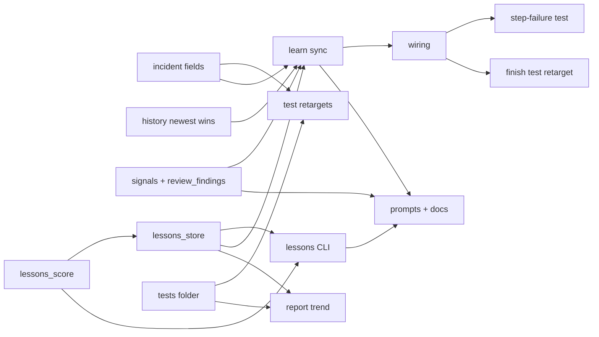

# Per-repo learning loop: integration

**Goal:** Port the approved prototype into superlite: progressive `learn sync`, the usefulness-evicted lessons cache with proven practices, lesson briefs for implementers, fixers, drafter and reviewers, the anonymised outbox, and the `.superlite/tests/` folder.
**Architecture:** New stdlib scripts in `skills/swarm/scripts/`: `lessons_score` (pure math), `learn_signals` (parsers), `lessons_store` (cache), `lessons` (CLI, brief, report), `learn` (sync, note, outbox), `review_findings` (record). Existing modules get additive changes and one advisory sync call each. Prototype code to port: `/Users/iheatuwogu/Projects/superlite/.superlite/sandboxes/per-repo-learning/per-repo-learning/proto/` (port, never copy its `_paths` or fakes).
**Tech stack:** Python stdlib, pytest, hypothesis, bash
**Detail:** contracts
**Target-min:** 40
**Full suite:** yes
**Review plan:** docs/plans/2026-11-12-per-repo-learning.feature.md

## Global constraints

- language: python; test command: `uv run pytest tests/scripts -m "not slow"`
- code-shape rules (`tests/scripts/test_code_shape_rules.py`): usage docstring ending "Stdlib only."; `# O(...)` after each def; `main(argv=None) -> int`; nesting <= 3; files <= 600 lines; no `.superlite` literal outside `state.py` (use `state.DIR_NAME`, `state.path`, `state.hub_root`); no broad `except Exception`; advisory steps use `base.advisory_errors()`; JSON via `base.read_json`/`base.locked_update`
- kept state in the hub run dir (`state.run_dir(state.hub_root(cwd))`): `lessons.json`, `learn-state.json`; outbox `history.home() / "learn" / "outbox.jsonl"`; no network imports
- constants as the prototype: CAP 50, GRACE 3, GRACE_RANK 0.1, HALF_LIFE 10, PROVEN_U 0.2, PROVEN_N 5, budgets 1000 / 2000, LINE_CUT 160
- FROZEN: `add_incidents` tuple; `make_entry` positional args; `incident add` flags; `derive`, `unique_rows`, `record_run`, `task_records` signatures; history v1 keys; final-review and fix-note formats; `run.json` keys; `--summary PATH` flag; prime byte-identical; `routing.py`, `config/`, `bench/` untouched; `CLAUDE.md`/`AGENTS.md` untouched
- every learning hook point is advisory: it never changes an exit code or blocks
- integration fixes from the try-out: outbox rows carry `run`; lesson lines say "1 run" / "N runs"

### T1 incident fields · Complexity 3 · Est. context 24k
**Owns:** skills/swarm/scripts/incident.py, tests/scripts/test_incident_fields.py
**Components:** 1
**LOC owned:** 70
**Tests:** fast
**Model:** sonnet
**Est. time:** 2.5 min (1 component, about 70 LOC, fast tests)
**Consumes:** none
**Produces:** incident.make_entry(file, line, context, agent, kind, resolution, confidence, date=None, run=None, module=None, category=None) -> dict · incident.read_all(log: str) -> list
e.g. make_entry("a/b.py", 3, "x", "T1", "test-failure", "", "high", run="r1") -> old keys plus "date" (ISO, today), "run": "r1", "module": "a" (parent dir), no "category" key when None
e.g. read_all(log) returns every JSON object row including hook rows {kind: rule-block, tool: Bash}; `_read` (hotspots) still skips rows without file/line; `incident summary` counts hook rows by kind
**Review Focus:** old rows without date read fine; hotspots never crash on hook rows; `incident add --category C` optional flag
**Test code (contracts):** test_new_fields · test_category_optional · test_read_all_keeps_hook_rows · test_hotspots_skip_hook_rows · test_summary_counts_hook_rows · test_old_rows_ok
**Steps:** 1 failing tests, 2 run: FAIL, 3 implement, 4 run: PASS

### T2 history newest wins · Complexity 4 · Est. context 30k
**Owns:** skills/swarm/scripts/history.py, tests/scripts/test_history_newest.py
**Components:** 1
**LOC owned:** 60
**Tests:** fast
**Model:** sonnet
**Est. time:** 3.0 min (1 component, about 60 LOC, fast tests)
**Consumes:** none
**Produces:** history.record_rows(rows: list, sl_dir: str) -> list
e.g. record_rows([{"v": 1, "run": "r", "task": "T1", "repository": "/repo", "first_time_pass": False}], sl) appends it to global and project history and refreshes both stats files; the same row again -> []; the same key with first_time_pass True -> appended; keys compared: first_time_pass, rework_s, rework_cost, status, findings
e.g. unique_rows keeps the last row per (repository, run, task); record_run now calls record_rows (its signature unchanged)
**Review Focus:** old files (no repeats) give identical stats; content duplicates across repositories still count once per repository
**Test code (contracts):** test_new_row · test_same_row_noop · test_changed_outcome_appended · test_unique_rows_last_wins · test_record_run_unchanged_signature · test_old_stats_identical
**Steps:** 1 failing tests, 2 run: FAIL, 3 implement, 4 run: PASS

### T3 lessons_score · Complexity 3 · Est. context 22k
**Owns:** skills/swarm/scripts/lessons_score.py, tests/scripts/test_lessons_score.py
**Components:** 1
**LOC owned:** 110
**Tests:** fast
**Model:** sonnet
**Est. time:** 2.5 min (1 component, about 110 LOC, fast tests)
**Consumes:** none
**Produces:** lessons_score.module_key(path: str) -> str · lessons_score.baseline(modules: dict, module: str, before: str | None, run_index: list) -> float · lessons_score.usefulness(deliveries: list, base: float, run_index: list) -> float · lessons_score.rank(lesson: dict) -> float · lessons_score.line(lesson: dict) -> str · lessons_score.select(lessons: list, budget: int) -> list
e.g. port proto/lessons_score.py and its tests: module_key("skills/x/y.py") -> "skills/x"; usefulness([{"run": "r3", "hit": True}]*4, 0.5, ["r1","r2","r3"]) -> 0.4; rank in grace -> max(u, 0.1); select returns lesson dicts, proven first, practice before its pitfall, within budget
e.g. line({"module": "skills/x", "kind": "practice", "proven": True, "text": "do: run t.py", "runs": ["r1"]}) -> "- skills/x: do: run t.py (practice, proven, 1 run)"
**Review Focus:** hypothesis properties kept; "1 run" singular
**Test code (contracts):** the prototype's 14 tests, plus test_line_singular
**Steps:** 1 failing tests, 2 run: FAIL, 3 implement, 4 run: PASS

### T4 signals and review_findings · Complexity 4 · Est. context 30k
**Owns:** skills/swarm/scripts/learn_signals.py, skills/swarm/scripts/review_findings.py, tests/scripts/test_learn_signals.py, tests/scripts/test_review_findings.py
**Components:** 2
**LOC owned:** 170
**Tests:** fast
**Model:** sonnet
**Est. time:** 3.5 min (2 components, about 170 LOC, fast tests)
**Consumes:** none
**Produces:** learn_signals.read_new_lines(path, offset: int) -> tuple · learn_signals.is_hook_row(row: dict) -> bool · learn_signals.parse_fix_note(text: str) -> dict | None · learn_signals.parse_learned(report: str) -> dict | None · learn_signals.model_mismatches(launches: list, dispatch: dict) -> list · learn_signals.outbox_row(signal: str, repo_id: str, date: str, version: str, **fields) -> dict · review_findings.main(argv=None) -> int
e.g. port proto/signals.py as learn_signals.py with its tests; outbox_row allow-list adds "run": outbox_row("hook-block", "/r", "d", "4.1.0", run="r1", tool="Bash", count=1) -> {..., "run": "r1", "tool": "Bash", "count": 1}
e.g. `superlite-cli review_findings record --file REPLY.txt` (or stdin) parses `file:line - problem - fix - tier N` lines into `<run dir>/review-findings.jsonl` (run id from current-run.json), prints "review_findings: N recorded", then runs learn sync advisory (import learn lazily; absent -> skip); exit 0 even with 0 lines
**Review Focus:** frozen reply format; partial lines; outbox never holds command/target/file/path/text
**Test code (contracts):** the prototype's 12 signal tests + test_outbox_run_field + test_record_writes_rows + test_record_zero_lines_ok + test_record_help_no_side_effects
**Steps:** 1 failing tests, 2 run: FAIL, 3 implement, 4 run: PASS

### T5 lessons_store · Complexity 5 · Est. context 32k
**Owns:** skills/swarm/scripts/lessons_store.py, tests/scripts/test_lessons_store.py
**Components:** 1
**LOC owned:** 170
**Tests:** fast
**Model:** sonnet
**Est. time:** 3.5 min (1 component, about 170 LOC, fast tests)
**Consumes:** lessons_score.baseline(modules: dict, module: str, before: str | None, run_index: list) -> float (T3) · lessons_score.usefulness(deliveries: list, base: float, run_index: list) -> float (T3) · lessons_score.rank(lesson: dict) -> float (T3)
**Produces:** lessons_store.hub_dir(cwd) -> Path · lessons_store.load(hub) -> dict · lessons_store.update(hub, fn) -> dict · lessons_store.add_signal(store: dict, kind: str, module: str, key: str, text: str, source: str, run: str, verified: bool = False) -> str · lessons_store.note_run(store: dict, run: str) -> None · lessons_store.step(store: dict) -> list · lessons_store.control(store: dict, lid: str, action: str) -> bool
e.g. port proto/lessons.py and its tests; hub_dir(cwd) -> state.run_dir(state.hub_root(cwd)) (cwd's run dir outside git); load(hub) with no lessons.json -> {"v": 1, "run_index": [], "modules": {}, "lessons": {}}; update(hub, fn) saves via base.locked_update
e.g. step(store) -> ["admitted L-…"] for a candidate seen in 2 runs; add_signal returns the lesson id; control(store, "L-x", "drop") on an unknown id -> False
**Review Focus:** idempotent step; pinned never evicted; grace from readmission; full cache keeps newcomer a candidate
**Test code (contracts):** the prototype's 14 tests + test_hub_dir_worktree_shares_hub
**Steps:** 1 failing tests, 2 run: FAIL, 3 implement, 4 run: PASS

### T6 lessons CLI · Complexity 4 · Est. context 30k
**Owns:** skills/swarm/scripts/lessons.py, tests/scripts/test_lessons_cli.py
**Components:** 1
**LOC owned:** 170
**Tests:** fast
**Model:** sonnet
**Est. time:** 3.5 min (1 component, about 170 LOC, fast tests)
**Consumes:** lessons_score.line(lesson: dict) -> str (T3) · lessons_score.module_key(path: str) -> str (T3) · lessons_store.control(store: dict, lid: str, action: str) -> bool (T5)
**After:** T3, T5
**Produces:** lessons.brief(hub, sl, run: str, task: str, owns: list, agent: str = "implementer") -> str · lessons.report(hub, rows: list, last_n: int = 10) -> str · lessons.main(argv=None) -> int
e.g. port proto/lessons_cli.py; CLI `superlite-cli lessons list|show ID|drop ID|pin ID|restore ID|report|brief --task Tn [--plan P] [--agent A] [--file F] [--files P...]`; brief reads owns from the plan (plan_tools) when --plan given, run id from current-run.json, appends to `<run dir>/deliveries.jsonl`
e.g. brief(...) with no matching lesson -> "" and no deliveries line; report uses history rows filtered by history.repository_id; also uses T3 select (returns lesson dicts) and T5 hub_dir, load, update
**Review Focus:** --help has no side effects (test_doc_contract); budgets by agent; drafter `--files`
**Test code (contracts):** the prototype's 13 tests + test_brief_from_plan_owns + test_help_no_side_effects
**Steps:** 1 failing tests, 2 run: FAIL, 3 implement, 4 run: PASS

### T7 learn sync · Complexity 7 · Est. context 44k
**Owns:** skills/swarm/scripts/learn.py, tests/scripts/test_learn_sync.py
**Components:** 1
**LOC owned:** 280
**Tests:** fast
**Model:** sonnet
**Est. time:** 5.0 min (1 component, about 280 LOC, fast tests)
**Consumes:** learn_signals.is_hook_row(row: dict) -> bool (T4) · lessons_store.add_signal(store: dict, kind: str, module: str, key: str, text: str, source: str, run: str, verified: bool = False) -> str (T5) · lessons_store.note_run(store: dict, run: str) -> None (T5) · history.record_rows(rows: list, sl_dir: str) -> list (T2) · incident.read_all(log: str) -> list (T1)
**After:** T1, T2, T4, T5
**Produces:** learn.sync(sl, plan=None, run=None, status: str = "unfinished", final: bool = False) -> list · learn.spawn(sl, plan=None) -> None · learn.main(argv=None) -> int
e.g. port proto/learn.py with real inputs: run id from run_archive.read_current_run(sl); tasks from metrics.task_records(sl, plan) when plan exists (owns from plan_tools); changed files per task from its checkpoint sha in the ledger (`git diff-tree --no-commit-id --name-only -r SHA`), test files among them = tests_run; history rows = history.run_rows + status + findings counts, written with history.record_rows; findings from review-findings.jsonl; fix notes from `<sl>/fixes/*.md`; learned lines from learned.jsonl; launches from metrics.jsonl and tiers from dispatch.json; outbox under history.home()
e.g. also uses T4 read_new_lines, parse_fix_note, model_mismatches, outbox_row and T5 hub_dir, update, step exactly as their prototype versions
e.g. sync(sl) -> ["admitted L-…"]; second sync -> []; final=True prints "learn: admitted N, evicted M, proven P"; spawn(sl, plan) starts `learn sync` with base.spawn_background, log `<sl>/learn.log`; CLI `superlite-cli learn sync [--plan P] [--final] [--status finished]` and `learn note --task Tn --tag T --text "…"`; errors warn, exit 0
**Review Focus:** crash between store and watermark save; newest outcome wins; no network import; outbox rows hold no path; works with no plan (incidents and findings only)
**Test code (contracts):** the prototype's 15 tests ported to real fixtures (tmp git repo, current-run.json, metrics.jsonl) + test_no_plan_ok + test_spawn_detached
**Steps:** 1 failing tests, 2 run: FAIL, 3 implement, 4 run: PASS

### T8 wiring · Complexity 5 · Est. context 36k
**Owns:** skills/swarm/scripts/checkpoint.py, skills/swarm/scripts/session_registration.py, skills/swarm/scripts/session_close.py, skills/swarm/scripts/finish.py, skills/swarm/scripts/run_archive.py, tests/scripts/test_learn_wiring.py
**Components:** 5
**LOC owned:** 60
**Tests:** fast
**Model:** sonnet
**Est. time:** 4.0 min (5 components, about 60 LOC, fast tests)
**Consumes:** learn.sync(sl, plan=None, run=None, status: str = "unfinished", final: bool = False) -> list (T7) · learn.spawn(sl, plan=None) -> None (T7)
**Produces:** run_archive.KEEP: set
e.g. checkpoint_one calls learn.spawn(sl, a.plan) right after append_ledger; prepare_run calls learn.sync(live) before ensure_run; session close and finish (before archive_run, status finished) call learn.sync(..., final=True); each wrapped in `try/except base.advisory_errors()`; KEEP gains "lessons.json", "learn-state.json" (and "tests" stays a run file)
**Review Focus:** test_finish_order, test_ensure_archive, test_run_archive_cycle still pass; a sync error never changes an exit code; checkpoint does not wait
**Test code (contracts):** test_checkpoint_spawns_sync · test_prepare_run_syncs_before_snapshot · test_finish_syncs_before_archive · test_close_syncs · test_sync_error_is_advisory · test_keep_has_lessons
**Steps:** 1 failing tests, 2 run: FAIL, 3 implement, 4 run: PASS

### T9 tests folder · Complexity 5 · Est. context 36k
**Owns:** skills/swarm/scripts/run_tests.py, skills/swarm/scripts/review_packet.py, skills/swarm/scripts/proto_discard.py, skills/swarm/scripts/pt_review.py, hooks/_rewrite, tests/scripts/test_tests_folder.py
**Components:** 4
**LOC owned:** 90
**Tests:** fast
**Model:** sonnet
**Est. time:** 4.0 min (4 components, about 90 LOC, fast tests)
**Consumes:** none
**Produces:** run_tests.summary_path(sl_dir) -> Path
e.g. DEFAULT_SUMMARY = `<DIR_NAME>/tests/summary.json`; pointer `tests/latest`; background `tests/runs/<id>.{json,log,done,suspect}`; `tests/setup.done`; each summary carries "superlite_run" from current-run.json; summary_path(sl) -> sl/tests/summary.json if it exists, else the old sl/test-summary.json if that exists, else the new path; readers use it; hooks/_rewrite message strings name `.superlite/tests/summary.json`
**Review Focus:** existing tests retargeted, not deleted; old archives with root test-summary.json still read; `.superlite/` root stays clean
**Test code (contracts):** test_root_clean_after_runs · test_background_files_in_runs · test_summary_path_fallback · test_packet_reads_new_and_old · test_proto_discard_reads_new_and_old · test_rewrite_message_path
**Steps:** 1 failing tests, 2 run: FAIL, 3 implement, 4 run: PASS

### T10 report trend · Complexity 3 · Est. context 26k
**Owns:** skills/swarm/scripts/report.py, tests/scripts/test_report_trend.py
**Components:** 1
**LOC owned:** 60
**Tests:** fast
**Model:** sonnet
**Est. time:** 2.5 min (1 component, about 60 LOC, fast tests)
**Consumes:** none
**After:** T5, T9
**Produces:** report.trend_line(rows: list, last_n: int = 10) -> str
e.g. trend_line(rows) -> "trend (last 3 runs): first-time pass 50% -> 67% -> 100%; findings 4 -> 2 -> 1; rework+fixer cost 30% -> 18% -> 9%" (rows filtered by repository; unfinished included); the build report adds that line and one line "lessons: N cached, M proven"; report reads the summary via T9's run_tests.summary_path(sl) and lessons via T5's lessons_store.load(lessons_store.hub_dir(cwd))
**Review Focus:** existing report tests unchanged; empty history -> no trend line
**Test code (contracts):** test_trend_line · test_trend_empty · test_report_lessons_line · test_report_reads_new_summary
**Steps:** 1 failing tests, 2 run: FAIL, 3 implement, 4 run: PASS

### T11 prompts and docs · Complexity 4 · Est. context 34k
**Owns:** skills/swarm/SKILL.md, skills/swarm/implementing.md, skills/swarm/fixing.md, skills/drafting/SKILL.md, agents/package-reviewer.md, skills/shipping/SKILL.md, skills/swarm/scripts/superlite-cli, docs/tools.md, docs/config.md, docs/how-a-run-works.md, assets/help.txt
**Components:** 3
**LOC owned:** 70
**Tests:** fast
**Model:** sonnet
**Est. time:** 3.5 min (3 components, about 70 LOC, fast tests)
**Consumes:** lessons.main(argv=None) -> int (T6) · learn.main(argv=None) -> int (T7) · review_findings.main(argv=None) -> int (T4)
**Produces:** none
e.g. SKILL.md step 2: append `bash "$CLI" lessons brief --task Tn --plan $PLAN` output to the task message; on a DONE report with `Learned: tag: text` run `bash "$CLI" learn note --task Tn --tag tag --text "…"`; after final review step 3 pipe the reply into `bash "$CLI" review_findings record`; implementing.md report format gains optional `Learned: <setup|test|pairing|convention>: <one line>`; fixing.md briefs fixers with `lessons brief --agent fixer --file F`; drafting gets `lessons brief --agent drafter --files …`; package-reviewer gets `lessons brief --agent reviewer`; shipping/swarm summary path text -> `.superlite/tests/summary.json`; tools/help/config/how-a-run-works list the new tools; superlite-cli header lists lessons, learn, review_findings
**Review Focus:** test_doc_contract (every documented call has a working --help); test_promises; test_name_scan; skills/using-superlite unchanged
**Test code (contracts):** existing doc tests pass
**Steps:** 1 edit, 2 run: PASS

### T12 retarget existing tests · Complexity 2 · Est. context 16k
**Owns:** tests/scripts/test_incident.py, tests/scripts/test_0_3_1_scripts.py, tests/scripts/test_testprobe.py, tests/scripts/test_testcmd.py, tests/scripts/test_run_scripts.py
**Components:** 1
**LOC owned:** 40
**Tests:** fast
**Model:** sonnet
**Est. time:** 1.5 min (1 component, about 10 LOC, fast tests)
**Consumes:** none
**Produces:** none
e.g. follow-up fix task: existing tests whose exact-format asserts the planned changes break (F-T1-1: test_add_writes_one_json_line now checks the old keys as a subset plus `date` and `module`; the 13 summary-path tests read `.superlite/tests/summary.json` and `tests/runs/<id>.json`)
**Review Focus:** asserts loosened only for the planned new fields
**Test code (contracts):** test_incident.py passes
**Steps:** 1 edit, 2 run: PASS

### T13 retarget finish archive tests · Complexity 1 · Est. context 12k
**Owns:** tests/scripts/test_finish_archive.py
**Components:** 1
**LOC owned:** 5
**Tests:** fast
**Model:** sonnet
**Est. time:** 1.0 min (1 component, about 5 LOC, fast tests)
**Consumes:** none
**Produces:** none
e.g. follow-up fix task: the fake run_archive KEEP gains "lessons.json" and "learn-state.json"; the waited summary name is "summary.json"
**Review Focus:** intent of both tests unchanged
**Test code (contracts):** test_finish_archive.py passes
**Steps:** 1 edit, 2 run: PASS

### T14 step-failure test for close sync · Complexity 2 · Est. context 14k
**Owns:** tests/scripts/test_step_failures.py
**Components:** 1
**LOC owned:** 10
**Tests:** fast
**Model:** sonnet
**Est. time:** 1.0 min (1 component, about 10 LOC, fast tests)
**Consumes:** none
**Produces:** none
e.g. follow-up fix task (F-T8-1): a failing close step must leave state unchanged although close now runs the advisory learn sync
**Review Focus:** the invariant still holds for every real session file
**Test code (contracts):** test_step_failures.py passes
**Steps:** 1 edit, 2 run: PASS

## Review Focus

- App type: CLI scripts over run files. Categories: state (cache, watermark, KEEP), file (atomic writes, partial lines, path moves), protocol (frozen formats, docs contract), numeric (U), encoding (Windows utf-8).
- Risks: sync slowing or failing a checkpoint; double counting; old archives unreadable after the tests move; outbox leaking paths; prime changing.
