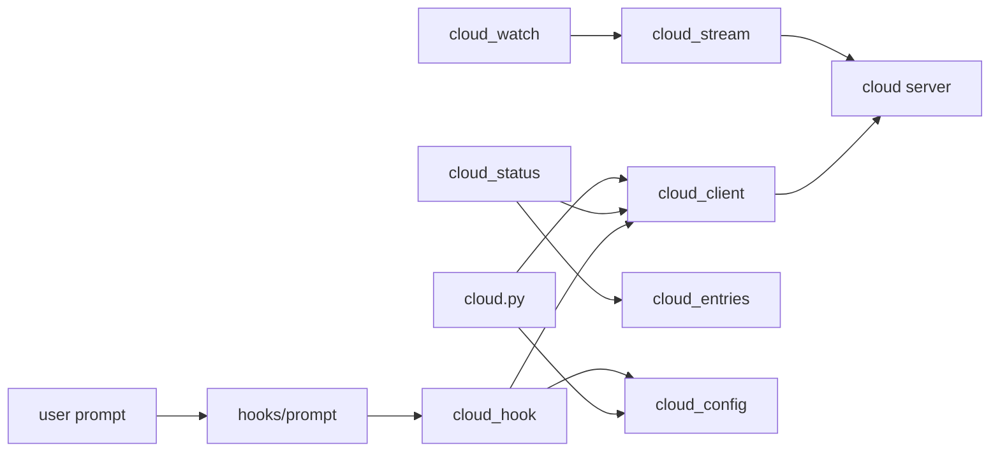
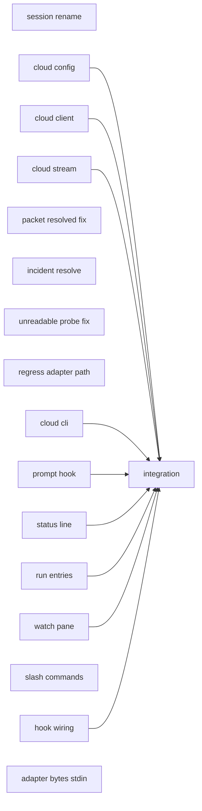

# Live cloud runs, superlite side: machine plan

**Review plan:** docs/plans/2026-11-15-cloud-client.review.md
**Goal:** the client half of live cloud runs (session rename, cloud client, prompt hook, watch pane, slash commands, status line, run entries) plus four plugin bug fixes.
**Architecture:** new stdlib modules in `skills/swarm/scripts/`, entry `cloud.py` (so `superlite-cli cloud <cmd>`), wired into `hooks/prompt`.
**Tech stack:** Python 3.10+, stdlib only; bash 3.2 for hooks.
**Spec:** docs/plans/2026-11-15-cloud-client.review.md
**Detail:** contracts
**Full suite:** no
**Target-min:** 11

Global constraints:
- Stdlib only. Tests in `tests/scripts/`, run with `bash "$CLI" run_tests`.
- `SUPERLITE_HOME` (default `~/.superlite`) and `CLAUDE_HOME` (default `~/.claude`) override homes; every test sets both to tmp dirs.
- The token is never printed or logged. `cloud.json` is mode 600.
- Cloud routes: `GET /api/me`, `GET /api/status` -> `{"runs":[...],"notices":[{"id","task","text","seen"}]}`, `GET /api/tasks[?all=1]`, `POST /api/runs/{ref}/nudge {"text"}` -> 202, `POST /api/runs/{ref}/give {"email"}` -> the task, `GET /api/runs/{ref}/attach` -> `{"run","id","status"}`, `POST /api/tasks/{ref}/respond {"answer"}`, `POST /api/tasks/{ref}/cancel`, SSE `GET /api/runs/{ref}/events?after=N` (frames `id/event/data`, data carries `"run"`; the server never closes, so readers stop on a terminal status). `/api/me` and `runs` in `/api/status` come from the cloud gap plan; fakes use the e.g. values. Auth header `Authorization: Bearer <token>`. Errors are `{"error": "..."}`.
- Event kinds: `status {to}`, `step`, `tool`, `message`, `nudge {by,text}`, `rename {from,to,why}`, `given {from,to,name}`, `result`, `notice`, `handback`. Terminal statuses: done, failed, cancelled.
- Run refs: `login_fix` or `chris/login_fix`.
- Ruling: [scope] the three cloud gaps are built by a separate one-task plan in the superlite-cloud worktree, because `checkpoint` commits only in its own repo - same content as approved - cost: one extra lint.
- Ruling: [scope] Wave 3 (live podman flow) runs after T14 as a coordinator-led live check, not a swarm task - it needs the cloud image and real agents - cost: live time only.

## Session

**Probe entry:** run=python skills/swarm/scripts/session.py

### T1 session rename · Complexity 4 (O-1) · Est. context 40k
**Owns:** skills/swarm/scripts/session_rename.py, skills/swarm/scripts/session.py, tests/scripts/test_session_rename.py
**Components:** 1
**LOC owned:** 115
**Tests:** fast
**Kind:** design
**Model:** sonnet
**Produces:** session_rename.cmd_rename(a: argparse.Namespace) -> int
**Review Focus:** `test_rename_dirty_keeps_changes`: dirty tree, rename login-fix to login-fix-3, file content unchanged, branch `superlite/sessions/login-fix-3`, registry slug login-fix-3; `test_rename_taken_refused`: target slug in registry or branch exists -> exit 2, `session: rename refused: login-fix-3 is taken`; `test_rename_unknown_refused`: exit 2, `session: rename refused: no session nope`
**Test code:** `test_rename_prints_line`: stdout `session: renamed login-fix to login-fix-3 (branch superlite/sessions/login-fix-3)`; `test_rename_custom_branch`: branch `feat/login-fix` becomes `feat/login-fix-3` (old slug suffix replaced); `test_rename_active_pointer`: registry `active` follows the rename.
**Steps:** add `rename --slug S --to T [--root DIR]` to `build_parser` and COMMANDS; under `registry_lock`, validate both slugs, `git branch -m`, update row slug, branch, store dir name, `active`.
**Notes:** works in the host or a session worktree; `git branch -m` never touches the tree. Tests use a tmp git repo, local only.

## Cloud core

**Probe entry:** run=python skills/swarm/scripts/cloud.py

### T2 cloud config · Complexity 3 (O-1) · Est. context 34k
**Owns:** skills/swarm/scripts/cloud_config.py, tests/scripts/test_cloud_config.py
**Components:** 1
**LOC owned:** 110
**Tests:** fast
**Kind:** design
**Model:** sonnet
**Produces:** cloud_config.find(project: Path, url: str | None = None, token: str | None = None, clipboard=None) -> dict
e.g. find(p, "https://c.example", "slc_abc") -> {"url": "https://c.example", "token": "slc_abc", "source": "args", "warnings": []}
e.g. find(p) with `p/.env` holding `SUPERLITE_CLOUD_URL=http://10.0.0.5:8787` tracked by git -> {"url": "http://10.0.0.5:8787", "token": "slc_abc", "source": "project .env", "warnings": ["project .env holds a token git is not ignoring", "plain http to a non-local address"]}
**Produces:** cloud_config.save(cfg: dict) -> Path · cloud_config.load() -> dict | None · cloud_config.clear() -> None
e.g. load() -> {"url": "https://c.example", "token": "slc_abc", "statusline_prev": null}
**Review Focus:** `test_order`: args > project .env > `$SUPERLITE_HOME/.env` > clipboard (token only); `test_clipboard_shape`: clipboard `hello world` ignored, `slc_` + 20+ chars taken; `test_mode_600`: saved file mode 0o600 (skip on Windows); `test_localhost_http_ok`: `http://127.0.0.1:8787` no warning.
**Notes:** env keys `SUPERLITE_CLOUD_URL`, `SUPERLITE_CLOUD_TOKEN`. `clipboard` is a callable returning text; default tries pbpaste, wl-paste, xclip -o, powershell Get-Clipboard. Tracked check: `git ls-files --error-unmatch .env` and `git check-ignore`.

### T3 cloud client · Complexity 4 (O-1) · Est. context 38k
**Owns:** skills/swarm/scripts/cloud_client.py, tests/scripts/test_cloud_client.py
**Components:** 1
**LOC owned:** 130
**Tests:** fast
**Kind:** design
**Model:** sonnet
**Produces:** cloud_client.Client(url: str, token: str, timeout: float = 5.0) · cloud_client.CloudError(Exception)
**Produces:** Client.me() -> dict
e.g. Client.me() -> {"handle": "chris", "email": "chris@example.com", "role": "member", "workspace": "acme"}
**Produces:** Client.status() -> dict
e.g. Client.status() -> {"runs": [{"name": "login_fix", "status": "running", "step": 14, "doing": "editing api.py", "agent": "claude"}], "notices": [{"id": 3, "task": "login_fix", "text": "login_fix from chris", "seen": 0}]}
**Produces:** Client.runs(all: bool = False) -> list[dict]
e.g. Client.runs() -> [{"name": "login_fix", "owner": "chris", "status": "running", "agent": "claude"}]
**Produces:** Client.give(ref: str, email: str) -> dict · Client.attach(ref: str) -> dict
e.g. Client.give("login_fix", "pat@example.com") -> {"id": "t_1", "name": "login_fix", "owner": "pat", "status": "running"}
e.g. Client.attach("login_fix") -> {"run": "login_fix", "id": "t_1", "status": "running"}
**Produces:** Client.nudge(ref: str, text: str) -> None · Client.respond(ref: str, text: str) -> None · Client.cancel(ref: str) -> None
**Review Focus:** `test_error_message`: 404 `{"error": "not found"}` -> CloudError("login_fix: not found"); `test_no_network`: refused port -> CloudError("cloud unreachable: <url>"); `test_token_not_in_errors`: no CloudError text contains the token; `test_ref_quoted`: `chris/login_fix` sent as one path segment pair, unchanged; `test_respond_body`: respond sends `{"answer": "approve"}`; `test_runs_all`: `runs(all=True)` requests `/api/tasks?all=1`.
**Notes:** tests patch `urllib.request.urlopen`; no server. nudge expects 202.

### T4 cloud stream · Complexity 5 (O-1) · Est. context 36k
**Owns:** skills/swarm/scripts/cloud_stream.py, tests/scripts/test_cloud_stream.py
**Components:** 1
**LOC owned:** 120
**Tests:** fast
**Kind:** design
**Model:** sonnet
**Produces:** cloud_stream.events(url: str, token: str, ref: str, after: int = 0, sleep=time.sleep, max_retries: int = 8) -> Iterator[dict]
e.g. events(u, t, "login_fix") -> first item {"id": 1, "kind": "status", "data": {"run": "login_fix", "to": "running"}}
e.g. events(u, t, "login_fix") after a drop at id 7 -> the next request carries `?after=7` and `Last-Event-ID: 7`
**Review Focus:** `test_parse_multiline_data`: two `data:` lines join with `\n`; `test_reconnect_resumes`: fake drops after id 2, iterator yields 3 next, never 2 again; `test_backoff`: sleeps 0.5, 1, 2 ... capped at 10; `test_stops_on_terminal`: yields `status {to: done}` then stops; `test_404_raises`: CloudError("login_fix: not found") with no retry.
**Notes:** reuse `cloud_client.CloudError` by import; comment lines (`:`) are keepalives. Tests patch `urllib.request.urlopen` with byte streams; the server never closes, so stopping on a terminal status is required.

## Bug fixes

**Probe entry:** run=python skills/swarm/scripts/incident.py

### T5 packet resolved fix · Complexity 2 (O-1) · Est. context 26k
**Owns:** skills/swarm/scripts/review_packet.py, tests/scripts/test_packet_resolved.py
**Components:** 1
**LOC owned:** 30
**Tests:** fast
**Kind:** mechanical
**Model:** haiku
**Produces:** none
**Test code:** `test_all_resolved_repeated_not_open`: two entries at a.py:3, both `resolution: fixed`, confidence high -> no item for a.py:3; `test_one_unresolved_repeated_open`: same with one `open` -> item, why includes repeated and unresolved; `test_resolved_low_still_listed`: one resolved low-confidence entry -> item with why `low confidence`.
**Steps:** in the grouping loop, `continue` when `not unresolved and not low`.

### T6 incident resolve · Complexity 3 (O-1) · Est. context 30k
**Owns:** skills/swarm/scripts/incident.py, tests/scripts/test_incident_resolve.py
**Components:** 1
**LOC owned:** 70
**Tests:** fast
**Kind:** mechanical
**Model:** haiku
**Produces:** none
**Test code:** `test_resolve_marks`: two entries at src/a.py:5 -> `resolve --file src/a.py --line 5 --evidence run-12` exit 0, stdout `incident: resolved 2 at src/a.py:5`, both rows `resolution: fixed`, `evidence: run-12`; `test_resolve_none`: no match -> exit 1, `incident: nothing open at src/a.py:9`; `test_resolve_path_norm`: `./src\\a.py` matches `src/a.py`; `test_other_rows_untouched`: other lines byte-identical.
**Steps:** `resolve` subparser with `--file --line --evidence --log`; rewrite under the same lock as `add`, via temp file and replace.

### T7 unreadable probe fix · Complexity 2 (O-1) · Est. context 24k
**Owns:** skills/swarm/probes/pack/file.py, tests/scripts/test_probe_unreadable.py
**Components:** 1
**LOC owned:** 30
**Tests:** fast
**Kind:** mechanical
**Model:** haiku
**Produces:** none
**Test code:** `test_twice`: call `_unreadable(None, ctx)` twice on the same `ctx.tmp`, no exception, file mode 0 after each; `test_restored_at_exit`: after the registered cleanup runs, mode allows owner read and write. Skip as root or on Windows.
**Steps:** if the file exists, chmod 0o600 and unlink before writing; register a restore (ctx cleanup hook if ctx has one, else `atexit`).

### T8 regress adapter path · Complexity 3 (O-1) · Est. context 32k
**Owns:** skills/swarm/probes/probe_regress.py, tests/scripts/test_probe_regress_adapter.py
**Components:** 1
**LOC owned:** 60
**Tests:** fast
**Kind:** design
**Model:** sonnet
**Produces:** none
**Review Focus:** `test_adapter_copied`: generating a test writes `tests/regression/probe_adapter.py` equal to `.superlite/probes/adapter.py`, and the test's `ADAPTER` is `ROOT / 'tests/regression/probe_adapter.py'`; `test_after_finish`: move `.superlite/probes` away, the generated test still passes; `test_user_file_kept`: an existing `tests/regression/probe_adapter.py` without the generated docstring is not overwritten and generation writes `probe_adapter_gen.py` instead.

### T17 adapter bytes stdin · Complexity 2 (O-1) · Est. context 22k
**Owns:** skills/swarm/scripts/review_adapter.py, tests/regression/test_adapter_run_bytes_stdin.py
**Components:** 1
**LOC owned:** 20
**Tests:** fast
**Kind:** design
**Model:** sonnet
**Produces:** none
**Review Focus:** `test_adapter_run_bytes_stdin`: the generated adapter's `run()` passes bytes stdin through unchanged, encodes str stdin, and returns decoded text.

## Cloud commands

**Probe entry:** run=python skills/swarm/scripts/cloud.py

### T9 cloud cli · Complexity 4 (O-1) · Est. context 40k
**Owns:** skills/swarm/scripts/cloud.py, tests/scripts/test_cloud_cli.py
**Components:** 1
**LOC owned:** 140
**Tests:** fast
**Kind:** design
**Model:** sonnet
**Consumes:** cloud_config.find(project: Path, url: str | None = None, token: str | None = None, clipboard=None) -> dict (T2) · cloud_config.clear() -> None (T2) · Client.me() -> dict (T3) · Client.runs(all: bool = False) -> list[dict] (T3) · Client.give(ref: str, email: str) -> dict (T3) · cloud_status.install(settings: Path, command: str) -> None (T11) · cloud_status.restore(settings: Path) -> None (T11) · cloud_entries.remove_all(skills_dir: Path) -> int (T12)
**Produces:** cloud.main(argv: list[str] | None = None) -> int
**Review Focus:** `test_login_prints_who`: `logged in as chris (chris@example.com)`, token absent from stdout and stderr; `test_login_warnings_printed`; `test_logout_restores`: calls restore and remove_all, prints `logged out`; `test_runs_marks`: a run with a notice prints `login_fix  running  new · given by chris`; `test_not_logged_in`: exit 2, `not logged in: run superlite-cli cloud login`.
**Notes:** `watch`, `statusline` and `hook` subcommands delegate to `cloud_watch.main`, `cloud_status.main`, `cloud_hook.main` (imported lazily, so tests here fake them). Login also calls `cloud_config.save(cfg)` from T2 (built; the fake returns a tmp path).

### T10 prompt hook · Complexity 6 (O-1) · Est. context 44k
**Owns:** skills/swarm/scripts/cloud_hook.py, tests/scripts/test_cloud_hook.py
**Components:** 1
**LOC owned:** 130
**Tests:** fast
**Kind:** design
**Model:** sonnet
**Consumes:** Client.nudge(ref: str, text: str) -> None (T3) · Client.respond(ref: str, text: str) -> None (T3) · Client.cancel(ref: str) -> None (T3) · Client.attach(ref: str) -> dict (T3) · Client.runs(all: bool = False) -> list[dict] (T3) · Client.give(ref: str, email: str) -> dict (T3) · cloud_config.load() -> dict | None (T2)
**Produces:** cloud_hook.route(prompt: str, current: str | None = None) -> dict | None
e.g. route(">> run the tests first", current="login_fix") -> {"block": True, "reason": "→ login_fix"}
e.g. route("fix the bug") -> None
e.g. route("\\\\explain this") while attached -> {"pass": "explain this"}
**Review Focus:** `test_prefixes`: `>>x`, `>>login_fix x`, `>>chris/login_fix x`, `/superlite:attach r`, `/superlite:attach-r`, `/superlite-attach-r`, `/superlite:detach`, `/superlite:runs`, `/superlite:watch r`, `/superlite:give r e` each routed; `test_failed_send_blocks`: CloudError -> block with reason `nudge not sent: cloud unreachable: <url>`; `test_attached_lines`: while `$SUPERLITE_HOME/attach.json` names login_fix, `yes` goes to respond (or nudge when running), `/cancel` cancels, `/approve` responds `approve`; `test_ended_run`: attach to a done run -> block `login_fix has ended`, no state written.
**Notes:** `cloud_hook.main()` reads the hook JSON on stdin and prints the result; any exception prints nothing and exits 0. Blocked output is `{"decision":"block","reason":...}`. Respond sends the line as the answer. `\` passes the rest to Claude. `/superlite:watch r` runs `herdr pane split --current --direction right --no-focus` then `herdr pane run <id> "bash <CLI> cloud watch r"` when `HERDR_ENV=1`, else blocks with that command to run. Current run = the attached run, else the newest running run of yours.

### T16 hook wiring · Complexity 3 (O-1) · Est. context 28k
**Owns:** hooks/prompt, tests/scripts/test_prompt_cloud.py
**Components:** 1
**LOC owned:** 40
**Tests:** fast
**Kind:** design
**Model:** sonnet
**Produces:** none
**Review Focus:** `test_bash_fastpath`: hooks/prompt with prompt `hello` and no attach file never starts Python for the cloud hook (a SUPERLITE_PYTHON shim logs calls); `test_prefix_starts_hook`: `>> hi` runs `superlite-cli cloud hook` once; `test_attached_starts_hook`: with `$SUPERLITE_HOME/attach.json`, `hello` runs it; `test_fail_open`: the cloud hook exiting 1 -> hooks/prompt exits 0 and does not block.
**Notes:** bash 3.2 `case` on the prefixes from T10, before the HUD; pass the hook's stdout through when non-empty.

### T11 status line · Complexity 4 (O-1) · Est. context 36k
**Owns:** skills/swarm/scripts/cloud_status.py, tests/scripts/test_cloud_status.py
**Components:** 1
**LOC owned:** 130
**Tests:** fast
**Kind:** design
**Model:** sonnet
**Consumes:** Client.status() -> dict (T3) · cloud_config.load() -> dict | None (T2) · cloud_entries.sync(runs: list[dict], skills_dir: Path, me: str, admin: bool) -> list[str] (T12)
**Produces:** cloud_status.segment(status: dict, attached: str | None = None) -> str · cloud_status.install(settings: Path, command: str) -> None · cloud_status.restore(settings: Path) -> None
e.g. segment({"runs": [{"name": "login_fix", "status": "running", "step": 14, "doing": "editing api.py"}], "notices": []}) -> "login_fix running · step 14 · editing api.py"
e.g. segment(s, attached="login_fix") -> "ATTACHED login_fix"
**Review Focus:** `test_roundtrip_with_prev`: install then restore leaves settings.json byte-identical; `test_roundtrip_without_prev`: no statusLine before -> none after; `test_wraps_prev`: prior command output printed first, then ` · ` and the segment; `test_notice`: unseen notice -> `new: login_fix from chris`; `test_rename_shown`: a run whose last event was rename shows `renamed login_fix to login_fix_3`; `test_offline`: status call fails -> prior output only, exit 0; `test_entries_rate_limited`: sync at most once per 15 s (cache file).

### T12 run entries · Complexity 3 (O-1) · Est. context 30k
**Owns:** skills/swarm/scripts/cloud_entries.py, tests/scripts/test_cloud_entries.py
**Components:** 1
**LOC owned:** 90
**Tests:** fast
**Kind:** design
**Model:** sonnet
**Produces:** cloud_entries.sync(runs: list[dict], skills_dir: Path, me: str, admin: bool) -> list[str] · cloud_entries.remove_all(skills_dir: Path) -> int
e.g. sync([{"name": "login_fix", "owner": "chris", "status": "running", "step": 14, "agent": "claude"}], d, "chris", False) -> ["superlite-attach-login_fix", "superlite-watch-login_fix"]
e.g. sync([{"name": "login_fix", "owner": "chris", ...}], d, "sam", True) -> ["superlite-attach-chris.login_fix", "superlite-watch-chris.login_fix"]
**Review Focus:** `test_frontmatter`: SKILL.md has `name: superlite:attach-login_fix`, `description: running · step 14 · claude`, `disable-model-invocation: true`; `test_marker_only`: a `superlite-attach-x` folder without `.superlite-entry` is never removed; `test_ended_removed`: a run no longer listed loses its folders; `test_name_safe`: run name `../x` is skipped.

### T13 watch pane · Complexity 5 (O-1) · Est. context 38k
**Owns:** skills/swarm/scripts/cloud_watch.py, tests/scripts/test_cloud_watch.py
**Components:** 1
**LOC owned:** 140
**Tests:** fast
**Kind:** design
**Model:** sonnet
**Consumes:** cloud_stream.events(url: str, token: str, ref: str, after: int = 0, sleep=time.sleep, max_retries: int = 8) -> Iterator[dict] (T4) · Client.nudge(ref: str, text: str) -> None (T3) · Client.respond(ref: str, text: str) -> None (T3) · Client.cancel(ref: str) -> None (T3)
**Produces:** cloud_watch.render(event: dict) -> str | None · cloud_watch.main(argv: list[str] | None = None) -> int
e.g. render({"id": 4, "kind": "nudge", "data": {"by": "sam", "text": "run the tests first"}}) -> "nudge from sam: run the tests first"
e.g. render({"id": 9, "kind": "rename", "data": {"from": "login_fix", "to": "login_fix_3", "why": "branch taken on origin"}}) -> "renamed login_fix to login_fix_3: branch taken on origin"
e.g. render({"id": 12, "kind": "given", "data": {"from": "chris", "to": "pat", "name": "login_fix"}}) -> "login_fix given to pat"
**Review Focus:** `test_result_shown`: terminal status prints the result line and exits 0; `test_input_line`: `/approve` -> respond("approve"), `/cancel` -> cancel, other text -> nudge; `test_unknown_kind`: returns None, no crash; `test_control_chars`: ESC and other control chars in data are stripped.
**Notes:** the given line appends ` (email)` when the event or task carries it.

### T14 slash commands · Complexity 1 (O-1) · Est. context 20k
**Owns:** commands/runs.md, commands/watch.md, commands/attach.md, commands/detach.md, commands/give.md, tests/scripts/test_cloud_commands_md.py
**Components:** 1
**LOC owned:** 60
**Tests:** fast
**Kind:** mechanical
**Model:** haiku
**Produces:** none
**Test code:** `test_files_exist`: each file has frontmatter `description:` and `argument-hint:`; `test_body_says_hook`: each body says the prompt hook answers it first and, if it reaches Claude, run `superlite-cli cloud <cmd> $ARGUMENTS` and print its output only.

### T15 integration · Complexity 4 (O-1) · Est. context 40k
**Owns:** tests/scripts/test_cloud_integration.py, tests/scripts/cloud_fake.py
**Components:** 1
**LOC owned:** 140
**Tests:** fast
**Kind:** design
**Model:** sonnet
**Produces:** none
**Review Focus:** `test_login_then_nudge`: fake server, `cloud login` then hooks/prompt with `>> hi` blocks with `→ login_fix` and the fake got the nudge; `test_no_network_nudge`: blocked with error, `hello` passes; `test_watch_replay`: watch on a finished run prints all events then the result; `test_logout_clean`: statusLine and run entries gone; `test_stdlib_only`: every new module imports only stdlib (sys.stdlib_module_names).
**Notes:** `cloud_fake.serve(routes: dict) -> (url, stop)` is a localhost ThreadingHTTPServer on port 0 returning the e.g. bodies, SSE closing after the terminal event; each test under 2 s.

## Review Focus
- cloud_hook (CLI, protocol): every prefix, fail-open, never blocks a normal line.
- cloud_config, cloud_status, cloud_entries (file, state): byte-exact restore, marker-only deletes, path-safe names, token never printed.
- cloud_stream (protocol, state): resume after last id, no duplicate events.
- session_rename (state): registry and branch agree after rename and after a refused one.

## Self-review
Each review plan part has a task; the cloud gaps and Wave 3 are covered by the two rulings above.
Spec coverage: What you will get (T1-T4, T9-T14, T16); How it fits together (main diagram); What will be built (all tasks); Three small gaps on the cloud side (ruling); How it gets built (taskgraph, Wave 3 ruling); Decisions you can change (header defaults); Risks (Review Focus); Out of scope (stdlib only, T15); How we will know it works (T1, T5-T8, T15); Rough time and cost (predicted schedule).
