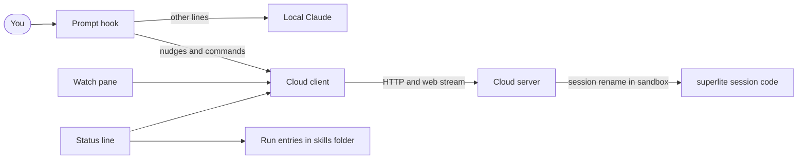
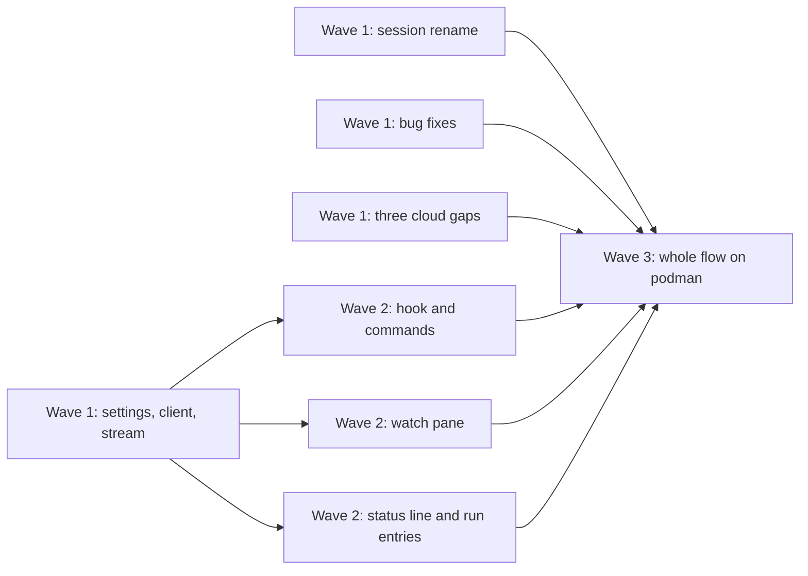

# Live cloud runs, superlite side: review plan

## Summary
This is the superlite half of the live cloud runs design you already approved (superlite-cloud `docs/plans/2026-11-15-cloud-live-runs.review.md`). The cloud half is built and in superlite-cloud PR #1. This half is what runs on your machine and inside each sandbox: `session rename`, the cloud client, the prompt hook, the watch pane, the slash commands, the status line and the run entries in the `/` list. It also fixes the four superlite bugs found while building the cloud half.

Nothing here changes what was approved: same commands, same behaviour, same order. The few things that are new (the bug fixes, `cloud.json`, the no-herdr fallback) are marked as new where they appear. It is built on `superlite/sessions/cloud-live-runs`, cut from the latest `origin/main` (e9798e8), and goes up as its own PR. Everything stays stdlib-only.

## What you will get
The same list as the approved design's "What you will get", for the parts that live in superlite:
- `superlite-cli session rename --slug login-fix --to login-fix-3` renames the session in the registry and its branch with `git branch -m`, in place. Uncommitted work is kept. The cloud calls it inside the sandbox.
- `superlite-cli cloud login` finds the address and token in this order: the command line, the project `.env`, `~/.superlite/.env`, then the clipboard (token only). It prints `logged in as chris (chris@example.com)` and never prints the token. It warns if the project `.env` holds a token git isn't ignoring, or if the address is plain http and not local. It installs the status line, keeping yours in front.
- `superlite-cli cloud logout` puts your old status line back exactly and removes every run entry it made.
- `/superlite:runs` lists your cloud runs (with `new · given by chris` marks) plus local runs. `--all` is for admins.
- `/superlite:watch <run>` opens the live view in a pane to the right, with its own input line for nudges, `/approve` and `/cancel`. It replays from the start if the run has finished. A dropped connection reconnects and resumes after the last event it saw. When the run ends, the pane shows the result.
- The watch pane shows who steered the run (`nudge from sam: run the tests first`) and any rename (`renamed login_fix to login_fix_3: branch taken on origin`, also on the status line). After a give, the giver's pane and attach mode end with `login_fix given to pat (pat@example.com)`.
- `>> text` nudges your current run, and `>>login_fix text` or `>>chris/login_fix text` nudges a named one. Each shows `→ login_fix`. Claude never sees these lines.
- `/superlite:attach <run>` sends every line to the run until `/superlite:detach` or the run ends. A line starting with `\` goes to Claude.
- `/superlite:give <run> <email>` gives a run away.
- The status line shows `login_fix running · step 14 · editing api.py`, `ATTACHED login_fix`, and `new: login_fix from chris`. It costs no tokens.
- Each live run you may open gets a command file in `~/.claude/skills/` (folders `superlite-attach-<run>` and `superlite-watch-<run>`), so it shows in the `/` list, with its state as the description, for example `/superlite:attach-login_fix  running · step 14 · claude`. An admin also sees other people's runs as `/superlite:attach-chris.login_fix`. The status line keeps them current, and picking a run that has just ended says `login_fix has ended` and adds nothing to the conversation. Superlite only touches files it made.

## How it fits together

The hook stays fail-open. A normal line costs one prefix check in bash, and Python starts only for a line that starts with `>>`, `/superlite:attach`, `/superlite:detach`, `/superlite:runs`, `/superlite:watch` or `/superlite:give`, or when you are attached. A nudge that fails to send is still blocked, so it never reaches Claude, and the hook shows the error.

## What will be built
| Part | What it does | Size |
|---|---|---|
| Session rename | `session rename --slug --to`: checks the new slug is free, renames the branch with `git branch -m`, updates the registry entry, refuses an unknown slug | S |
| Settings and login | Reads `.env` files and the clipboard, saves the address and token in `~/.superlite/cloud.json` (mode 600), warns on a tracked `.env` and plain http, prints who you are | S |
| HTTP client | Stdlib calls for the run list, status, nudge, give, approve, cancel and attach; errors become short messages | S |
| Stream reader | Reads the web stream, hands over each event, reconnects with backoff and asks for events after the last id | M |
| Prompt hook | The routing in the approved design's `on_prompt`, plus the attach state file; wired into `hooks/prompt` before the HUD | M |
| Watch pane | Renders events as short lines, reads its own input line, opens in a herdr pane to the right, or prints the command to run when there is no herdr | M |
| Slash commands | `commands/runs.md`, `watch.md`, `attach.md`, `detach.md`, `give.md`; the hook answers them first | S |
| Status line | Prints the run segment and `new:` notices; wraps your command; install and restore in `~/.claude/settings.json` | S |
| Run entries | Writes and removes `superlite-attach-*` and `superlite-watch-*` folders, each marked as superlite's own and `disable-model-invocation: true` | S |
| Plugin bug fixes | The four below | S |

**The four bug fixes** (new: not in the approved design; they came from building the cloud half):
1. **The review packet counts resolved incidents as open.** A file:line with several entries shows as "repeated" even when all are resolved. A group whose entries are all resolved stays out of the open list.
2. **No command marks an incident resolved.** Adds `superlite-cli incident resolve --file F --line N --evidence <run id>`. Today fixers edit the JSONL by hand.
3. **The probe for unreadable files fails on its second run.** It writes into the chmod-0 file it left last time. It removes the old file first and restores its permissions at the end.
4. **Generated regression tests need an ignored file.** They load `.superlite/probes/adapter.py`, which is gitignored and moved away by `finish`. The adapter is now written next to the tests, as `tests/regression/probe_adapter.py`, and the tests point there.

## Three small gaps on the cloud side
The approved design needs all three: login prints your handle and email, the status line reads the current run and its notices in one call, and opening a run marks its notice seen. PR #1 doesn't do these yet, so they're gaps in the cloud build, not new scope. They are small, and they are built on the PR #1 branch in the superlite-cloud worktree, as three follow-up tasks of this same build:
- `GET /api/me` returns `{"handle": "chris", "email": "chris@example.com", "role": "member", "workspace": "acme"}`, so login can say who you are.
- `GET /api/status` also returns your live runs, `{"runs": [{"name": "login_fix", "status": "running", "step": 14, "doing": "editing api.py", "agent": "claude"}], "notices": [...]}`. The status line needs the run state, and the run list route marks notices seen, which the status line must not do.
- Watch, attach and nudge mark that run's notice seen, as the design says. Today only listing runs does.

## How it gets built

- **Wave 1** builds the parts that need nothing else: `session rename`, the settings, HTTP client and stream reader, the four bug fixes, and the three cloud gaps. The client is tested against a small fake server that returns the cloud's own JSON examples.
- **Wave 2** builds the hook, the slash commands, the watch pane, the status line and the run entries against the client. (The design put the hook and status line in Wave 1. They move to Wave 2 here only because they call the client. What gets built is the same.)
- **Wave 3** runs the whole flow, live on podman, with the cloud image pointing at this branch: start a run, watch it, nudge each agent, attach, give, rename mid-run for each agent, push. It checks that the agent's superlite says "already open here" and opens no second session. It also tests the hook in the interactive prompt box, not just headless, with the plugin's `superlite:` command names. Then the approved design's "How we will know it works" list is checked for both repos.
- After that, a fresh final review covers this branch. Then the merge order from the design: this PR merges and is tagged first, superlite-cloud's `Dockerfile.worker` is pinned to the tag, and then PR #1 merges. Nothing is pushed or merged without your say-so.

## Decisions you can change
The design's own choices (the `>>` prefix, `\` for Claude, web stream plus POST, short events) stay as approved. These are new, small choices the design left open:
- Where login keeps the token: `~/.superlite/cloud.json` with mode 600 (default) | only in the `.env` files, read each time
- Watch pane outside herdr: print the command to run in another terminal (default) | open a new terminal window
- The three cloud gaps: added to PR #1 (default) | a separate small cloud PR
- Run the whole test suite at finish? No, affected tests only (default) | yes, once at finish

## Risks
- **The hook runs on every prompt.** Only the prefix check runs for normal lines, and any error lets the line through to Claude. Tests cover each prefix, `\`, attached and not attached, a failed send, and a normal line.
- **Your existing status line.** Login saves the exact old `statusLine` value, and logout writes it back byte for byte. A test round-trips settings with and without one.
- **Run entries in `~/.claude/skills/`.** Superlite writes only folders named `superlite-attach-*` or `superlite-watch-*` that hold its marker file, and removes only those. A folder without the marker is never touched. The design's open questions about the `superlite:` name and `/` filtering are still checked live in Wave 3. If either fails, `/superlite:attach` with no name opens a picker in the watch pane.
- **Renaming the branch the agent is on.** `git branch -m` keeps commits and uncommitted changes. Tests rename mid-work, with a dirty tree, and refuse a taken name.
- **The clipboard.** It is read with `pbpaste`, `wl-paste`, `xclip` or PowerShell, whichever exists. It is taken only when it looks like a token, and it is never printed.
- **The token on disk.** `cloud.json` is written with mode 600 and the token is never logged. A test greps all output for it.

## Out of scope
The same as the approved design. Also: no changes to how local runs work, and no new dependencies.

## How we will know it works
Every check in the approved design's list that touches superlite, plus:
- `session rename` on a dirty session keeps the changes, the registry and branch both show the new name, and a taken or unknown slug is refused.
- With no network, a nudge is blocked and shows an error. A normal line still reaches Claude.
- The bug fixes each get a regression test: an all-resolved repeated incident is not open; `incident resolve` marks entries resolved; the unreadable probe passes twice in a row; a generated regression test passes after `finish`.
- The affected superlite tests pass (or the whole suite, if you choose that above), and nothing outside the standard library is imported.

## Rough time and cost
About 35 to 55 minutes and $18 to $32 for the build (rough until the machine plan is linted), plus a few cents per agent for the live nudge checks in Wave 3.
