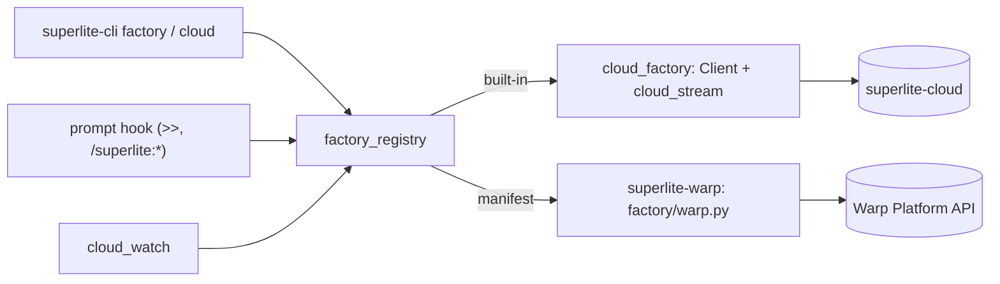

# Spec: factory-plugins

## Intent

superlite talks to one remote factory, superlite-cloud, through code that hardcodes its URLs, token and event shapes. Teams also run work on other factories, starting with Warp Factories. A factory should be a pluggable provider: superlite-cloud is built in, and other factories ship as separate plugins (first one: `superlite-warp`, its own repo). superlite can then list, dispatch, watch, steer and cancel runs on whichever factory is active, without knowing provider internals.

## Goals

- One provider contract (`factory_api`, API version 1) that every factory implements; superlite-cloud is the built-in provider.
- Discovery of provider plugins from installed Claude Code plugins and from `SUPERLITE_FACTORY_PATH`.
- A new dispatch verb (`send`) so superlite can start a run from a prompt or a plan file.
- A generic `--superlite` interface: a factory instance can be marked as having superlite installed, and `send --superlite` asks the remote agent to build with superlite. Warp environments can install custom Claude plugins, so a Warp factory with superlite installed is a supported target (setup in the superlite-warp README). Tests cover the request shape only. A real remote run is future work, because we can't assume Warp access.
- An active-factory switch; existing run commands (`runs`, `attach`, `detach`, `watch`, `give`, `>>` nudges) go to the active factory.
- Addressing: every factory is a named instance of a kind (provider type). You can have more than one per kind, for example `payments` and `web`, both `warp`. A run is addressed as `<factory>:<ref>`. Attaching, `>>` lines and per-run commands can name the factory, and each routed message says which factory and kind it went to.
- MCP as an optional agent channel: a kind may declare an MCP server in its manifest. superlite shows it in `factory list`, and `factory mcp <factory> on|off` adds or removes a Claude Code MCP entry for it. The superlite-cloud `/mcp` server is the built-in example. Scripts and hooks never use MCP; they use the provider contract only.
- Attach parity: a Warp run gets the same attach mechanism as a superlite-cloud run (attach state, plain lines and `>>` routed to the run, `/cancel`, auto-detach when the run is lost, the watch pane, the status line segment, and per-run `/superlite-attach-…` / `/superlite-watch-…` entries).
- `superlite-warp` plugin: Warp Factory API provider (dispatch to a factory, list, status, follow-ups, cancel, watch with state changes and conversation steps).

## Non-goals

- Standalone Warp agent runs (`POST /agent/runs` with `environment_id`).
- Publishing the GitHub repo or pushing anything.
- Changing superlite-cloud server code.
- Live tests against real Warp or superlite-cloud. We can't assume Warp access, so all e2e tests are hermetic.

## Constraints

- Stdlib only, Python >= 3.10 at runtime (launcher), 3.12 for tests; LF endings.
- FROZEN: `superlite-cli cloud <verb>` behaviour and output, `cloud_client.Client` method signatures, `~/.superlite/cloud.json`, `~/.superlite/attach.json` shape, `hooks/prompt` prefixes, every existing test.
- Tokens are never printed, logged or put in error text; config files are mode 0600.
- A broken or missing provider plugin never breaks superlite-cloud or any other command.
- Version bumps only through `scripts/bump-version.sh`; `skills/using-superlite/SKILL.md` stays <= 2000 chars.

## Done looks like

| # | Check |
|---|---|
| 1 | `superlite-cli factory list` prints `superlite-cloud (built-in)` and each discovered plugin with its path; the active one is marked `*`. |
| 2 | Every existing test passes; `superlite-cli cloud runs` output is byte-identical before and after. |
| 3 | `factory login warp --token wk-…` stores the token (0600) and prints no token; `factory use warp --target payments` resolves the factory via `GET /factory?search=payments` and prints its name and UID. |
| 4 | `factory send "Fix flaky test"` (or `--plan <file>`) on Warp calls `POST /factory/{uid}/runs` and prints run id, `queued` and the run URL; on superlite-cloud it calls `POST /api/tasks` with the origin repo. |
| 5 | `/superlite:runs` with Warp active lists runs with statuses mapped to `queued|running|waiting|done|failed|cancelled`. |
| 6 | `factory watch <ref>` on Warp prints each state change and each new conversation text/action line once, then exits after a terminal state. |
| 7 | While attached to a Warp run, `>> add a regression test` sends `POST /agent/runs/{id}/followups {"message": …}`; `/cancel` calls `/cancel`. |
| 8 | A verb a provider lacks (Warp `give`) prints `warp: give is not supported` and exits 2. |
| 9 | A plugin with a bad manifest shows as `error: <reason>` in `factory list`; all other factories still work. |
| 10 | Attached to a Warp run: plain lines go to it as follow-ups, `/superlite:detach` ends it, and a run that returns 403/404 detaches itself with one notice, exactly as for superlite-cloud. |
| 11 | The status line shows the attached run (whatever factory it is on) and the active factory's runs, and a Warp run that finishes or blocks raises one notice. |
| 12 | Each live Warp run gets `/superlite-attach-warp-<run8>` and `/superlite-watch-warp-<run8>` entries, which are removed when the run ends. |
| 13 | `/superlite:attach payments:1a2b3c4d` attaches to that run on the `payments` factory (kind `warp`), even if another factory is active. `>> web:9f8e7d6c also add a test` sends to a run on another factory without changing the attachment. A bare ref resolves on the attached factory first, then the active one. |
| 14 | When two or more factories are logged in, every routed line confirms its target, for example `→ payments (warp) 1a2b3c4d: follow-up sent`, and the status line segment shows `payments(warp)`. With only superlite-cloud logged in, the output is unchanged. |
| 15 | `factory mcp superlite-cloud on` adds a `superlite-cloud` entry to the project's `.mcp.json`. The entry points at `<cloud url>/mcp` and sends `Authorization: Bearer ${SUPERLITE_CLOUD_TOKEN}`, so the token itself is never written. `off` removes only that entry, and other entries stay byte-identical. |
| 16 | superlite-warp ships Warp Factory MCP (`https://app.warp.dev/api/v1/mcp/factory`, browser sign-in) in its plugin `.mcp.json`, plus a skill that says when to use MCP (pick up a task, hand it back, message the foreman) and when to use `superlite-cli factory`. |
| 17 | On an instance marked `superlite: true`, `send --superlite` (prompt or `--plan`) posts the core preamble followed by the text and calls `provider.send(…, superlite=True)`. On an unmarked instance it prints `<factory>: superlite is not enabled` and exits 2. |
| 18 | Hermetic e2e tests run `superlite-cli` and the prompt hook as subprocesses against fake Warp and superlite-cloud servers, and check the output, the exact requests received (method, path, auth header, body) and that no token leaks. No test calls real Warp or superlite-cloud. |

## Decided

- Contract = the existing `cloud_client.Client` methods (`me, status, runs, task, nudge, respond, cancel, give, attach`) plus `events(ref, after) -> Iterator[{id, kind, data}]`, `send(prompt, title=None, repo=None, base=None, superlite=False) -> run dict`, `name: str`, `caps: frozenset[str]`. Missing caps raise `factory_api.Unsupported`.
- Kinds come from plugins. Each plugin adds one kind, and superlite core has no kind-specific code beyond the built-in `superlite-cloud`. superlite finds a plugin's `superlite-factory.json` at the plugin root: `{"api": 1, "kind": "warp", "label": "Warp Factories", "module": "factory/warp.py", "entry": "create", "token_env": "WARP_API_KEY"}`. It then loads `module` and calls `entry(config: dict) -> provider` for each instance of that kind. The provider implements the generic contract above. superlite only talks to providers through that contract and `caps`, and never imports a plugin module by name.
- Store `~/.superlite/factories.json` `{"active": name, "factories": {name: {kind, token, target, target_name, superlite}}}` (`superlite` is optional, default false, set by `factory add|use … --superlite`). `factory add <name> --kind <kind>` creates an instance, and the first `factory use <kind>` creates an instance named after the kind. superlite-cloud is the instance `superlite-cloud` of kind `superlite-cloud` and keeps `cloud.json`.
- Address grammar: `<factory>:<ref>`, where `<factory>` matches `[a-z0-9-]+` and is a known instance name. Anything else is a bare ref. superlite-cloud refs (`t_…`, `name`, `handle/name`) never contain `:`, so they keep their meaning.
- Manifest optional `"mcp": {"name": str, "url": str, "auth": "oauth" | "bearer-env:<VAR>"}`. superlite-cloud's is `{"name": "superlite-cloud", "url": "<url>/mcp", "auth": "bearer-env:SUPERLITE_CLOUD_TOKEN"}`. `factory mcp` is opt-in and never on by default. MCP has no per-factory scopes (Warp) or token scopes (superlite-cloud), so `on` prints that warning.
- `attach.json` gains an optional `factory` key holding the instance name (absent = superlite-cloud), so existing files keep working.
- Per-run entry labels are `<instance>-<run8>` for plugin factories; superlite-cloud labels are unchanged.
- `superlite-warp` lives at `../superlite-warp`, a Claude Code plugin; marketplace `superlite-dev` lists it as `{"source":"github","repo":"iha2/superlite-warp"}`.

### Inside superlite-warp (the `warp` kind), not superlite

- Warp mapping: QUEUED/PENDING/CLAIMED -> queued, INPROGRESS -> running, BLOCKED -> waiting, SUCCEEDED -> done, FAILED/ERROR -> failed, CANCELLED -> cancelled. `nudge` and `respond` both send follow-ups. Run ref = `run_id` or its first 8 chars. Base URL `https://app.warp.dev/api/v1`, override `WARP_API_URL`. Auth `Authorization: Bearer <key>`; errors read RFC 7807 `title`/`detail`.
- Warp events: poll `GET /agent/runs/{id}` (state) and `GET /agent/runs/{id}/conversation?scope=full` (steps -> messages -> content blocks `text`, `action`) about every 10 s; emit `status {to}`, `text {text}`, `tool {tool, target}`.
- Notices: the Warp provider's `status()` compares run states with `~/.superlite/factory-warp-seen.json` and emits one notice per change into `done|failed|cancelled|waiting`.

## Left to the builder / plan

File split inside each repo, polling interval details, the dedup key for conversation blocks, CLI help text, test layout.

## Diagrams

