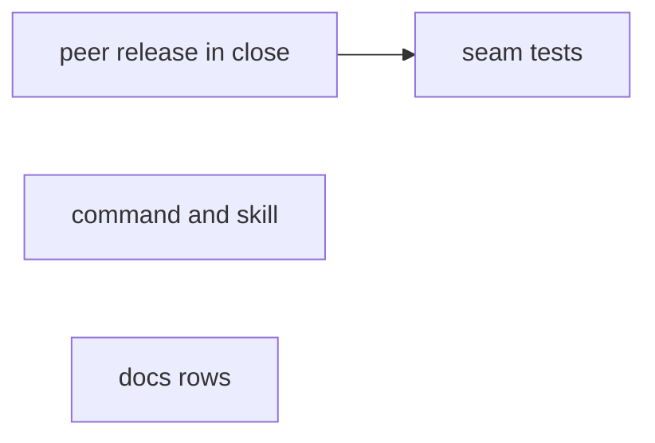

# /superlite:close: integration plan

**Review plan:** docs/plans/2026-11-23-close-session.feature.md
**Goal:** a slash command and skill that end a session without a merge, keeping or deleting its local branch on the user's answer; `session close` restores suspended peer plugins.
**Architecture:** one helper in `skills/swarm/scripts/session_close.py`; markdown command + skill; doc rows.
**Tech stack:** Python 3.10+, stdlib only; markdown.
**Spec:** docs/plans/2026-11-23-close-session.spec.md
**Detail:** contracts
**Full suite:** no
**Target-min:** 4

Global constraints:
- FROZEN: `session close` / `session discard` flags, output lines (`SESSION`, `ASK`, `session: closed`), exit codes (2 refuse, 4 ask); `exclusive.release` rule that peers stay off while another run is open.
- Ported from the sandbox, never merged: `close_patch.py` and `run_session.py` stay behind.
- Tests in `tests/scripts/`, run with `bash "$CLI" run_tests`.
- Ruling: inline build - 4 tasks over 9 small files on one chain, below the swarm threshold - cost: no parallel speed-up.

## Session

**Probe entry:** run=python skills/swarm/scripts/session.py

### T1 peer release in close · Complexity 2 · Est. context 20k
**Owns:** skills/swarm/scripts/session_close.py, tests/scripts/test_learn_wiring.py
**Components:** 1
**LOC owned:** 25
**Tests:** fast
**Kind:** design
**Model:** sonnet
**Produces:** session_close._park(live: Path, store: Path, j: Journal) -> None
**Review Focus:** release runs under the held registry lock; undo re-suspends on a failed close; all three park sites use it.

### T2 command and skill · Complexity 2 · Est. context 15k
**Owns:** commands/close.md, skills/close/SKILL.md
**Components:** 2
**LOC owned:** 60
**Tests:** fast
**Kind:** design
**Model:** sonnet
**Produces:** /superlite:close [slug | branch]
**Review Focus:** every `superlite-cli` call valid (`test_doc_contract.py`); never pushes; deletion only after the user's answer.

### T3 docs rows · Complexity 1 · Est. context 8k
**Owns:** assets/help.txt, README.md, docs/sessions.md, skills/shipping/SKILL.md
**Components:** 4
**LOC owned:** 6
**Tests:** fast
**Kind:** mechanical
**Model:** haiku
**Produces:** help and README rows for /superlite:close
**Review Focus:** help.txt stays within 80 columns.

### T4 seam tests · Complexity 2 · Est. context 15k
**Owns:** tests/scripts/test_session_close_peers.py
**Components:** 1
**LOC owned:** 110
**Tests:** fast
**Kind:** design
**Model:** sonnet
**Consumes:** session_close._park(live: Path, store: Path, j: Journal) -> None
**Produces:** test_close_host_with_open_run_restores_peers, test_close_owned_with_open_run_restores_its_peers, test_close_keeps_peers_off_while_another_run_is_open, test_close_keeps_branch_and_wip, test_delete_after_close_removes_branch_and_wip
**Review Focus:** acceptance checks 1, 3, 6, 7, 8 through the real CLI.
