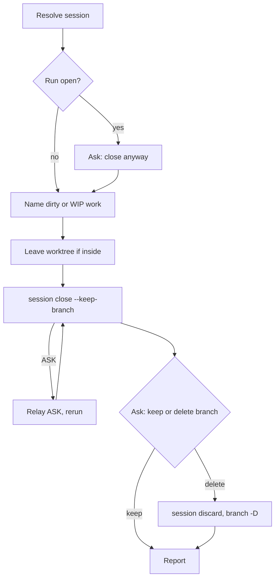

# Spec: close-session

## Intent

Superlite opens sessions (branch + worktree + run files) on its own, but the only way to end one by hand is `/superlite:merged`, which requires a merged PR. A user who abandons, parks or finishes a session without a PR has to call `superlite-cli session close` and git by hand. `/superlite:close` gives that a safe, guided command.

## Goals

- `/superlite:close [slug | branch]` ends one session without a merge: the session row goes, its run files are archived, a superlite-cut worktree is removed, the host checkout returns to the base branch.
- Keeps the local branch by default; offers once to delete it, showing what would be lost.
- Never loses work silently: uncommitted, untracked, parked (WIP ref) or unpushed commits are named before any destructive step.

## Non-goals

- No push, no remote branch delete, no PR open/close.
- No update of the base branch (that is `/superlite:merged`).
- No closing several sessions at once.
- No new `session close` semantics beyond what the gaps below need.

## Constraints

- Uses existing tools: `superlite-cli session status|close|discard`, `ExitWorktree`, git. Every `superlite-cli` call in the docs names a real tool and flag (`test_doc_contract.py`).
- `skills/using-superlite/SKILL.md` stays at most 2,000 characters (not edited).
- Under Claude Code, a Claude-created worktree is ended with `ExitWorktree`, never `git worktree remove`.
- `git branch -D` / `session discard` only after the user's explicit "delete" answer.

## Done looks like

| # | Check |
|---|---|
| A1 | `/superlite:close` with no argument, inside a session worktree, closes that session: `session status` no longer lists it, the worktree folder is gone, the branch still exists. |
| A2 | `/superlite:close <slug>` from the main checkout closes the named session the same way. |
| A3 | With uncommitted tracked edits, the edits are named first and end up in `refs/superlite/wip/<slug>`, not lost. |
| A4 | With untracked files, the user is asked the `ASK untracked` question (stash / keep) and nothing changes until they answer. |
| A5 | After closing, the user is asked once "Keep the branch" / "Delete local branch", with the count of commits not on the base and whether the branch has an upstream. |
| A6 | On "Delete local branch": the local branch and the WIP ref are gone; the remote branch is untouched. |
| A7 | On "Keep the branch" (default): the branch and any WIP ref remain. |
| A8 | A session with an open run is named as such and the user confirms before it is closed. |
| A9 | `/superlite:help` and the README list `/superlite:close`. |

## Decided

- Names: command `commands/close.md`, skill `skills/close/SKILL.md` (`name: close`).
- Close step is always `session close --slug <s> --keep-branch`; branch deletion is a separate, asked step via `session discard --slug <s>` then `git branch -D` if the branch remains.
- Default answer is keep.
- `session close` releases the peer suspension (`exclusive.release`) when it closes a session whose run was open, so superpowers and other peers load again. Today only `finish` does, and the hub's `.claude/settings.local.json` keeps them disabled after a host close.

| # | Check (CLI) |
|---|---|
| A10 | After `session close` on a session with an open, suspended run, `exclusive status` reports peers not suspended. |

## Left to the builder / plan

- Wording of questions and the report line.

## Diagrams

