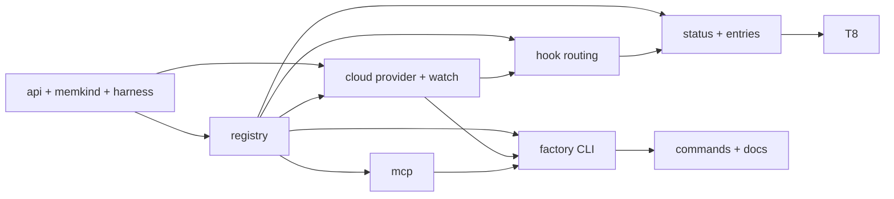

# Integration: factory plugins

**Goal:** Port the approved factory-plugins prototype into superlite: the pluggable factory contract, the built-in superlite-cloud provider, the `factory` CLI, `<factory>:<ref>` hook routing, the multi-factory status line and entries, `factory mcp`, `--superlite`, commands and docs, with every existing test passing.
**Architecture:** New modules in `skills/swarm/scripts/` next to the `cloud_*` modules they wrap (siblings on `sys.path`, as today). `cloud.py` delegates `hook` and `statusline` to the factory wrappers, which are byte-identical to `cloud_hook` and `cloud_status` while only superlite-cloud is logged in. A test-only in-memory kind (`tests/scripts/fixtures/memkind/`) stands in for plugin kinds. Warp specifics ship in the separate `superlite-warp` repo (its own build after this one).
**Tech stack:** Python stdlib, pytest, bash
**Spec:** docs/plans/2026-11-18-factory-plugins.spec.md
**Detail:** contracts
**Target-min:** 45
**Full suite:** yes
**Review plan:** docs/plans/2026-11-18-factory-plugins.feature.md

Spec coverage: Intent, Goals, Non-goals, Constraints, Done looks like, Decided, Left to the builder / plan, Diagrams apply. "Inside superlite-warp (the `warp` kind)" is the follow-up superlite-warp build; core only ships the marketplace entry and the generic contract.

## Global constraints

- language: python; P = `.superlite/sandboxes/factory-plugins/factory-plugins` in the main checkout `/mnt/c/Users/CWogu/source/repos/superlite` (the approved prototype, read-only). Port each module from `P/core/<same name>.py`, keeping its behaviour and the five live-test fixes (F-T1/T4/T5/T0 superlite flag, preamble, error lines, title names; F-T6-4 attach check; F-T8-5 mcp off). Drop `_paths` (scripts already import siblings from their own dir).
- test command: `python -m pytest tests/scripts -q -n auto`
- FROZEN: `cloud <verb>` output, `cloud_client.Client` signatures, `cloud.json`, `attach.json` `{run,id}` (+ optional `factory`; absent = superlite-cloud), `hooks/prompt` prefixes, `project_config.KEYS`. With only superlite-cloud logged in, hook, watch and status output are byte-identical to today; every existing `tests/scripts/test_cloud_*.py` passes unchanged.
- Run dict: `{id, name, status, owner, agent, title, url, created}`, status in `queued|running|waiting|done|failed|cancelled`.
- Provider attrs: `name`, `caps` (frozenset), `nudge_word` ("nudge" for cloud), `_token`.
- `$SUPERLITE_HOME/factories.json` `{active, factories: {name: {kind, token, target, target_name, superlite}}, builtin_superlite}`, 0600. superlite-cloud keeps its token in `cloud.json`.
- Discovery: `$CLAUDE_HOME/plugins/installed_plugins.json` (user scope, or projectPath containing cwd) + `SUPERLITE_FACTORY_PATH`; a root with `superlite-factory.json` is a kind; load `module` by file path (importlib), never by name. A broken plugin never breaks another factory.
- Tokens never in stdout, stderr, errors or any file but the 0600 stores. Errors print `<factory>: <message>` and exit 1; unsupported / not enabled / usage exit 2; never a traceback.
- Acceptance tests are e2e: subprocess `bash skills/swarm/scripts/superlite-cli factory …` / `cloud hook` / `cloud statusline` against `cloud_fake` and the memkind fixture, asserting output and recorded requests. Network: 127.0.0.1 only. Stdlib; LF.

### T0 api, memkind fixture and e2e harness · Complexity 3 · Est. context 25k
**Owns:** skills/swarm/scripts/factory_api.py, tests/scripts/fixtures/memkind/superlite-factory.json, tests/scripts/fixtures/memkind/factory/memkind.py, tests/scripts/factory_e2e.py, tests/scripts/test_factory_api.py
**Components:** 2
**LOC owned:** 260
**Tests:** fast
**Model:** sonnet
**Est. time:** 4.0 min (2 components, about 260 LOC, fast tests)
**Consumes:** none
**Produces:** factory_api.FactoryError(message: str, status: int | None = None) · factory_api.Unsupported(factory: str, verb: str) · factory_api.require(provider, verb: str) -> None · factory_api.superlite_prompt(text: str) -> str · memkind.create(config: dict) -> object · factory_e2e.env(tmp_path, cloud_url: str | None = None) -> dict · factory_e2e.cli(args: list[str], env: dict, input: str | None = None, timeout: float = 20) -> object · factory_e2e.hook(prompt: str, env: dict, via: str = "factory") -> dict | None · factory_e2e.status_line(env: dict, via: str = "factory") -> str · factory_e2e.cloud_login(env: dict, url: str, token: str = "slc_test_tok") -> None
e.g. factory_api ported from P/core/factory_api.py: FactoryError subclasses cloud_client.CloudError, FactoryError("x", 404).status -> 404; str(Unsupported("mem", "give")) -> "mem: give is not supported"; require(p, "give") raises it when "give" not in p.caps; superlite_prompt("Fix") -> SUPERLITE_PREAMBLE + "\n\n" + "Fix" with the prototype's headless preamble text (Skill tool, superlite:using-superlite / superlite:start, `superlite-cli orchestrator set ai`)
e.g. memkind manifest {"api": 1, "kind": "mem", "label": "Memory factory (tests)", "module": "factory/memkind.py", "entry": "create", "token_env": "MEM_API_KEY", "mcp": {"name": "mem-factory", "url": "http://127.0.0.1:9/mcp", "auth": "oauth"}}
e.g. memkind.create({"name": "lab", "kind": "mem", "token": "mk-test", "target": "t1", "target_name": "lab", "superlite": False}) -> provider with caps {me,status,runs,task,nudge,respond,cancel,attach,events,send,target}, nudge_word "follow-up"; state lives in `$SUPERLITE_HOME/memkind-<name>.json` so subprocess calls share it; send("Fix flaky test") -> run {"id": "1a2b3c4d5e6f", "name": "1a2b3c4d", "status": "queued", ...} and records {"verb": "send", "prompt": ..., "superlite": ...}; ids are distinct per send; task("zzzz") -> FactoryError("lab: zzzz: not found", 404); events(ref) yields {"kind": "status", "status": "running"}, {"kind": "text", "text": "Looking at the test"}, {"kind": "tool", "tool": "run_command", "target": "pytest"}, {"kind": "status", "status": "done"} then stops; set_state helpers for tests via the state file
e.g. factory_e2e.env(tmp_path) -> env copy with SUPERLITE_HOME, CLAUDE_HOME, HOME under tmp, SUPERLITE_FACTORY_PATH=<abs tests/scripts/fixtures/memkind>, "_cwd" = a tmp git repo with origin git@github.com:acme/app.git; cli(["list"], env) runs `bash skills/swarm/scripts/superlite-cli factory list` in env["_cwd"]; hook(">> hi", env) -> parsed JSON of `superlite-cli factory_hook` fed {"prompt": ">> hi"}, or None; hook(..., via="cloud") uses `superlite-cli cloud hook`; status_line(env) -> stripped stdout of `superlite-cli factory_status` (via="cloud": `superlite-cli cloud statusline`); cloud_login writes cloud.json {"url", "token"} 0600
**Review Focus:** test_unsupported_text · test_require · test_superlite_prompt · test_error_is_clouderror · test_memkind_state_shared_across_processes
**Test code (contracts):** the Review Focus tests
**Steps:** 1 failing tests, 2 run: FAIL, 3 implement, 4 run: PASS

### T1 registry · Complexity 5 · Est. context 30k
**Owns:** skills/swarm/scripts/factory_registry.py, tests/scripts/test_factory_registry.py
**Components:** 1
**LOC owned:** 420
**Tests:** fast
**Model:** sonnet
**Est. time:** 5.0 min (1 component, about 420 LOC, fast tests)
**Consumes:** factory_api.FactoryError(message: str, status: int | None = None) (T0) · memkind.create(config: dict) -> object (T0)
**Produces:** factory_registry.discover(cwd: str | None = None) -> list[dict] · factory_registry.load_store() -> dict · factory_registry.save_store(store: dict) -> None · factory_registry.add(name: str, kind: str, target: str | None = None, superlite: bool = False) -> dict · factory_registry.use(name: str, target: str | None = None, superlite: bool | None = None) -> dict · factory_registry.active() -> str · factory_registry.kind_of(name: str) -> str · factory_registry.provider(name: str) -> object · factory_registry.logged_in() -> list[str] · factory_registry.resolve(address: str, attached: str | None = None) -> tuple[str, str] · factory_registry.superlite_enabled(name: str) -> bool
e.g. ported from P/core/factory_registry.py and P/tests/test_registry.py (warp fixtures become memkind): discover() with SUPERLITE_FACTORY_PATH=fixtures/memkind -> [{"kind": "superlite-cloud", "path": "built-in", "error": None}, {"kind": "mem", "label": "Memory factory (tests)", "path": "<abs>", "manifest": {...}, "error": None}]; bad manifest -> {"kind": "<folder>", "path": "<root>", "error": "manifest: missing \"module\""}
e.g. load_store() with no file -> {"active": "superlite-cloud", "factories": {}}; save_store writes 0600; use("superlite-cloud", superlite=True) stores builtin_superlite true and superlite_enabled("superlite-cloud") -> True
e.g. resolve("lab:1a2b3c4d") -> ("lab", "1a2b3c4d"); resolve("chris/login_fix", attached="lab") -> ("lab", "chris/login_fix"); resolve("nope:x") -> (active(), "nope:x"); provider("superlite-cloud") -> cloud_factory.create({"name": "superlite-cloud"}) (lazy import)
e.g. factory_registry.provider("lab") -> the memkind provider for instance lab (module loaded by path, config {name, kind, token, target, target_name, superlite}); unknown name -> FactoryError("nope: no such factory")
e.g. factory_registry.discover() -> built-in superlite-cloud first, then each plugin kind found; a broken one carries "error"
e.g. factory_registry.logged_in() -> ["superlite-cloud", "lab"] when cloud.json has a token and lab has one
**Review Focus:** test_store_mode_0600 · test_broken_manifest_isolated (bad JSON, missing module, api 2, module raising on import) · test_installed_plugins_scope · test_address_grammar · test_provider_by_path · test_builtin_superlite_flag
**Test code (contracts):** the Review Focus tests plus test_discover_builtin_first · test_add_and_use · test_logged_in
**Steps:** 1 failing tests, 2 run: FAIL, 3 implement, 4 run: PASS

### T2 cloud provider and watch · Complexity 5 · Est. context 35k
**Owns:** skills/swarm/scripts/cloud_factory.py, skills/swarm/scripts/factory_watch.py, tests/scripts/test_cloud_factory.py, tests/scripts/test_factory_watch.py
**Components:** 2
**LOC owned:** 380
**Tests:** fast
**Model:** sonnet
**Est. time:** 5.0 min (2 components, about 380 LOC, fast tests)
**Consumes:** factory_api.FactoryError(message: str, status: int | None = None) (T0) · factory_api.superlite_prompt(text: str) -> str (T0) · memkind.create(config: dict) -> object (T0) · factory_registry.provider(name: str) -> object (T1)
**Produces:** cloud_factory.create(config: dict) -> object · CloudFactory.send(prompt: str, title: str | None = None, repo: str | None = None, base: str | None = None, superlite: bool = False) -> dict · cloud_factory.origin_repo(cwd: str) -> str | None · cloud_factory.server_name(title: str | None) -> str | None · factory_watch.render(event: dict) -> str | None · factory_watch.run(provider, ref: str, after: int = 0) -> int
e.g. cloud_factory.create({"name": "superlite-cloud"}) -> CloudFactory on cloud.json url and token; no cloud.json -> FactoryError("superlite-cloud: not logged in")
e.g. ported from P/core/cloud_factory.py and P/core/factory_watch.py with their tests (warp cases become memkind): CloudFactory subclasses cloud_client.Client, name "superlite-cloud", nudge_word "nudge"; send("Fix", superlite=True) -> POST /api/tasks {"repo": origin_repo(cwd), "prompt": superlite_prompt("Fix"), "agent": "claude"} (preamble added once); server_name("SL Live Two!") -> "sl_live_two"; server_name("!!") -> None (name omitted)
e.g. factory_watch.render({"kind": "text", "text": "hi"}) -> "hi"; {"kind": "tool", "tool": "run_command", "target": "pytest"} -> "tool: run_command pytest"; other kinds -> cloud_watch.render output unchanged; run(memkind provider, ref) prints each event once and returns 0 at a terminal status
**Review Focus:** test_cloud_send_body · test_superlite_preamble_once · test_server_name · test_watch_terminal_exit · test_render_matches_cloud_watch
**Test code (contracts):** the Review Focus tests plus the ported prototype tests
**Steps:** 1 failing tests, 2 run: FAIL, 3 implement, 4 run: PASS

### T6 factory mcp · Complexity 3 · Est. context 20k
**Owns:** skills/swarm/scripts/factory_mcp.py, tests/scripts/test_factory_mcp.py
**Components:** 1
**LOC owned:** 200
**Tests:** fast
**Model:** sonnet
**Est. time:** 3.0 min (1 component, about 200 LOC, fast tests)
**Consumes:** factory_registry.discover(cwd: str | None = None) -> list[dict] (T1) · factory_registry.kind_of(name: str) -> str (T1)
**Produces:** factory_mcp.on(name: str, project: str) -> str · factory_mcp.off(name: str, project: str) -> str
e.g. ported from P/core/factory_mcp.py and P/tests/test_mcp.py: on("superlite-cloud", proj) -> "superlite-cloud: MCP on in .mcp.json (MCP acts with the account's full permissions)", entry {"type": "http", "url": "<cloud url>/mcp", "headers": {"Authorization": "Bearer ${SUPERLITE_CLOUD_TOKEN}"}}; on("lab", proj) uses the memkind manifest mcp entry; off removes only its entry and deletes .mcp.json when it is left with no servers and no other keys
**Review Focus:** test_no_token_in_file · test_off_keeps_other_keys · test_off_removes_file_it_created
**Test code (contracts):** the Review Focus tests
**Steps:** 1 failing tests, 2 run: FAIL, 3 implement, 4 run: PASS

### T3 factory CLI · Complexity 6 · Est. context 50k
**Owns:** skills/swarm/scripts/factory.py, tests/scripts/test_factory_cli_e2e.py
**Components:** 1
**LOC owned:** 700
**Tests:** fast
**Model:** sonnet
**Est. time:** 6.0 min (1 component, about 700 LOC, fast tests)
**Consumes:** factory_registry.provider(name: str) -> object (T1) · factory_registry.resolve(address: str, attached: str | None = None) -> tuple[str, str] (T1) · factory_registry.superlite_enabled(name: str) -> bool (T1) · cloud_factory.create(config: dict) -> object (T2) · factory_watch.run(provider, ref: str, after: int = 0) -> int (T2) · factory_mcp.on(name: str, project: str) -> str (T6)
**Produces:** factory.main(argv: list[str] | None = None) -> int
e.g. ported from P/core/factory.py and P/tests/test_e2e_cli.py (warp cases become memkind `lab`): `superlite-cli factory list` -> "* superlite-cloud (built-in)  logged in" plus "  mem  <path>"; with superlite-cloud only, `factory runs` output == `cloud runs` output byte for byte
e.g. `factory login lab --token mk-test` -> "lab: logged in" (no token anywhere in output); `factory send "Fix flaky test"` on lab -> "1a2b3c4d queued <url>"; `factory give <ref> a@b.c` on lab without give -> "lab: give is not supported", exit 2; `send --superlite` on a factory not marked -> "lab: superlite is not enabled", exit 2; a server error -> "superlite-cloud: <message>", exit 1, no traceback
**Review Focus:** test_cloud_runs_identical · test_no_token_leak · test_unsupported_exit_2 · test_error_line_no_traceback · test_superlite_send_preamble
**Test code (contracts):** the Review Focus tests plus the ported prototype CLI e2e tests
**Steps:** 1 failing tests, 2 run: FAIL, 3 implement, 4 run: PASS

### T4 hook routing · Complexity 6 · Est. context 50k
**Owns:** skills/swarm/scripts/factory_hook.py, tests/scripts/test_factory_hook_e2e.py
**Components:** 1
**LOC owned:** 560
**Tests:** fast
**Model:** sonnet
**Est. time:** 6.0 min (2 components, about 600 LOC, fast tests)
**Consumes:** factory_registry.resolve(address: str, attached: str | None = None) -> tuple[str, str] (T1) · factory_registry.provider(name: str) -> object (T1) · factory_registry.logged_in() -> list[str] (T1) · cloud_factory.create(config: dict) -> object (T2)
**Produces:** factory_hook.route(prompt: str) -> dict | None · factory_hook.attached_factory() -> str | None · factory_hook.main(argv: list[str] | None = None) -> int
e.g. factory_hook.attached_factory() -> "lab" when attach.json has {"factory": "lab"}; "superlite-cloud" when attach.json has no factory key; None when not attached
e.g. ported from P/core/factory_hook.py and P/tests/test_e2e_hook.py (warp cases become memkind); tests drive it as `superlite-cli factory_hook` (T5 switches `cloud hook` over to it); with only superlite-cloud logged in every reply equals cloud_hook's for the same prompt
e.g. with superlite-cloud and lab logged in: `/superlite:attach lab:1a2b3c4d` -> block "→ lab (mem) 1a2b3c4d: attached"; a plain line -> "→ lab (mem) 1a2b3c4d: follow-up sent"; `>> superlite-cloud:chris/login_fix check` -> "→ superlite-cloud (superlite-cloud) chris/login_fix: nudge sent" and attach.json still names lab; attach to an unknown run -> block "not attached: <ref>: not found" and no attach.json; a 403/404 while attached -> one detach notice
**Review Focus:** test_cloud_only_identical · test_cross_factory_nudge_keeps_attachment · test_attach_unknown_run_blocked · test_auto_detach_on_404 · test_backslash_passthrough
**Test code (contracts):** the Review Focus tests plus the ported prototype hook e2e tests
**Steps:** 1 failing tests, 2 run: FAIL, 3 implement, 4 run: PASS

### T5 status line, entries and delegates · Complexity 5 · Est. context 40k
**Owns:** skills/swarm/scripts/factory_status.py, skills/swarm/scripts/cloud.py, tests/scripts/test_factory_status_e2e.py
**Components:** 1
**LOC owned:** 420
**Tests:** fast
**Model:** sonnet
**Est. time:** 5.0 min (1 component, about 420 LOC, fast tests)
**Consumes:** factory_registry.logged_in() -> list[str] (T1) · factory_registry.provider(name: str) -> object (T1) · factory_hook.attached_factory() -> str | None (T4)
**Produces:** factory_status.segment() -> str · factory_status.sync_entries(skills_dir: str) -> list[str] · factory_status.main(argv: list[str] | None = None) -> int
e.g. ported from P/core/factory_status.py and P/tests/test_e2e_status.py; cloud.py `_DELEGATES` becomes {"watch": "cloud_watch", "statusline": "factory_status", "hook": "factory_hook"}; with only superlite-cloud logged in the status line == cloud_status output and `cloud hook` replies == cloud_hook's, byte for byte; tests/scripts/test_cloud_*.py and test_prompt_cloud.py pass unchanged
e.g. lab attached and running -> segment contains "lab(mem) 1a2b3c4d running"; a lab run finishing raises one notice; sync_entries creates `superlite-attach-lab-1a2b3c4d` and `superlite-watch-lab-1a2b3c4d` skill entries (marker .superlite-factory-entry) and removes them when the run ends; cloud entries are never touched
**Review Focus:** test_cloud_only_identical · test_cloud_hook_delegates · test_plugin_segment · test_entries_created_and_removed · test_notice_once
**Test code (contracts):** the Review Focus tests plus the ported prototype status e2e tests; run tests/scripts/test_cloud_status.py and test_cloud_entries.py too
**Steps:** 1 failing tests, 2 run: FAIL, 3 implement, 4 run: PASS

### T7 commands and docs · Complexity 3 · Est. context 25k
**Owns:** commands/send.md, commands/factory.md, commands/attach.md, commands/runs.md, commands/watch.md, commands/give.md, commands/detach.md, assets/help.txt, assets/intro.txt, docs/tools.md, README.md, .claude-plugin/marketplace.json, tests/scripts/test_factory_commands_md.py
**Components:** 2
**LOC owned:** 220
**Tests:** fast
**Model:** sonnet
**Est. time:** 4.0 min (2 components, about 220 LOC, fast tests)
**Consumes:** factory.main(argv: list[str] | None = None) -> int (T3)
**Produces:** commands/send.md and commands/factory.md (slash commands that run `superlite-cli factory send|<verb>`)
e.g. commands/send.md: "Send a run to the active factory" -> `bash "$CLI" factory send <text>` (`--plan`, `--superlite` documented); commands/factory.md lists list/add/use/login/logout/mcp; attach/runs/watch/give/detach mention `<factory>:<ref>` addresses and the active factory; help.txt, intro.txt, docs/tools.md and README gain the factory commands; marketplace.json lists {"name": "superlite-warp", "source": {"source": "github", "repo": "iha2/superlite-warp"}} like the existing claude-agent-map entry; existing test_cloud_commands_md.py still passes
**Review Focus:** test_send_and_factory_commands · test_marketplace_lists_warp · test_help_mentions_factory
**Test code (contracts):** the Review Focus tests
**Steps:** 1 failing tests, 2 run: FAIL, 3 implement, 4 run: PASS

### T8 delegate test follow-up · Complexity 1 · Est. context 8k
**Owns:** tests/scripts/test_cloud_cli.py
**Components:** 1
**LOC owned:** 15
**Tests:** fast
**Model:** sonnet
**Est. time:** 1.0 min (1 component, about 15 LOC, fast tests)
**Consumes:** factory_status.main(argv: list[str] | None = None) -> int (T5)
**Produces:** none
e.g. follow-up fix F-T5-1: test_delegates stubs cloud_watch, factory_hook, factory_status and asserts `cloud hook x` reaches factory_hook.main(["x"])
**Review Focus:** test_delegates
**Test code (contracts):** test_delegates
**Steps:** 1 failing tests, 2 run: FAIL, 3 implement, 4 run: PASS

## Self-review

- 8 tasks; T0 is Wave 0 (contract, test kind, harness). Every module is ported from the approved prototype, never merged; its fakes and `_paths` stay behind.
- Checks: 1, 3–6, 8, 9, 17 T3; 7, 10, 13, 14 T4; 11, 12 T5; 15 T6; 2 = the existing suite (T5 switches the delegates and runs the cloud tests); 16 and Warp-specific parts of 1, 3–8, 18 are the superlite-warp build; 18 core half = this suite.
