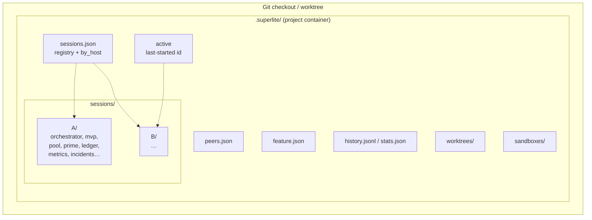
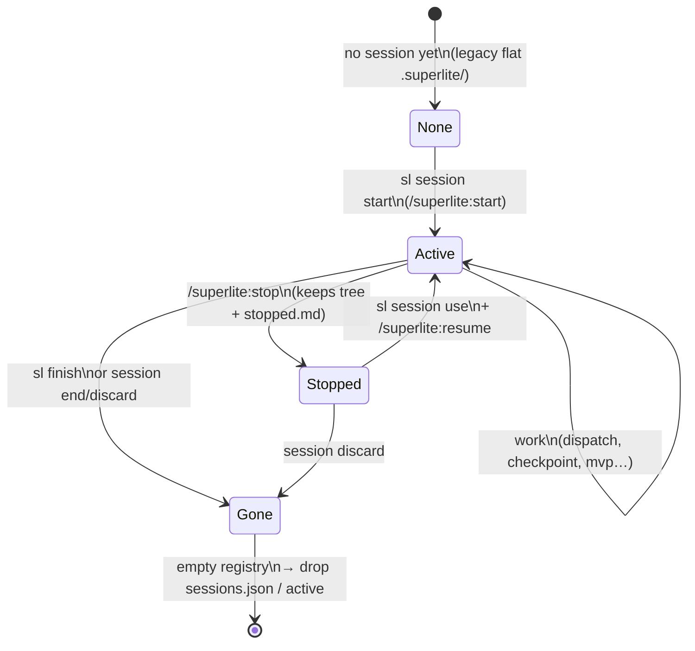
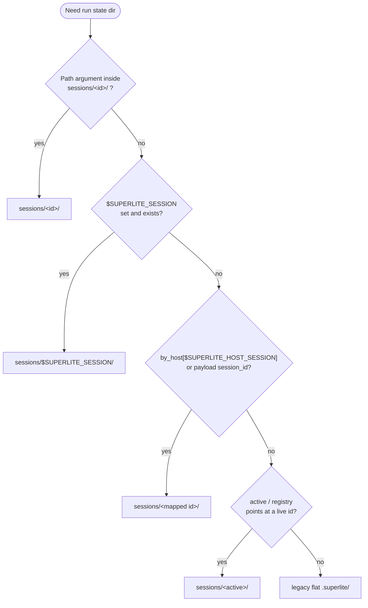
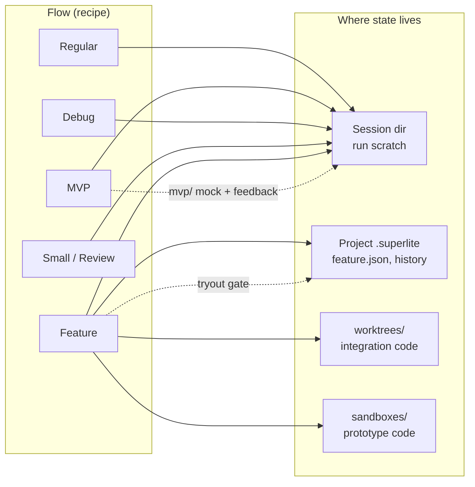
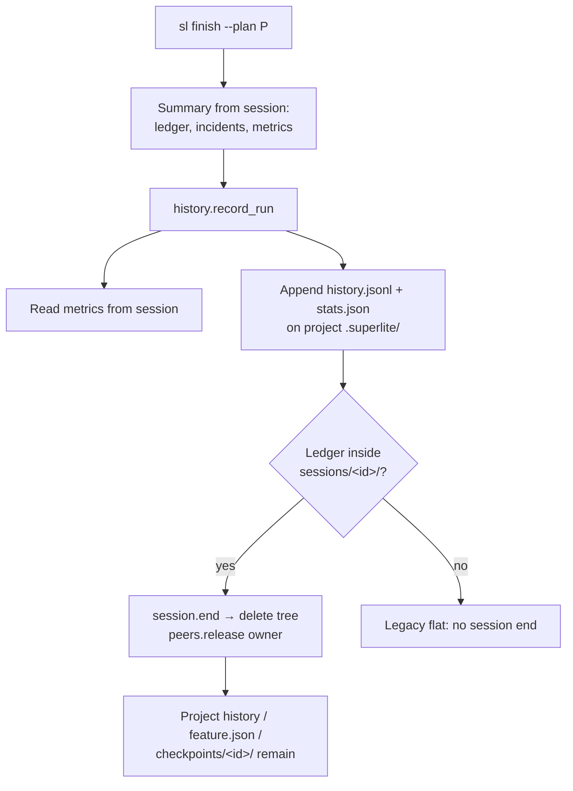

# Sessions

A **session** is one chat’s run-state folder inside a single checkout. It is **not** a git worktree.

Sessions exist so two superlite chats in the same folder do not overwrite each other’s orchestrator, MVP mock, pool, ledger, or metrics. Flows (regular, MVP, feature, debug, …) still decide *what* to do; the session only decides *where that run’s scratch state lives*.

| Concept | What it is | Typical path |
|---|---|---|
| Session | Per-chat run state | `.superlite/sessions/<id>/` |
| Project container | Shared project `.superlite` | `.superlite/` |
| Feature worktree | Integration checkout | `.superlite/worktrees/<topic>/` |
| Prototype sandbox | Tryout checkout | `.superlite/sandboxes/<topic>-proto/` |

## Layout



**Session-local** (deleted by `finish` / `discard`): orchestrator approval, ledger (`progress.md`), pool, prime, stable/dispatch, metrics, incidents, MVP `mvp/`, test summary, lint log.

**Project-shared** (survive finish): `feature.json`, `peers.json`, `worktrees/`, `sandboxes/`, cumulative `history.jsonl` / `stats.json`, checkpoint metadata under `.superlite/checkpoints/<session>/` (for post-finish `autocommit apply`).

## Lifecycle



Commands:

| Command | Effect |
|---|---|
| `sl session start [--host-session H]` | New id under `sessions/`; same host restarts end the previous tree first |
| `sl session path` / `status` | Resolve / describe the current state dir |
| `sl session list` | Every registered session (`*` = active) |
| `sl session use --id ID` | Point `active` + `SUPERLITE_SESSION` at another session |
| `sl session end` / `discard` | Delete that session tree; release peer ownership |
| `sl finish` | Summarize, then **always** end the session encoded in the ledger |
| `/superlite:stop` | Pause without deleting (resume later) |

## How a state directory is chosen

Tools and hooks pick one directory for the run. Order is fixed:



Hooks bind the native chat id from the payload (`session_id` / `conversation_id`) into `SUPERLITE_HOST_SESSION` when the env is unset, so chat A’s hooks do not write into chat B’s tree just because B is `active`.

## Two chats in one checkout

```mermaid
sequenceDiagram
  participant ChatA as Chat A
  participant ChatB as Chat B
  participant Reg as sessions.json
  participant SA as sessions/A/
  participant SB as sessions/B/

  ChatA->>Reg: start --host-session chat-a
  Reg->>SA: create tree, active=A
  ChatB->>Reg: start --host-session chat-b
  Reg->>SB: create tree, active=B
  Note over SA,SB: Both trees live side by side
  ChatA->>SA: MVP mock / ledger / metrics
  ChatB->>SB: its own MVP / ledger / metrics
  ChatA->>Reg: finish (ledger in sessions/A/)
  Reg->>SA: end A, release peers owner A
  Note over SB: B untouched
  ChatB->>Reg: finish
  Reg->>SB: end B; empty registry cleaned
```

Same host restart (`start --host-session chat-a` again) ends the previous A tree before creating a new one.

## Sessions vs flows



- **Regular / debug / small / review:** swarm state is session-scoped; no extra checkout.
- **MVP:** clickable prototype and feedback under `sessions/<id>/mvp/`. `finish` deletes that tree (copy out first if `keep_as_frontend`).
- **Feature:** session holds the *integration run*; the prototype still uses a **sandbox worktree** and project-level `feature.json` for the tryout gate.

## Finish and cumulative history



Lint and budget call `history.project_stats()` with the session dir; that helper resolves the **project container** so cumulative routing/duration stats stay visible after earlier finishes.

## Mental model

1. **Flow** = which recipe to run.  
2. **Session** = this chat’s scratchpad for that recipe.  
3. **Worktree / sandbox** = a separate git checkout when the recipe needs isolated *code*, not just isolated *run files*.
