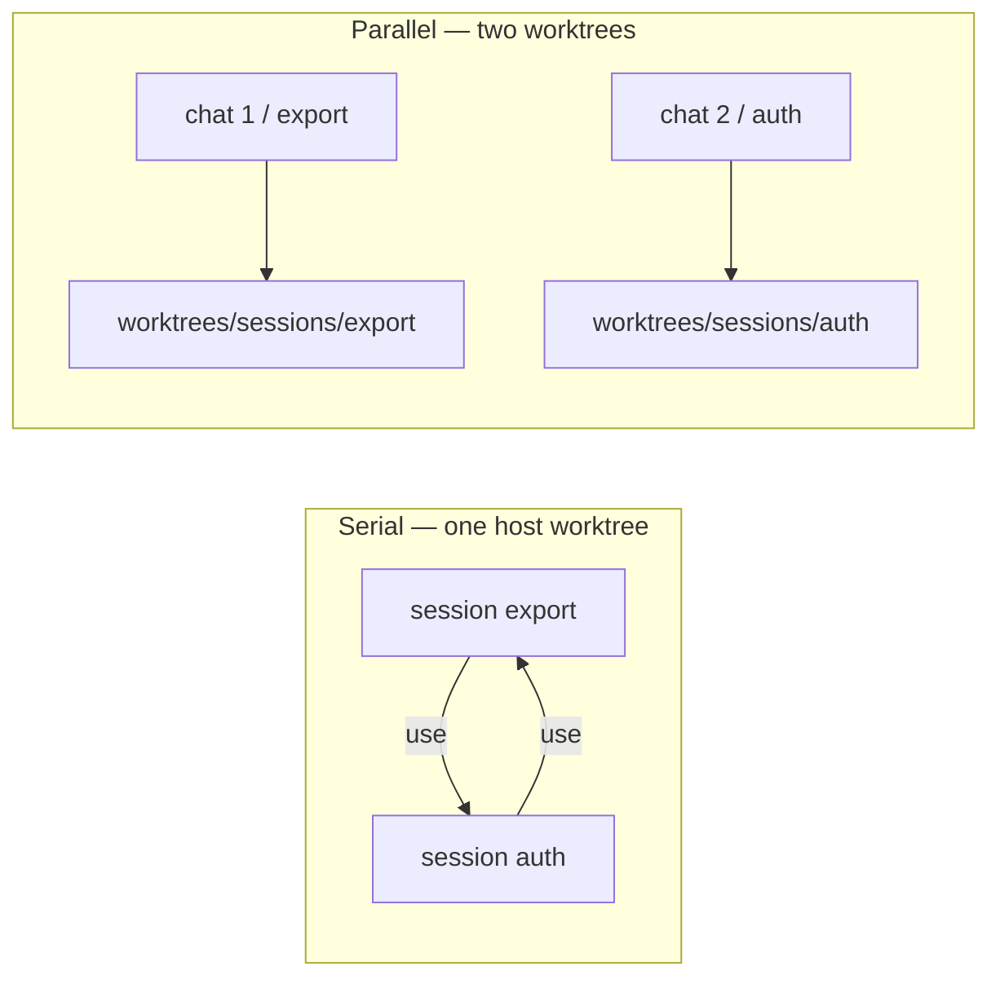
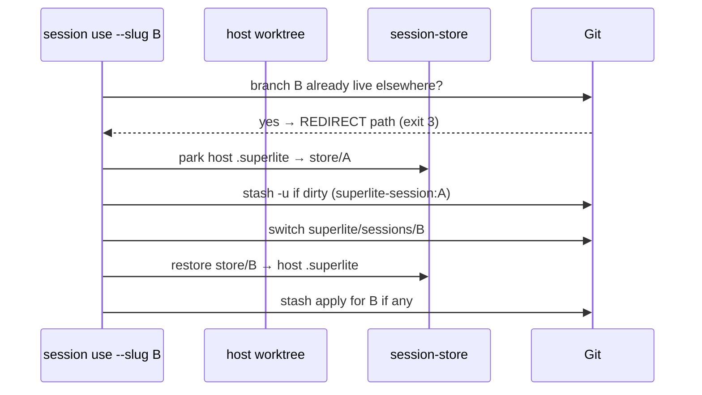
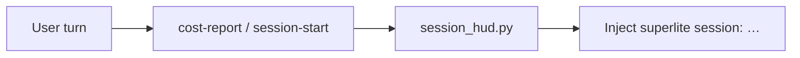

# Sessions (worktrees + branches)

A **session** is one line of work: a branch `superlite/sessions/<slug>`, parked run state under `.superlite/session-store/<slug>/`, and optional WIP stash. By default many sessions share one **host worktree** (saves space). A second worktree is only for **parallel** chats.

| Concept | Path / rule |
|---|---|
| Hub | Primary checkout on `main`; holds `sessions.json` + `session-store/` |
| Host worktree | `.superlite/worktrees/sessions/host` |
| Parallel worktree | `.superlite/worktrees/sessions/<slug>` |
| Branch | `superlite/sessions/<slug>` — one checkout only |
| Live run | Host’s `.superlite/` while that session is active |

## Why

Two chats in the same folder overwrite `.superlite/`. Sessions isolate via branches (serial) and worktrees (parallel).



## Switch rules (`sl session use`)



1. Park run state (stash does **not** hold ignored `.superlite/`).
2. Stash dirty project files with message `superlite-session:<slug>`.
3. Switch branch; restore store; apply stash (never silent `stash pop` on conflict).
4. If the branch is already checked out in another worktree → **REDIRECT** (do not check it out here).

## Commands

| Command | Effect |
|---|---|
| `sl session create --slug S` | Host worktree + branch; make active |
| `sl session create --slug S --worktree` | Parallel worktree + new branch |
| `sl session use --slug S` | Park/stash/switch or REDIRECT |
| `sl session split --new S [--keep K]` | Parallel: move open hub run + cut new worktree |
| `sl session status [--json]` | List sessions |
| `sl session discard --slug S` | Drop store/stash/branch; remove parallel tree |

## Session HUD

Each session-start / user turn injects:

```text
superlite session: export | branch superlite/sessions/export | worktree …/host | active | stash:no
```



Opt out: `SUPERLITE_NO_SESSION_HUD=1`. Wired through `hooks/cost-report` via `session_hud.py`.

## Start menu

**Start something new** (run in progress): prefer create + use on the host for serial work; choose **separate into worktrees** / `split` when a second chat must run at the same time. On `REDIRECT`, move the agent root to the printed path before inventing.

## Feature flow

Prototype sandboxes stay `.superlite/sandboxes/<topic>-proto`. Feature integration stays `.superlite/worktrees/<topic>` (not under `sessions/`). See [Feature flow](feature-flow.md).

## Tests

`tests/scripts/test_session.py`, `tests/scripts/test_session_split.py`.
