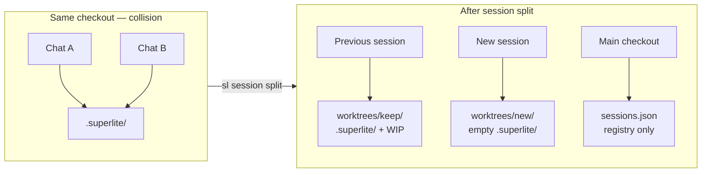
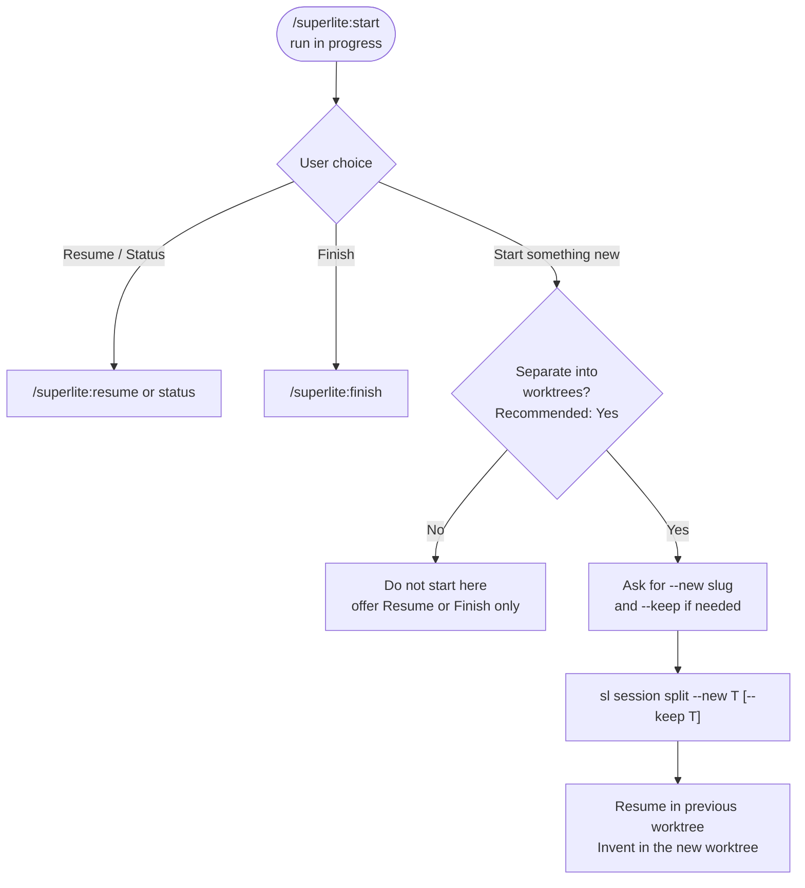
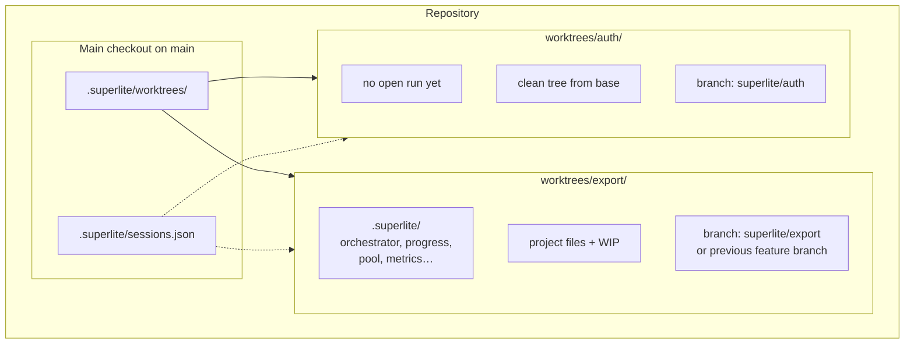
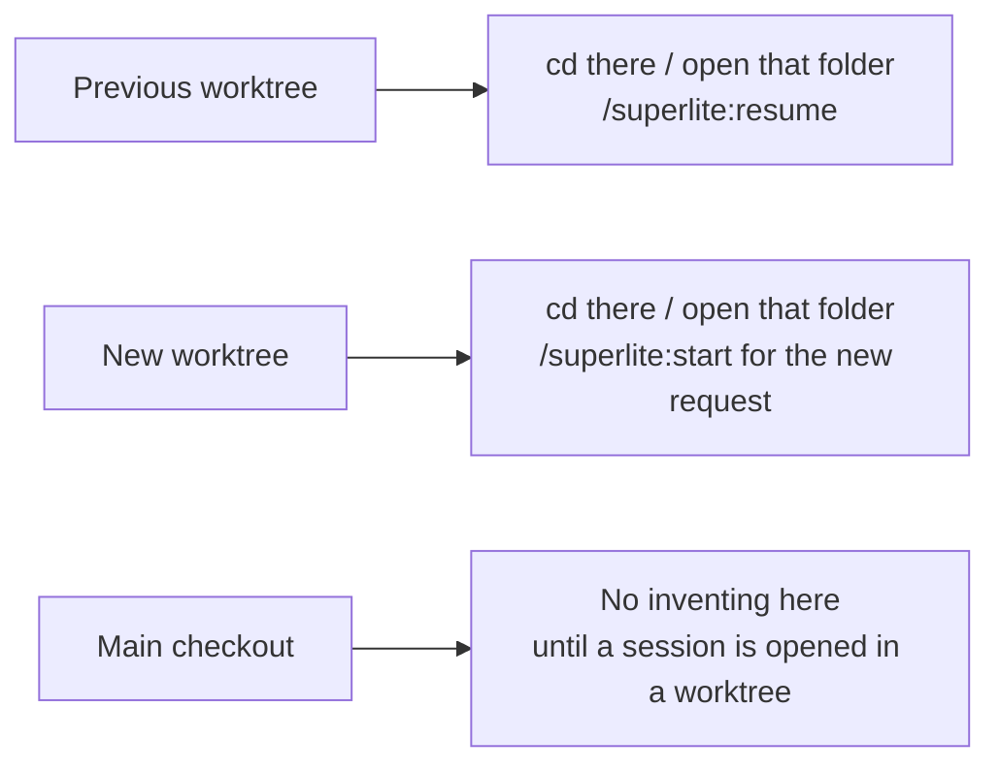
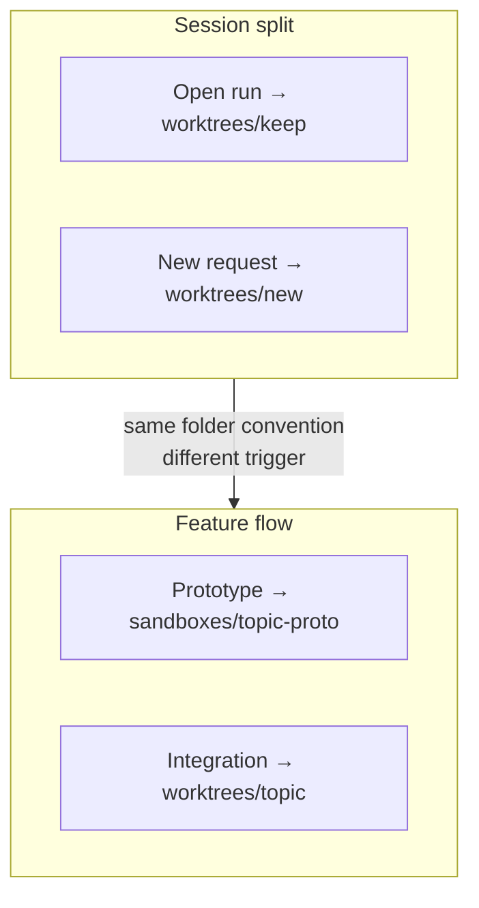

# Sessions (worktree split)

Two superlite sessions in the **same checkout** overwrite the same `.superlite/` tree (orchestrator, ledger, MVP mock, pool, metrics). The simple fix: when you already have a run open and want to start something else, separate the work into **git worktrees** so each session owns its own checkout and its own `.superlite/`.

This page describes that split. Feature-mode prototype sandboxes (`.superlite/sandboxes/<topic>-proto`) and integration worktrees (`.superlite/worktrees/<topic>` for a single feature build) stay as documented in [Feature flow](feature-flow.md); the session split reuses the same worktree folder for a different job: isolating a second *session*.

| Concept | What it is | Typical path |
|---|---|---|
| Open run | One session’s state in the current checkout | `.superlite/orchestrator.json` (+ ledger, pool, …) |
| Previous worktree | The open run, moved aside | `.superlite/worktrees/<keep>/` on its branch |
| New worktree | Fresh checkout for the next request | `.superlite/worktrees/<new>/` on `superlite/<new>` |
| Main checkout | Parked on `main`/`master` after a split | `.superlite/sessions.json` only (no open run) |

## Why split



Without a split, a second `/superlite:mvp` (or any other start) in the same folder replaces the first run’s files. With a split, each chat works in its own worktree.

## Start menu path

When the session-start hook reports **Project state: run in progress**, `/superlite:start` offers Resume, Status, **Start something new**, and Finish.



## What `sl session split` does

```mermaid
sequenceDiagram
  participant Main as Main checkout
  participant Keep as worktrees/keep
  participant New as worktrees/new

  Note over Main: Open run + optional WIP<br/>.superlite/orchestrator.json
  Main->>Main: Move .superlite aside; stash dirty work
  Main->>Main: Park on base branch (main/master)
  Main->>Keep: git worktree add (keep branch)
  Main->>Keep: Move .superlite into keep; stash pop
  Main->>New: git worktree add -b superlite/new
  Main->>Main: Write .superlite/sessions.json
  Note over Keep: Previous session lives here
  Note over New: Start the new request here
  Note over Main: No open run
```

Steps in order:

1. Refuse unless `.superlite/orchestrator.json` exists (nothing to move).
2. Resolve `--keep` (default: slug of the current branch) and `--new` (required); both must be short `a-z0-9-` slugs and differ.
3. Move the whole `.superlite/` tree to a temp folder; stash uncommitted work if any.
4. If the checkout is on the base branch, create `superlite/<keep>` at HEAD so main can stay on base. If it is already on a feature branch, check out base and keep that branch for the previous worktree.
5. `git worktree add .superlite/worktrees/<keep> <keep-branch>`, then move the parked `.superlite/` into that worktree and `stash pop` there.
6. `git worktree add -b superlite/<new> .superlite/worktrees/<new> <base>`.
7. Write `.superlite/sessions.json` on the main checkout listing both sessions.

## Layout after a split



Example registry:

```json
{
  "v": 1,
  "sessions": [
    {
      "topic": "export",
      "worktree": "/path/to/repo/.superlite/worktrees/export",
      "branch": "superlite/export",
      "role": "previous"
    },
    {
      "topic": "auth",
      "worktree": "/path/to/repo/.superlite/worktrees/auth",
      "branch": "superlite/auth",
      "role": "new"
    }
  ]
}
```

`sl session status` prints those rows; `--json` prints the file.

## Commands

| Command | Effect |
|---|---|
| `sl session split --new T [--keep T] [--base REF]` | Move the open run to a worktree and cut a new one |
| `sl session status [--json]` | List sessions recorded by the last split |

Wired from `commands/start.md` under **Start something new**. Tool one-liner: [Tools](tools.md).

## After the split



Move the agent root (or open a new harness session) into the worktree before inventing. Project state on the main checkout is no longer “run in progress” (no `orchestrator.json` there), so a mistaken start on main would begin a third run unless you split again or finish first.

## Relation to feature worktrees



- **Session split:** triggered when a second *session* would collide; both sides are full checkouts with their own `.superlite/`.
- **Feature prototype / integration:** triggered inside one feature flow; the prototype never touches the user’s checkout, and integration is one feature per worktree ([Feature flow](feature-flow.md), AGENTS.md).

## Tests

`tests/scripts/test_session_split.py` covers: move open run + WIP, derive `--keep` from `superlite/<slug>`, refuse without an open run or with bad slugs, and the start-command wording.
