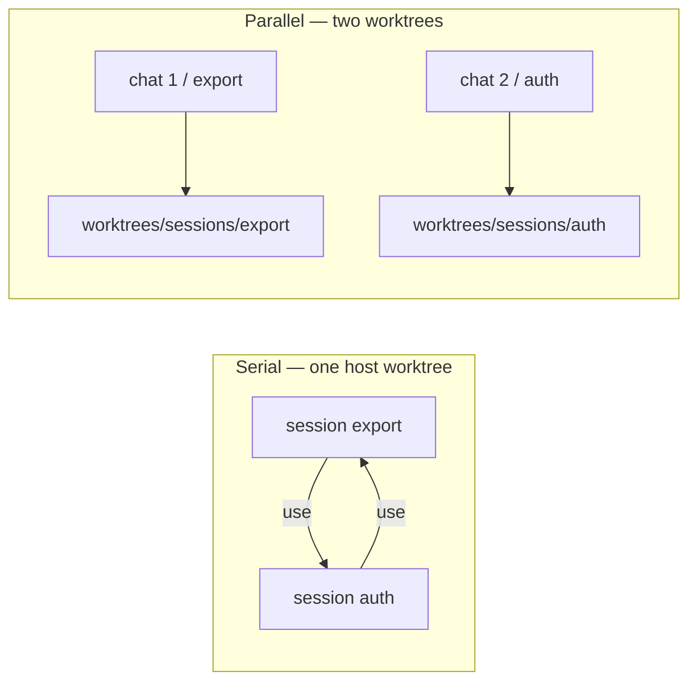
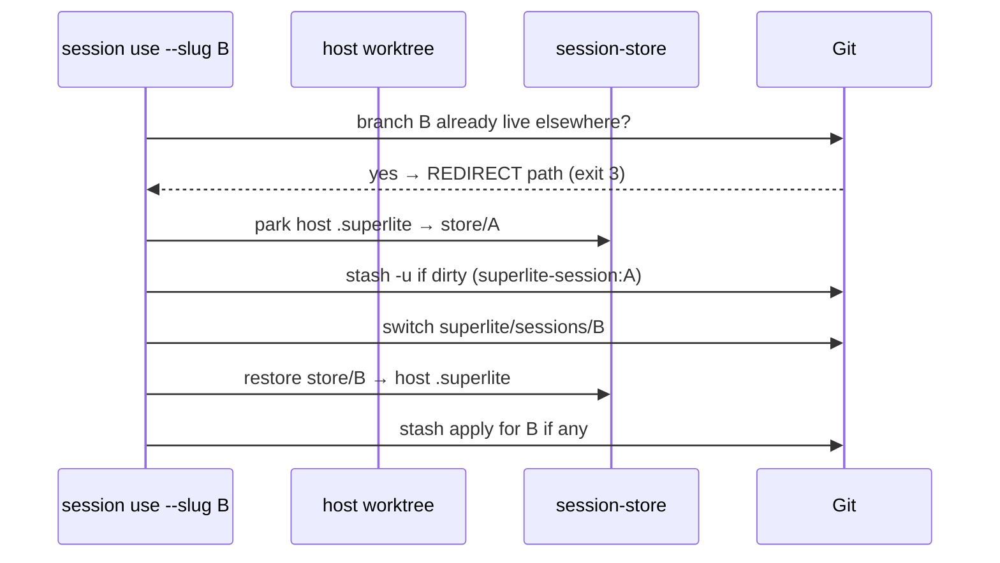
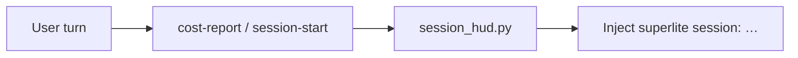

# Sessions (worktrees + branches)

A **session** is one line of work: a branch `superlite/sessions/<slug>`, parked run state under `.superlite/session-store/<slug>/`, and optional WIP stash. By default many sessions share one **host worktree** (saves space). A second worktree is only for **parallel** chats.

| Concept | Path / rule |
|---|---|
| Hub | Primary checkout on `main`; holds `sessions.json` + `session-store/`. Every `sl session` command finds it from any worktree of the repo |
| Host worktree | `.superlite/worktrees/sessions/host` |
| Parallel worktree | `.superlite/worktrees/sessions/<slug>` |
| Branch | `superlite/sessions/<slug>` (or the branch recorded for the slug) — one checkout only |
| Slugs | `a-z`, `0-9`, `-`; `host` is reserved |
| Live run | Host’s `.superlite/` while that session is active |

## Why

Two chats in the same folder overwrite `.superlite/`. Sessions isolate via branches (serial) and worktrees (parallel).



## Switch rules (`sl session use`)



1. Stash dirty project files (`superlite-session:<slug>`); the registry records the stash's object id, so `auth` never picks up `auth-api`'s stash.
2. Park run files (stash does **not** hold ignored `.superlite/`). Checkouts under `.superlite/sandboxes/` and `.superlite/worktrees/` never move.
3. Switch branch; restore store; apply the stash with `--index` (staged changes survive).
4. On a conflict the session stays active with `stash:yes`. Resolve the files, `git add` them, then `sl session use --slug S --continue`: it checks nothing is unmerged and drops the stash without re-applying it.
5. If the branch is already checked out in another worktree → **REDIRECT** (do not check it out here).

All registry writes take `.superlite/sessions.lock` and replace `sessions.json` atomically, so concurrent chats never lose each other's rows.

## Commands

| Command | Effect |
|---|---|
| `sl session create --slug S` | Host worktree + branch; make active (an existing slug: use `use`) |
| `sl session create --slug S --worktree` | Parallel worktree + new branch |
| `sl session use --slug S` | Park/stash/switch or REDIRECT |
| `sl session split --new S [--keep K]` | Parallel: move open hub run + cut new worktree. From a linked worktree (or when the base is busy elsewhere) the run stays where it is. Any failure rolls back run files, WIP and branches |
| `sl session status [--json]` | List sessions |
| `sl session discard --slug S [--keep-branch]` | Drop store/stash/branch; remove a parallel tree superlite cut. The active host session's uncommitted changes are discarded and the host is detached |

## Session HUD

Each session-start / user turn injects:

```text
superlite session: export | branch superlite/sessions/export | worktree …/host | active | stash:no
```



Opt out: `SUPERLITE_NO_SESSION_HUD=1` (independent of `SUPERLITE_NO_COST_REPORT`). Wired through `hooks/cost-report` and `hooks/session-start` via `session_hud.py`; it shows in a fresh session worktree before it has a `.superlite/`.

## Start menu

**Start something new** (run in progress): prefer create + use on the host for serial work; choose **separate into worktrees** / `split` when a second chat must run at the same time. On `REDIRECT`, move the agent root to the printed path before inventing.

## Feature flow

Prototype sandboxes stay `.superlite/sandboxes/<topic>-proto`. Feature integration stays `.superlite/worktrees/<topic>` (not under `sessions/`). See [Feature flow](feature-flow.md).

## Tests

`tests/scripts/test_session.py`, `tests/scripts/test_session_split.py`.
