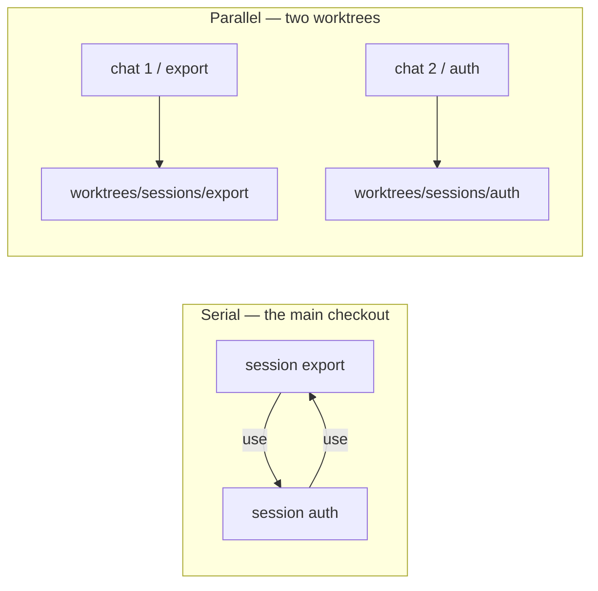
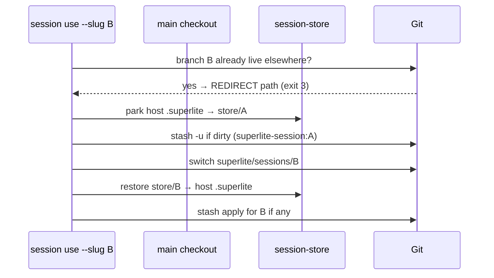
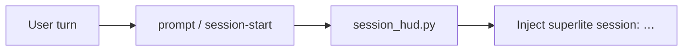

# Sessions (worktrees + branches)

A **session** is one line of work: a branch `superlite/sessions/<slug>`, parked run state under `.superlite/session-store/<slug>/`, and optional WIP stash. By default many sessions share one **host** (the main checkout; saves space). A second worktree is only for **parallel** chats.

| Concept | Path / rule |
|---|---|
| Hub | Primary (main) checkout; holds `sessions.json` + `session-store/`. Every `superlite-cli session` command finds it from any worktree of the repo |
| Host | The main checkout itself: its active session's branch is checked out right there. |
| Parallel worktree | `<hub>/.claude/worktrees/sessions-<slug>` (older rows under `.superlite/worktrees/sessions/` keep working) |
| Branch | `superlite/sessions/<slug>` (or the branch recorded for the slug) — one checkout only |
| Slugs | `a-z`, `0-9`, `-`; `host` is reserved |
| Live run | Host’s `.superlite/` while that session is active |
| `runs/` | `<hub>/.superlite/runs/`: archived runs, never moved by sessions |

## Why

Two chats in the same folder overwrite `.superlite/`. Sessions isolate via branches (serial) and worktrees (parallel).



## Switch rules (`superlite-cli session use`)



1. Stash dirty project files (`superlite-session:<slug>`); the registry records the stash's object id, so `auth` never picks up `auth-api`'s stash.
2. Park run files (stash does **not** hold ignored `.superlite/`). Checkouts under `.superlite/sandboxes/` and `.superlite/worktrees/` never move.
3. Switch branch; restore store; apply the stash with `--index` (staged changes survive).
4. On a conflict the session stays active with `stash:yes`. Resolve the files, `git add` them, then `superlite-cli session use --slug S --continue`: it checks nothing is unmerged and drops the stash without re-applying it.
5. If the branch is already checked out in another worktree → **REDIRECT** (do not check it out here).

All registry writes take `.superlite/sessions.lock` and replace `sessions.json` atomically, so concurrent chats never lose each other's rows.

## Commands

| Command | Effect |
|---|---|
| `superlite-cli session ensure --slug S` | Idempotent flow entry; see [Auto-start](#auto-start). Last line `SESSION worktree=<path> slug=<s> branch=<b>`; exit 3 `REDIRECT`, exit 4 `ASK untracked` or `ASK move` |
| `superlite-cli session ensure --slug S --branch B` | Session on an existing branch `B`: in place if `B` is checked out here (a finished session already on `B` is reopened, its uncommitted work kept), `REDIRECT` if checked out elsewhere (an unregistered checkout is registered as a session first), else a worktree on `B`; exit 2 if `B` does not exist. Registration copies existing run state to an unfinished archive and leaves it live |
| `superlite-cli session close --slug S [--keep-branch]` | End of flow: mark `S` finished, park it and put the host back on the base branch, remove a parallel worktree `ensure` cut |
| `superlite-cli session untracked [ask\|stash\|keep]` | Per-repo choice for untracked files (default `ask`); stored in the main checkout's `sessions.json` |
| `superlite-cli session create --slug S` | Branch on the host (the main checkout); make active (an existing slug: use `use`; asks before stashing untracked files) |
| `superlite-cli session create --slug S --worktree` | Parallel worktree + new branch |
| `superlite-cli session use --slug S` | Park/stash/switch or REDIRECT |
| `superlite-cli session split --new S [--keep K]` | Parallel: move open hub run + cut new worktree. From a linked worktree (or when the base is busy elsewhere) the run stays where it is. Any failure rolls back run files, WIP and branches |
| `superlite-cli session sync --slug S [--untracked stash\|keep] [--later]` | Fast-forward `S`'s branch to local main; see [Sync with main](#sync-with-main). Exit 4 `ASK untracked`, exit 2 when it would need a merge commit |
| `superlite-cli session status [--json]` | List sessions, each with `run:open` or `run:finished` |
| `superlite-cli session discard --slug S [--keep-branch]` | Drop store/stash/branch; remove a parallel tree superlite cut. The active host session's uncommitted changes are discarded and the host is detached |

## Auto-start

Every flow (start, regular, mvp, feature, debug, small, review, research) runs `superlite-cli session ensure --slug <topic>` once the topic is known, before its first other `superlite-cli` call. Nobody types `superlite-cli session create`. Exit codes: 0 ok, 2 error, 3 `REDIRECT`, 4 `ASK`. `SUPERLITE_NO_AUTO_SESSION=1` prints `session: auto-start off` and changes nothing.

| Where it runs | What `ensure` does |
|---|---|
| A checkout whose session is open | Preserve its run state; prints `session: <slug> already open here` |
| Main checkout, no active session or the active one is finished | `create` with the main checkout as host: branch `superlite/sessions/<topic>` from the current branch; a finished active session is parked first |
| Main checkout, active session still open | Moves the open session out (see [Move-out](#move-out)): asks `ASK move`, then it continues in `.superlite/worktrees/sessions/<old>` and the new topic takes the main checkout. Without a move the open session is untouched |
| Main checkout with a pre-existing run (`orchestrator.json`, no row) | Records it as the active open host session, then follows the row above |
| Unregistered linked worktree | Registers it where it is (`owned: false`), copying any existing run state to an unfinished archive and leaving it live to resume |

A taken slug gets `-2`, `-3`, and the slug it settled on is printed. Under Claude Code the command also prints `session: enter EnterWorktree path=<abs>` when the worktree is not the cwd: call `EnterWorktree` with that path. Elsewhere `cd` to the `SESSION worktree=<path>` (fallback).

**Claude Code creates the worktree.** When the hub is on the needed base, `ensure` / `create --worktree` print `session: create EnterWorktree name=<n> base=<ref>` and change nothing: call `EnterWorktree name=<n>`, then rerun the same command inside it; superlite adopts the worktree. First, `ASK branch-name slug=<s>: ...` asks once whether to keep `worktree-<slug>`, use `superlite/sessions/<slug>`, or a pattern with `{slug}`; rerun with `--branch-name worktree|superlite|PATTERN` (saved; change with `superlite-cli session branch-name`). If the hub is on another branch, superlite cuts the worktree itself, prints `session: note hub on <cur>, not <base>; superlite cut the worktree` and the `session: enter` line. The repo's `.claude/settings.json` sets `worktree.baseRef: head` so the cut starts from the hub's HEAD; it applies from the next Claude Code session start. End a Claude-created worktree with `ExitWorktree` `remove`; `session close` only archives and unregisters it.

**Run status.** Each `sessions.json` row has `run: "open" | "finished"` and `finished_at`. `ensure` and `create` set `open`; `superlite-cli finish` and `superlite-cli session close` mark `finished`. `status`, `use` and the HUD show `run:open` or `run:finished`; "run in progress" is shown only for an open run.

**Shipping merge.** When the main checkout hosts another open session, shipping merges in a temporary checkout of the base branch (`.claude/worktrees/merge-<base>`) and removes it, never switching the main checkout.

**Close.** `superlite-cli session close --slug S [--keep-branch]` ends a flow (shipping runs it from the main checkout): it marks `S` finished, parks its run files and switches the host back to the registry's base branch, and removes a parallel worktree that `ensure` cut. When that worktree held uncommitted work or run files, close parks them (stash + store) and keeps the row and branch even without `--keep-branch`; with `--untracked keep` the worktree stays in place. If the base branch is checked out in another worktree, close refuses and changes nothing.

**Untracked files** are stashed only with your OK, by `ensure`, `close`, `use` and `create` when it parks. `superlite-cli session untracked ask|stash|keep` sets the repo default; `--untracked stash|keep` overrides it per command. With `ask` the command changes nothing, prints `ASK untracked=<N> slug=<s>: <files>` and exits 4; the agent asks once (stash with the session, keep in the folder, always stash, always keep), runs `superlite-cli session untracked …` for an "always" answer, and reruns with `--untracked …`. `stash` names the files stashed. `keep` leaves them in the folder; if one would block the branch switch the command undoes everything and exits 2.

`superlite-cli orchestrator set` warns on stderr (`session: none for this checkout; run superlite-cli session ensure --slug <topic> first`) when the checkout has no session; it still exits 0.

## Move-out

When the main checkout holds an open session and a new flow starts, `ensure` does not touch it silently. It prints `ASK move slug=<s>: …` and exits 4; nothing changed. The agent asks "Move it" / "Not now"; on "Move it" it reruns `ensure` with `--move yes`. The open session moves to `.superlite/worktrees/sessions/<s>` (`session: moved <s> -> <path>`), its run files and WIP go with it, and any failure rolls back. The row records `base_sha` (the base branch tip when the session started), `moved_from` and `moved_at`. A session on the base branch itself stays in the main checkout (the base cannot be checked out twice); only the new session goes to its own worktree, with no `ASK move`. The main checkout's HUD then reads `superlite session: <s> moved to <path> — enter it (`EnterWorktree path=`; else `cd`)`.

## Sync with main

Each row records its own `base` (the branch it was cut from); sync, `status` and the HUD measure the row against that branch, and rows without it use the registry base. The HUD adds `| main:+N` when the local base has moved N steps ahead of the session's `base_sha`, plus a one-time offer line that starts with `superlite sync:`. The agent offers the update in that session's own chat; nothing is synced automatically. `superlite-cli session sync --slug S` is fast-forward only: when the branch cannot be fast-forwarded it prints `session: needs a merge commit; not synced` (exit 2) and leaves the branch untouched. `--later` records the offer as declined for the current main tip, so the offer line stops showing until main moves again; `main:+N` stays in the HUD. If untracked files block the update it prints `ASK untracked=<N> slug=<s>: <files>` and exits 4 (nothing changed); rerun with `--untracked stash|keep`.

Sync never runs `git fetch`, `push`, `pull` or `rebase`, and never makes a merge commit: it only uses the local main.

## Session HUD

Each session-start / user turn injects:

```text
superlite session: export | branch superlite/sessions/export | worktree …/host | active | stash:no | run:open
```

In the main checkout with no active session it reads `superlite session: none here (main checkout) | <N> sessions`.



Opt out: `SUPERLITE_NO_SESSION_HUD=1` (independent of `SUPERLITE_NO_COST_REPORT`). Wired through `hooks/prompt` and `hooks/session-start` via `session_hud.py`; it shows in a fresh session worktree before it has a `.superlite/`.

## Start menu

**Start something new**: `superlite-cli session ensure --slug <topic>` runs first (see [Auto-start](#auto-start)); follow its `SESSION` or `REDIRECT` line, and handle an `ASK` line (exit 4) as its `ask:` line says. `split` and serial `use` stay manual tools for moving a run or switching by hand. On `REDIRECT`, enter the printed path (`EnterWorktree path=` under Claude Code, else `cd`) before inventing.

## Feature flow

Prototype worktrees are `.claude/worktrees/<topic>-proto`, feature integration `.claude/worktrees/<topic>`; branches stay `superlite/...`. `ExitWorktree` never removes them: `session close` / `proto discard` do. Harness-made worktrees end with `ExitWorktree` or the app's cleanup. See [Feature flow](feature-flow.md).

## Tests

`tests/scripts/test_session.py`, `tests/scripts/test_session_split.py`, `tests/scripts/test_session_moveout.py`, `tests/scripts/test_session_sync.py`.
