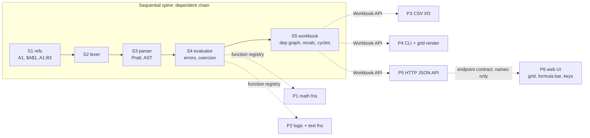

# minisheet: a cheap, short benchmark mixing sequential and parallel work

**Status:** draft for review, 2026-10-17 (rev 2: adds the HTTP API and web UI at the user's request)
**Suite:** **sitegen** (parallel-heavy, the existing regression task) + **minisheet** (sequential spine, parallel leaves and a UI). Both run each round.
**Budget per arm (minisheet):** target ≤ 25 min wall-clock and ≤ $8 API-equivalent; hard cap 45 min and $12, after which the run is scored as-is with `timed_out: true`. Revisit the caps once the round-2 sitegen data is in (superpowers took 34 min there).

## 1. Why this task

Anthropic's published orchestration benchmarks (a defect hunt over 14 packages, BrowseComp, DeepWideSearch) take 2–20 h and $225–$552 per run, which is unusable as an inner-loop benchmark. A mini spreadsheet engine is small (≈ 700 LOC of stdlib Python), deterministic to grade, and has a **dependency structure that mixes both regimes**:

- a **sequential spine**, where each stage consumes the previous stage's output types, so orchestration overhead buys nothing;
- **parallel leaves** that depend only on the spine's interfaces, so fan-out should win.

A good workflow serializes the spine and fans out the leaves. The benchmark measures whether it does.

P6 depends on P5 only through the pinned endpoint contract, so a names-only dependency lets both share a wave. P6's tests do run P5's code, so a strict workflow serializes them. Either schedule is defensible, and the scorer records which one each arm chose.

Ideal schedule: S1→S5 run serially (or inline by the orchestrator), then P1–P4 run as one parallel wave. The leaves' contracts are fixed in the SPEC, so P1/P2 could start right after S4's interface exists.

## 2. Scope (what the SPEC pins down)

| Unit | Contract (summary) | Hidden tests |
|---|---|---|
| S1 refs | `parse_ref("B12") -> (col=1, row=11)`, `$` flags, `A1:C3` → a rectangular ordered range; `to_a1` inverse. Columns go A..ZZ | 6 |
| S2 lexer | Tokens: number, string `"…"` (`""` escape), ref, range, name, operators `+ - * / ^ & = <> < <= > >= %`, `( ) ,`. Errors raise `FormulaSyntaxError(pos)` | 6 |
| S3 parser | Excel precedence: `:` > unary `-` > `%` > `^` (left-assoc, as in Excel) > `* /` > `+ -` > `&` > comparisons. Function calls take ≥ 0 args | 10 |
| S4 evaluator | Values are `float \| str \| bool \| Empty \| Error`. Coercion rules follow Excel: `""`→0 in arithmetic, `TRUE`→1. Errors are `#DIV/0!`, `#VALUE!`, `#REF!`, `#NAME?` and `#CIRC!`; an error propagates through operators. Comparisons are case-insensitive for strings | 12 |
| S5 workbook | `set(ref, raw)`, `get(ref) -> Value`, `raw(ref)`. Dependency graph with **incremental** recalc in topological order. A cycle marks every cell in the cycle `#CIRC!` and recovers when the cycle is broken. `recalc_count` is exposed so tests can assert minimal recomputation | 12 |
| P1 math | `SUM AVERAGE MIN MAX COUNT ROUND ABS`. Ranges skip text and empty cells (as Excel does); `AVERAGE` of nothing is `#DIV/0!` | 7 |
| P2 logic + text | `IF` (lazy branches), `AND OR NOT`, `CONCAT LEN UPPER LOWER LEFT RIGHT` | 7 |
| P3 CSV I/O | `load_csv(path, formulas=True)` and `save_csv(path, values=True)`. Round-trips quotes, commas and newlines; `=`-prefixed cells load as formulas | 5 |
| P4 CLI | `python -m minisheet` REPL with `set A1 =B1*2`, `get A1`, `show A1:C4` (fixed-width grid, right-aligned numbers, 2 dp), `load`, `save` and `quit`. Exit codes 0 / 2 | 5 |
| P5 HTTP API | `python -m minisheet serve --port N`. `GET /`, `GET/POST /api/cells` (POST returns `changed` = the cell + recalculated dependents), `GET/POST /api/csv`. JSON value encoding is pinned; 400/404 errors | 8 |
| P6 web UI | One vanilla `index.html`: a 26×50 grid of `td[data-ref]`, `#cell-name`, `#formula-bar`, `#status`, classes `selected`/`error`. Enter commits and moves down, Tab moves right, Esc reverts, arrows navigate, type-to-edit; dependents update in place without a reload | 10 |
| **Total** | | **88** |

**Out of scope:** formatting styles, multiple sheets, named ranges, dates, array formulas, multi-user editing, and undo (ladder10 covers undo).

**UI test harness:** the hidden tests start `serve` on a free port and drive headless Chromium via Python Playwright (`uv run --with playwright`, with Chromium installed once per machine). If the browser is missing, the UI tests count as **failed-infra** and are reported separately, never as passes.

## 3. Assets (built the same way as sitegen)

| Asset | Path | Built by |
|---|---|---|
| SPEC (≤ 15k chars, exact examples per rule) | `bench/tasks/minisheet/SPEC.md` | worker, from §2 |
| Reference implementation | `bench/tasks/minisheet/reference/` | worker A, from the SPEC only |
| Hidden tests (70) | `bench/tasks/minisheet/hidden_tests/` | worker B, from the SPEC only |
| Reconciliation | 88/88 against the reference; any disagreement is ruled against the SPEC | orchestrator |
| `task.json` | `{flow:"mvp", max_budget_usd:12, max_minutes:45, target_minutes:25, groups:{spine:[S1..S5], leaves:[P1..P4], service:[P5], ui:[P6]}}` | orchestrator |

## 4. What gets scored

| Metric | Source | Signal |
|---|---|---|
| Hidden pass rate, **split spine vs leaves** | junit, by test file | Correctness where chaining is hard vs where fan-out is easy |
| Wall-clock, cost, orchestrator cost share | result events (last per session) | Speed and spend |
| **Schedule shape** | dispatch timeline (logscan) | Spine serialized? Leaves overlapped? Count of spine dispatches made in parallel (a wasted fan-out) |
| Fix rounds on spine tasks | progress file and logs | Cost of splitting a dependent chain across agents |
| Stops-for-human, gates | harness | Unattended behaviour |
| `recalc_count` minimality tests | hidden S5 tests | Depth of design quality, not just correctness |

**Hypothesis to test:** the best arm does the spine inline (the orchestrator, or a single worker) and the leaves as one wave. Superpowers' serial per-task loop is slow on the leaves. A naive full fan-out is slow and error-prone on the spine.

## 5. Time-box enforcement

- `--max-budget-usd 5` per arm, plus a 15-min wall-clock kill in the harness. On a timeout the run is scored as-is, with `timed_out: true`.
- The SPEC stays under 15k chars, so plan writing stays at about 1 min.
- 3 reps per arm, run sequentially, alternating arm order.

## 6. Rulings

- Ruling: Python stdlib + pytest via uv, the same toolchain as sitegen, so the harness changes are only a `--task` path.
- Ruling: `^` is left-associative, as in Excel (`2^3^2 = 64`). That's a deliberate trap the SPEC states explicitly, and it checks spec-reading, not guessing.
- Ruling: there is no "mini Excel" benchmark in Anthropic's published material (searched 2026-10-17). minisheet is ours, shaped to reproduce the published finding at a small scale: orchestration pays on splittable bulk, not on dependent chains.

## Related
- Used by: [[2026-10-17-superlite-flows-design]] (benchmark additions)
- Project: [[Superlite]]

Hub: [[Specs index]]
