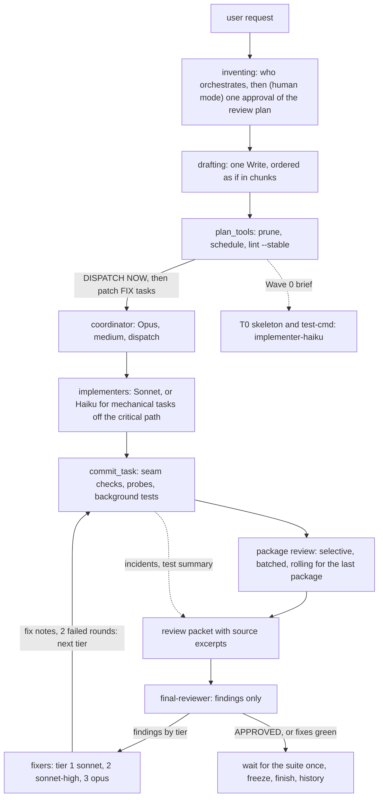
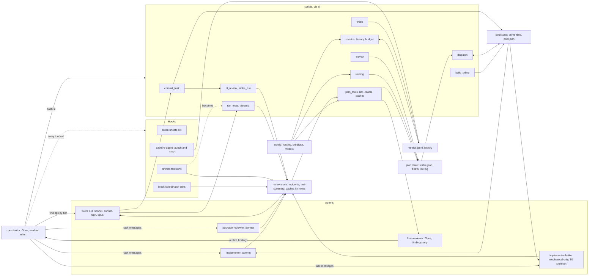
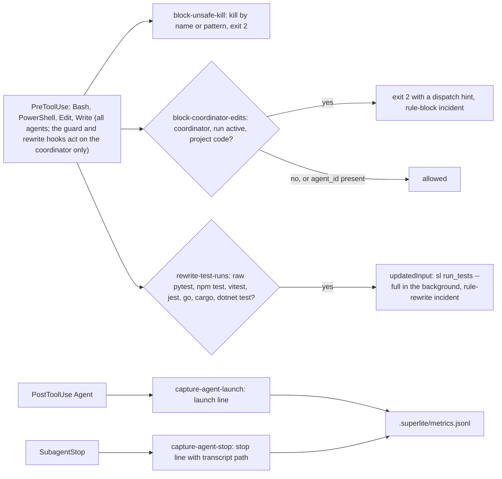
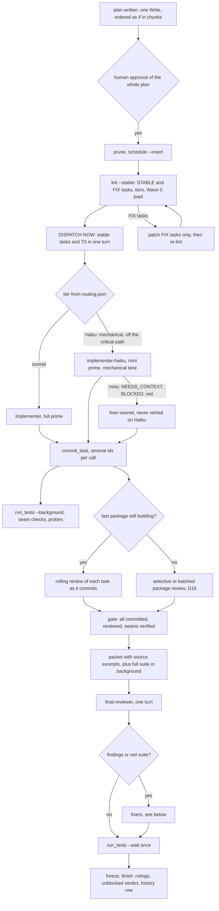
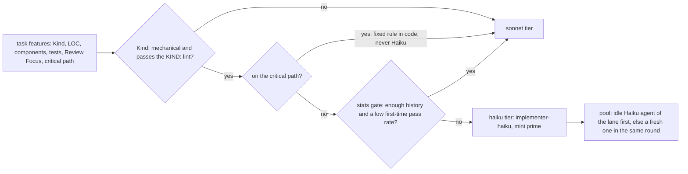
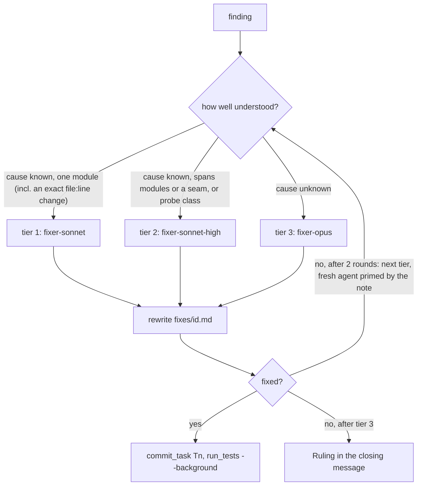
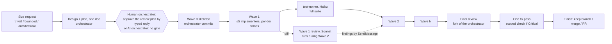
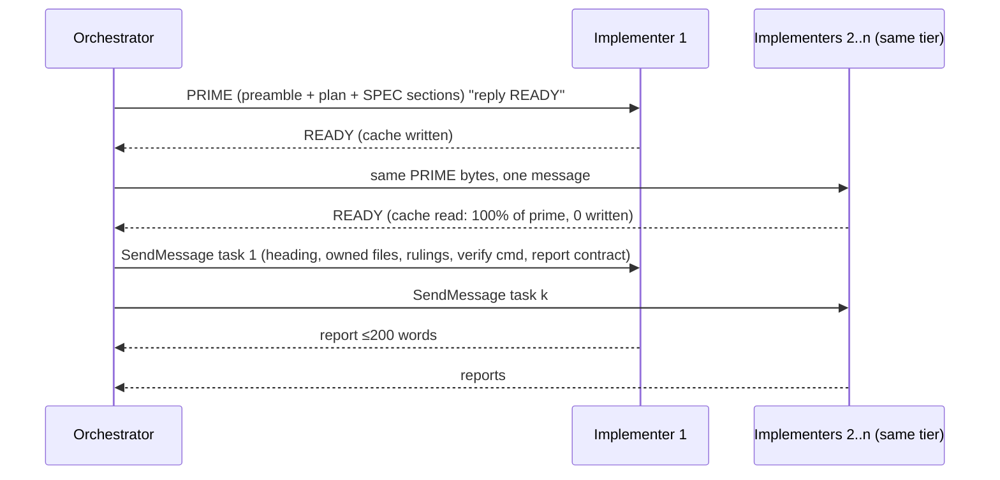

# Superlite — Architecture Design (rewrite)

## superlite 0.3.1 on one page (updated 2026-10-18, repo at 950bd9a)

Superlite is a Claude Code plugin that builds software with a coordinator, parallel subagents, scripts and hooks. Goal G2 is to beat its own 0.3 time by about half; the earlier comparison with superpowers (rep set v) stays as history. Detail: design §3.0, decisions §1 and §12.1, what changed and why §12.4, measurements §12.5, open risks §12.6, build status §12.7.

**Agents** (`agents/`, none can spawn agents: explicit tool lists)

| Agent | Model, effort | Job |
|---|---|---|
| implementer | sonnet, medium | builds one task, stays idle for reuse |
| implementer-haiku | haiku, high | builds one `Kind: mechanical` task literally (Wave 0 skeleton, small fully specified tasks) |
| package-reviewer | sonnet, medium | reviews a task or package, fixes its own findings |
| final-reviewer | opus, high | reads only the packet, returns findings only, tiers 1 to 3 |
| fixer-sonnet | sonnet, medium | tier 1: cause known (including a fully specified change), one module |
| fixer-sonnet-high | sonnet, high | tier 2: cause known, spans modules or a seam, or a known probe class |
| fixer-opus | opus, high | tier 3: cause unknown, or lower tiers failed |

`fixer-haiku` (the former tier 1) was removed in D39: Haiku must not fix, because a fix keeps a decision.

**Hooks** (`hooks/`, bash builtins only, fail open; D40)

| Hook | Event | Effect |
|---|---|---|
| block-unsafe-kill | PreToolUse Bash, PowerShell | blocks kills by process name or pattern; PID kills pass |
| block-coordinator-edits | PreToolUse Edit, Write, NotebookEdit, Bash, PowerShell | the coordinator (no `agent_id` in the hook input) cannot write project code; allowed: `docs/plans/**`, `SPEC*.md`, `docs/**/*.md`, `.superlite/**`; active when `.superlite/stable.json`, `prime.md` or `pool.json` exists |
| rewrite-test-runs | PreToolUse Bash | rewrites the coordinator's raw test commands into a background `sl run_tests --full` |
| capture-agent-launch, capture-agent-stop | PostToolUse Agent, SubagentStop | append launch and stop lines to `.superlite/metrics.jsonl` |

**Tools** (all via `bash sl <tool>`): `plan_tools` lint (`--stable`), prune, schedule, stubs, adapter, packet · `wave0` Wave 0 brief · `routing` task features to tier · `shape` examples, removable edges, chain ids · `predict` task time, context and cost (refit from results or history) · `build_prime` full and mini prime · `dispatch` ready tasks, tiers, who runs each · `commit_task` scoped commits, starts probes and seam checks · `run_tests` and `testcmd` background test runs in the project's own toolchain · `pt_review` review selection, packet, seam checks · `probe_run` robustness probes · `incident` shared log · `metrics`, `history`, `budget` run measurement and soft budget · `graphify_gate` search gate · `finish` rulings, unblocked verdict, history rows.

**Shared files** (`.superlite/`): `stable.json` stable and fix tasks and tiers · `briefs/wave0.md` the Wave 0 brief · `prime.md`, `prime-haiku.md` shared agent prefixes · `pool.json` agent ledger with tiers · `test-cmd.json` the project's test command · `test-summary.json` last test result · `incidents.jsonl` append-only findings log · `review-packet.md` the final reviewer's only input · `fixes/<id>.md` a fixer's working notes · `progress.md` start SHA, rulings, `unblocked:` lines · `lint-log.jsonl` lint runs · `metrics.jsonl` hook records · `probes/adapter.py` generated probe entry. Outside the project: `~/.superlite/history.jsonl` (aggregates only).

**Rules that define the design**
1. The coordinator never edits code or runs raw test commands; fixers do, and the guard and rewrite hooks enforce it (D19, D40).
2. Every test run is in the background; one wait before the final commit (D22).
3. Consumers test against stubs and `e.g.` examples; integration is a per-package task; `CHAIN:` lint caps the critical path and a chain ruling needs the printed chain id (D28, D38).
4. Implementers are Sonnet. Haiku only for `Kind: mechanical` tasks off the critical path, on a mini prime, with a miss going straight to a Sonnet fixer (D29, D30, D36).
5. Fixes are routed by tier (1 to 3); each round leaves a fix note and a fresh agent continues from it (D19, D21, D39).
6. Review is selective per task or batched per package, rolling for the last package, then one findings-only final review (D16, D20, D24).
7. Scripts do anything with a definite answer; agents design, write, review and fix (D17). Agents read short purpose-built lines, not files (D43).
8. Bash everywhere, by PID for kills (D18).
9. One size band (`SIZE:` over 6 min, `NOTE:` under 1.5) replaces the 3-min cap (D33). The human approves the whole plan first; `lint --stable` then dispatches what is stable at once and patches the rest while agents run, with dispatched blocks frozen (`FROZEN:`) and a per-run record that no agent waited (D34, D35).
10. Superlite stays language agnostic: it uses the project's own toolchain wherever it can (D39; the adapter is only partly built, `Specs\2026-10-18-superlite-language-adapter-design.md`).
11. Runs are judged by outcomes (time, cost, quality), not by whether the planning tools were used (D42).

**Results and goal.** Rep set v (combined task, 3 reps, 177/177 hidden tests every run): superlite 25.1 min mean against superpowers 33.6, at about the same cost ($8.39 vs $8.34). Since then, single runs on a TypeScript site generator: inline 613 s and $2.36, planning forced 582 s and $3.75 (frozen plugin), planning forced with the fixed plugin 511 s and $3.39 (§12.5). Not yet done: the standard combined benchmark with the whole current stack, and any comparison with superpowers since the 0.3.1 changes. Goal G2: about 13.4 min on the combined task, half of superlite's own 0.3 mean of 26.9 min.

---

**Status:** rewritten 2026-10-17 from everything measured so far, and brought up to date on 2026-10-18 (repo at 950bd9a: one-page overview, §3.0 diagrams, D40-D45, §12.4-§12.7). It supersedes the earlier 0.2 draft. · **Repo:** [iha2/superlite](https://github.com/iha2/superlite) (local `C:\Users\CWogu\source\repos\superlite`)
**Evidence:** `superlite\bench\report.md` (run 1, corrected), the round-2 benchmark (running), the run-log analyses (`AppData\Local\Temp\claude\cache-analysis\analyze.py`, `context_model.py`), the §9 smoke tests, and the Claude Code and API docs.
**Rule for this document:** the core design contains only mechanisms that were measured, smoke-tested, documented, or decided by the user. Everything else is an experiment in §7, with the measurement that would promote it.

## 1. Goal and decisions

Superlite is a faster default than superpowers at equal or better quality. Wall-clock time is set by the critical path, cost by context re-sent per request, and quality by an objective oracle plus top-tier review.

| # | Decision | Source |
|---|---|---|
| D1 | **The orchestrator is the second most powerful available Claude model at the highest effort**: today Opus 5.5 at `max`. Fable 5.1 (the most powerful) is an opt-in tier above it, never the default | User |
| D1′ | **Superseded in 0.3 (R1, 2026-10-17):** the coordinator runs at **medium** effort, which is what every benchmark actually ran. The final review is a fresh Opus agent at **high**, reading a log-built review packet in one turn, with a target under 30 s. Effort can't change within one agent without invalidating its cache | User |
| D2 | **Keep top-tier review.** The final whole-branch review runs on the orchestrator's model. **Superseded in 0.3 by R1:** top-tier review stays, but it is now a fresh Opus agent at high effort, not a fork | User |
| D3 | **Keep code in plans, as a switch.** Test code is verbatim by default (`detail: tests`), and implementation code is optional per task | User, plus evidence: removing code from plans saved no time (§2.1) |
| D4 | **Share prompt cache wherever a verified mechanism exists** | User; mechanisms in §9 |
| D5 | **Size tasks by predicted context** | User; predictor in §4.3 |
| D6 | **Route tasks by complexity, escalate on failure.** Retries shrink with distance from the orchestrator tier, as a function of cost savings | User; policy in §4.4 |
| D8 | **The router may build inline,** skipping the plan and waves, when that's faster and eventually cheaper. On sitegen-core it built inline and beat superpowers 1.7× on time and 1.9× on cost at 56/56. **The final review always applies (D2), inline or in waves.** It runs on the orchestrator's tier, as a fork or as an opus reviewer, and is enforced in `using-superlite` (**fork superseded in 0.3 by R1**: the final review is the fresh `final-reviewer` agent). Still open: whether the approval gate (D7) applies inline | User, 2026-10-17 |
| D7 | **One human approval gate, then no stops** except destructive, outward-facing or security-sensitive actions | Measured: superpowers' stops are its slowest part |
| D9 | **Lean toward orchestration; the workflow decides by its own complexity judgment.** It is the default in superlite and in every benchmark prompt and decider: prefer an orchestrator dispatching parallel subagents, build inline only when the agent judges the task small and says so. **A separate reviewer always runs**, inline or orchestrated | User, 2026-10-17 ("that was the original ask") |
| D10 | **The best split, whatever the agent count.** Tasks follow interface boundaries. The task graph decides parallel width; there is no fixed wave size. **Supersedes** "≤ 5 per wave" (§3.2, §3.3, §6) | 0.3 plan |
| D11 | **No agent queues behind another.** Ready work starts the moment its dependencies are committed. **Reuse only idle agents**, so their cache is preserved. Finished agents wait in an idle pool, and a ready task goes to the most relevant idle agent (the coordinator picks when the match is known, otherwise the highest relevance score wins). If no agent is idle or eligible, create a new one. **Supersedes** sending work to busy agents (rep e1's queued fixes). Idle reuse stays | 0.3 plan |
| D12 | **Review on the builders' model: selective per task, otherwise one batched review per package (D16)**, then **one Opus final review (R1)**. **Supersedes** wave review plus the fork final review | 0.3 plan |
| D13 | **Whoever finds a defect fixes it**, with a regression test from the failing input. Supersedes fix rounds sent back to implementers. **Narrowed in 0.3.1 by D20:** package reviewers still fix; the final reviewer no longer does, and the coordinator never does (D19) | 0.3 plan |
| D14 | **A diagram-skeleton plan** with superpowers' planning considerations. Supersedes 0.2's contract-only plan format | 0.3 plan |
| G1 | **Target: about half of superpowers' orchestrated time.** Its combined-task mean is 23.5 min (b1, e1, e2), so superlite targets about 11-12 min or less, at equal hidden-test score and robustness ≥ 6/7 | User, 2026-10-17 |
| D15 | **Cap the longest task at about 3 min** (predicted `Est. time`), split anything longer, start the longest tasks first, and keep slow tests out of the TDD loop. **The 3-min cap is superseded by D33** (size band); the rest stands | 0.3 plan |
| D16 | **Selective per-task review, and seam checks by script.** A task gets its own review when it commits only if it is on a seam, has `Complexity` ≥ 5, touches a Review Focus risk, or has an open incident. Other tasks are batched into one review per package. A seam check runs as a background script (no model) when the second side of an interface commits; only a mismatch brings in an agent. Supersedes reviewing every task | 0.3 plan |
| D17 | **Scripts over agents for anything mechanical.** If a step has a definite right answer (run tests, commit owned files, check scope, compute ready tasks, score idle agents, lint the plan, build the prime, check contracts, collect the finish summary, block unsafe commands), a script does it. Agents only design, write code, review meaning, fix and rule. The test-runner and reviewer agents are removed; `agents/` holds implementer, package-reviewer and final-reviewer (**0.3.1 adds implementer-haiku and fixers, D19, D30; the four fixers became three in D39**) | 0.3 plan |
| D18 | **Bash wherever a `.cmd` wrapper would go.** Hooks call `bash "${CLAUDE_PLUGIN_ROOT}/hooks/<script>"` directly (`run-hook.cmd` is removed: it lost non-zero exit codes on Windows). Every tool is invoked as `bash <skill-dir>/scripts/sl <tool> …`. `sl` runs a `.sh` tool under bash, or a `.py` tool under the first working Python (`$SUPERLITE_PYTHON`, `python3`, `python`, `py -3`, `uv run --no-project python`), skipping Windows Store stubs, and exits 3 when there is none | User, 2026-10-17 |
| R1 | **Coordinator at medium effort; final review by a fresh Opus `final-reviewer` at high effort, from a review packet built from the logs, in one turn, with no tools, targeting under 30 s.** The packet holds open and repeated incidents, probe failures and uncovered categories, contract mismatches, failing tests and code excerpts around each hotspot. The reviewer reads only the packet, and findings are fixed afterwards (D13; **0.3.1 D19/D20: by fixer agents, never by the reviewer or the coordinator**). **Supersedes** the fork final review and the coordinator-review ruling (the earlier R1) | User, 2026-10-17 |
| (incident log, Graphify) | A shared **incident log** (file, line, context) informs reviewers, and **Graphify** is gated for search in non-trivial codebases. The 0.3 plan's decision table numbers these E12 and E13, but its §10 uses E12 and E13 for the benchmark tasks (§7), so they are unnumbered here | 0.3 plan |

## 2. Evidence

### 2.1 Benchmark run 1: sitegen, 9 modules, n = 1, arms overlapped, pre-approved

| | superpowers 6.4.1 | superlite 0.1 |
|---|---|---|
| Wall-clock | 34.4 min | **8.8 min (3.9× faster)** |
| Cost | $8.15 (Opus $6.43, Sonnet $1.72) | **$3.28** (Opus $1.53, Sonnet $1.75) |
| Hidden tests | 89/89 | 89/89 (the suite is at its ceiling) |
| Serial dispatch chain | 21 dispatches, one at a time | 3 levels, up to 5 concurrent |
| Agent-busy time | 25.1 min | 4.8 min |
| Plan writing | ≈ 1 min (with code) | ≈ 1 min (without code) |
| Reviews during the build | 8 task reviews + 3 re-reviews ≈ 12 min | 1 wave review |
| Final review | Opus, 5.5 min, then a fix wave and re-review | Sonnet, 1.7 min |
| Coordinator context, median / max | 108k / 154k | 70k / 90k |
| Sibling first-call cache hit | 80% (serial dispatches share the system prefix) | 43% (5 parallel siblings all cold) |

What run 1 proves:
1. **Parallel waves are the speed.** Most of the 3.9× comes from collapsing the serial chain.
2. **Plans aren't the bottleneck.** Code in plans costs about a minute either way.
3. **Superpowers' cost is a large coordinator context re-sent over many turns, plus Opus subagents on the critical path.** It isn't Opus review as such.
4. **Parallel siblings lost cache sharing.** The cause is in §9.

### 2.2 Context measurements (29 dispatches across both arms)

| Quantity | Value |
|---|---|
| Fixed prefix on first call | implementer 17.8k · superpowers general-purpose 20.5k · reviewer 6.7k · Haiku test-runner 5.9k |
| Implementer peak context | 28–56k tokens. The window is 1M, so the window is never the constraint |
| Composition of implementer peaks | prefix 45%, docs and code read 29%, code written 17%, brief 2%, test output 1%, other 4% |
| Tokens per char | about 0.53 (≈ 1.9 chars per token) for code written or read |
| Growth | about 5.4k tokens per API call |

### 2.3 Facts from the docs that bind the design

| Fact | Consequence |
|---|---|
| Opus, Sonnet and Haiku 5.5 have 1M windows. Opus and Sonnet have no long-context price step. **Haiku 5.5's price rises 5× above 100k input** | Budget for quality and cost, not capacity. Keep Haiku jobs under 100k |
| Accuracy degrades as context grows ("context rot") | Keep a ceiling per task (§4.3) |
| Cache reads cost 0.05× input on Opus and Sonnet 5.5 ($0.20 / $0.10 per MTok). Haiku is $0.01. Writes cost 1.25× (5 min) or 2× (1 h). The minimum cacheable prefix is 512 tokens | Cache hits make large shared context almost free |
| **Each model has its own cache** | Sharing happens only within one model tier |
| Subagents get a 5-minute TTL by default, even on subscriptions. `subagentPromptCacheTtl` / `CLAUDE_CODE_SUBAGENT_PROMPT_CACHE_TTL` / agent `experimental.cacheTtl` raise it | A fix round more than 5 min after the last call re-writes the cache unless 1 h works (§7) |
| **Forks** inherit the session's conversation, model and cache. They're on by default interactively, but in `claude -p` they need `CLAUDE_CODE_FORK_SUBAGENT=1`. No per-fork model or effort is documented | A fork is the orchestrator's model, at the orchestrator's effort |
| A skill's `effort` frontmatter overrides the session effort while the skill is active. A skill's `model` switches the model and invalidates the cache | Superlite must not switch models mid-session |
| **Changing effort also invalidates the cache:** *"Changing the `output_config.effort` value always invalidates message blocks"* (prompt-caching docs). A per-message effort beta avoids this on the API, but Claude Code's use of it is undocumented | **Keep one effort level per agent for its whole life.** The coordinator stays at max. Vary effort only across separate agents (per-call `effort` on Agent calls, or agent frontmatter) |
| `SendMessage` resumes a finished subagent with its history, and it reads its own cache within the TTL | Fix rounds and task assignment by message are cheap |

### 2.3b Results after the rewrite (2026-10-17, Opus decider plays the human, n = 1 each)

| Benchmark | superpowers 6.4.1 | superlite 0.2 | superlite advantage |
|---|---|---|---|
| Round 2 rep 1: full sitegen, 89 tests, sequential | 20.1 min, $4.43, 89/89, 2 stops; chose **inline** (1 Opus agent) | 11.4 min, $3.72, 89/89, 2 stops; 9 dispatches, 5 concurrent, **sibling cache hit 100%**, 1 fork review | 1.8× faster, 16% cheaper |
| sitegen-core m1: 56 tests, arms in parallel | 11.1 min, $2.88, 56/56 | 6.6 min, $1.48, 56/56; **router built inline, no skills, Sonnet review** | 1.7× faster, 1.9× cheaper |
| minisheet m1: 88 tests (spine, leaves, HTTP API, Playwright UI), arms in parallel | 41.1 min, $5.22, 88/88, 3 stops; inline | 10.2 min, $2.50, 88/88, 0 stops; **inline + Opus fork final review** (D8 rule) | **4.0× faster, 2.1× cheaper** |

Observations:
- Every hidden suite is at its ceiling, so quality didn't separate the arms.
- Under the decider, superpowers chose inline execution all three times, so its subagent mode was never exercised.
- superlite's minisheet fork review took 15 s. Check its depth.
- superlite's round-2 tail after the final review was 3.2 min.

### 2.3c The first quality separation: an independent Opus review (2026-10-17)

Both minisheet m1 builds scored 88/88. An independent Opus reviewer (high effort, SPEC only, no access to the reference or the hidden tests) probed superlite's build and found:
- **Critical:** a formula nested 76+ deep, a 5,000-term formula or 1,500 unary minuses raised `RecursionError` out of `Workbook.set`. That crashed the CLI REPL, dropped HTTP connections, and left dependent cells stale.
- **Important:** `=1e999` leaked `inf`, which serializes as invalid JSON and breaks the UI. A lone surrogate in a request body broke every later GET. TRACE and unknown methods returned 501, where the SPEC requires 404.
- **Minor:** a bad Content-Length, no body cap, HEAD responses carrying a body, non-ASCII digits counted as numbers, a CSV BOM, and full recalculation on every load.

Verified by direct probe (`parens100`, `terms5000`): superlite crashed. **Superpowers returned `1.0` and `#VALUE!`,** because its own Opus final review had found the recursion crash and its fix loop had fixed it. That was most of its extra 30 minutes. Superlite's fork final review took 15 s and found nothing.

What it means:
1. The hidden suites measure SPEC conformance, not robustness. Even the reference implementation fails all of these probes.
2. **Review depth is a real quality lever, and superlite 0.2's fork review is too shallow.** A 15 s Opus pass doesn't probe hostile input.
3. A new **robustness score** is added to the benchmark (`bench/tasks/combo/robustness/`, 7 beyond-SPEC probes, reported separately): reference 0/7, superlite m1 0/7, **superpowers m1 5/7**.
4. **Proposed, pending the user (E10):** replace the fork final review with a fresh Opus reviewer at high effort, plus a robustness checklist: deep or long input, non-finite numbers, invalid encodings, unsupported HTTP methods, oversize input. Promote it if robustness rises with ≤ +5 min wall-clock.

### 2.4 Round 2 (cut after rep 1 at the user's request; results in §2.3b)

### 2.5 "Let it choose" doesn't produce orchestration

Under the Opus decider, superpowers chose inline (Native) execution in all three runs. Its handoff text pitches Native as "cheapest and fastest", and the decider took the recommendation. Superlite's router built inline in 2 of 3. So §2.3b compares inline against inline. The only orchestrated-vs-orchestrated data is run 1 (§2.1). D9 fixes this for every later run.

### 2.6 Combined benchmark b1 (running, started 2026-10-17)

sitegen + minisheet as one project (`bench/tasks/combo`): 177 hidden tests (177/177 against the merged references), plus the 7 robustness probes. Both arms ran in parallel from 18:00 at a $40 cap each, with the D9 prompt and decider. **Both orchestrated.**

| | superpowers 6.4.1 | superlite 0.2 | superlite advantage |
|---|---|---|---|
| Wall-clock | 27.2 min | **15.5 min** | **1.75× faster** |
| Cost | $9.03 (Opus $7.41, Sonnet $1.61) | **$5.54** (Opus $2.60, Sonnet $2.94) | **39% cheaper** |
| Hidden tests | 177/177 | 177/177 | tie (ceiling) |
| **Robustness probes** | 1/7 | **3/7** | superlite better, neither good |
| Stops for the decider | 0 | 0 | |
| Execution | SDD: 6 implementers (4 Sonnet, **2 Opus**), up to 4 concurrent, 2 Opus package reviews, 1 fix agent | 6 Sonnet implementers, up to 3 concurrent, **3 Opus fork reviews** (per package plus final) | |
| Sibling first-call cache hit | 88% | 71% | |
| Coordinator context, median | 92k | 73k | |
| Own tests | 748 | 514 | |

Findings:
1. **With orchestration forced (D9), superlite still wins on speed and cost** at equal hidden-test quality. It is about the same margin as run 1 on sitegen alone (§2.1). Superpowers' extra cost is mostly Opus: 2 Opus implementers on the longest tasks (T4 6.6 min, T5 9.0 min, serial with each other) and 2 long Opus package reviews (6 min each), all on the critical path.
2. **Superpowers lost its robustness edge when orchestrated:** 5/7 at minisheet m1 (inline, with one Opus review and a fix loop), 1/7 here. Its package reviews didn't probe hostile input this time. Robustness depends on whether the reviewer happens to probe, not on the workflow, and that argues for E10's explicit checklist.
3. **Superlite's 3 fork reviews (per package plus final) raised robustness from 0/7 to 3/7**, fixing the deep-parenthesis and unary crashes. A 5,000-term formula still crashes, `inf` still leaks, and TRACE still returns 501.
4. **Neither arm's review covers non-finite numbers or unsupported HTTP methods.** E10's checklist targets exactly these.
5. **Superpowers parallelised its SDD** (4 concurrent), against its own "never dispatch implementers in parallel" rule. The D9 prompt overrode it.

Next: E10 (a fresh Opus reviewer with a robustness checklist) in superlite, then a 3-rep best-vs-best on this combined task, run sequentially.

## 3. Architecture

### 3.0 Current architecture (0.3 and 0.3.1, as of repo 950bd9a)

The coordinator (Opus, medium effort, D1′) decides, dispatches and rules. Agents design, write, review and fix. Scripts do every step with a definite answer (D17), always run as `bash <skill-dir>/scripts/sl <tool>` (D18). Hooks guard and measure the coordinator's tool calls (D40). Agents, scripts and hooks talk only through files in `.superlite/`. The sections below the 0.2 heading (§3.2-§3.3) describe the superseded flow.

Main diagram: who runs what. Files are grouped into four nodes; the tables after the diagrams give the writer and reader of every file.

Hooks: what fires when and what each one touches (D40):

| File | Written by | Read by |
|---|---|---|
| `stable.json` | `plan_tools lint --stable` (stable and fix sets, `tiers`) | `dispatch`, `routing`, `finish`; its existence also marks an active run for the hooks |
| `briefs/wave0.md`, `wave0.json` | `lint --stable` through `wave0` | the T0 agent (implementer-haiku), `commit_task T0` (Owns) |
| `lint-log.jsonl` | `lint --stable` | `finish` (unblocked verdict) |
| `prime.md`, `prime-haiku.md` | `build_prime` (`--tier haiku` writes the mini prime) | every fresh agent of that tier (pasted verbatim by the coordinator) |
| `pool.json` | `dispatch`, coordinator (busy flags), `commit_task` (clears `current`) | `dispatch`, `commit_task`; each agent has a `tier` |
| `test-cmd.json` | T0 on the stub tree (Wave 0), verified there | `run_tests` through `testcmd` |
| `test-summary.json`, `test-output.log` | `run_tests` | `plan_tools packet`, fixers, coordinator (one `--wait` before the final commit) |
| `incidents.jsonl` | `incident` (agents, coordinator), `probe_run`, `pt_review`, the guard and rewrite hooks | package-reviewer (hotspots), `plan_tools packet`, `finish` |
| `review-packet.md` | `plan_tools packet` | `final-reviewer` (its only input) |
| `fixes/<id>.md` | every fixer round | the next round or tier, as its only history |
| `progress.md` | coordinator (start SHA, rulings, `unblocked:` lines) | `finish` |
| `metrics.jsonl` | capture hooks (the stop line can precede the launch line, so start times come from each agent's transcript) | `metrics`, `budget` |
| `budget.state` | `budget` | `budget` (prints only when the line changed) |
| `probes/adapter.py` | `plan_tools adapter` | `probe_run` |
| `~/.superlite/history.jsonl`, `.superlite/stats.json` | `history write` (from `finish --plan`), `history import` | `predict.load_coef`, `routing` stats gate, the lint `stats:` line |

| Config file | Holds | Read by |
|---|---|---|
| `config/routing.json` | tiers (agent, prime, reuse limits), ordered rules, lane, `stats_gate` | `routing`, `dispatch`, `build_prime`, `plan_tools lint` |
| `config/predictor.json` | time and context coefficients, `size_band` (1.5 and 6.0 min), fit statistics | `predict`, `plan_tools lint`; `predict --refit` writes it |
| `config/models.json` | prices and output speed per model | `predict`, `metrics`, `budget` |

Run flow:

Tier routing (D36, D41). The tier is computed once in `lint --stable` and stored in `stable.json`; the same plan always gives the same tiers:

Fix routing (D19, D21, D39). Findings come from the final reviewer, a red suite, a probe or seam failure, or a mechanical task that missed:

### 3.1 Roles and tiers (0.2 table; 0.3 and 0.3.1 tiers are in §3.0)

| Tier | Model (today) | Role | Effort |
|---|---|---|---|
| O+1 (opt-in) | Fable 5.1 | Last-resort escalation, or a final review the user asks for | max |
| **O, orchestrator** | **Opus 5.5** | Coordinator: design, plan, rulings, commits. Final review **as a fork** (§3.4). Escalation target for O−1 failures (fork) | **max** (D1) |
| O−1 | Sonnet 5.5 | Default implementer, wave reviewer | medium (low for `detail: full` tasks) |
| O−2 | Haiku 5.5 | Test-runner, lookups (Explore), implementer for low-complexity tasks with a test oracle (§4.4) | low |

**Never:** Haiku as a reviewer (superpowers' data: 0 of 10 planted defects caught). A Sonnet coordinator (superpowers' data: 1 in 5 runs passed a planted-defect check).

### 3.2 0.2 architecture (superseded): lifecycle

> **Superseded in 0.3 by D10, D12 and R1:** the ≤ 5 wave size, the test-runner step and the fork final review below are replaced by the task-graph flow in §8.

- **Sizing (proven in run 1):**
  - Trivial: do it (human orchestrator: only after an approved one-page review plan).
  - Bounded: a short design in chat, one approval (human orchestrator: a review plan, approved by typed reply).
  - Architectural: one batched question (≤ 4), one doc, one approval (human orchestrator: the review plan, then the machine plan).
  - AI orchestrator, unattended or pre-approved: rule and record.
- **Skeleton first (proven).** Shared manifests, package init and test config are committed before parallel waves, so siblings never collide.
- **Commits.** Only the orchestrator commits, by explicit path, one commit per task (proven).

### 3.3 Waves and prime-then-assign

> **Superseded in 0.3 by D10, D11 and D16:** no fixed wave size and no queuing; the task graph sets the width, ready work goes to idle agents, and review is selective or batched per package.

A wave is ≤ 5 tasks that share no files and don't import each other's output. A task that needs only a name from another task shares its wave, with the name in both task messages (proven in run 1).

**Cache sharing between siblings** works only with a byte-identical first message (§9):

Rules:
- one prime per **model tier** per wave;
- every agent sharing a prime has the same subagent_type, model, effort and tools;
- task text is never pasted in;
- plans over 25k chars go into the prime as a path, not text.

### 3.4 Review

| Review | Who | When | Status |
|---|---|---|---|
| Task tests | **Superseded in 0.3 (D17): `sl run_tests`.** Was: test-runner (Haiku) on the task's tests and the full suite | after each wave, on a quiet tree | Proven |
| Wave review | **Superseded in 0.3 (D12, D16): `package-reviewer`, selective or batched.** Was: `superlite:reviewer` (Sonnet, medium), diff file + plan | **pipelined**: runs while the next wave implements, and findings go to the original implementer by SendMessage | Implemented; round 2 measures it |
| Blocking rule | the orchestrator holds only a next-wave task that imports the faulty code | when a finding lands | Implemented |
| Final review | **Superseded in 0.3 by R1** (a fresh Opus `final-reviewer` at high effort, one turn, from a review packet). Was: **a fork of the orchestrator**, which reads the warm coordinator cache and is told to re-derive requirements from the spec, not from the rulings | after the last wave is green | Mechanism verified (§9). Quality value unmeasured: E4 |
| Final review fallback | **Superseded in 0.3 (R1, D17).** Was: `superlite:reviewer` with model opus, effort max | when there's no fork (`-p` without the env var) | Proven pattern |
| Fix policy | **Superseded in 0.3.1 by D19 and D21 (fixers by tier with fix notes; the coordinator never takes over).** Was: ≤ 2 fix rounds per task (O−1), then the orchestrator takes over. One fix pass after the final review, with a scoped check only when a Critical finding was fixed | | Proven in run 1 |

### 3.5 Coordinator context diet

Run 1 shows this is the main cost lever: superpowers spent 8.7M Opus cache-read tokens, superlite 2.3M.
- Never read large files or logs. Hand reading to Explore (Haiku) or to workers.
- Load each skill once.
- One bookkeeping message per wave, and no polling wake-ups.
- Diffs go to scratch files that only reviewers read.
- Target a median coordinator context ≤ 90k. Run 1 superlite: 70k median, 90k max.

## 4. Planning

### 4.1 Plan format

One doc holds the design plus the plan. The header has Goal, Architecture, Tech stack, Global constraints (exact values), the Waves table and `Detail`. Each task has:
- Files
- Interfaces (exact signatures consumed and produced)
- Tests
- Notes
- Wave
- `Est. context`
- `Complexity`

The plan budget is ≤ 25k chars, because it rides in the prime.

### 4.2 Detail switch (D3)

| `detail` | The plan carries | Implementer effort |
|---|---|---|
| `contracts` | files, signatures, named tests with exact values | medium |
| **`tests` (default)** | contracts plus the **test code verbatim**, written by the orchestrator | medium |
| `full` | tests plus implementation code | low |

Verbatim tests serve three roles at once: the spec, the reviewer's yardstick, and the cheap pass/fail oracle that complexity routing needs (§4.4). The orchestrator may set `full` per task for algorithmic cores.

### 4.3 Context-budgeted sizing (D5)

The planning-time predictor was fit on 14 implementers: R² 0.91, leave-one-out error 3.2k tokens (about 7%).

`Est. context ≈ prefix(type) + 3.3k + 21.6·LOC_owned + 0.45·doc_chars_in_prime + 36.9·LOC_of_interfaces_read` (+10–15% margin)

| Rule | Threshold | Action |
|---|---|---|
| Ceiling | > 80k | Split the task, or move the reading to an Explore summary |
| Floor | variable part < the agent's prefix (≈18k for an implementer) | Merge with a same-wave neighbor if the result stays < 80k |
| Haiku tier | > 60k | Not eligible for O−2 (the price step is at 100k input, and Haiku's tokenizer counts about 30% more tokens) |
| Coordinator | median > 90k | Hand reading to workers |

The predictor is refit after every benchmark run from the logged actual peaks.

### 4.4 Complexity routing and escalation (D6)

> Superseded for implementers in 0.3.1: no Opus implementers (D29); the tier is set by `Kind` and `config/routing.json` (D30, D36, evidence in D41); fixes are routed by D19 and D39. The score and retry tables below are the 0.2 design and are kept for the record.

**Score**, written in the plan as `Complexity: N (tier)`. Each factor scores 0–2:

| Factor | 0 | 1 | 2 |
|---|---|---|---|
| Algorithm | plumbing, mapping | known algorithm | novel, parsing, concurrency, numeric edges |
| Interfaces | 0–1 | 2–3 | ≥ 4, or shared by many tasks |
| Oracle | verbatim tests in the plan | named tests with exact values | prose only |
| Est. context | < 30k | 30–60k | > 60k |
| Risk | internal | user-visible | security, auth, data loss, money |

**Start tier:**
- N ≤ 3 → O−2 (Haiku)
- 4–7 → O−1 (Sonnet)
- ≥ 8 → O (an Opus implementer) (**superseded in 0.3.1 by D29:** implementers are always Sonnet, or Haiku for `Kind: mechanical`; Opus does the hard part as a fixer, now tier 3 `fixer-opus` after D39)

Overrides:
- **Critical path +1 tier.** A task that a later wave imports starts one tier higher.
- **No oracle, no Haiku.** A task needs oracle = 0 to start at O−2.
- **Haiku cap.** Est. context > 60k is never O−2.

**Retry budget by distance from the orchestrator,** as a function of cost savings:

| Tier | Price vs O | Attempts before escalating | Why |
|---|---|---|---|
| O−1 (Sonnet) | 0.5× | 1 + **2** fix rounds by SendMessage (resumed, own warm cache) | Escalating doubles the price, and resumed retries are cheap and often converge |
| O−2 (Haiku) | 0.025× | **1**, then escalate to O−1 | An attempt is nearly free, but retries rarely recover (Haiku takes 2–3× the turns), and each failure adds a serial step |
| O (Opus) | 1× | escalation from O−1 goes to a **fork** (shares the coordinator's cache); then the orchestrator rules or takes over | |
| O+1 (Fable) | 2.5× | only on request, or after O fails twice on a task flagged risk 2 | Opt-in |

Expected cost of starting at tier t: E = c_t + (1−p_t)·(r_t·c_t·(1−q_t) + c_{t+1}) + λ·serial_steps. A retry at t pays only while q_t·(c_{t+1} − c_t) > c_t + λ.

Failure signals, cheapest first:
1. The task's tests fail (test-runner, Haiku).
2. BLOCKED or NEEDS_CONTEXT twice.
3. Critical or Important wave-review findings.

An escalated agent gets the task message, the failing output and the prior report (≤200 words), but never the transcript.

Every task logs its tier, attempts and outcome, so p_t and q_t become measured values.

## 5. Benchmark methodology (lessons that cost a run to learn)

| Lesson | Rule |
|---|---|
| A `result` event repeats the session's cumulative cost every time the coordinator idles | Score the last result per session; sum across resumed sessions |
| A host session's env (`CLAUDE_CODE_SIMPLE`) silently disables plugin hooks | Strip `CLAUDE*`/`ANTHROPIC*` env vars. Set fork mode explicitly |
| Overlapping arms share rate limits | Run reps sequentially, alternating arm order |
| Pre-approval hides the cost of human gates | A tool-less Opus decision-maker answers each stop (≈11 s, $0.16 per stop). Report arm time separately from decider time |
| A hidden suite at its ceiling can't measure review value | Add task2: robustness cases plus planted defects (E4) |
| Arms can read hidden tests if the run dirs sit inside the repo | Run dirs live outside the repo |
| Per-dispatch metrics need log parsing | The scorer records dispatches, the sibling hit rate, coordinator median/max context, concurrency and a phase timeline |
| "Let it choose" plus a decider that takes recommendations turns both arms inline | The prompt and decider lean toward orchestration (D9). The scorer records `orchestrated`, `implementer_dispatches` and `reviewer_dispatches` |
| Hidden suites at their ceiling hide robustness gaps | An independent Opus review per finished run, plus a separate beyond-SPEC robustness score |
| Windows `PYTHONPATH` needs Windows paths with `;` separators; Git Bash `/c/...` gives ModuleNotFoundError on every test | Build paths with `cygpath -w` or `os.pathsep` |
| Two suites in one hidden dir collide (`test_cli.py` in both), and importlib mode registers folder names as modules (a `sitegen/` folder shadowed the real package) | Suite folders named `suite_<pkg>`, plus `pytest.ini` with `--import-mode=importlib` |

## 6. Tried and dropped

| Idea | Result | Replaced by |
|---|---|---|
| Shared brief prefix with the task line in the same message | **Fails**: siblings re-write the shared block (§9) | Prime-then-assign |
| A per-plan agent file written mid-session, carrying the plan in its system prompt | **Fails**: agents load only at session start | Prime-then-assign |
| Haiku reviewers | 0 of 10 planted defects caught (superpowers' data) | Sonnet wave review, orchestrator-fork final review |
| A review after every task, with re-review loops | ≈12 of superpowers' 34 min | Per-wave review, pipelined |
| Removing code from plans to save time | No time saved (≈1 min either way) | The `detail` switch, default `tests` |
| Strictly serial dispatch | 21-step serial chain | Waves of ≤ 5 (superseded in 0.3 by D10: the task graph sets the width) |

## 7. Experiments: unproven, each with a promotion gate

| # | Experiment | Gate to become default |
|---|---|---|
| E1 | Pipelined wave review (implemented) | Round 2: critical path shorter than the serial-review equivalent, with no rise in final-review Critical findings |
| E2 | Prime-then-assign at scale (implemented) | Round 2: sibling first-call hit rate ≥ 80% across reps |
| E3 | Decision count under the decision-maker | Round 2: superlite averages ≤ 2 stops per run |
| E4 | Value of top-tier review | task2 with planted defects: fork final review against Sonnet-high against a fresh Opus reviewer, 3 reps. Promote the fork if it finds ≥ the fresh reviewer's count at lower cost |
| E5 | Complexity routing (§4.4) | Worker cost −20% or better at the same hidden-test score and ≤ +10% wall-clock. Logged p_t and q_t replace the priors |
| E6 | 1-hour subagent TTL (`experimental.cacheTtl`) | A fix round more than 5 min after the last call shows a cache read close to its history |
| E7 | Workflow fan-out (automatic stagger and sibling sharing) | Available on this plan and triggerable from a plugin skill; cheaper than prime-then-assign |
| E8 | `detail` A/B: contracts, tests or full | Fewest fix rounds and lowest cost at equal score |
| E9 | Fable as O+1 escalation | A task that Opus failed twice is fixed by Fable at < 2× the cost of an orchestrator takeover |
| E10 | Fresh Opus final reviewer with a robustness checklist, replacing the 15 s fork review (§2.3c). **Adopted in 0.3 as R1** | Robustness score ≥ superpowers' at ≤ +5 min wall-clock, with no drop in hidden tests |
| E12 | **Planted defects on the combined task** (`bench/tasks/combo-planted`): 3 reps, with and without the incident log, arms in parallel. Runs after the combined task passes G1 and robustness ≥ 6/7 | Defects caught by the final-reviewer and package-reviewers at or above superpowers' count, with no rise past G1's time target |
| E13 | **Brownfield** (`bench/tasks/brownfield`): a feature in an existing pure-Python library (MIT, ≥ 10k LOC, chosen against fixed criteria and recorded in its README), 3 reps, with and without Graphify. The harness copies `start/` into the run dir | Graphify cuts time or cost with no drop in score; otherwise it stays gated off |

### 7.1 Quick results (2026-10-17, micro-experiments, n = 1; scripts and raw data in `superlite\bench\experiments\`)

| # | Test | Result | Decision |
|---|---|---|---|
| E4 | 6 planted SPEC violations in `slug.py` + `search.py`, full SPEC given, each reviewer fresh | **All four tiers found 6/6.** Sonnet-medium $0.09 / 15 s; Sonnet-high $0.10 / 17 s; Opus-max $0.19 / 23 s (+1 extra); Fable-max $0.19 / 21 s (+1 extra) | On clear spec violations in small diffs, tier doesn't matter: **Sonnet-medium wave review confirmed**. Top-tier value, if any, lies in subtle or cross-module defects, so E4 stays open for task2. The fork final review stays (D2), because it's cheap |
| E5/E9 | 6 self-contained problems (2 easy, 2 medium, 2 hard: an expression parser and an RFC 4180 CSV parser) with visible plus hidden edge-case tests, one attempt each | **Haiku 6/6, Sonnet 6/6, Opus 6/6, all first try.** Cost for all six: Haiku $0.020, Sonnet $0.262, Opus $0.610. Mean time 26 s / 22 s / 31 s. With no failures, q couldn't be measured | **Haiku is viable for isolated tasks with a test oracle, at about 1/13 of Sonnet's cost and about the same speed.** Re-weight §4.4: algorithmic difficulty matters less than integration. New rule: oracle = 0, interfaces ≤ 1 and Est. context < 30k → O−2, whatever the algorithm score. Still unproven: integration tasks on Haiku (E5 on task2) |
| E8 | Sonnet builds `templates.py` and `markdown.py` from the SPEC section only vs. that plus verbatim tests | **All variants 100% hidden** (17/17, 16/16). Verbatim tests were 8–10% cheaper ($0.20 vs $0.22, $0.10 vs $0.11) and about 4% faster | No quality difference at module scale. **Keep `detail: tests` as default**, mainly because it provides the oracle that Haiku routing needs |
| E7 | Is a workflow fan-out tool available in `-p`? | **No.** The session exposes only `Task`, `ListAgents` and `TaskStop` | Drop E7. Prime-then-assign stays the sharing mechanism |
| E2 | Prime-then-assign at full width: 5 Sonnet implementers | **Siblings 2–5 read all 24,876 prime tokens on their first call and wrote 0** | **Promoted** (it was already the default) |
| E6 | 1-hour subagent TTL, via a resume after a gap of more than 5 minutes | **Confirmed.** The implementer (`experimental.cacheTtl: 1h`) resumed after about 7 min and read 26,857 cached tokens, writing 112. The control test-runner (5-min default) read 0 and re-wrote 11,699. The user had accepted it as true as well | **Promoted**: implementer `experimental.cacheTtl: 1h` |

The ceiling effect is the main lesson. Small, well-specified tasks don't separate the tiers. The next benchmark (task2) needs integration-heavy tasks, subtle cross-module defects, and underspecified edges to measure where the expensive tiers earn their price.

## 8. 0.3 product scope: flows (from the user's requirements in the flows session)

Defined in `Specs\2026-10-17-superlite-flows-design.md` (see its erratum). It is compatible with this architecture as long as it uses the verified mechanisms:

| Flow | What changes | Mechanism notes |
|---|---|---|
| MVP | ARCHITECTURE.md (Mermaid, batched decisions, ASCII UI) → gate → single-file `prototype.html` with mock data → gate → build | Two gates by design, the user's choice. Under the decision-maker, both are answered automatically |
| Feature / Bugfix | Sandboxes at levels L0–L3 (in place, worktree with shared deps, worktree with isolated env, docker), then merge back. A remote push stays human-gated | The sandbox manifest path goes **in the prime**, not in a brief prefix |
| Refactor | In place or in a sandbox, the orchestrator's choice | |
| Per-agent task specs | Each implementer writes `.superlite/specs/<plan>/T<N>.md` before TDD, in the `writing-specs` style (Mermaid first, tables, ≤150 prose words, checked by `spec_check.py`). The plan wins on conflict | It adds output tokens per task. Measure the cost against review findings |

The orchestrator rule from that session ("most capable model") is replaced by D1 (second most capable, at max effort).

## 9. Verified mechanisms (smoke tests, 2026-10-17)

| Mechanism | Result |
|---|---|
| A fork from a plugin skill in `-p`, with `CLAUDE_CODE_FORK_SUBAGENT=1` | **Works.** Runs on the session model (Opus). First call: 27.4k cache read, 475 written |
| Shared text plus a different task line in one first message | **Fails.** Siblings read only the 4.7k system-and-tools prefix, and re-wrote the 4.5k shared block |
| An agent file created mid-session | **Fails.** Not loaded until the next session start |
| Prime-then-assign: an identical first message → READY → task by SendMessage | **Works.** Siblings 2 and 3 read all 8.8k on their first call and wrote 0. Task turns read their own history |
| Plugin agents with `model` and `effort` frontmatter, referenced as `superlite:<agent>` | **Works** (run 1 and smoke tests) |
| Opus decision-maker as the human (tool-less `claude -p`, plugins off) | **Works.** About 11 s and $0.16 per stop, and it holds to the SPEC |
| Headless arms with a clean env: plugin hooks fire, and each arm sees only its own plugin | **Works** |
| 1-hour TTL via agent frontmatter | **Works** (E6, §7.1): resumed after about 7 min, read 26.9k, wrote 112 |
| Per-fork model or effort | **Not documented.** A fork uses the session's model |

## 10. Implementation status (local repo, not pushed)

> Superseded: this table is the 0.2 state. The current build status is §12.7.

| Component | State |
|---|---|
| Skills: swarm (prime-then-assign, context check, pipelined review, fork final review), drafting (`detail`, `Est. context`, size budget), inventing (`detail` choice) | Done in 0.2 (commit 42d7b49) |
| Agents: implementer (READY protocol, 1h TTL), reviewer (wave and fallback), test-runner (< 100k) | Done in 0.2. **Superseded in 0.3 (D17):** `agents/` holds implementer, package-reviewer and final-reviewer; tools live in `skills/swarm/scripts/` behind `sl` |
| Harness: decision-maker mode, fork mode on, per-dispatch metrics, sequential alternating reps | Done (local commit) |
| Orchestrator default (D1): a superlite skill sets `effort: max` in its own frontmatter; the README tells users to run the session on Opus | **To do** |
| Complexity routing (§4.4): the `Complexity` line in drafting, the tier ladder and retry budgets in SDD, per-tier primes, per-task tier logs | **To do** (E5) |
| task2 benchmark (robustness plus planted defects) | **To do** (E4) |
| 0.3 flows (§8) | **Designed, not built** |

## 11. Risks

> Superseded for 0.3.1: the current list is §12.6. The rows below are the 0.2-era risks.

| Risk | Mitigation |
|---|---|
| `max` effort makes the orchestrator slower and spends more thinking tokens | The orchestrator does little bulk work (§3.5). Measure the coordinator's share of wall-clock in the next benchmark |
| A fork reviewer shares the coordinator's blind spots (**superseded in 0.3 by R1**: the final reviewer is a fresh agent) | It re-derives requirements from the spec. E4 compares it against a fresh reviewer |
| Pipelined review lets a wave build on unreviewed code | The blocking rule, plus the final review covers the whole branch |
| A prime is useless if the task arrives after the TTL | Assign tasks immediately after the fan-out (seconds). E6 for long fix gaps |
| The complexity priors are wrong | Log p_t and q_t per tier, and the policy updates from data |
| The predictor is fit on one project | Refit after every run, and log predicted vs actual peaks |

## 12. 0.3.1: post-benchmark changes (2026-10-18)

**Status:** designed and built from combined benchmark rep set v (§12.3), then extended by the pre-build, routing, build-shape, hook and language work (§12.4); the current design diagrams are in §3.0. Implementation plan: `C:\Work\Planning\Plans\2026-10-18-superlite-0.3.1-fixes.md` (F1-F24). Repo state when updated: the code described here is committed (HEAD 950bd9a); the working tree also holds uncommitted edits to the README and the `using-superlite` references, and a combined-benchmark rep `k1` had just started (empty log, no score file yet, so nothing from it is used here). This part adds decisions D19 onward (D40-D45 added 2026-10-18; D44 is open and D45 only proposed). Nothing above is deleted: each row says what it supersedes, and the old rows carry a pointer.

### 12.1 Decisions

| # | Decision | Source |
|---|---|---|
| D19 | **The coordinator never fixes.** It does not edit source or tests and does not run raw `pytest`. Every fix goes to a fix-only agent, routed by how well the fix is understood: tier 1 `fixer-sonnet` (cause known, one module; **D39 removed the former tier 1 `fixer-haiku`**, which took exact `file:line` changes), tier 2 `fixer-sonnet-high` (cause known, spans modules or a seam, or a known probe class), tier 3 `fixer-opus` (cause unknown, or a lower tier failed 2 rounds). After 2 failed rounds at a tier, move up one. A fixer fixes only the named findings, adds one regression test each, runs the touched tests in the background, commits by task id and reports a closed list. The coordinator never passes `model` to an agent call and never dispatches an ad-hoc reviewer or a `general-purpose` agent. **Supersedes** the coordinator taking over after the fix rounds (§3.4 fix policy) and the "fix them" path after the final review (R1) | User (F1) |
| D20 | **The final reviewer reports findings only** (`file:line - problem - fix - tier N`, at most 300 words, Read-only tools). Its findings go to fixers, split by file. Package reviewers still fix their own findings but must close every finding, including ones sent later. **Supersedes** D13 for the final reviewer, and R1's "findings are fixed afterwards (D13)" | User (F1) |
| D21 | **Fix notes: compaction in a file.** Subagents can't compact themselves, so each finding has `.superlite/fixes/<id>.md` (at most 1,500 chars: Goal, Where, Changed, Tried and failed, Evidence, Next), rewritten at the end of every fixer round. A later round or an escalation starts a fresh agent primed only with the note, never a resumed long session. **Owner reuse for fixes is capped at 40k context**; over that, a fresh fixer takes the fix. **Supersedes** owner reuse up to 80k context for fix work (the 80k limit still applies to reuse for new tasks) | User, 2026-10-18; 0.3.1 plan F8, with F1 |
| D22 | **Every test run is a background run** (`sl run_tests ... --background`), writing `.superlite/test-summary.json`. Reviewers read the summary from their packet, red results become findings under D19, and the only wait is one `--wait` right before the final commit. No foreground suites and no suite after the merge. **Supersedes** foreground fast runs in fix rounds and waiting for the full suite before building the packet | User (F2) |
| D23 | **Dispatch as plan sections are approved.** There is one coordinator for the whole run: each approved section's data (its tasks, interfaces and features) goes to that coordinator, whose ready queue grows as sections are approved. No coordinator is started per section. The moment a section is approved and lints clean, the coordinator runs `dispatch` and starts agents for its ready tasks in the same turn: an idle agent when `dispatch` offers one, otherwise a fresh one. Work never waits for the next section or the full plan. A task may carry `**Status:** draft`; `next_tasks` and `dispatch` skip draft tasks and their dependents, and lint and `taskgraph` accept partial plans. A section is approved only when its Produces/Consumes interfaces are frozen; a later change to an interface an approved task consumes becomes a follow-up fix task, not a restart. Pre-approved runs still approve section by section. **Supersedes** dispatching after the whole plan is approved. **Superseded by D34 as the main way to dispatch early** (`**Status:** draft` stays as a manual hold) | User (F3) |
| D24 | **Rolling review of the last package.** Batched per-package review (D16) stays the default. Once a package is the last one building, each of its tasks is reviewed as it commits, so only the last task's review trails the build | Benchmark v: the build ended at about 13 min in v2 and v3, then 10-18 min went on the tail (F4) |
| D25 | **The review packet carries source excerpts:** the changed hunks of the hot-spot files, capped at 120 lines per file and 600 overall, separate from the 15k plan cap. In v2 a packet-only final reviewer gave up after 16 s for lack of code, which set off an improvised extra review. **Extends** R1's "code excerpts around each hotspot" | Benchmark v2 (F5) |
| D26 | **Steer builds into swarm.** Any build with 2 or more tasks runs through `superlite:swarm`, loaded before the plan is written; `using-superlite` and `drafting` say so. `general-purpose` agents are never used for build or review. In v1 superlite loaded only `drafting`, dispatched `general-purpose` agents and ran none of the 0.3 tools | Benchmark v1 (F6) |
| D27 | **Per-task records and a predictor refit.** `bench/harness.py` joins each implementer dispatch to the plan's task features and writes `task, components, loc, tests, model, actual_s` into the score JSON (`rescore-tasks` backfills old results). The predictor was refit on 19 tasks from v2 and v3: mean absolute error 2.14 to 1.44 min per task | Benchmark v (F7) |
| D28 | **Build-path rules in `drafting`.** Consumers test only against stubs, never the real producer. Integration tests that run both sides go in one small integration task per package at the end. Lint fails with `CHAIN:` when the predicted critical path is over 2.5 times the longest task (with 3 or more tasks on it), unless a `Ruling: sequential - <why>` exists. **Supersedes** "the integration test that runs both sides belongs to the later task" | User, 2026-10-18; 0.3.1 plan F9 |
| D29 | **No Opus implementers.** `Model` is always `sonnet` (or `haiku` for mechanical tasks, D30); lint rejects `opus` (`OPUS-TASK:`) because Opus writes about half as fast. A task that seems to need Opus is split, and the part Sonnet can't get right goes to `fixer-opus`. Security-sensitive code still gets an Opus review. **Supersedes** `Model: opus` for Complexity 7+ in `drafting`, and the Complexity ≥ 8 → Opus implementer start tier in §4.4 | User, 2026-10-18; 0.3.1 plan F9 |
| D30 | **`Kind: mechanical` tasks go to `implementer-haiku`.** Mechanical means the what is fully decided: LOC owned ≤ 150, Components ≤ 2, `Tests: fast`, no Review Focus case in deep, numeric, state or protocol, and exact test values. `Model: haiku` is allowed only for mechanical tasks, and lint rejects violations (`KIND:`). The agent stops at NEEDS_CONTEXT or BLOCKED rather than guess; a miss goes to `fixer-sonnet` with a fix note and is logged as a `kind-miss` incident, so the first-pass rate can be measured. Haiku remains a non-reviewer (§3.1) | User, 2026-10-18; 0.3.1 plan F10 |
| D31 | **Bench kill guard and superlite-only runs.** The superpowers arm gets superlite's `block-unsafe-kill` as a settings-level PreToolUse hook (no skills, no context), because in v1 it ran `taskkill //F //IM python.exe` and killed both harness runners. `run_combo.sh` takes `ARMS` and `REPS_PARALLEL`. Benchmarks now run superlite only | v1 incident for the guard; user for the superlite-only runs (F11) |
| D32 | **Fewer spawns in coordinator steps** (extends D17): `sl` caches the Python interpreter, `taskgraph` and incidents run in process, `dispatch` returns ready tasks and their agents in one call (`next_tasks` + `assign`), and `commit_task` takes several task ids and `--dispatch`. `.superlite/pool.json` is the agent ledger | 0.3.1 speed work. Related evidence: the coordinator's Opus spend was about $4.40 of v3's $5.48 Opus total |
| D33 | **One size band replaces the 3-min cap (D15) and the "mergeable" rule.** The old rules measured different things and overlapped: every task in benchmark w3 was flagged one way or the other (actuals 101-445 s). The only measure is predicted time, held in `config/predictor.json` as `size_band` (`low_min` 1.5, `high_min` 6.0). Over `high_min`, lint fails with `SIZE:` (split the task). Under `low_min` it prints `NOTE:` (consider merging) and never fails. `predict --refit` moves the band from measured task times: `high_min` is the 90th percentile clamped to [4, 8], `low_min` is 2.5 times the agent start overhead. The 80k context ceiling stays. **Supersedes** the 3-min cap of D15 and the rule merging tasks whose variable context is under 18k or that take under 1 min | Benchmark w3 (F12) |
| D34 | **`lint --stable`: extract what is stable, fix the rest.** It splits the plan into STABLE and FIX tasks with reasons and writes `.superlite/stable.json`. A task is stable when its own checks pass, every Consumes has a clean Produces line somewhere (even in an unstable task), it has no taskgraph edge to an unstable task, and it is not on a flagged `CHAIN:`. Plan-level issues (SPEC coverage, `CHAIN:`, the size cap, `MISSED TARGET`) never block stable tasks. `dispatch` offers only stable tasks; the coordinator dispatches the stable set at once, then patches only the FIX tasks and re-lints ("edits, never full rewrites" and any write-in-chunks rule are **superseded by D35**); newly stable tasks are dispatched. Stable and dispatched tasks have frozen interfaces: a later change is reported as `FROZEN:` and becomes a follow-up fix task. **Supersedes** D23's section-by-section approval as the main way to dispatch early; `**Status:** draft` remains an optional manual hold | Prototype on w3's first-draft plan: T2, T4 and T5 would have dispatched at 104 s instead of the actual 322 s, and every stable task mapped to a SPEC section (F13) |
| D35 | **One-write plan written for chunks; unblocked fix loop; per-run unblocked record.** (1) Benchmarks showed the coordinator writes the whole plan in one Write (16.7 KB at 125 s), so the chunked-write rule in `drafting` (and the chunked part of D34) cannot be followed and is **superseded**: the plan is one Write, ordered as if written in chunks: header and taskgraph, Wave 0 skeleton task (`Kind: mechanical`, haiku), root and producer tasks with exact `Produces` lines, correct `Kind` and band size, then consumers after their producers, every block complete, so the prefix is stable on its own. Human-approval mode is unchanged (plan shown whole, lint only after the yes). (2) The fix loop never blocks agents. Fixed order: write -> `schedule --insert` -> `lint --stable` -> dispatch the whole stable set in the same turn -> only then patch FIX tasks (edits or a full rewrite, any number of rounds) -> re-lint -> dispatch the newly stable ones -> repeat. "No agent waits on plan polishing." Rewrites are allowed but dispatched task blocks are frozen: lint reports `FROZEN:` when a dispatched block changes, is removed or its interface changes. (3) Checkable per run: `lint --stable` ends with `DISPATCH NOW: T2 T4` (or `none`) and appends one line per run to `.superlite/lint-log.jsonl` (time, stable, fix, newly stable, dispatched, pending); each dispatch round appends `unblocked: dispatched T2 T4 at HH:MM:SS; waiting on fixes: T1 T3` to `progress.md`; `finish` reports whether every stable task was dispatched before the next patch and the largest stable-to-dispatch lag. (4) Wave 0 has an owner: `lint --stable` writes `.superlite/briefs/wave0.md` from the plan alone (Global constraints, language facts or the rule to infer them from marker files, the plan's own Wave 0 task or a synthesized T0, a language-neutral YAML stub spec limited to Produces another task consumes, done criteria) and prints `START FIRST:` with the Agent line for implementer-haiku; T0 is dispatched in the same message as the stable set, so the coordinator writes no skeleton files and real tasks do not wait for it. `sl wave0` reprints it; `dispatch` lists `T0 wave0` until committed; `commit_task T0` commits its Owns. **Supersedes** D34's "edits, never full rewrites" and the chunked-write rule | User ruling after the pre-build test (x1) |
| D36 | **Deterministic tier routing, mechanical lane, per-tier prime.** The pool was model-blind (D11 scoring ignored model and Kind), so a mechanical task could land on an idle Sonnet agent and a design task on an idle Haiku agent, and every agent got the same ~15k-token prime. Now `plan_tools lint --stable` computes each task's tier once from its features (Kind passing the lint rules, LOC, Components, Tests, Review Focus categories, critical-path membership from `schedule`) using the ordered rules table in `config/routing.json` (data, not code; a third tier is one more entry plus rules) and writes it to `.superlite/stable.json` (`tiers`) and a `TIERS:` line. Defaults: mechanical and off the critical path -> `haiku` (`superlite:implementer-haiku`, mini prime); mechanical on the critical path -> `sonnet` (fixed rule in code, no switch: a critical-path task never gets Haiku); everything else -> `sonnet` (`superlite:implementer`, full prime). Same plan, same tiers. Pool matching is strict: `pool.json` records each agent's `tier` (untiered = sonnet); a task goes only to an idle agent of its own tier, the relevance poll runs only among same-tier agents, a fresh agent's type is fixed by the tier, per-tier reuse limits live in `routing.json`, and no task queues behind a busy agent. Dispatch lines: `T3 fresh tier=haiku agent=superlite:implementer-haiku`, `T2 agent=a1 tier=sonnet`. Mechanical lane: the Wave 0 agent (T0, haiku) is the first lane member and takes further haiku-tier tasks before any fresh agent; every ready haiku-tier task takes an idle eligible Haiku agent (within the tier's max tasks and context; lowest context, then fewest tasks, no poll); a fresh Haiku agent starts only when none is idle and eligible, in the same round (nothing waits); an agent over a limit is retired. `build_prime --tier haiku` writes `prime-haiku.md` (constraints, stub spec, interfaces of the haiku tasks, no spec: far smaller than the full prime), byte-identical within a tier. First-time pass is the gate: a haiku-tier task that ends NEEDS_CONTEXT, BLOCKED or red goes straight to `fixer-sonnet` with a fix note, `routing miss` logs `kind-miss Tn`, and the task is never retried on Haiku; a rule may carry `min_first_time_pass` + `evidence {n, rate}` so a band measured below its minimum stays on Sonnet (none disabled yet). **Extends** D11's model-blind reuse (scoring still applies within a tier) | User ruling after the Haiku/Sonnet A/B (84 s vs 72 s; 12.3 vs 8.3 tool calls); thresholds were to come from the mech-measure study. **Update:** the study's recommendation is in D41; its LOC and slack rules are not applied, and the critical-path rule above is the user's final decision |
| D37 | **Measured runs: metrics, history, feed-forward and a soft budget.** Capture hooks (D40) append launch/stop lines to `.superlite/metrics.jsonl`; `sl metrics` turns them (plus each subagent transcript and `config/models.json` prices) into per-task records with the bench's field names; `history.py` keeps one aggregate row per task per run in `~/.superlite/history.jsonl` (plus a per-project copy and `stats.json` by band and tier; `import` seeds it from bench score files); `finish --plan` records the run and reports predicted against actual. Feed-forward, all deterministic: `predict.load_coef` refits from history at 30+ rows (shipped coefficients otherwise, explicit `--coef` never replaced), the size band follows the refit's p90, `routing.json` `stats_gate` keeps a band with enough samples and a low first-time pass rate on Sonnet, and lint prints `stats: n=..` with a history-backed time and cost prediction. `sl budget` prints elapsed, cost, projected finish and cost against `**Target-min:**` / `**Budget-usd:**`: WARN at 70% of the cap, OVER CAP stops optional work (extra review rounds, fix rounds beyond the first), LATE names the critical path. Soft controls only; harder ones (hook refusing new Agent calls over the cap) are proposed in `metrics.md`. Detail: `skills/swarm/metrics.md` | User ruling: measure inside superlite's own runs and use it to control time and cost |
| D38 | **Build shape: contract examples, removable edges, chain ids.** (1) A task may put `e.g.` lines under Produces (a call and its result, language-neutral); one source, two uses: the consumer's fake returns them and the producer's tests assert them; the seam check still reruns the consumer against the real producer. Lint: `EXAMPLE: Tn consumes <name> but its Produces line has no e.g.` makes the consumer a fix task when the producer returns structured data (primitive returns are exempt). (2) An edge Ta -> Tb is removable when every interface Tb consumes from Ta has an example; lint prints `EDGE: ...` with the critical path once it is dropped, and `plan_tools prune` rewrites the taskgraph without removable edges whose consumer is not dispatched (FROZEN rules hold), then runs `schedule --insert`, which also prints a `shape:` line (chain, width, removable edges, build with and without them). An advisory NOTE suggests splitting a multi-component task with independent consumes. (3) The CHAIN check compares the critical path with max(longest task, total work / peak width) instead of the longest task (merging cannot game it) and prints a chain id `[chain-xxxx]`; `Ruling: sequential [chain-xxxx] - why` silences that chain only when the id matches what lint printed, so a ruling written before lint never matches; accepted rulings are listed in lint and in the finish summary with the minutes they cost. Honest limits (bench/results/build-shape-audit.md): predicted critical paths shrink a lot when pruned (audit numbers, pruned with examples: v2 14.8 to 3.2 min, v3 11.8 to 3.3, z4 10.8 to 3.1, z3 8.8 to 5.7, no change for x1 and w1-w3; an earlier version of this row quoted z3 8.8 to 3.2 and x1 11.5 to 2.7, which the audit does not reproduce), but replays of real task seconds show a small real saving (v2 63 s, v3 77 s, w1-w3 about 0) and real spans are 0.62-1.93x predictions | User ruling after the x1/z3 chain analysis |
| D39 | **Language-agnostic tests, a working server probe adapter, and no Haiku fixer.** (1) `run_tests` resolves the test command in order: `.superlite/test-cmd.json` {language, test, test_file with {files}, junit, setup}; deterministic detection from marker files (package.json scripts.test with the JUnit reporter for vitest / jest-junit, go.mod, Cargo.toml, *.sln / *.csproj, then the existing pytest path); otherwise exit 2 with a `no test command found` summary. The summary parses JUnit when the runner wrote one, else exit code plus the last 40 output lines (`test-output.log`) with failing names extracted best effort; `test-summary.json` keeps its shape. Wave 0's T0 writes and verifies `test-cmd.json` on the stub tree. (2) The generated server probe adapter now defines `start_server` (probe_run requires it; w3: 90 of 116 `exception` incidents and failing regression tests came from its absence); the probe stage stays Python-only. (3) The user ruled that Haiku must not fix, because a fix keeps a decision: `fixer-haiku` is removed and **supersedes the tier-1 part of D19**; tiers are now 1 `fixer-sonnet`, 2 `fixer-sonnet-high`, 3 `fixer-opus`; a haiku implementer miss goes straight to `fixer-sonnet`; Haiku remains only `implementer-haiku` for `Kind: mechanical` tasks, off the critical path | User ruling |
| D46 | **Who orchestrates: a human orchestrator or an AI orchestrator.** Brainstorming asks once, as one single-choice question in the same `AskUserQuestion` batch as its other open questions: `Human orchestrator: I approve the plan before it runs` or `AI orchestrator: hands off, it does everything`; it does not ask when the request settles it (decide yourself, user away, pre-approved, headless: AI, recorded as a `Ruling:`). The choice is deterministic: `sl orchestrator set human|ai | approve | status` writes `.superlite/orchestrator.json` {mode, approved, by, time}; in human mode `lint --stable`, `dispatch`, `wave0` and `build_prime` exit 4 with one BLOCKED line until `approve` (`schedule --insert`, `prune` and plain lint stay allowed so the plan can be shown with its Gantt); AI mode and a missing file are ungated. `finish` reports the mode and the approval time. Replaces the wording human approves / delegated in drafting, SDD and inventing; the existing human-approval flow is the human orchestrator. Benchmark prompts all say `Orchestrator: AI, do not ask me to choose or to approve.` (tested). Proposed, not built: a PreToolUse hook denying AskUserQuestion in AI mode except for destructive, outward or security-sensitive actions, and denying `orchestrator approve` before a human answer. The gate stops the tools, not the model | User ruling |
| D47 | **Human orchestrator in two phases: a review plan for the human, then the machine plan.** With a human orchestrator the plan the human validates is written for a human: `docs/plans/<date>-<topic>.review.md`, plain words, no code, taskgraph, Produces lines or paths, about two pages, with a one-paragraph summary, what the human will get, a table of parts (what it does, size S/M/L, who builds it in plain words), at least two mermaid diagrams of at most 12 nodes (architecture or context, and the build flow with parallel and waiting parts; optionally a gantt), decisions with defaults, risks, out of scope, acceptance checks, and a rough time and cost labelled rough until linted. Template, rules and an example: `skills/drafting/review-plan.md`. After the yes, `sl orchestrator approve --review <path>` records the path and its sha256 in `orchestrator.json` (a missing file fails; `approve` alone is unchanged), `status` and `finish` print the path, and the coordinator writes the standard machine plan from the approved review plan (same tasks and scope; a change to scope or to an interface the human saw goes back to the human as one question) with the header `**Review plan:** <path>`, then `schedule --insert`, `lint --stable` and dispatch; the gates (lint --stable, dispatch, wave0, build_prime) stay shut until `approve`. AI orchestrator mode is unchanged: no review plan. **Extends** D46 | User ruling |
| D48 | **Hard rule: in human orchestrator mode no build starts before the human approves the first plan.** This includes small requests that would be built inline, which get a one-page review plan (summary, parts table, one diagram, decisions with defaults, acceptance checks, rough estimate). The approval is asked in plain text, never with AskUserQuestion, because the human's typed reply is what a UserPromptSubmit hook records in `.superlite/human-replies.jsonl` ({t, approves, text}); the coordinator shows the review plan path, a five-line summary and "Reply approve to start, or tell me what to change", then ends the turn. `sl orchestrator approve` in human mode requires `--review PATH` (exit 2 without it) and a recorded reply with approves true later than the review file's modification time (exit 3 with BLOCKED otherwise); `set human` writes approved false; `status` says whether a qualifying reply exists; AI mode never needs `approve`. Hooks (coord-guard) deny code writes and superlite agent dispatch while the mode is human and unapproved, and deny the model writing `orchestrator.json` or `human-replies.jsonl`. **Extends** D46 and D47; closes the D46 gap that the gate stopped the tools but not the model | User ruling after a small request ignored human mode in a live check |
| D40 | **Hooks: guard the coordinator, rewrite its test runs, record every agent.** Four hook scripts beyond `session-start`, all bash-builtin only, because a spawned process costs about 260 ms on this machine: before the rewrite the kill hook cost 1.3 s per call and the coordinator guard 2.3 s, afterwards about 340 ms (f79d699); the capture hooks cost about 300 ms (be8c090). A probe showed that hook inputs differ by caller: subagent calls carry `agent_id` and `agent_type`, the coordinator's do not, which is what lets one script tell them apart. (1) `block-unsafe-kill` (PreToolUse Bash, PowerShell): blocks kills by process name or pattern, PID kills pass (extends D31's bench guard to every run). (2) `block-coordinator-edits` (PreToolUse Edit, Write, NotebookEdit, Bash, PowerShell): during an active run (`.superlite/stable.json`, `prime.md` or `pool.json` exists; `stable.json` was added in 6f4e510 because lint writes it before Wave 0 and the coordinator used to write `pyproject.toml` in that gap) the coordinator cannot write project code; allowed targets: `docs/plans/**`, `SPEC*.md`, `docs/**/*.md`, `.superlite/**`; the block message names the right fixer or implementer and logs a `rule-block` incident; Bash and PowerShell write detection is best-effort and allows when unsure. (3) `rewrite-test-runs` (PreToolUse Bash): rewrites the coordinator's raw test commands (pytest, unittest, npm, pnpm, yarn or bun test, vitest, jest, go, cargo and dotnet test) into a background `sl run_tests --full`; only the test segment of a chained command is replaced; a command that already contains `run_tests`, a heredoc, `\u` escapes or odd quotes passes unchanged; each rewrite logs a `rule-rewrite` incident. A probe verified that a PreToolUse hook can return `updatedInput`, including `run_in_background`, and the rewrite was verified live (950bd9a). (4) `capture-agent-launch` (PostToolUse Agent) and `capture-agent-stop` (SubagentStop): append launch and stop lines to `.superlite/metrics.jsonl`; the stop line can precede the launch line, so `sl metrics` takes start times from each agent's own transcript (D37). Every hook fails open on malformed input. **Enforces** D19 and D22, which were rules in skill text only. Limit: any session that has no `agent_id` is treated as the coordinator; the first Haiku-vs-Sonnet A/B run was discarded for this reason (all six runs BLOCKED by the guard, `mechanical-ab-combo-superlite-x1-INVALID-hook-blocked`) | User rulings (coordinator never edits code; all test runs in the background); probes for hook inputs and `updatedInput` |
| D41 | **Routing evidence, and what of its recommendation is applied.** `bench/results/routing-recommendation.md` (from 45 task samples, 10 of them Haiku) says Haiku evidence is one task: combo T8 `refs` (80 LOC, 1 component, fast tests): the killed x1 run, 6 A/B replays and 3 mini-prime replays; no Haiku miss has been observed, so a miss price (about 100 s and $0.095, the fixer-sonnet median, n=16) is a price, not an observation. Recommended: Haiku only for mechanical, LOC ≤ 100, components ≤ 2, fast tests, no deep, numeric, state or protocol Review Focus; mechanical with 101 to 150 LOC stays on Sonnet until there is data; Haiku on the critical path only with 120 s of slack; reuse limits of 3 tasks and 40k context for Haiku; a minimum first-time pass of 0.5 (cost-driven). Applied in `config/routing.json`: mechanical and off the critical path means Haiku (the `KIND:` lint already caps mechanical at 150 LOC), the stats gate (8 samples, 0.8). **Superseded by the user's final decision:** a mechanical task on the critical path never goes to Haiku, so the 120 s slack rule is not built. Not applied: the LOC ≤ 100 rule, and the recommended reuse limits (`routing.json` currently allows a Haiku agent 6 tasks and 60k context; both sets are unmeasured policy). No `min_first_time_pass` is set on any rule, so none is disabled | User, 2026-10-18; evidence in `routing-recommendation.md` |
| D42 | **Working and benchmark rules (user rulings).** Judge a run by its outcomes (time, cost, quality), not by whether the planning tools were used. This **supersedes** the old risk-table rule that a run where no `sl` tool ran is an adherence failure rather than a design result (§12.6, old row kept and marked); D26's steering wording stays. Benchmarks run one superlite rep with a 15 minute stop. A test run costs under $4 (`BENCH_BUDGET`). Ask before committing. The human approves the whole plan first and `lint --stable` runs after the yes, while delegated runs stream (D35). Superlite stays language agnostic and uses the project's own toolchain wherever it can (D39). **Refines** D31 (superlite-only runs) and D26 | User |
| D43 | **Agents read short purpose-built lines, not files; YAML views dropped.** The language-adapter design proposed a `to_yaml` converter on the assumption that YAML saves 20 to 30% of tokens. Measured on real input tokens (four datasets, about $0.03): on three of four, YAML is 8 to 31% smaller than pretty-printed JSON, on the fourth (per-task records) 4% larger; against compact JSON YAML is 2 to 11% larger on all four. The absolute amounts are a few hundred tokens per file. So there is no `to_yaml` and no YAML dependency, and `test-cmd` is JSON. What saves tokens is a short whitelisted line (`DISPATCH NOW:`, `TIERS:`, `stats:`, the `budget:` line, the dispatch lines) and compact machine files; a per-task record has 35 fields and an agent needs about 8. **Supersedes** the YAML view part of the language-adapter proposal (kept there for the record) | User ruling after the measurement; `Specs\2026-10-18-superlite-language-adapter-design.md` §3.3 |
| D44 | **OPEN: the router threshold.** When to force the planning path instead of building inline is undecided pending data. Single TypeScript runs on ts-sitegen: inline b1 613 s and $2.36; planning forced b2 582 s and $3.75 (5% faster, 59% more expensive); planning forced with the fixed plugin f1 511 s and $3.39 (17% faster, 44% more expensive than b1; a different plugin version from b2). The small TypeScript tasks were built inline (wordstat 186 s, textkit 261 s); ts-logflow was built by 2 agents in 444.6 s, against an inline estimate of 13+ minutes (from the commit message, not measured). One run each, so no threshold is set | Open; user to decide on more data (§12.5) |
| D45 | **PROPOSED, not applied: calibrate the predicted total.** `bench/results/predict-calibration.md` (5 complete runs, 43 dispatches, one project): the predicted total has no term for the work before the first implementer (161 to 357 s) or after the last build (506 to 1055 s), and the per-dispatch predictor explains little (R² 0.18). A scale on the predicted build plus those phases cut mean total-time error from 41% to 14% (leave-one-run-out). The proposed per-dispatch coefficients were not applied; `predictor.json` and `schedule` are unchanged (D27's refit stands). It is a range estimate | Bench analysis; promote after more runs |
| G2 | **Target: beat superlite's own 0.3 time by about half.** The 0.3 mean over v2 and v3 is 26.9 min, so the target is about 13.4 min, at equal hidden-test score. It is a self-baseline: benchmarks no longer run superpowers (D31). **Supersedes** G1 as the working target; G1's comparison with superpowers (23.5 min on b1, e1, e2) stays as history | User, 2026-10-18 |

### 12.1b Decision status (D19 onward)

| # | Status |
|---|---|
| D19 | Built; its former tier 1 (`fixer-haiku`) superseded by D39 |
| D20, D21 | Built |
| D22 | Built; now enforced by the rewrite hook (D40) |
| D23 | Superseded by D34 as the main early dispatch (`Status: draft` stays as a manual hold) |
| D24 | Wording in `SKILL.md` only; untested in a run |
| D25, D27, D28 | Built; D28's chain rulings refined by D38 |
| D26 | Built; the "no `sl` tool ran is an adherence failure" reading superseded by D42 |
| D29 | Built; refined by D30 and D36 |
| D30, D32, D33 | Built |
| D31 | Built; the kill guard now applies to every run (D40) |
| D34 | Built; "edits, never full rewrites" and chunked writes superseded by D35 |
| D35, D36 | Built; D36's thresholds are in D41 |
| D37 | Built (hooks in D40); harder budget controls not built |
| D38 | Built; the real saving is smaller than the predicted one (§12.5.6) |
| D39 | Built for `run_tests` and the probe adapter; probes, seam signatures and stubs stay Python only |
| D40 | Built |
| D46 | Built: the gate is unit-tested; the hook that denies AskUserQuestion in AI mode and denies `approve` until a human answered is proposed, not built |
| D41 | Partly applied; the slack rule superseded by the user's final decision |
| D42 | Standing rules |
| D43 | Built (there is no converter) |
| D44 | **Open** |
| D45 | **Proposed**, not applied |
| G2 | Working target; unproven |

Also fixed in this window, outside the decisions: `hooks/session-start` mangled newlines on bash 5.2+ (single backslashes in the JSON replacements), so `using-superlite` reached the model as one line; it now doubles the backslashes and drops CR, with a round-trip test (b18cf33). Child I/O is forced to UTF-8 in `run_tool` and `sl` (9c37e56). `probe_run` uses the tarfile data filter for its archive fallback (98e45fc). Background launches use `CREATE_NO_WINDOW`, never `DETACHED_PROCESS`, so seam checks, probes and tests no longer open console windows on Windows (3fa9e56, with a test that fails on any `DETACHED_PROCESS` spawn). A producer note after task ids (`-> HTTPServer (T14, names only)`) is no longer parsed as part of a signature, which had made T13 unstable in w3's first draft (920a9d1).

### 12.2 Architecture after 0.3.1

The component diagram, the file read/write table, the run flow and the fix routing are in §3.0, which now shows the 0.3.1 design.

### 12.3 Benchmark rep set v: results and lessons

Combined task (`bench/tasks/combo`), 3 reps per arm, both arms ran in parallel, all 177 hidden tests passed in every run. Raw results: `superlite\bench\results\combo-*-v{1,2,3}.json`, table in `table-combo-v.md`. Robustness is the beyond-SPEC probe score, out of 7.

| | v1 | v2 | v3 | mean |
|---|---|---|---|---|
| superpowers wall-clock (min) | 21.2 | 31.9 | 47.6 | 33.6 |
| superlite wall-clock (min) | 21.4 | 23.2 | 30.5 | 25.1 |
| superpowers cost | $5.59 | $9.25 | $10.18 | $8.34 |
| superlite cost | $7.20 | $9.25 | $8.73 | $8.39 |
| superpowers robustness | 4 | 6 | 7 | |
| superlite robustness | 4 | 6 | 4 | |

Hidden tests: 177/177 in all six runs. Cost and robustness are about equal; superlite's time advantage is in v2 and v3 only.

Lessons:
1. **v1: superlite skipped the 0.3 flow.** It loaded only `drafting`, dispatched `general-purpose` agents and ran no tool, and finished in 21.4 min at $7.20, the fastest superlite run of the set. This is plan adherence, not design: D26 steers builds into SDD. It also means the 0.3 flow has not yet beaten the improvised one in this set.
2. **v2 and v3: the build ended at about 13 min** (792 s and 766 s), then 10-18 min went on reviews, fixes and raw test runs (tail after build: 9.8 and 17.6 min). The final review itself took 28 s and 35 s; the fixes after it took 120 s and 281 s. The tail is the target of D19-D25.
3. **The coordinator was the cost.** Its Opus spend was about $4.40 of v3's $5.48 Opus total, and its median context in v3 was 132k. D19 and D22 take fixes and raw test runs off it; D32 cuts its spawns.
4. **A packet-only final reviewer needs code** (v2: gave up after 16 s). D25.
5. **Robustness is stochastic and the workflow has not moved it.** Superlite v1 and v3 scored 4/7 and both missed the huge-literal and unsupported-HTTP-method probes (v1 also missed the 5,000-term formula, v3 the huge function argument); v2 missed only the unsupported method. The plan does not yet put these cases in each task's Review Focus. Superpowers scored 7/7 once (v3, 47.6 min) and 4/7 once (v1).
6. **v1 incident (superpowers arm).** It ran `taskkill //F //IM python.exe`, which killed both harness runners mid-run. Name-based kills are blocked in the superpowers arm since c10e53b (D31); every agent file also forbids them.
7. **Seam checks.** v3 logged 9 seam checks and 9 mismatches. Whether these are real contract gaps or false positives is not yet analyzed.
8. **Predictor.** After the refit on 19 tasks the mean absolute error is 1.44 min per task (was 2.14), still large against tasks capped at 3 min. v3's predicted total was 21.0 min against 30.5 actual. Note (2026-10-18): `predict-calibration.md` gives v3's predicted total as 918 s (15.3 min: predicted build 708 s plus the 3.5 min tail) against 1821 s actual, so the 21.0 figure above was not reproduced from the files read.

### 12.4 What changed since 0.3 and why

Each row is a change, the reason it was made, and the number that backs it (single runs unless stated; caveats in §12.5). Decisions are in §12.1, the plan items in `Plans\2026-10-18-superlite-0.3.1-fixes.md`.

| Change | Why | Evidence | D, F |
|---|---|---|---|
| The coordinator never edits code; fixers by tier with file-based notes | In v2 and v3 the build ended at about 13 min and 10-18 min went on reviews, fixes and raw test runs; the coordinator was about $4.40 of v3's $5.48 Opus spend | tail after build 9.8 and 17.6 min; fixes after the final review 120 s and 281 s | D19-D21, F1, F8 |
| All test runs in the background; a hook rewrites the coordinator's raw runs | foreground suites blocked the coordinator | rules in skill text were not enough, so D40 enforces them | D22, D40, F2, F19 |
| One size band (1.5 to 6 min) instead of the 3-min cap and the merge rule | every w3 task was flagged one way or the other (actuals 101-445 s) | w3 task times | D33, F12 |
| `lint --stable`: dispatch what is stable at once, patch the rest; one-write plan; per-run unblocked record | the coordinator writes the plan in one Write (16.7 KB at 125 s), so chunked writing cannot be followed; first agents started late | prototype on w3's first draft: T2, T4 and T5 at 104 s instead of 322 s; pre-build run x1: first real agents at 240 s against 322 s in w3 | D34, D35, F13, F14 |
| Wave 0 has an owner: `wave0` builds the brief, T0 runs on Haiku in the same turn | the coordinator wrote skeleton files while agents waited | live run z3: first agents at 118 s, T0 on Haiku about 120 s, off the critical path | D35, F14 |
| Deterministic tier routing, strict same-tier pool matching, mechanical lane, mini prime | the pool was model-blind and every agent got the same prime | Haiku vs Sonnet A/B and mini prime A/B (§12.5.3) | D36, D41, F15, F20 |
| Build shape: `e.g.` contract examples, removable-edge pruning, chain ids | plans still had chains because consumers declared edges to producers whose values they only needed | predicted critical paths shrink a lot, real saving is small (§12.5.6): the fixes were built only after the audit | D38, F17 |
| Metrics, history, soft budget, capture hooks | measure inside superlite's own runs and use it to control time and cost | `metrics --reconcile` on z2: -9.9% against the stream-json total | D37, D40, F16, F19 |
| Language-agnostic `run_tests`; server probe adapter `start_server`; no Haiku fixer | superlite assumed a Python project; a fix keeps a decision | w3: 90 of 116 `exception` incidents came from the adapter's missing `start_server` | D39, F18 |
| YAML agent views dropped for short whitelisted lines | the 20-30% saving was an assumption | YAML smaller than pretty JSON on 3 of 4 sets, larger than compact JSON on all 4 | D43, F22 |
| Windows fixes | `DETACHED_PROCESS` made every background child open a console window (3fa9e56, with a test); a producer note after task ids was parsed as part of a signature and made T13 unstable in w3 (920a9d1); `session-start` mangled newlines on bash 5.2 (b18cf33) | tests added | outside the D list |

### 12.5 Measurements since rep set v

All numbers are from `bench/results` files or the commits named; single runs unless the text says otherwise.

**12.5.1 Rep set v and w3 (combined task).** Superpowers 21.2 / 31.9 / 47.6 min and $5.59 / $9.25 / $10.18; superlite 21.4 / 23.2 / 30.5 min and $7.20 / $9.25 / $8.73. Means: 33.6 min and $8.34 against 25.1 min and $8.39; robustness 5.7 against 4.7 of 7. Superpowers' earlier orchestrated runs b1, e1 and e2 average 23.5 min and $6.89, so the v mean for superpowers is slower than those; v1 superlite skipped the 0.3 flow (§12.3). Superlite w3 (after D33): 25.0 min and $7.81 (1500.7 s in the score file). Superlite has not been compared with superpowers since the 0.3.1 changes.

**12.5.2 Pre-build wait.** w3: first real agents at 322 s (the figure used in D34; the score file's `first_implementer_s` is 350.3 s). Pre-build run x1 (killed; no score file): first real agents at 240 s. Live run z3: 118 s, with T0 on Haiku taking about 120 s off the critical path. These are three different runs of different plans, not a controlled comparison.

**12.5.3 Haiku against Sonnet, and the mini prime** (combo T8 `refs`, a replay on x1's plan, 3 runs each, all passing; `mechanical-ab-combo-superlite-x1-20261018-132142`, `mechanical-ab-prime-size-x1`; means):

| | time | cost | tool calls |
|---|---|---|---|
| Haiku, full prime | 84.0 s | $0.0113 | 12.3 |
| Sonnet | 72.4 s | $0.118 | 8.3 |
| Haiku, full prime (second set) | 72.9 s | $0.0110 | 11.3 |
| Haiku, mini prime | 64.0 s | $0.0076 | 9.0 |

Haiku is about a tenth of Sonnet's cost and about 12 s slower on this task; the mini prime (about 1.0k tokens against 4.6k) saves about 9 s and a third of the cost. Caveats: one task, one project, n = 3 per cell, no Haiku miss observed, the mini prime is below the 3k-5k target because T8's block is tiny, and the first A/B attempt was discarded (see D40).

**12.5.4 TypeScript tasks** (`bench/tasks/ts-*`, vitest, one superlite rep each, hidden tests all passing unless noted):

| Task | Mode | Wall | Cost | Hidden | Robust |
|---|---|---|---|---|---|
| ts-wordstat | inline | 186 s | $0.54 | 23/23 | 3/3 |
| ts-textkit | inline | 261 s | $0.87 | 31/31 | 3/3 |
| ts-logflow | 2 implementers, none of the planning tools | 444.6 s | $1.72 | 101/101 | 4/4 |
| ts-logflow-plus | inline | 593 s | $2.33 | 166/166 | 5/5 |
| ts-sitegen b1 | inline | 613 s | $2.36 | 132/132 | 3/3 |
| ts-sitegen b2 | planning forced, frozen plugin, 9 agents, 8 at once | 582 s | $3.75 | 131/132 | 3/3 |
| ts-sitegen f1 | planning forced, fixed plugin, 9 agents, 7 at once | 511 s | $3.39 | 132/132 | 3/3 |

All stay under the $4 test-run cap. The language-adapter pass line (under $4 and 5 min) is met only by wordstat and textkit, the two small tasks it was set for. In b2 the one failed hidden test was `site > empty tag slug and duplicate tags in post`.

**12.5.5 Forced planning against inline, and the tail.** b2 against b1: 5% faster (582 against 613 s) and 59% more expensive ($3.75 against $2.36); f1 against b1: 17% faster, 44% more expensive. In f1, 253 s of 511 s came after the last implementer finished (256.7 s), and the fixer round (`fixer-sonnet-high`, 327 to 477 s, 150 s; the score file's `final_fix_s` says 172 s) was most of it; the final review took 17 s. In b2 the tail after the build was 189 s with no fix round. Other b2 numbers worth chasing: 5 of 8 seam checks mismatched, the prime hash check failed for all 8 implementers, and the sibling first-call cache hit was 0.33 (f1: 0.0, 7 hash mismatches); the cause is not analyzed (F15 notes that the harness checks only the full prime file, but the Sonnet agents mismatched too).

**12.5.6 Build-shape audit** (`build-shape-audit.md`, generated). Predicted critical paths shrink a lot once removable edges are pruned and examples added (v2 14.8 to 3.2 min, v3 11.8 to 3.3, z4 10.8 to 3.1, z3 8.8 to 5.7; no change for x1, w1, w2, w3). A replay of the real task seconds shows much less: 63 s saved in v2 (range 57-69), 77 s in v3 (35-120), about 0 in w1, w2 and w3. Real build spans were 0.62 to 1.93 times the predicted ones over 5 runs, so the what-if minutes are a range, not a result. D38 originally quoted "z3 8.8 to 3.2" and "x1 11.5 to 2.7"; the audit does not reproduce them and D38 now carries the audit's numbers.

**12.5.7 Predictor calibration** (`predict-calibration.md`, 5 complete runs, 43 dispatches, leave-one-run-out). The real total is dominated by phases the predictor has no term for: 161 to 357 s before the first implementer and 506 to 1055 s after the last build. A scale on the predicted build plus those phases cut mean total-time error from 41% (worst 50%) to 14% (worst 29%). Not applied (D45).

**12.5.8 Token format and hooks.** YAML against JSON on real input tokens: see D43 and the language-adapter spec §3.3. Hook cost: about 260 ms per spawned process on this machine; the kill hook fell from 1.3 s to about 340 ms and the coordinator guard from 2.3 s to about 340 ms by using bash builtins only (D40). The latency of the third Bash PreToolUse hook (the test rewrite) was not measured separately.

### 12.6 Open risks (0.3.1, updated)

| Risk | Mitigation or next step |
|---|---|
| **The router threshold is undecided** (D44): forcing the planning path was 5% faster but 59% more expensive on ts-sitegen (b2 against b1, one run each) | collect more paired runs, then set a rule; until then the choice stays the agent's (D9) |
| **Haiku first-pass rate rests on one task.** `implementer-haiku` has passed 9 of 9 on T8 and ran T0 in the ts-sitegen runs b2 and f1 (and T4 in b2); no miss has been observed, so the miss path (straight to `fixer-sonnet`) is untested in a real run | `kind-miss` incidents and the stats gate measure it; keep or restrict Haiku by that number |
| **Rolling review of the last package is untested.** It is a rule in `SKILL.md` with no script, and no package reviewers ran in the small runs | exercise it in the next combined run |
| **The standard combined benchmark has not been run with the whole current stack**, and superlite has not been compared with superpowers since the 0.3.1 changes (rep set v is the last such comparison) | run it next (one rep, 15 min stop, under $4 per test run, D42); G2 is judged there |
| **`sl wrapup`, `sl pool` and `sl next`-style hooks are not built** | open, not scheduled |
| **The language adapter is partly built.** Done: `run_tests`, `testcmd`, the Wave 0 `test-cmd.json`, the stub spec in the Wave 0 brief. Not done: probes and the seam signature check are Python only (`ast`); `plan_tools stubs` still emits Python; skill wording is partly pytest-specific. The seam check should use the project's own compiler or type-checker | language-adapter spec §3.5, §3.6 and §4 |
| **Plan-vs-real prediction is weak.** Real spans were 0.62 to 1.93 times predictions and pruning's predicted savings did not show in replays (D38, D45) | treat predicted minutes as ranges; calibration is proposed only |
| **Prime hash mismatches and seam mismatches are unexplained** (b2: 8 of 8 hashes, 5 of 8 seam checks; f1: 7 hashes; v3: 9 of 9 seam checks) | read the incident logs and the harness check before trusting either number; the harness compares against the full prime file only |
| **Robustness gap.** The same probes keep failing on the combined task (huge literal and unsupported HTTP method in v1 and v3); TypeScript sitegen scored 3/3 every time | a separate item: put those cases in each package's Review Focus |
| **Hook guard is best-effort and session-wide.** Bash and PowerShell write detection allows when unsure; any session without an `agent_id` is treated as the coordinator (it blocked the first A/B run); the per-call latency of three Bash PreToolUse hooks together is unmeasured | fail-open design; measure the stack before adding hooks |
| **Metrics are approximate.** Thinking tokens are not stored and stay uncounted; `metrics --reconcile` on z2 was 9.9% below the stream total | the reconcile check stays in `metrics.md` |
| **Parallel reps share rate limits.** Two arms, or `REPS_PARALLEL` reps, in one window can slow each other | compare means over several reps, record the parallelism, re-run any rep that hit a limit |
| ~~**Plan adherence is stochastic (v1).** Treat a run where no `sl` tool ran as an adherence failure, not a design result~~ **Superseded by D42:** such a run is judged by its outcomes. D26 wording stays | |
| **G2 is an unproven target.** About 13.4 min needs the post-build tail cut to a few minutes while the build alone took about 13 min on the combined task | measure `tail_after_build_s` per run; the stub rules (D28) and early dispatch (D34) shorten the build |
| **Early dispatch may churn.** An interface change after dispatch costs a follow-up fix task (`FROZEN:`, D34) | the interface guard; count follow-up tasks per run |
| ~~**Haiku first-pass rate is unmeasured.** `implementer-haiku` and `fixer-haiku` rest on the mechanical gate~~ **Superseded:** `fixer-haiku` was removed (D39); see the Haiku row above | |

### 12.7 Build status after 0.3.1 (repo 950bd9a)

| Area | Built | Not built or partial |
|---|---|---|
| Agents | implementer, implementer-haiku, package-reviewer, final-reviewer, fixer-sonnet, fixer-sonnet-high, fixer-opus (explicit tool lists, none can spawn agents) | `fixer-haiku` removed (D39) |
| Hooks | block-unsafe-kill, block-coordinator-edits, rewrite-test-runs, capture-agent-launch and stop, session-start | harder budget hooks (refusing new Agent calls over a cap) are proposed in `metrics.md`, not built |
| Planning scripts | `plan_tools` (lint, `--stable`, prune, schedule, stubs, packet), `wave0`, `routing`, `shape`, `predict` (refit, history), size band | predictor calibration (D45); `plan_tools stubs` still emits Python |
| Run scripts | `dispatch`, `commit_task`, `run_tests`, `testcmd`, `pt_review`, `probe_run`, `finish`, `metrics`, `history`, `budget`, `build_prime` (full and mini) | `sl wrapup`, `sl pool`, `sl next`-style hooks |
| Review | selective and batched package review, packet with source excerpts, findings-only final review, tiered fixers with notes | rolling review of the last package: wording in `SKILL.md`, untested |
| Languages | `run_tests` and `testcmd` detect Python, Node (vitest, jest), Go, Rust and .NET projects (only Python and Node with vitest were exercised in benchmark runs); `start_server` in the probe adapter | probes, seam signature check and stubs are Python only |
| Evidence tooling | `bench/` harness for any language, `taskmetrics.py`, `routing_evidence.py`, `build_shape_audit.py`, `predict_calibration.py`, `history_import.py` | the combined benchmark on the current stack |

## Related
- Next: [[2026-10-18-superlite-language-adapter-design]], [[2026-10-17-superlite-flows-design]]
- Project: [[Superlite]]

Hub: [[Specs index]]
